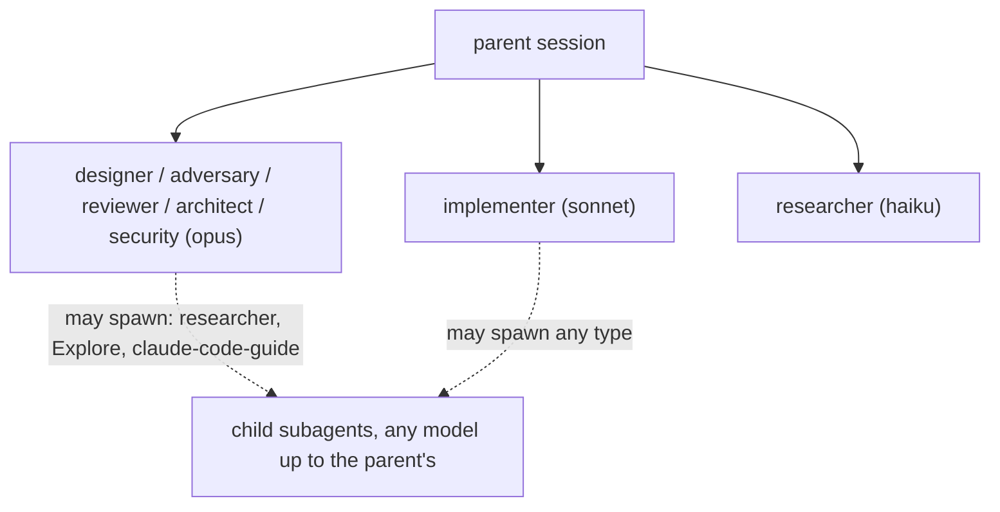

# Harness personas: the one registry

This folder is the single source for the development harness's agent personas (owner 2026-11-03, D52). Each file
holds one persona with one responsibility; its frontmatter sets the model, the default effort and the tools. Other
fleet code that needs a dev persona (Weaver's "resolve from the persona file", the loop service) reads these files.

| Persona | One responsibility | Model | Default effort | Writes | May spawn |
|---|---|---|---|---|---|
| designer | define the spec and contracts before any code | opus | medium | spec files | read-only research children |
| adversary | find outcomes a design misses, before review | opus | medium | nothing (report) | read-only research children |
| reviewer | judge a design, code or fix with a fresh context | opus | medium | nothing (report; the parent writes the record) | read-only research children |
| architect | settle a contested or twice-failed design with an ADR | opus | medium | nothing (ADR text) | read-only research children |
| security | find exploitable holes in a change | opus | medium | nothing (report) | read-only research children |
| implementer | build against a locked spec, tests first | sonnet | medium | code, tests, Build amendments | any child type, sonnet or haiku |
| researcher | answer a factual lookup over the code | haiku | (session) | nothing | haiku children |

## Effort and sub-delegation (owner 2026-11-03)

- **Effort varies per dispatch**; the parent sets it on each call and medium is the default. High for: a design
  review of a T2 item with an `enforcement`, `security` or `contract` flag; any architect run; security on a
  `revenue` repo. Low for: a verify of a docs-only fix.
- **Every persona may spawn its own subagents** for research, consolidation or fetching context (Claude Code allows
  nesting to three levels below the main session). A child's model is at most the parent persona's model (opus may
  spawn haiku, sonnet or opus; sonnet may spawn haiku or sonnet; haiku only haiku).
- **Read-only personas stay read-only**: designer, adversary, reviewer, architect and security spawn only
  `researcher`, `Explore` or `claude-code-guide` children, never a write-capable type.
- A child's findings come back to its persona, which states them in its own report; a child never writes a record.

## Who may write which record

The review, adversary, ADR and security records are written by the parent session from the named persona's report,
and name that persona and its model. Owner records (milestone approval, owner decision, final approval) are
written by the owner, or by an agent on the owner's explicit instruction in the conversation; each carries the date
and time, the owner's words verbatim (their reasoning, or "none given"), the channel and the session id (D56). The authority table and its enforcement are specified in
`D:/repo/docs/reports/2026-11-03 Loop service MVP proposal.md` and become one contract,
`contracts/record-authority.v1.json`.

## Other persona sources in the fleet (not dev-harness personas)

| Source | What it holds | Relation |
|---|---|---|
| `D:/repo/Assistant/cortex/agents/` | Cortex's product agents (chief-of-staff, deal-scout, harness-steward, researcher) | product agents with their own responsibilities; Cortex's `researcher` (life research) shares only a name with the harness `researcher` (code lookup) |
| `D:/repo/Factory/ostler/.claude/` | pilotfish role agents (scout, executor, verifier, security-executor) | reference only (ostler idle since 2026-08-24); overlap with implementer, reviewer and security, not used |
