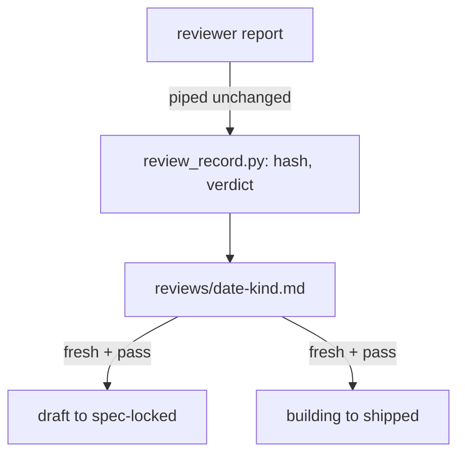

# Review records gate the lock and the ship moves

On 2026-10-31 a spec was redesigned three times after its only design review and locked by its author. Its gaps
(merge composition, look-alike prose) surfaced only in code review. So a work item may move `draft` → `spec-locked`, or
`building` → `shipped`, only when its `reviews/` folder holds a **fresh** record with verdict `pass`:
- **Fresh** means the record's content hash equals the hash of the item being committed, with the `status:` line removed and line endings normalised to LF. The owner's round-2 rule (every `.md` except `reviews/` and `evidence/`) was widened by the design review to every file except `reviews/`, `evidence/`, `cycles/`, `trace.jsonl` and `drift.md`, byte-exact (D31; `docs/work/review-records/components.md` FR-1 is the single definition). A code review also binds to the reviewed commit (D29).
- **Who writes it**: a script (`scripts/review_record.py`, work item `review-records`) that hashes the content and stores the reviewer's report verbatim. Until it ships, the parent session writes records by hand in the same format (`playbooks/agent-dispatch.md` § Review records), and the script re-verifies them.
- **After a fix-first verdict**: a verify review of the fix diff is required.
- **Between the two moves**: freshness is not checked, so spec edits during the build stay free until ship.

Owner decisions, grilling round 2, 2026-11-02.

## Considered options

- **A `Design-Review:` trailer on the lock commit.** Rejected: a trailer is a claim with no evidence behind it.
- **A reviews table inside the README.** Rejected: it changes the very content being hashed.
- **Checking freshness at rest.** Rejected: every edit would force another review.

## Consequences

- **Two reviews per item, plus a verify review after a fix-first verdict**: one at lock and one at ship. The review budget becomes 1 review, up to 1 fix round, then 1 verify review. A second fix-first goes to the architect.
- **Reviewer independence is trusted by process for now**: the gate refuses an empty `reviewer` or "self". The trigger to revisit is Weaver run traces.
- **Hook bypasses are re-checked later in CI**: `--no-verify`, server-side squash merges, cherry-pick and rebase skip local hooks. A CI re-check over pushed ranges (work item `gate-ci`) flags them after the push.
