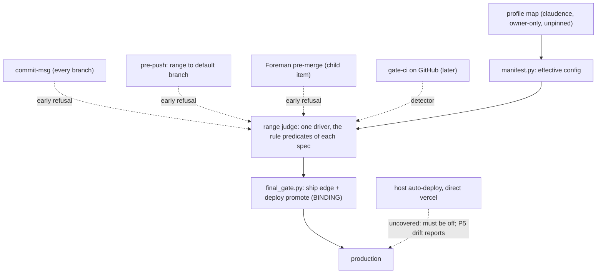

# Loop gates are judged over history at the action boundary; the profile lives outside the judged repo

Written by the architect persona on 2026-11-03; committed from the main session with the owner's approval (the guard
refused the architect's own write as a false positive: the text names governance paths). Answers the second
`fix-first` on `agentic-loop` (verify `reviews/2026-11-04-verify-52a89b83.md`, finding 1) and on `project-manifest`
(verify `reviews/2026-11-04-verify-202e01f8.md`, findings 1A, 1B, 2, 3). Review budget: D23, D36.

## Context

Both verifies found the same root cause: each new loop gate (milestone cap, manifest presence and lowering, final
gate) is a rule inside the local commit-msg hook, so it judges only the commit being created, on the machine and in
the repo where the hook is installed. Observed on 2026-11-03:

- `spec_gate.py:341-342` returns early while `MERGE_HEAD`, `REBASE_HEAD`, `CHERRY_PICK_HEAD` or `REVERT_HEAD` exists;
  `:345-346` returns early off the default branch. A fast-forward, a rebase and a plain cherry-pick create no commit
  for the hook to see at all.
- Foreman merges every PR with `gh pr merge --squash` (`D:/repo/Factory/foreman/core/merge.js:135`, `:421-426`): a
  server-side squash. No local hook runs on any Foreman merge, ever.
- The gate is installed in claudence, `Lib/cast`, `Lib/contracts` and `Lib/spindle` only. cashcow, the one `revenue`
  repo, has no `.pre-commit-config.yaml`, its own `.git/hooks/pre-push` (a build), no `docs/work/`, and is not in
  `~/.foreman/repos.json`. Every commit-msg loop gate protects nothing in cashcow today.
- GitHub branch protection and rulesets on private repos: `gh api repos/sibulus13/cashcow/branches/main/protection`
  returns 403 "Upgrade to GitHub Pro or make this repository public". claudence is public: 404 "Branch not protected"
  (available, not enabled). No CI in claudence; cashcow has `.github/workflows/ci.yml` (build and tests).
- cashcow's `vercel.json` has no `git.deploymentEnabled`; on a Git-connected Vercel project every push to the
  production branch deploys. If that holds, code reaches paying users without passing any gate in either spec.
- `project-manifest` stores the profile in the repo's own `catalog-info.yaml` and detects "had one" from HEAD. The
  verify showed both fail open: a deletion that arrives by fast-forward or squash makes the repo "never had one", and
  the first manifest has no baseline (an agent can commit cashcow's first manifest as `yolo`).
- The lowering rule needs the `owner-decision` record kind (AL-M2), and AL-M2 depends on PM-P1: a cycle.

**Premise.** The question is not "which hook catches each channel" but "what is the authoritative source each rule
must observe". The cap and the trailers are facts about history: what reached the default branch, in what order,
against which owner records. The profile is the owner's policy about a repo. Neither belongs to the commit being
created. A rule judged at the arriving commit has as many holes as there are arrival channels; a rule judged over
history, at the point where work is exposed, has none. A policy read from inside the repo it governs can be rewritten
by any channel into that repo.

**At stake.** If this is wrong, a `revenue` repo ships unreviewed milestones or takes the `yolo` auto final gate, and
paying users get code nobody reviewed. The fix rounds kept producing findings of the same class (arrival channel,
first-time): the signal to stop patching the hook (first-principles; the same move as D32).

## Arrival channels in scope

R1 = trailers, dependencies and milestone cap; R2 = profile and manifest integrity; R3 = final gate (an action gate).
"Binding" is the judge whose refusal is final; "early" judges cut latency and wasted work.

| Channel | Early judge | Binding judge | Status |
|---|---|---|---|
| commit, amend, revert, local `merge --squash` + commit, on the default branch | commit-msg (exists) | final gate re-judges the range | covered |
| commit on a non-default branch (worktrees) | commit-msg: lifecycle (exists) + cap for commits citing a milestone item (new) | final gate | covered |
| local non-fast-forward merge | pre-push (new) | final gate | covered |
| fast-forward, local rebase, plain cherry-pick | pre-push (new) | final gate | covered |
| Foreman server squash (`gh pr merge --squash`) | Foreman pre-merge range check (child item, `merge.js:387-404` slot) | final gate | covered once the child item ships; until then Foreman auto-merge stays off for repos with `loop: on` |
| GitHub web merge, the parent's `gh pr merge`, a push from another machine, a repo without the hook, `--no-verify`, a `core.hooksPath` override | gate-ci CI (later; detector; required check on claudence only) | final gate | covered at ship and deploy; latency until gate-ci |
| force push rewriting the default branch | guard denies (string, `guard.py:359-361`) | final gate judges the rewritten history; the profile map is not in that repo | covered for R1, R2 |
| rename or delete of `catalog-info.yaml` | commit-msg HEAD-vs-staged refusal (PM AC-7, config integrity) | profile unaffected (read from the map) | covered |
| import: a new repo or its first manifest | intake asks the owner for a map entry | an unlisted repo reads CLAUDE.md (A-3) until PM-P4, then is refused | covered |
| `deploy-web` promote, ship edge | - | `final_gate.py` | covered |
| host auto-deploy on push | - | none | uncovered: must be off for `public` and `revenue`; PM-P5 drift reports it |
| direct `vercel --prod` / `vercel promote` from an agent shell | guard denies outside the promote script (AL-M3) | none | uncovered past a command-string bypass; PM-P5 drift reports a production deployment with no final-gate pass |
| a guard bypass on the profile map (helper script, import) | guard denies Edit/Write and shell writes on the map path for every agent tool call | none | uncovered past a command-string bypass; the map's history is public and the session hook shows a change since the last session |

Failing safe: the range judge, wherever it runs, refuses by name when it cannot finish (git timeout, shallow
history, missing objects, more commits than its bound). An unjudged range never passes as judged.

## Options considered

### Q1: the enforcement layer

**a. Local hooks only (commit-msg + pre-merge-commit + pre-push), each judging the range a merge or push introduces.**
Buildable now (pre-commit 4.7, git 2.39); seconds of latency; no network. Costs three hook stages and a migration of
cashcow's own pre-push hook (pre-commit chains it as `.legacy`). Breaks every off-machine channel (Foreman's server
squash, GitHub web merges, another machine) and every repo without the hook, which today includes cashcow and
Foreman's managed repos. An agent bypasses all of it with `-c core.hooksPath=` or `git update-ref`; the guard matches
command strings only.

**b. One sanctioned merge path (Foreman's merge and a parent-session merge command) running the range check, with
direct pushes to the default branch refused by pre-push.** One place to judge, and Foreman already has a SHA-pinned
pre-merge slot (`merge.js:387-404`). But every yolo repo and claudence lose "commit and push" (CLAUDE.md section 3)
for a PR round trip, Foreman does not manage cashcow, and the push refusal is a local hook as bypassable as a. All of
a's friction, none of a stronger guarantee.

**c. CI on the remote (gate-ci) with branch protection.** The only server-side refusal, and the same check for every
channel that reaches GitHub. But branch protection on these private repos needs GitHub Pro (observed 403), which is
billing and the owner's call; without it CI only reports after the push. Minutes of latency per push.

**d. Hybrid: bind at the action boundary, warn early everywhere cheap.** One range judge (a driver that walks a span
of history and applies the rule predicates each spec owns) is called by `final_gate.py` at the ship edge and the
deploy promote, over the item's history from its lock commit to the tip (binding); by commit-msg, a new pre-push
stage, Foreman's pre-merge slot, and gate-ci later (early). Every channel meets the binding judge because it reads
history, not the arriving commit; a missing hook costs latency only. Costs one driver (about 300 lines plus tests), a
pre-push stage, a Foreman child item, and squash commits carrying exactly one `Spec:` and one `Milestone:` trailer.
The action boundary must be the only path to production; host auto-deploy and a direct `vercel` call violate that.

### Q2: profile authority, first-manifest baseline, "had one"

- **Baseline from the CLAUDE.md tier, "had one" from HEAD**: P4 strips the tier lines, so the baseline disappears;
  HEAD-based detection is the verified hole.
- **"Had one" from history** (`git log -1 -- catalog-info.yaml`, bounded): defeated by a rewritten history, wrong in
  a shallow checkout, and a proxy for the real question (how low may the repo go).
- **An owner-only floor beside a profile kept in the manifest**: two homes for nearly one fact, against D-B.
- **The profile's single home moves out of the repo**: an owner-only profile map in claudence, read from claudence's
  current tree at judgment time, never a version a repo pins. One writable home; no channel into the judged repo can
  change it; the first-manifest question disappears. Costs: every reader needs claudence (the gate, the final gate and
  `fleet config` already live there; Foreman and Catwalk consume `fleet config --json`); profile assignments become
  public (claudence is public; its CLAUDE.md already names cashcow).

### Q3: the ordering cycle

- P1 refuses every lowering until AL-M2: breaks the cycle but keeps a rule the arrival channels defeat.
- Move the owner-decision kind into PM-P1: splits the record work across two specs ahead of its own probe.
- **Remove the dependency**: with the profile in the owner-only map, a profile change is the owner's own edit and P1
  needs no record kind. The kind stays in AL-M2 for what only it serves.

## Decision

> **Amended 2026-11-03** (owner D55, D56; project-manifest round 2): the map is read from claudence's
> committed HEAD, not the working tree; the floor is "a `live` repo never below `public`" and cashcow is `public`
> (D44's `revenue` floor is superseded); an unlisted repo takes its CLAUDE.md tier until the map is complete, and an
> unlisted repo with no tier line fails safe (decided in the spec). Owner records may be agent-written with time,
> verbatim words and session (D56).

1. **Binding layer: the action boundary.** `final_gate.py` (the ship edge and the `deploy-web` promote step, AL-M3)
   runs one range judge over the item's history from its lock commit to the tip and refuses on any rule breach or any
   failure to judge. It never trusts the README status or a hook having run.
2. **Early layers, for latency only**: commit-msg (the cap now runs on every branch for commits whose `Spec:` names a
   milestone item); a new `pre-push` stage in `git-hooks/fleet-pre-commit-config.yaml` judging the range pushed to the
   default branch; Foreman's pre-merge slot (child item `foreman-range-gate`, which also writes the squash commit's
   `Spec:` and `Milestone:` trailers). pre-merge-commit is not adopted; direct pushes are not refused (option b
   rejected). gate-ci's CI stage, built later on the same driver, is the off-machine detector and a required check on
   claudence only.
3. **The range judge is its own capability**, the planned `gate-ci` item, milestone GC-G1: decide whether a span of
   history satisfies the lifecycle and loop rules. The rules stay with the specs that define them, as pure predicates
   over (history view, records, effective config); commit-msg and the range judge are two drivers of one rule set.
4. **The profile's single writable home is an owner-only profile map in claudence**, read from claudence's current
   tree, never from the judged repo or a pinned defaults version. Unlisted repos default to `yolo`; cashcow is pinned
   at `revenue` by name, held by D44. The guard denies every agent tool call (subagent and main session) that writes
   the map, from PM-P1. `catalog-info.yaml` holds no `profile` key (refused as unknown). Until PM-P4 an unlisted repo
   takes A-3's CLAUDE.md-derived profile (`live` gives `revenue`); after PM-P4 the map lists every repo and an unlisted
   repo is refused. The HEAD-vs-staged deletion refusal stays, for config integrity only.
5. **The cycle is removed, not ordered around.** Build order:
   `PM-P1 -> AL-M1 -> PM-P2 -> AL-M2 -> (GC-G1 || FL-F1) -> AL-M3 -> FL-F2 -> FL-F3 -> PM-P4 -> PM-P5`.
   The P1-to-AL-M2 window is protected by the map's guard rule (moved from P2 into P1) and by the reader refusing an
   in-repo profile.
6. **Branch protection on private repos (GitHub Pro) is not required.** Logged needs-owner, low urgency. Turning off
   cashcow's host auto-deploy is needed before the final gate can claim to protect cashcow (see D49).

### Q4: the D44 conflict (owner decides)

D44 (confirmed): "a `live` repo can never be set below `revenue`". The fix rounds map `public` to `live`, so D44 read
literally forbids `public` itself, and AC-13 let `revenue` fall with an owner record, which D44 forbids.

| Option | What it means | Cost | Protects against |
|---|---|---|---|
| 1. Absolute floor for `revenue` | the reader refuses any map value below `revenue` for an entry held by D44; to lower cashcow, the owner removes the hold in the same edit as a DECISIONS row superseding D44 | one schema field, one refusal, one test | a sloppy agent; any channel into cashcow |
| 2. Lowering needs an owner record | an owner-decision record for the current map content lets a lowering land | brings back the cycle and the record-authority assumptions | a sloppy agent; as strong as the guard's command matching |
| 3. Owner edit + cooling-off | a `revenue` lowering takes effect only when the lowering commit to the map is 72 h old, with a TeleFi notice | a small function over the map's git log, plus a notifier | also a guard bypass: the owner sees it and has 72 h to revert |

Recommendation: option 1, with D44 reworded from `live` to `revenue`, and `public` recorded as a new rung below it
that D44's floor does not cover. Every profile change is already the owner's own edit under decision 4, so D44's
"never" costs nothing to keep; option 3 is the upgrade if a guard bypass is ever observed.

## Rationale

- **d over a**: a judges the arriving commit on this machine, and two channels that carry real work never run a local
  hook (Foreman's server squash, repos without the hook, cashcow among them). Judging history at the exposure point
  closes the class.
- **d over b**: b refuses with the same bypassable hook and adds PR latency to every yolo repo; its asset, Foreman's
  SHA-pinned pre-merge slot, is kept as an early judge.
- **d over c, for now**: c refuses nothing on these private repos without a paid plan; d builds c's driver first, and
  adding CI and branch protection later is additive.
- **The binding point is the action, not the commit**: nothing reaches users except through a deploy, so the promote
  step is where a refusal matters; the early judges cut wasted work.
- **The profile out of the repo**: it is the one fact whose authority must survive every channel into the repo; this
  is the policy-versus-descriptor split (central policy such as Allstar or rulesets, the catalog descriptor in the
  repo; `D:/repo/docs/research_notes/Project manifest/web_config_sot.md:185`). It removes findings 1A, 1B and 2 with no
  new mechanism.
- **No pre-merge-commit**: it covers only local non-fast-forward merges, which pre-push and the binding judge see.

## Consequences

- Every spec drops the claim that commit-msg covers "commit, amend, squash, cherry-pick"; arrival-channel rows cite
  the table above.
- Builders put `Spec:` and `Milestone:` trailers on branch commits; a squash commit carries one of each. A range with a
  source commit lacking them is refused at push and at ship.
- `loop: on` is set for a repo only after AL-M3 ships the binding judge; claudence (yolo) is the pilot exception.
  Before AL-M3 the cap is early-warning only.
- cashcow gets the fleet hooks only by owner choice; the binding judge does not depend on them.
- A shallow CI checkout must fetch full history, since the judge refuses a range it cannot judge.
- Review-records' code freshness (D32) gets a home: a later gate-ci milestone on the same driver.

## Reversibility

- **Enforcement layer: cheap to strengthen.** Adding the CI stage, a required check, or a CI-held deploy token adds
  callers and changes no rule. Revisit when the first `public` repo appears, when drift reports a production deploy
  with no final-gate pass or the guard logs a bypass, or when the owner buys GitHub Pro.
- **Profile map: cheap before PM-P4, costly after.** Revisit when a reader must know a profile without claudence, or
  the owner wants profiles private (the map then moves to `$FLEET_DOCS` and CI needs a token).
- **pre-merge-commit: trivially addable.** Revisit if an unpushed bad local merge misleads a later judgment.
- **D44 option 1 to option 3: additive.** Revisit on the first observed guard bypass.

## References

- `C:/Users/Michael/.claude/scripts/spec_gate.py:334-346`, `:107-110`
- `C:/Users/Michael/.claude/hooks/guard.py:352`, `:359-361`, `:401`
- `C:/Users/Michael/.claude/git-hooks/fleet-pre-commit-config.yaml:3`; `C:/Users/Michael/.claude/scripts/install_fleet_hooks.py:47`
- `D:/repo/Factory/foreman/core/merge.js:135`, `:387-404`, `:421-426`
- `D:/repo/SaaS/cashcow/CLAUDE.md:11`, `D:/repo/SaaS/cashcow/vercel.json:1`
- `C:/Users/Michael/.claude/docs/adr/0001-review-records-gate-lock-and-ship.md:36`; `C:/Users/Michael/.claude/docs/DECISIONS.md` (D32, D44)
- `C:/Users/Michael/.claude/docs/capabilities/INDEX.md:40`
- `C:/Users/Michael/.claude/contracts/review-record.v1.json:9`
- Web (not re-fetched in the architect's session; model knowledge as of June 2026, the private-repo fact confirmed by
  the 403 above): GitHub protected branches and rulesets; GitHub reusable workflows; git `githooks` (pre-merge-commit
  is not run on a fast-forward; pre-push reads ref ranges); pre-commit stages and `.legacy` migration; `gh pr merge
  --subject --body`; Vercel `git.deploymentEnabled`; OpenSSF Allstar.
