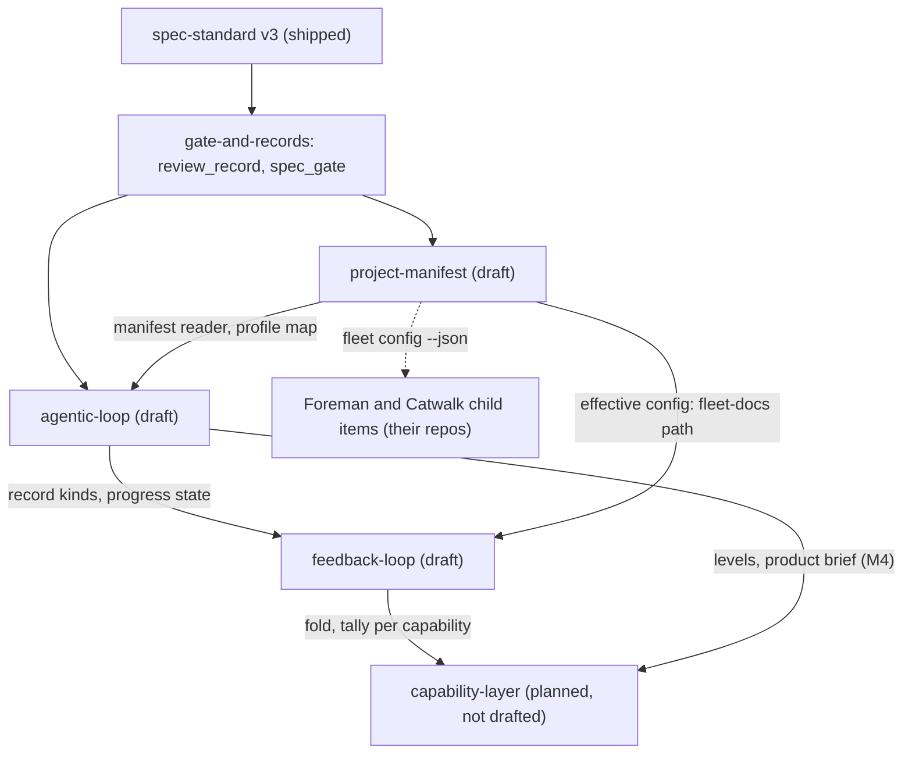

# Product brief: the harness lifecycle program

A doc, not a work item (v3 refuses `parent` and `children`). It holds links, one build order and the contracts shared
across specs; it holds no acceptance criteria. Limits (agentic-loop A-2): at most 9 capabilities, then group into
domains; links only. Created 2026-11-03 for design fix round 1 of the three draft specs.

## Capabilities

| Capability | Status | Work item | Owns (single core responsibility) |
|---|---|---|---|
| spec-standard | shipped | [spec-standard-v3](../work/spec-standard-v3/README.md) | what a v3 item must contain |
| gate-and-records | shipped and building | [review-records](../work/review-records/README.md), [spec-gate](../work/spec-gate/README.md) | refuse a commit that breaks the lifecycle; hash and read review records |
| project-manifest | draft | [project-manifest](../work/project-manifest/README.md) | one source of truth for each per-repo fact |
| agentic-loop | draft | [agentic-loop](../work/agentic-loop/README.md) | milestones, owner checkpoints, final gate by profile |
| feedback-loop | draft | [feedback-loop](../work/feedback-loop/README.md) | append-only history and escape trace-back |
| capability-layer | planned, not drafted | none yet | current-truth `SPEC.md` per capability, the fold at ship, the probe citation rule |

Abbreviations in the build order: PM = project-manifest, AL = agentic-loop, FL = feedback-loop; `PM-P1` is milestone
P1 of project-manifest, `AL-M2` milestone M2 of agentic-loop, `FL-F1` milestone F1 of feedback-loop.

## Build order and file owners

One order across the three specs. A shared file has exactly one owning milestone at a time; the next owner starts
after the previous one has shipped. Parallel work is allowed only where the milestones' Owns are disjoint
(PM-P3 and AL-M4 are).

`PM-P1 -> AL-M1 -> PM-P2 -> AL-M2 -> ST-S1 -> (GC-G1 || FL-F1) -> AL-M3 -> FL-F2 -> FL-F3 -> PM-P4 -> PM-P5`

ST-S1 is `stage-trace`'s first milestone (a per-stage record with cost; owner 2026-11-03, D48) and GC-G1 is
`gate-ci`'s range judge (ADR 0002, D47); both items are planned, not yet drafted.

PM-P3 is absent from the default order: its Owns are disjoint, so it runs at any step after PM-P1 and before PM-P4.
AL-M4 and the capability layer come after FL-F3.

| Shared file | Owner sequence |
|---|---|
| `scripts/spec_gate.py` | PM-P1, PM-P2, AL-M2, FL-F1, AL-M3 |
| `scripts/spec_v3.py` | PM-P1, AL-M1, AL-M2, FL-F1, FL-F2 |
| `contracts/work-item.v3.json` | AL-M1, FL-F1, FL-F2 |
| `scripts/review_record.py` | AL-M2 (kinds, `approve`), AL-M3 (`goal`) |
| `contracts/review-record.v1.json` (the review-record contract; extended, no v2 file) | AL-M2, AL-M3 |
| `hooks/guard.py` | PM-P2 (manifest and defaults protected), AL-M2 (D-L), AL-M3 (`goal`) |
| `agents/*.md` | AL-M3 (implementer, reviewer, goal-checker), then FL-F3 (designer, adversary, implementer, reviewer) |
| `skills/dark-factory/SPEC-STANDARD-V3.md` | AL-M1, FL-F1, PM-P4 |
| `scripts/spec_check.py` | PM-P2 |

## Cross-spec contracts

Each is defined in one spec and referenced, never restated, by the others.

| Contract | Defined in | Used by | Content |
|---|---|---|---|
| Progress state | agentic-loop AL-M2 | feedback-loop (freeze), agentic-loop | generated `evidence/progress.json` and `progress.md` per item, derived from records and commits; excluded from the content hash; never read by a gate; no Status column in any README |
| Review-record kinds | agentic-loop AL-M2 (`goal`: AL-M3) | project-manifest (owner-decision), agentic-loop | extend `review-record.v1.json` backward-compatibly: kinds `milestone`, `milestone-approval`, `owner-decision`, `final-approval`, `goal`, plus an optional `milestone` field. Owner kinds (`milestone-approval`, `owner-decision`, `final-approval`) are written only by the owner (agentic-loop D-L) |
| Manifest reader and its JSON | project-manifest PM-P1 (reader), PM-P3 (`fleet config --json`, `effective-config.v1.json`) | agentic-loop (profile, limits), feedback-loop (fleet-docs path), Foreman and Catwalk | `scripts/manifest.py` is the one Python reader; other repos consume the JSON, never the YAML. Keys other specs read: `profile`, `limits`, `fleetDocs` (derived from `scripts/fleet_paths.py`) |
| Profile map | project-manifest | agentic-loop, Foreman | see below |

| Profile | `deploymentTier` (derived, never stored) | Foreman autonomy |
|---|---|---|
| `yolo` | pre-traffic | full |
| `public` | live | label-gated |
| `revenue` | live | label-gated |

## Child items outside claudence (planned, not drafted)

Named here so no spec owns them: `foreman-manifest-reader` in `D:/repo/Factory/foreman/docs/work/` and
`catwalk-manifest-reader` in `D:/repo/Factory/catwalk/docs/work/` adopt `fleet config --json` and the autonomy map
(`repos.json` stays a generated cache); Catwalk and TeleFi approve actions (agentic-loop D-L) are further child items
in those repos. The `capability-layer` item owns the fold at ship, the per-capability tally key and the probe
citation rule that feedback-loop defers to it.
