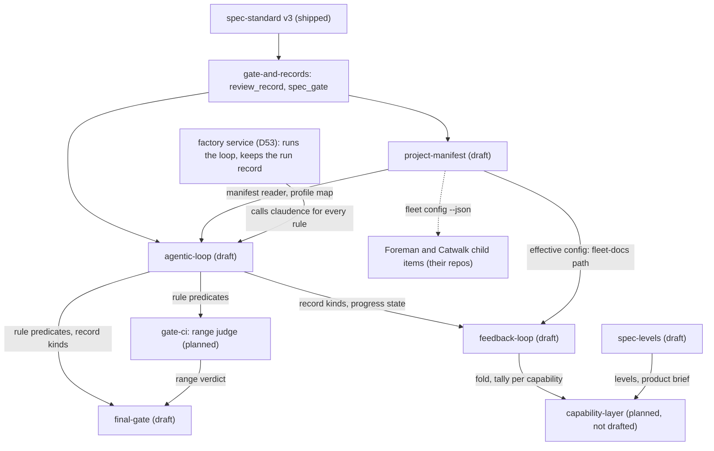

# Product brief: the harness lifecycle program

A doc, not a work item (v3 refuses `parent` and `children`). It holds links, one build order and the contracts shared
across specs; it holds no acceptance criteria. Limits (spec-levels A-2): at most 9 capabilities, then group into
domains; links only. Created 2026-11-03 for design fix round 1 of the three draft specs; updated for design fix
round 2 (ADR [0002](../adr/0002-loop-gate-enforcement-layer.md), D47, D53, D54), and for the agentic-loop scope cut
(2026-11-03: its M3 became `final-gate` FG-1, its M4 became `spec-levels` SL-1).

## Capabilities

9 of the 9 allowed: the next capability groups them into domains. `spec-levels` is a work item of
`spec-standard` (what an item and an index may contain), not a capability of its own.

| Capability | Status | Work item | Owns (single core responsibility) |
|---|---|---|---|
| spec-standard | shipped and draft | [spec-standard-v3](../work/spec-standard-v3/README.md), [spec-levels](../work/spec-levels/README.md) | what a v3 item and an index must contain, and their limits |
| gate-and-records | shipped and building | [review-records](../work/review-records/README.md), [spec-gate](../work/spec-gate/README.md) | refuse a commit that breaks the lifecycle; hash and read review records |
| project-manifest | draft | [project-manifest](../work/project-manifest/README.md) | one source of truth for each per-repo fact (the profile's home is the owner-only profile map) |
| agentic-loop | draft | [agentic-loop](../work/agentic-loop/README.md) | milestones and owner checkpoints, gated by profile |
| final-gate | draft | [final-gate](../work/final-gate/README.md) | admit to production only a span whose every item passed its profile's final gate |
| gate-ci | planned, not drafted (milestone GC-G1, ADR 0002, D47) | none yet | decide whether a span of history satisfies the lifecycle and loop rules, and publish the verdict |
| feedback-loop | draft | [feedback-loop](../work/feedback-loop/README.md) | append-only history and escape trace-back |
| capability-layer | planned, not drafted | none yet | current-truth `SPEC.md` per capability, the fold at ship, the probe citation rule |
| factory (a service, not claudence code) | planned, repo not created (D53) | none yet; will live at `D:/repo/Factory/factory` | run the loop as a product and keep its run record, per-stage cost included; every rule stays in claudence |

Abbreviations in the build order: PM = project-manifest, AL = agentic-loop, FG = final-gate, SL = spec-levels, FL =
feedback-loop, GC = gate-ci, FA = factory; `PM-P1` is milestone P1 of project-manifest, `AL-M2` milestone M2 of
agentic-loop, `FG-1` and `SL-1` the single milestones of final-gate and spec-levels, `FL-F1` milestone F1 of
feedback-loop, `GC-G1` the range judge of gate-ci, `FA-M1` milestone M1 of factory (the run record).

Stage-by-stage purpose, budget, failure points and owner notices: the [stage catalog](../work/agentic-loop/evidence/stage-catalog.md).

## Build order and file owners

One order across the specs. A shared file has exactly one owning milestone at a time; the next owner starts
after the previous one has shipped. Parallel work is allowed only where the milestones' Owns are disjoint
(PM-P3 and SL-1 are; GC-G1 and FL-F1 are).

`PM-P1 -> AL-M1 -> PM-P2 -> AL-M2 -> (GC-G1 || FL-F1) -> FG-1 -> FL-F2 -> FL-F3 -> PM-P4 -> PM-P5`

`stage-trace` (ST-S1) is dropped from the order: D53 folds it into the factory service's run record (factory M1) and
supersedes D48, so no claudence milestone remains for it. GC-G1 is `gate-ci`'s range judge (ADR 0002, D47); both
GC-G1 and factory are planned, not yet drafted.

PM-P3 is absent from the default order: its Owns are disjoint, so it runs at any step after PM-P1 and before PM-P4.
SL-1 and the capability layer come after FL-F3 (SL-1 also after PM-P4, which owns `SPEC-STANDARD-V3.md` before it). Factory M1 and later run in the factory repo and block nothing here.

| Shared file | Owner sequence |
|---|---|
| `scripts/spec_gate.py` | PM-P1, PM-P2, AL-M2, FL-F1, FG-1 |
| `scripts/spec_v3.py` | PM-P1, AL-M1, AL-M2, FL-F1, FL-F2, SL-1 |
| `contracts/work-item.v3.json` | AL-M1, FL-F1, FL-F2, SL-1 |
| `scripts/review_record.py` | AL-M2 (kinds, `approve`), FG-1 (`goal`) |
| `contracts/review-record.v1.json` (the review-record contract; extended, no v2 file) | AL-M2, FG-1 |
| `hooks/guard.py` | PM-P1 (profile map, `catalog-info.yaml` and fleet defaults protected), FG-1 (`goal` identity; bare `vercel --prod`, `vercel deploy --prod` and `vercel promote`; `commit -n` and `core.hooksPath` overrides); AL-M2 no longer touches it (D56 drops the owner-record deny rule) |
| `scripts/final_gate.py`, `skills/deploy-web/SKILL.md` | FG-1 (create; `final_gate.py` is called by FG-1's `scripts/promote.py`), then PM-P5 (the deploy refusal while drift is open) |
| `scripts/milestone_brief.py`, `contracts/milestone-brief.v1.json` | AL-M2 (create), then SL-1 (the limits part) |
| `git-hooks/fleet-pre-commit-config.yaml`, `scripts/install_fleet_hooks.py` | GC-G1 (the `pre-push` stage) |
| `scripts/range_judge.py`, `contracts/range-verdict.v1.json` | GC-G1 |
| `contracts/profile-map.v1.yaml` and `contracts/profile-map.v1.json` (its schema) | PM-P1 creates both; after that the owner only (the guard denies every agent tool call; PM-P4 produces proposed entries that the owner commits with their own `!` command) |
| `agents/*.md` | FG-1 (implementer, reviewer, goal-checker), then FL-F3 (designer, adversary, implementer, reviewer) |
| `skills/dark-factory/SPEC-STANDARD-V3.md` | AL-M1, FL-F1, PM-P4, SL-1 |
| `scripts/spec_check.py` | PM-P2 |

## Cross-spec contracts

Each is defined in one spec and referenced, never restated, by the others.

| Contract | Defined in | Used by | Content |
|---|---|---|---|
| Progress state | agentic-loop AL-M2 | feedback-loop (freeze), agentic-loop | generated `evidence/progress.json` and `progress.md` per item, derived from records and commits; excluded from the content hash; never read by a gate; no Status column in any README |
| Review-record kinds | agentic-loop AL-M2 (`goal`: final-gate FG-1) | project-manifest (owner-decision), agentic-loop, final-gate | extend `review-record.v1.json` backward-compatibly: kinds `milestone`, `milestone-approval`, `owner-decision`, `final-approval`, `goal`, plus an optional `milestone` field. Owner kinds (`milestone-approval`, `owner-decision`, `final-approval`) may be written by an agent on the owner's behalf and require `owner_words`, `channel` and `session_id` beside `recorded` (agentic-loop D-L, D56) |
| Manifest reader and its JSON | project-manifest PM-P1 (reader), PM-P3 (`fleet config --json`, `effective-config.v1.json`) | agentic-loop (profile), spec-levels (limits), feedback-loop (fleet-docs path), Foreman and Catwalk | `scripts/manifest.py` is the one Python reader; other repos consume the JSON, never the YAML. Keys other specs read: `profile` (resolved from the profile map, never from the repo), `limits`, `fleetDocs` (derived from `scripts/fleet_paths.py`) |
| Profile map | project-manifest PM-P1 | agentic-loop, final-gate, Foreman, gate-ci | owner-only `contracts/profile-map.v1.yaml` in claudence, read from claudence's committed HEAD and never pinned; unlisted repos take the CLAUDE.md tier until the owner sets `complete` after PM-P4 and are refused after; every `public` or `revenue` entry carries a floor at `public` (D55); cashcow is `public`; see the tier map below |
| Range verdict | gate-ci GC-G1 | final-gate (`final_gate.py`), agentic-loop (commit-msg, through `CommitFacts`), Foreman child item `foreman-range-gate`, the `pre-push` stage, gate-ci CI later | `contracts/range-verdict.v1.json`: the verdict of one judged span (pass, or refusals each naming the rule and commit; or `unjudged` with the named reason). The rule predicates stay in the specs that define them (agentic-loop cap and trailers, project-manifest config integrity, spec-gate lifecycle) |

| Profile | `deploymentTier` (derived, never stored) | Foreman autonomy |
|---|---|---|
| `yolo` | pre-traffic | full |
| `public` | live | label-gated |
| `revenue` | live | label-gated |

## Child items outside claudence (planned, not drafted)

Named here so no spec owns them: `foreman-manifest-reader` in `D:/repo/Factory/foreman/docs/work/` and
`catwalk-manifest-reader` in `D:/repo/Factory/catwalk/docs/work/` adopt `fleet config --json` and the autonomy map
(`repos.json` stays a generated cache); `foreman-range-gate` in `D:/repo/Factory/foreman/docs/work/` runs the range
judge in Foreman's pre-merge slot (`D:/repo/Factory/foreman/core/merge.js:387-404`) and writes the squash commit's one
`Spec:` and one `Milestone:` trailer (ADR 0002); until it ships Foreman auto-merge stays off for repos with `loop: on`.
Catwalk and TeleFi approve actions (agentic-loop D-L) are further child items in those repos. The `capability-layer`
item owns the fold at ship, the per-capability tally key and the probe citation rule that feedback-loop defers to it.

## Integrations

Which fleet service serves each loop touchpoint (survey 2026-11-03: `D:/repo/docs/research_notes/Agentic loop
design/service_integrations.md:203`). The factory service drives these touchpoints and records them; it adds no rule.
A gap is closed by the child item in the named repo, never by a copy inside claudence.

| Loop touchpoint | Service | Interface today | Gap | Child item (repo) |
|---|---|---|---|---|
| Milestone brief delivery | TeleFi + Catwalk | `envelope.v1` `template` + `facts` (`D:/repo/Lib/telefi/telefi/schemas/envelope.v1.json:217`) | no `milestone.brief` template; kind policy (`review` under the cap, `blocker` at it) unset | `milestone-brief-template` (`D:/repo/Lib/telefi`); the producer stays AL-M2 `milestone_brief.py` |
| Owner approvals | TeleFi inbound, command sink | actions + command sink (`D:/repo/Lib/telefi/telefi/inbound.py:102`) | no approve sink; inbound events unsigned; a queue sink is agent-writable | `signed-inbound` (`D:/repo/Lib/telefi`, inbound.v2); `telefi-approve-sink` (claudence, `review_record.py approve --via telefi`); `catwalk-approve-action` later (`D:/repo/Factory/catwalk`) |
| Drift reports | TeleFi | `envelope.v1` free text, kind `failure` | producer unbuilt; Catwalk `drift-flagged` dead-ends | none new: PM-P5 `manifest_drift.py` publishes |
| Escape and recurring-class alerts | TeleFi | `envelope.v1`, `dedup_key` = `RP-n` | producer unbuilt | none new: FL-F3 `escape_tally.py` publishes |
| Process-flag and kill-switch notices | TeleFi | `envelope.v1` | no producer for manifest flags or Foreman STOP / `paused` | PM-P2 adds the notice (claudence); `pause-notice` (`D:/repo/Factory/foreman`) |
| Stage cost against budget | meter, then the factory run record (D53) | `run.v1`, `spend`, `decide` (`D:/repo/Lib/meter/index.js:217`) | no item, milestone or stage keys; sessions unrecorded; telemetry `cost_usd` null; Catwalk bypasses meter | `meter-run-v2` with `item`, `milestone`, `stage` (`D:/repo/Lib/meter`); `session-cost-record` hook (claudence); `catwalk-meter-reader` (`D:/repo/Factory/catwalk`); factory M1 owns the per-stage record |
| Shared enums and schemas | Lib/contracts (target), claudence `contracts/` (now) | `C:/Users/Michael/.claude/contracts/review-record.v1.json:10` | Lib/contracts is docs only; Catwalk copies enums untested | author in claudence, move with `boundary-contracts` (`D:/repo/Lib/contracts`); `catwalk-contract-tests` (`D:/repo/Factory/catwalk`) |
| Progress view | Catwalk | `readWorkItems` (`D:/repo/Factory/catwalk/src/lib/work-items.ts:36`) | does not read `evidence/progress.json` | `catwalk-progress-view` (`D:/repo/Factory/catwalk`) |
| Dispatch and scheduling of milestones | Foreman | `backlogItems.dependsOn` (`D:/repo/Factory/foreman/core/scheduler.js:108`), autonomy (`D:/repo/Factory/foreman/core/config.js:26`) | no Milestones-table reader, no `Milestone:` trailer, no cap or profile | `foreman-manifest-reader`; `foreman-milestone-dispatch` (`D:/repo/Factory/foreman`) |
| Range check before a Foreman merge | Foreman | `gh pr merge --squash` (`D:/repo/Factory/foreman/core/merge.js:135`), the SHA-pinned pre-merge slot (`:387-404`) | no range judgment on a server-side squash; the squash carries no trailers | `foreman-range-gate` (`D:/repo/Factory/foreman`) |
| Research for the probe | harness researcher + WebSearch; Cortex Researcher; Augur for news | `D:/repo/Assistant/cortex/config/capabilities.json:80` | Augur has no ad-hoc query (by design) | none: adopt as is |
| Verification and fact checks | harness reviewer + goal-checker | `C:/Users/Michael/.claude/agents/reviewer.md:89` | no fleet verifier | none new: FG-1 `goal-checker`; copy Herald's majority-block lens pattern |
| Retro queue | RETRO-QUEUE + `/retrospect` + Cortex Harness Steward | `D:/repo/docs/RETRO-QUEUE.md:9` | `/retrospect` and the steward cannot read it | FL-F3; `steward-reads-retro` grant (`D:/repo/Assistant/cortex`) |
| TeleFi verb duplication; consumer contract tests (found on the way) | TeleFi + Foreman | 4 verb definitions; hand-built test events | no single source; no agreement test | `foreman-verbs-from-manifest`, `telefi-consumer-tests` (`D:/repo/Factory/foreman`) |
