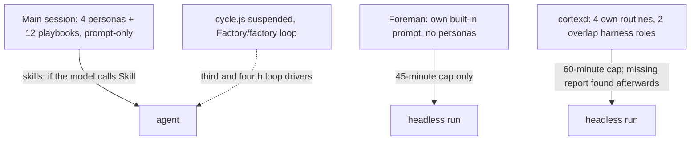
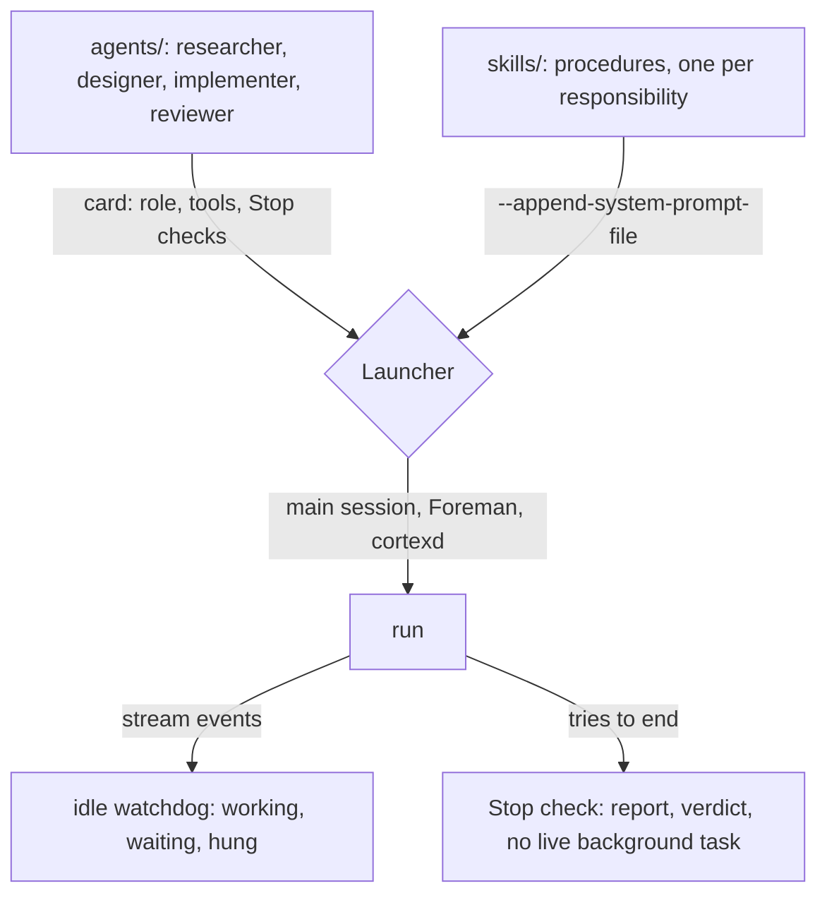
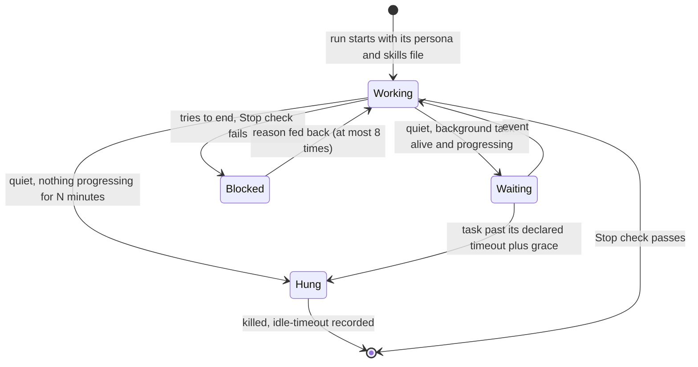

# One agent system: four personas, shared skills, enforced in code

Before:

After:

Research:
- `D:/repo/docs/reports/2026-11-07-deterministic-enforcement-research.md`
- `D:/repo/docs/reports/2026-11-07-lean-delivery-proposal.md`, sections "Agents, skills and context", "Persona split review" and "Hung runs"

## Why

The owner, 2026-11-07, asked for this:
- Consolidate the orchestration, turning the agent playbooks into persona + associated skills and context, including the cortexd agents.
- Enforce loops, actions and flows deterministically.
- Handle hung sessions.

## Before and after

| Concern | Before (measured 2026-11-07) | After |
|---|---|---|
| Agent systems | 3: harness personas, Foreman's prompt (`D:/repo/Factory/foreman/core/runner.js:95`), Cortex routines | 1: four personas in `~/.claude/agents/`, used by all three launchers |
| Personas | 9 prompt systems; researcher written twice; Cortex chief-of-staff 6,901 words with 4 stages | 4 personas; a new one only where the tools differ |
| Procedures | 12 playbooks, 27,383 words of `dark-factory` docs, 4 overlapping skills | One skill per responsibility. Reviewer modes, ADR mode, triage, schedule, deal-scout and clips become skills. Playbooks are retired |
| Skill delivery | Headless runs get skills only if the model calls the Skill tool | Each launcher attaches the run's skills as one file (D-SK-1) |
| Loop drivers | 3: `cycle.js` (suspended), Foreman's chain, `Factory/factory` | 1: Foreman's chain, with the full design, review, implement, review loop as the default (D-RF-4) |
| Run ends early | Prompt text; 3 of 71 Cortex runs wrote no report; Foreman #86 ended mid-review | Stop check blocks the end until the report exists, no background task is live and the reviewer gave a verdict |
| Hung run | Wall-clock kill at 45 min (Foreman) or 60 min (Cortex) | Idle watchdog kills a hung run after N minutes and logs `idle-timeout` |
| Deterministic steps | Cortex Dashboard reconcile and wishlist move run as prompt stages | Plain code |

## States

## Behaviour

| AC | Traces | Given / when | Pass when | Fail when | Test |
|---|---|---|---|---|---|
| AC-1 | Why | Foreman and cortexd each launch a run for a persona | the run's prompt comes from `~/.claude/agents/<persona>.md` plus its skills file | either launcher uses its own prompt text | `tests/test_agent_consolidation.py` |
| AC-2 | States | a headless run tries to end with no report, or with a live background task | the Stop check blocks it with the reason | the run ends and the gap is found only afterwards | `tests/test_agent_consolidation.py` |
| AC-3 | States | a run is silent and nothing it started makes progress for N minutes | it is killed and `idle-timeout` is recorded; a silent run whose background task is progressing is left alone | a hung run lasts until the wall-clock cap, or a waiting run is killed | `tests/test_agent_consolidation.py` |
| AC-4 | Why | a Foreman run with no mode named | it runs design, design review, implement and code review | it runs build-only | `tests/test_agent_consolidation.py` |
| AC-5 | Why | the harness lint runs | it names any persona outside the four, any playbook still referenced, and any skill with no persona using it | a duplicate role passes | `tests/test_agent_consolidation.py` |

## Milestones

- **M1, by 2026-11-10:** idle watchdog and Stop checks (AC-2, AC-3), on Foreman first, then cortexd.
- **M2, by 2026-11-13:** persona cards and skills; Cortex routines split (AC-1).
- **M3, by 2026-11-17:** Foreman's default becomes the full chain; `cycle.js` and `Factory/factory` are retired (AC-4).
- **M4, by 2026-11-21:** the lint (AC-5); playbooks are retired; compare against the before column.

Stop if the first 3 consolidated runs merge worse work than before.

## Outcomes

| Dimension | Level | Row or n/a reason | AC |
|---|---|---|---|
| success | L3 | Every launcher runs one of four personas with its skills | AC-1 |
| invalid input | L2 | A missing skills file stops the launch (D-SK-1) | - |
| dependency fails | L2 | Claude exits non-zero: recorded as a failed run, as today | - |
| timeout | L3 | A hung run is killed by the idle watchdog | AC-3 |
| crash mid-step | L2 | Foreman `checkpoint.js` resume is unchanged | - |
| concurrent actor | L2 | Foreman and cortexd launch independently; personas are read-only files | - |
| duplicate or replay | L2 | Stop check continuations are capped at 8 by Claude Code | - |
| arrival channel | L3 | Main session, Foreman and cortexd all use the same cards | AC-1 |
| performance or cost | L2 | A Stop check is a local file test; it costs no model call | - |
| security | L2 | Cortex keeps its capability grants as tool limits | - |
| data and compatibility | L3 | Foreman defaults to the full chain | AC-4 |
| operability | L3 | Duplicates are named by the lint | AC-5 |

## Assumptions

| Assumption | Observed | If violated |
|---|---|---|
| A Stop hook passed with `--settings` runs in `claude -p` | Cortex already passes per-run settings with PreToolUse hooks | keep: the check moves into the launcher after the run, which detects but cannot block |
| Background task liveness and output growth are visible to the launcher | Foreman reads the stream; tasks write output files | keep: fall back to process-tree CPU time |
