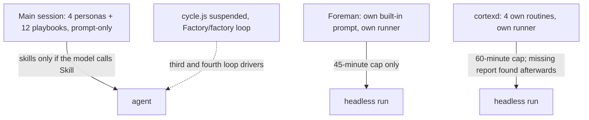
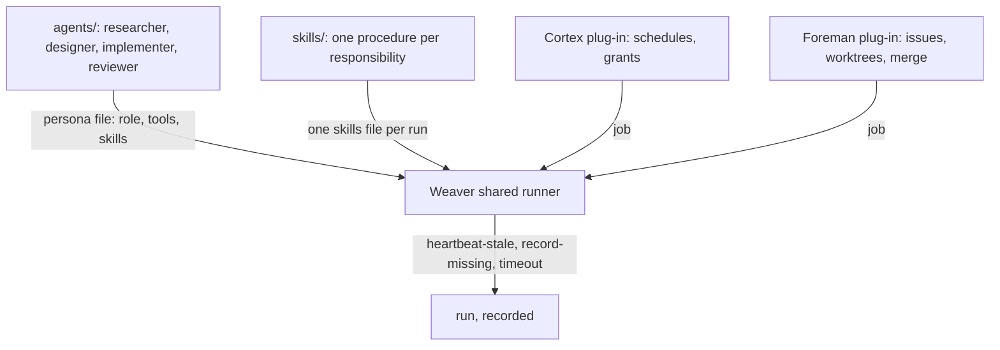
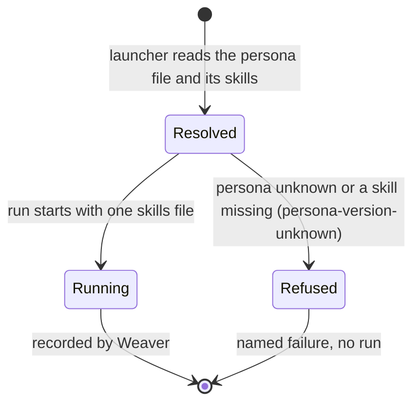

# One agent layer: four personas and shared skills, run by Weaver

Before:

After:

## Scope: this item is the agent layer; Weaver is the runner

Weaver (`D:/repo/Lib/weaver/docs/specs/agent-platform.md`) is the shared runner. Its core spec was locked 2026-10-31 and is roadmap item 1 (`D:/repo/docs/LEDGER.md:22`). It has no code yet. Cortex and Foreman become its plug-ins (`D:/repo/docs/ARCHITECTURE_JOB_LIFECYCLE.md:68`). Weaver already specifies:
- the hang and early-end checks: `heartbeat-stale` (10 min, `agent-platform.md:56`), `record-missing`, `timeout` (`:81-83`);
- persona routing: "resolve from the persona file" (`:41`).

So this item does not build a watchdog or Stop checks in Foreman or cortexd. They belong in Weaver's Execute and Verify stages. This item delivers what Weaver's persona file points at.

Research:
- `D:/repo/docs/reports/2026-11-07-deterministic-enforcement-research.md`
- `D:/repo/docs/reports/2026-11-07-lean-delivery-proposal.md`: Persona split review, Hung runs

## Why

Owner, 2026-11-07: "consolidating the orchestration, including turning the agent playbooks into persona + associated skills and context", covering "the agents we set up on cortexd", with deterministic enforcement of loops and flows.

## Before and after

| Concern | Before (measured 2026-11-07) | After | Owner |
|---|---|---|---|
| Agent systems | 3: harness personas, Foreman's prompt (`D:/repo/Factory/foreman/core/runner.js:95`), Cortex routines | 1: four persona files in `~/.claude/agents/`, used by every launcher | this item |
| Personas | 9 prompt systems; researcher written twice; Cortex chief-of-staff 6,901 words | 4 personas; a new one only where the tools differ | this item |
| Procedures | 12 playbooks; 27,383 words of `dark-factory` docs; overlapping skills | One skill per responsibility; playbooks retired | this item |
| Deterministic steps | Cortex Dashboard reconcile and wishlist move run as prompt stages | Plain code in the Cortex plug-in | this item |
| Loop drivers | 3: `cycle.js` (suspended), Foreman's chain, `Factory/factory` | 1: Foreman's chain, whose default is design, review, implement, review (D-RF-4) | this item |
| Runners | Foreman and cortexd each run their own | Weaver | Weaver |
| Hung run | Wall-clock kill at 45 or 60 min | `heartbeat-stale` at 10 min; a background task that is progressing counts as alive | Weaver |
| Run ends early | Prompt text; 3 of 71 Cortex runs wrote no report | `record-missing` plus a per-run Stop check in Verify | Weaver |

## States

## Behaviour

| AC | Traces | Given / when | Pass when | Fail when | Test |
|---|---|---|---|---|---|
| AC-1 | Why | the persona folder and the skills folder | exactly four personas, each naming its skills; every skill is named by at least one persona | a fifth persona, a duplicate role, or an orphan skill | `tests/test_agent_consolidation.py` |
| AC-2 | Why | Foreman and cortexd each launch a persona run | the prompt is the persona file plus its skills file, and no launcher-owned prompt text remains | either launcher adds its own role text | `tests/test_agent_consolidation.py` |
| AC-3 | States | a launch names an unknown persona or a missing skill | it is refused with a named failure before any run | a run starts without its skills | `tests/test_agent_consolidation.py` |
| AC-4 | Why | a Foreman run with no mode named | it runs design, design review, implement and code review | it runs build-only | `tests/test_agent_consolidation.py` |
| AC-5 | Why | the harness lint runs | it names any playbook still referenced, and any persona file that does not match Weaver's persona schema | either passes | `tests/test_agent_consolidation.py` |

## Milestones

- **M1, by 2026-11-10:** the persona split (AC-1). Reviewer modes and ADR mode become skills; the Cortex researcher and deal-scout fold into one persona.
- **M2, by 2026-11-13:** Foreman and cortexd launch from persona files (AC-2, AC-3). Cortex stages 0 and 0b become code.
- **M3, by 2026-11-17:** Foreman's default becomes the full chain; `cycle.js` and `Factory/factory` are retired (AC-4).
- **M4, by 2026-11-21:** the lint (AC-5); playbooks are retired; compare against the before column.

Stop if the first 3 consolidated runs merge worse work. Weaver step 0 follows its own item; until it lands, the hang and early-end gaps stay open.

## Outcomes

| Dimension | Level | Row or n/a reason | AC |
|---|---|---|---|
| success | L3 | Every launcher runs one of four personas with its skills | AC-2 |
| invalid input | L3 | An unknown persona or a missing skill is refused | AC-3 |
| dependency fails | L2 | Claude exits non-zero: recorded as a failed run, as today | - |
| timeout | L1 | Weaver's `heartbeat-stale`, not this item | - |
| crash mid-step | L2 | Foreman `checkpoint.js` resume is unchanged | - |
| concurrent actor | L2 | Persona files are read-only at run time | - |
| duplicate or replay | L1 | Launch is idempotent; reading a file twice changes nothing | - |
| arrival channel | L3 | Main session, Foreman and cortexd use the same files | AC-2 |
| performance or cost | L2 | Fewer, shorter prompts; measured at M4 | - |
| security | L2 | Cortex keeps its capability grants as tool limits | - |
| data and compatibility | L3 | Foreman defaults to the full chain | AC-4 |
| operability | L3 | Duplicates and stale playbooks are named by the lint | AC-1 |

## Assumptions

| Assumption | Observed | If violated |
|---|---|---|
| Weaver's persona file can be the harness agent card | `agent-platform.md:41` resolves routing "from the persona file" | keep: a small adapter maps the card to Weaver's fields |
| Cortex grants fit an agent card's tools fields | Cortex builds `--tools` from grants (`D:/repo/Assistant/cortex/bin/run-agent.ps1:108-111`) | keep: grants stay in the plug-in and narrow the card's tools |
