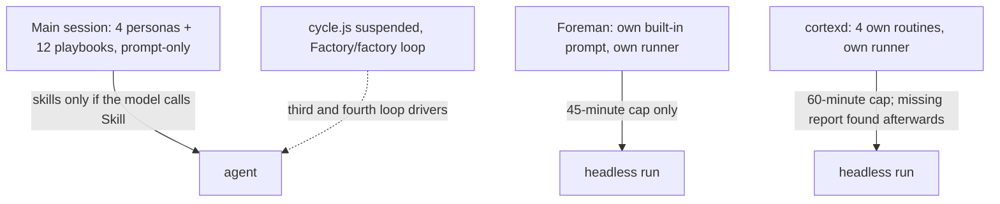
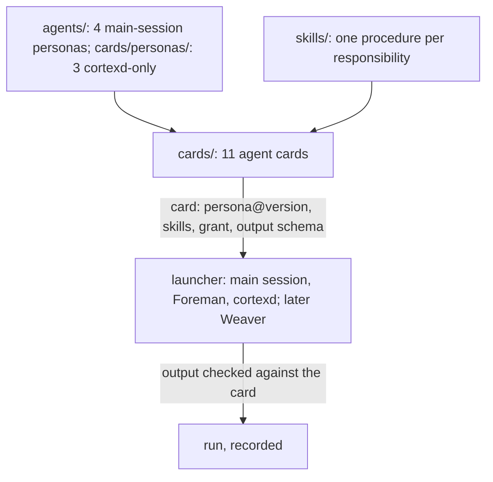
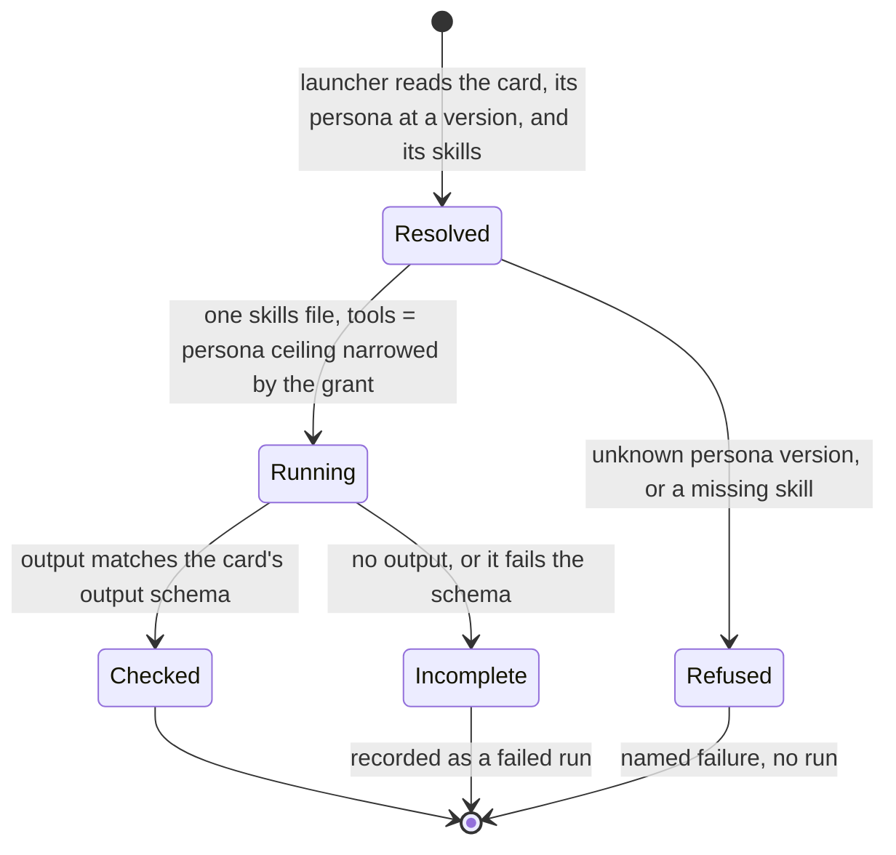

# One agent layer: agent cards built from seven personas and shared skills

Before:

After:

## Goals and non-goals

One plan for roadmap item 0 (`D:/repo/docs/LEDGER.md:20`). This item merges two drafts written the same day:
- the 11 agent cards (`D:/repo/docs/reports/2026-11-07-agent-retrospective-and-cards.md:90`);
- the persona split (`D:/repo/docs/reports/2026-11-07-lean-delivery-proposal.md:128`).

The report's milestones are superseded by the ones below.

Goals:
- Define one versioned card schema, `agent-card.v1`, owned here.
- Build every agent from it: in the main session, Foreman and cortexd.
- Make a check of every rule that is prose today.

Non-goals, because they belong to Weaver (`D:/repo/Lib/weaver/docs/specs/agent-platform.md`): the runner, the scheduler, `heartbeat-stale`, `record-missing` and `timeout`. Weaver's core spec was locked 2026-10-31 and has no code yet (roadmap item 1).
- Weaver pins a persona name and version per run (`agent-platform.md:134`) and rejects an unknown version (`persona-version-unknown`, `:83`).
- Weaver defines no file schema. It reads the card's `persona` and `personaVersion` from this item's schema.
- Until Weaver lands, M3 to M5 patch the current launchers, a small stop-gap: Foreman already attaches skills (`D:/repo/Factory/foreman/core/step-skills.js:48`), and cortexd already reads a persona file (`D:/repo/Assistant/cortex/bin/run-agent.ps1:45`).

Research:
- `D:/repo/docs/reports/2026-11-07-deterministic-enforcement-research.md`
- `D:/repo/docs/reports/2026-11-07-lean-delivery-proposal.md`: Persona split review, Hung runs
- Design review 2026-11-07: fix-first, 7 findings, all folded in below.

## Why

Owner, 2026-11-07: "consolidating the orchestration, including turning the agent playbooks into persona + associated skills and context", covering "the agents we set up on cortexd", with deterministic enforcement of loops and flows.

## Model

- A **persona** is a role plus a tool ceiling, with a `version`. There is a new persona only where the tools or permissions differ (`lean-delivery-proposal.md:131`). That gives seven: researcher, designer, implementer, reviewer, chief-of-staff, harness-steward and web-scout. web-scout is the Cortex researcher and deal-scout persona: its ceiling holds Notion and the browser, which the main-session researcher must never get (the main session takes a subagent's tools straight from its persona file).
- Only the four main-session personas live in `C:/Users/Michael/.claude/agents/`, the folder the main session loads agents from. The three personas only cortexd runs (web-scout, chief-of-staff, harness-steward) live in `C:/Users/Michael/.claude/cards/personas/`, so the main session can never dispatch one with its Notion, Calendar or browser tools.
- A **card** is one agent: its persona at a version, its skills, its grant, its loop and states, its output schema, its checks and its eval. A grant only narrows the persona's tool ceiling, and it belongs to the card, not the persona. So the Cortex researcher (web reader, no Bash) and deal-scout (Wishlist-only Notion) share the web-scout persona but never each other's grants.
- **Skills** hold procedure, one responsibility each. Reviewer modes and ADR mode become skills.

| Card | Persona | Runtime |
|---|---|---|
| designer, implementer, researcher, reviewer | same name | main session |
| Foreman build | implementer | Foreman |
| Foreman spec | designer | Foreman |
| Foreman review (merge review and Patch Patrol settle) | reviewer | Foreman |
| chief-of-staff | chief-of-staff | cortexd |
| deal-scout, Cortex researcher | web-scout | cortexd |
| harness-steward | harness-steward | cortexd |

## Before and after

| Concern | Before (measured 2026-11-07) | After | AC |
|---|---|---|---|
| Agent systems | 3: harness personas, Foreman's prompt (`D:/repo/Factory/foreman/core/runner.js:95`), Cortex routines | 1: 11 cards on 7 personas, read by every launcher | AC-1, AC-2 |
| Personas | 9 prompt systems; researcher written twice; Cortex chief-of-staff 6,901 words | 7 versioned personas | AC-1 |
| Grants | Cortex grant lives in the persona file | per card, narrowing the persona's tools | AC-6 |
| Procedures | 12 playbooks; 27,383 words of `dark-factory` docs; overlapping skills | one skill per responsibility; a playbook is at most a pointer | AC-5 |
| Deterministic steps | Cortex Dashboard reconcile and wishlist move run as prompt stages 0 and 0b | plain code in cortexd | AC-7 |
| Loop drivers | 3: `cycle.js` (suspended), Foreman's chain, `Factory/factory` | 1: Foreman's chain; default design, review, implement, review (D-RF-4) | AC-4, AC-8 |
| Run ends early | prompt text; 3 of 71 Cortex runs wrote no report | the launcher checks the output against the card's schema after every run | AC-9 |
| Hung run | wall-clock kill at 45 or 60 min | `heartbeat-stale` at 10 min | Weaver |

## States

Failure classes: `persona-version-unknown` (Weaver's own, `agent-platform.md:83`), `card:skill-missing`, `card:output-invalid`.

## Behaviour

Each repo tests its own launcher against the shared fixtures in `C:/Users/Michael/.claude/contracts/fixtures/agent-card.v1/`. No test reads another repo's code.

| AC | Traces | Given / when | Pass when | Fail when | Test |
|---|---|---|---|---|---|
| AC-1 | Model | the card lint over `agents/`, `cards/personas/` and `cards/` | 7 personas, each with a `version`; 11 cards, each valid against `agent-card.v1` with no empty cell; every skill named by at least one card | a persona without a version, a card missing a cell, or an orphan skill | `C:/Users/Michael/.claude/tests/test_agent_cards.py` |
| AC-2 | Why | Foreman and cortexd each launch a fixture card | the prompt is the persona file plus the card's skills file; no launcher-owned role text | the launcher adds its own role text | Foreman `test/agent-card.test.js`; Cortex `test/agent-card.test.js` |
| AC-3 | States | a fixture card naming an unknown persona version, or a missing skill | refused with `persona-version-unknown` or `card:skill-missing` before any run | a run starts | same two launcher tests |
| AC-4 | Why | a Foreman run with no mode named | runs design, design review, implement and code review | runs build-only | Foreman `test/dispatch-modes.test.js` |
| AC-5 | Model | the harness lint | names any skill pair with the same responsibility, and any playbook holding a rule no skill or check holds | either passes | `C:/Users/Michael/.claude/tests/test_agent_cards.py` |
| AC-6 | Model | the deal-scout and Cortex researcher fixture cards | each run's `--tools` and Notion allowlist equal its own card's grant | either run gets a tool or database from the other card | Cortex `test/agent-card.test.js` |
| AC-10 | Model | every persona file in `agents/` after the fold | each has only tools from the main-session set (`Read, Grep, Glob, Bash, Edit, Write, WebSearch, WebFetch, Agent`), and web-scout, chief-of-staff and harness-steward are not in `agents/` | a persona there has a Notion, Calendar or browser tool | `C:/Users/Michael/.claude/tests/test_agent_cards.py` |
| AC-7 | Why | the chief-of-staff run on a fixture Dashboard | Dashboard reconcile and wishlist move run as code before the model starts; the prompt has no stage 0 or 0b | either stage is still prompt text | Cortex `test/reconcile.test.js` |
| AC-8 | Why | the harness lint | no file outside `_Archive` references `workflows/cycle.js` or `Factory/factory` as a loop driver | a live reference remains | `C:/Users/Michael/.claude/tests/test_agent_cards.py` |
| AC-9 | States | a fixture run that exits 0 with no output, or invalid output | recorded as failed with `card:output-invalid` | recorded as succeeded | same two launcher tests |

## Milestones

Today is Sat 2026-11-07. Scheduled Cortex runs keep their current files until M4: researcher Sun, Wed and Fri 07:30; harness-steward Sun; deal-scout Tue and Fri 08:00.

- **M0, by 2026-11-08:** the report's quick fixes. Fast lane cannot merge unreviewed: done (D-MR-1). `skills/synced` is ignored in `claudence`. Trimming plugins is logged as `needs-owner`.
- **M1, by 2026-11-10:** prove the mechanism. A Foreman run's transcript contains the attached skill text (issue #104 carries `context-index`, D-SK-2). Reviewer modes and ADR mode become skills. Harness only; no Cortex file changes.
- **M2, by 2026-11-14:** the `agent-card.v1` schema, fixtures and card lint (AC-1, AC-5). Personas get a `version`. The designer, implementer and reviewer cards are migrated.
- **M3, by 2026-11-21:** the Foreman cards (build, spec, review). Foreman reads cards (AC-2, AC-3, AC-9 on Foreman). Playbooks become pointers.
- **M4, by 2026-11-28:** the Cortex cards. cortexd reads cards (AC-2, AC-3, AC-9 on Cortex). The Cortex researcher and deal-scout move onto web-scout with their own grants (AC-6, AC-10). Stages 0 and 0b become code (AC-7).
- **M5, by 2026-12-05 (review date):**
  - Foreman's default becomes the full chain (AC-4). `cycle.js` and `Factory/factory` are retired (AC-8).
  - The first creative eval runs, and spec loops get spend caps.
  - Measure against the before column.

Stop if the first 3 card-built runs merge worse work than the 3 before them, or if a scheduled Cortex run fails because of a card change.

## Outcomes

| Dimension | Level | Row or n/a reason | AC |
|---|---|---|---|
| success | L3 | Every launcher runs a card built from a persona and its skills | AC-2 |
| invalid input | L3 | An unknown persona version or a missing skill is refused | AC-3 |
| dependency fails | L2 | Claude exits non-zero: recorded as a failed run, as today | - |
| timeout | L1 | Owned by Weaver's heartbeat-stale check, outside this item | - |
| crash mid-step | L2 | Foreman `checkpoint.js` resume is unchanged | - |
| concurrent actor | L2 | Cards and personas are read-only at run time | - |
| duplicate or replay | L1 | Launch is idempotent; reading a file twice changes nothing | - |
| arrival channel | L3 | Main session, Foreman and cortexd read the same cards | AC-2 |
| performance or cost | L2 | Fewer, shorter prompts; measured at M5 | - |
| security | L3 | A card's grant narrows its persona's tools; no grant crosses cards | AC-6 |
| data and compatibility | L3 | Run output is checked against the card's schema | AC-9 |
| operability | L3 | Duplicate skills, stale playbooks and dead loop drivers are named by the lint | AC-5, AC-8 |

## Assumptions

| Assumption | Observed | If violated |
|---|---|---|
| Weaver can read `persona` and `personaVersion` from the card | Weaver pins a name and version and defines no file schema (`agent-platform.md:134`) | amend Weaver FR-5 to cite `agent-card.v1` (needs-owner, low urgency) |
| Claude Code does not load `C:/Users/Michael/.claude/cards/` as agents | cards sit outside `agents/`, which is the folder it scans | move them if one shows up as a dispatchable agent (check with one card at M2) |
| Cortex grants fit a card's grant field | Cortex builds `--tools` from the persona's capabilities (`D:/repo/Assistant/cortex/bin/run-agent.ps1:89`) | the grant stays in `config/capabilities.json`, keyed by card |
| A per-run Stop check is needed beyond the output check | No Weaver spec has one | AC-9 covers early ends until Weaver Verify; revisit at M5 |
