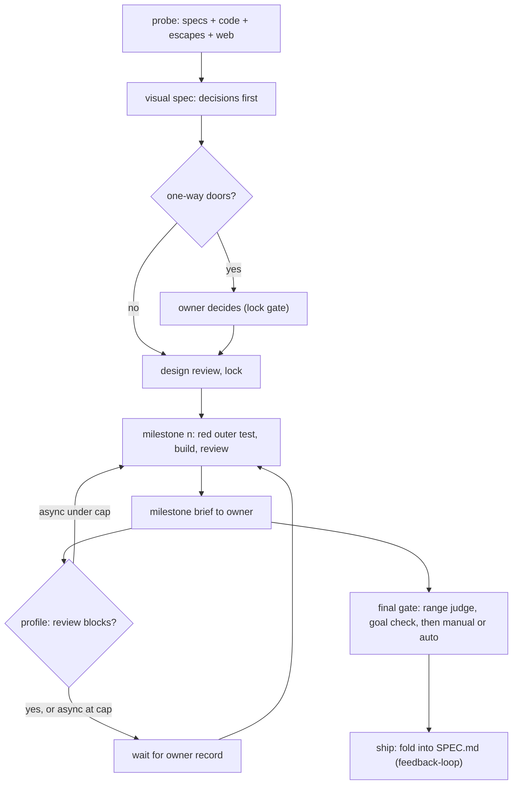
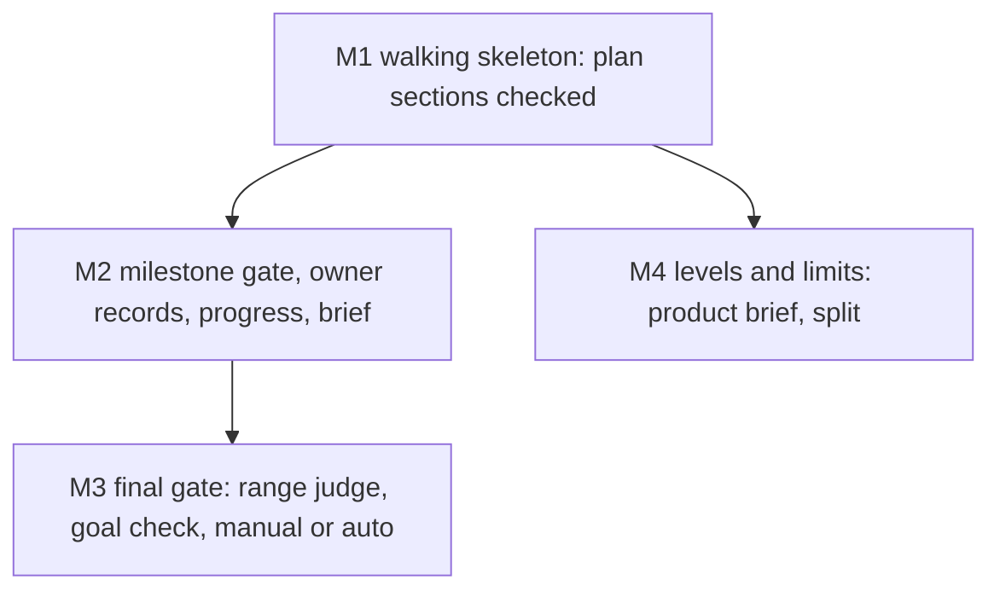

# The agentic loop: research, a visual spec, milestones the owner checks, a final gate set by project profile

Companion spec: `docs/work/feedback-loop/` (split by this spec's own limit of 5 milestones). The range judge the final
gate calls is the planned `gate-ci` capability (GC-G1; ADR [0002](../../adr/0002-loop-gate-enforcement-layer.md), D47).
Build order across the specs, the owner of each shared file and the cross-spec contracts: [INDEX](../../capabilities/INDEX.md).

## Decisions (one-way doors)

| # | Decision | Status | Choice | Alternatives | Why it is hard to reverse |
|---|---|---|---|---|---|
| D-A | How a spec changes after lock | **confirmed** (owner 2026-11-03, D43) | frozen original + append-only Amendments log + folded current view; built by `feedback-loop` | D37 in-place edits | every spec, gate rule and reviewer reads this format |
| D-B | Where per-project switches live | **confirmed, expanded** (owner 2026-11-03, D45): one source of truth for every config and core fact, built by spec `project-manifest` | one owner-only manifest per repo, `catalog-info.yaml` (approved, unbuilt) | `.claude/gates.json`; CLAUDE.md keys | Foreman, Catwalk, the gate and the brief all read it |
| D-C | What sets the loop's caution | **confirmed** (owner 2026-11-03, D44; cashcow is `public` since D55) | a project **profile** read from the owner-only profile map in claudence (`contracts/profile-map.v1.yaml`, project-manifest D-I), never from the repo: `yolo`, `public` or `revenue` (table below); defaults follow the profile; cashcow `public`, every other listed repo `yolo` | one default for all; `deploymentTier` alone; the profile in the repo's own manifest (every channel into the repo can rewrite it) | every gate default in every repo |
| D-D | Final gate per profile | **confirmed** (owner 2026-11-03, D44) | `yolo`: auto (goal check + health check); `public` and `revenue`: manual | manual everywhere | what ships without a human |
| D-L | Who may write owner-kind records | **confirmed** (owner 2026-11-03, D56) | `milestone-approval`, `owner-decision` and `final-approval` may be written by an agent on the owner's behalf when the owner gives the approval in the conversation. Each carries `recorded` (date and time, set by the script), `owner_words` (the owner's words verbatim: their reasoning, or `none given`), `channel` (`chat`, `!` or `telefi`) and `session_id`; a record missing any of them is refused and never counts. No guard rule blocks the write. `goal` records come only from a goal-checker agent that is not the implementer | a guard that denies every agent write (the earlier proposal; dropped by D56); a signed owner record (ssh signature; needs key setup, stronger); the free `reviewer` string (today); Catwalk Confirm alone | every gate, cap and profile default trusts these records; the audit fields are what lets a later audit tell an approval from a forgery |

### Profiles (D-C, D-D)

| Profile | Who is exposed | Values | Milestone review | Final gate | Also |
|---|---|---|---|---|---|
| `yolo` | the owner only (pre-revenue, internal) | speed | async, at most 2 unreviewed | auto: a fresh independent `goal` record that quotes a green health check | design review only where the tier requires it |
| `public` | public users, no money | security, stability | async at most 1; blocking for a milestone with a security or data flag | manual: owner `final-approval` | `security` forced to L3 in every T2; security reviewer on every T2; full end-to-end suite and a canary before release |
| `revenue` | paying users, payments or PII | security, stability, data | blocking (cap 0) | manual: owner `final-approval` | flag `live` derived; security reviewer on every T2 and flagged bugfix; a rollback plan in the spec |

`deploymentTier` is derived from the profile and Foreman autonomy follows it (INDEX map: `yolo` pre-traffic and full;
`public` and `revenue` live and label-gated). The profile is read from the owner-only profile map, never from the repo;
a repo missing from the map reads CLAUDE.md as today (A-3) until the map is `complete`, then is refused; a listed repo
with no valid manifest at the tip is refused (project-manifest AC-7). A `live` repo can never drop below `public` (D55,
project-manifest AC-13). cashcow is `public` (D55): manual final gate, the security reviewer on every T2, blocking
review for security or data milestones, a canary before release; it becomes `revenue` when it takes money.
**Unreviewed** (= waiting) means a milestone that is done but has no owner `milestone-approval` record; it is derived
from records, never from a README column.

## Assumed defaults (reversible, listed for the owner's review)

| # | Default | Why assumed | Revisit when |
|---|---|---|---|
| A-1 (was D-E) | Background: a visible one-line summary per pattern, detail collapsed; `background: expanded` in the manifest opens everything | owner: not a one-way door (2026-11-03) | the owner opens most collapsed sections |
| A-2 (was D-F) | The limits in the table below are starting values, not measured optima; a project overrides them in its manifest `limits`, and one item overrides them in its frontmatter `limits:` with a `why`; every milestone brief reports actual against limit | owner: no accurate estimate yet, keep it reversible and tunable (2026-11-03) | five items per tier have reported actuals |
| A-3 | A repo missing from the profile map takes its profile from CLAUDE.md `deploymentTier` (pre-traffic `yolo`, live `revenue`, the highest caution) until the owner sets the map's `complete: true`; after that it is refused; a listed repo never falls back | the fallback exists only where the owner has not yet classified a repo | `project-manifest` P4 lists every repo and the owner sets `complete` |

### Levels and limits for large projects (A-2)

A document holds at most two levels; scale grows sideways (more capabilities) and up (one thin product brief), never
deeper inside a spec.

| Level | Document | Holds | Limit, then |
|---|---|---|---|
| Product | `docs/capabilities/INDEX.md` as a product brief (claudence's own: [INDEX](../../capabilities/INDEX.md)) | vision, capability map, cross-capability contracts, release milestones; links, no ACs | 9 capabilities, then group into domains |
| Domain (only past 9 capabilities) | `docs/capabilities/<domain>/INDEX.md` | the same shape for its capabilities | 9 capabilities each |
| Capability | `docs/capabilities/[<domain>/]<name>/SPEC.md` | current truth: ACs, outcomes, owned paths, timeline | 40 current ACs or 200 lines, then split the capability |
| Change | `docs/work/<id>/README.md` | one change: decisions, milestones, contracts, ACs | 15 ACs, 5 milestones, 5 scopes and about 400 changed lines per milestone, 4 parallel agents |
| Child change | `docs/work/<id>/` with `parent:` | one milestone that broke a limit | never nests again |

Complexity class: **S** is one capability (a change spec alone), **M** is 2-9 capabilities (a product brief),
**L** is 10 or more (domains). Worked example, a Tarive rebuild: [levels-example.md](evidence/levels-example.md).

## Purpose

Specs today plan one change at a time with no milestones, no contracts between agents, and the owner seeing work only
at `live` deploys. The owner wants to steer the design, check each milestone, and set per project how much the loop
may do unattended, from a single change up to a large application (owner design, `evidence/owner-design.md`).

## Goals and non-goals

- Goal: a T2 spec carries one-way-door decisions, an alternatives table, a milestone chart, contracts and an outer
  test per milestone, all checked.
- Goal: the loop pauses for the owner exactly where the project profile says, and never auto-accepts.
- Goal: large projects decompose into a product brief, capabilities and changes within fixed limits.
- Non-goal: amendments, escape trace-back and retro feedback (spec `feedback-loop`).
- Non-goal: T1 and bugfix items; Catwalk UI work (owner-gated); `cycle.js` (`stage-trace`, now folded into the factory
  service, D53); the range judge itself (`gate-ci` GC-G1).

## Background

- **Walking skeleton**: the first milestone is the thinnest end-to-end path that runs, so integration risk shows on day one.
- **Vertical slice**: every milestone delivers something usable through all layers, never one layer at a time.
- **Contract-first**: agents that build different parts agree on a versioned schema with example fixtures before coding.
- **Double-loop TDD**: one outer acceptance test per milestone drives many inner unit tests.
- **One-way and two-way doors**: decide only the irreversible choices early; log the rest as defaults.
- **Ship / Show / Ask**: building on in-review work is fine when the amount waiting for review is capped.
- **Canary gate**: automatic deploys stay safe only when health checks can stop and roll them back.
- **Pugh matrix**: alternatives scored +, 0 or - against a baseline, no weighted total.
- **C4 levels**: context, container, component, code; most teams need only the first two documented.

Detail and sources for each pattern

- Walking skeleton: Cockburn, Crystal Clear (2004); Shape Up ch. 11-13 (2019): revise the chart after the skeleton.
- Contract-first: Pact; MAST (arXiv 2503.13657, 2025): 32% of multi-agent failures are misalignment between agents;
  Claude Code agent teams: two agents on one file overwrite each other; 3-5 agents.
- Double-loop TDD: Freeman and Pryce, GOOS (2009); Google (2016): about 16% of tests are flaky, so the full
  end-to-end suite runs once, at the final gate.
- Doors: Bezos letters 2015/2016; Poppendieck (2003). Ship/Show/Ask: Wilsenach, martinfowler.com (2021-09-08).
- Canary: Google SRE workbook; GitHub/GitLab environments: the deployer never approves. Pugh: Hazelrigg on false
  precision of weighted scores.
- C4: c4model.com ("context and container diagrams are sufficient for most teams"); arc42; OpenSpec and the Spec Kit
  domain extension group capabilities into domains.
- Full notes: `D:/repo/docs/research_notes/Agentic loop design/` and `.../Spec folder structure/`.

## Approach

Baseline: today's v3 (no milestones, the owner sees work at `live` only). Scores are +, 0 or - against the
baseline; each cell names its scenario.

| Dimension | A: owner's design as written | B: recommended (A with the probe's changes) | C: heavy plan docs per milestone (Spec Kit style) |
|---|---|---|---|
| Owner time | - every spec reviewed | 0 one-way doors and milestone briefs only | - long plan documents to read |
| Agent cost (stages, tokens) | - unit + integration + e2e per milestone | 0 one outer test + contract tests per milestone | - 2,577 lines of markdown for 689 of code (Scott Logic) |
| Latency to ship | - blocking reviews everywhere | + async where the profile allows | - |
| Defect escape | + | + goal check at the final gate (MAST: 15.6% of failures) | 0 prose not executed |
| Reversibility | - every decision front-loaded | + only one-way doors front-loaded | - |
| Security and privacy | 0 | + the builder never passes its own gate; `public` and `revenue` add the security reviewer | 0 |
| Operability | 0 | + auto-deploy needs a health check | 0 |
| Scale to large apps | - no levels | + product, capability, change, fixed limits | 0 numbered folders, no current state |
| Build complexity | 0 | - manifest, milestone gate, brief, levels | - |

Chosen: **B**. Its cost is the build complexity; the milestones below keep each piece small.

## Milestones

The table is the plan only (no Status column, no color classes). Build order and file owners: INDEX.

| Milestone | Slice (what works after it) | Depends on | Owns | Outer test (red first) | Unblocks |
|---|---|---|---|---|---|
| M1 | a T2 spec with Decisions, Milestones and Contracts passes the checker; this spec checks itself | PM-P1 (spec_v3.py order) | `scripts/spec_v3.py`, `contracts/work-item.v3.json` | AC-1 | every T2 spec can carry a checked plan |
| M2 | owner-kind records exist, carry the four audit fields and count only for the current content; a source commit on a milestone spec is gated by records through pure predicates (cap, trailers, dependencies, Owns) that commit-msg runs on every branch for milestone items and the range judge reuses; progress and the brief are generated and reach Catwalk and TeleFi | M1, PM-P1 (reads `scripts/manifest.py` and the profile map) | `scripts/spec_v3.py`, `scripts/spec_gate.py`, `scripts/review_record.py`, `contracts/review-record.v1.json`, `scripts/progress.py`, `scripts/milestone_brief.py`, `contracts/progress-status.v1.json`, `contracts/milestone-brief.v1.json` | AC-4 | the owner checks each milestone |
| M3 | the final gate (ship edge and deploy promote) runs the range judge from the lock commit to the tip, then needs a `goal` record, then an owner `final-approval` (manual) or a green health check inside the goal record (auto); the guard denies a bare `vercel --prod` and `vercel promote` | M2, GC-G1 (`gate-ci` range judge and `range-verdict.v1.json`) | `scripts/final_gate.py`, `scripts/spec_gate.py`, `scripts/review_record.py`, `contracts/review-record.v1.json`, `hooks/guard.py`, `skills/deploy-web/SKILL.md`, `agents/goal-checker.md`, `agents/implementer.md`, `agents/reviewer.md` | AC-9 | unattended ship on `yolo` repos, safely |
| M4 | the checker reads the product brief and domains, refuses a spec or index past its limits or depth | M1, capability layer | `scripts/spec_levels.py` | AC-11 | large projects decompose by rule |

### Gates on real work (AL-2)

Every rule below is a pure predicate over (commit facts, records, effective config) with no git call inside: one rule
set, several drivers. The binding driver is the range judge at the action boundary; the others cut latency (ADR 0002).

- A milestone is **done** when a `milestone` record (verdict `pass`: the reviewer ran its outer test green) names it by
  `milestone: M<n>` and a commit; **waiting** when done with no owner `milestone-approval`. Source commits on a
  milestone spec (an item with a Milestones table) carry a `Milestone: M<n>` trailer beside `Spec:`.
- **Rules (M2).** Refuse a source commit while the item's waiting count is at the profile cap (blocking: while any other
  milestone waits), when the trailer is missing or unknown, or when a dependency is not done. The Owns check applies to
  every `Milestone:` trailer: the commit's changed paths must lie inside that milestone's Owns, waiting or not, so a
  self-asserted trailer cannot reach outside its milestone. A commit inside a milestone's Owns after that milestone's
  `milestone` record lands as rework and the milestone reads **not done** until a new record, so its dependents are
  refused. A commit naming a waiting milestone is rework, allowed only inside that milestone's Owns.
- **Binding judge.** `final_gate.py` controls the `building` to `shipped` edge and the `deploy-web` promote step. Both
  run the range judge (`gate-ci` GC-G1) over the item's history from its lock commit to the tip, applying the rules to
  every source commit, and refuse on any breach or any failure to judge (git timeout, shallow history, missing objects,
  more commits than the bound: `unjudged`). It never trusts the README status or that a hook ran. After a clean range it
  still needs the `goal` record and, for `public` and `revenue`, an owner `final-approval`.
- **Early judges (latency only).** commit-msg on every branch for commits whose `Spec:` names a milestone item; the
  `pre-push` stage over the range pushed to the default branch (GC-G1); Foreman's pre-merge slot (child item
  `foreman-range-gate`, which also writes the squash commit's trailers). Until that child item ships, Foreman
  auto-merge stays off for repos with `loop: on`. `pre-merge-commit` is not adopted.
- **Arrival (ADR 0002 channel table).** commit-msg judges a commit, an amend and a local `merge --squash` followed by a
  commit. It returns early while a merge, rebase, cherry-pick or revert is in progress (`spec_gate.py:341-342`), and a
  fast-forward creates no commit, so those channels meet pre-push and the binding judge, not commit-msg (this corrects
  the earlier claim that commit-msg covers cherry-pick). A squash commit carries exactly one `Spec:` and one
  `Milestone:` trailer; a range with a source commit lacking them is refused at push and at ship.
- **Not covered by the judge.** A host that auto-deploys on push bypasses every gate: it must be off for `public` and
  `revenue`, and project-manifest P5 reports it, with a production deploy that has no final-gate pass (that spec's
  AC-10 holds the fixture). A direct `vercel --prod` or `vercel promote` from an agent shell is denied by an M3 guard
  rule on the command string; a helper script past it is detected by the same drift report.
- **File owners.** `final_gate.py` and `skills/deploy-web/SKILL.md` belong to AL-M3, then to PM-P5, which adds the deploy
  refusal while drift is open (INDEX).

### Progress and status (AL-3)

Two measures: **spec readiness** (ready checks passed over applicable ones) and **implementation progress** (per AC:
no test, red, green, reviewed; per milestone: green ACs over its ACs). Progress is generated, never edited:
`scripts/progress.py` writes `evidence/progress.json` and `evidence/progress.md` from the records, the `Milestone:`
trailers and the last recorded test run per AC. `evidence/` is outside the content hash (regenerating makes no record
stale) and outside the README (the feedback-loop freeze never refuses it); no gate reads it. One source for statuses,
symbols and colors, `contracts/progress-status.v1.json`: planned ○ grey, blocked ⊘ red outline, building ◐ blue,
review ◔ amber, owner ⏸ purple (done, waiting), done ● green (approved), failed ✕ red, killed ⨯ black; each shows
symbol and word. Shown in `evidence/progress.md`, `spec_status` and each brief; sample:
[progress-sample.md](evidence/progress-sample.md). M4 runs in parallel with M2 and M3 (no shared paths) and needs the
capability layer; the chart is revised after M1.

## Contracts

| Name | Version | Schema | Fixtures |
|---|---|---|---|
| plan sections (Decisions, Milestones, Contracts tables) | v3.1 | `contracts/work-item.v3.json` | `contracts/fixtures/plan-valid.md`, `plan-invalid-*.md` |
| per-project manifest (no `profile` key) and the owner-only profile map (defined by `project-manifest`, read through `scripts/manifest.py`) | v1 | `contracts/project-manifest.v1.json`, `contracts/profile-map.v1.json` | `contracts/fixtures/manifest-*.yaml`, `contracts/fixtures/profile-map-*.yaml` |
| milestone brief | v1 | `contracts/milestone-brief.v1.json` | `contracts/fixtures/brief-*.json` |
| review record kinds `milestone`, `milestone-approval`, `owner-decision`, `final-approval` (M2), `goal` (M3); optional `milestone` field; the owner kinds require `owner_words`, `channel` and `session_id` beside the existing `recorded` (D56): an extension of v1, no v2 file, old records stay valid | v1 | `contracts/review-record.v1.json` | `contracts/fixtures/record-*.md` |
| range verdict of one judged span of history (defined by `gate-ci` GC-G1, read by `final_gate.py`) | v1 | `contracts/range-verdict.v1.json` | `contracts/fixtures/range-*.json` |
| progress statuses: enum, symbol, color, meaning | v1 | `contracts/progress-status.v1.json` | `contracts/fixtures/progress-*.json` |
| product brief and domain index | v1 | `contracts/product-brief.v1.json` | `contracts/fixtures/brief-index-*.md` |

Owner-kind record fields and their writers: `recorded` (script clock), `owner_words` (the writer: the owner's words
verbatim, or `none given`), `channel` (the writer: `chat`, `!` or `telefi`), `session_id` (the script, from the hook
event or environment; the writer when none exists). Nothing among them is an author-editable proxy for a gate fact: a
gate reads only that the fields are present and the record's content hash and commit are current; the audit compares
the rest with the transcript.

Signatures: `review_record.py approve --item ID --kind <owner kind> [--milestone M<n>] --report FILE --owner-words TEXT
--channel chat|!|telefi --session ID` (the owner's `!` or an agent on the owner's behalf; `write` refuses owner kinds);
`progress.milestone_states(tree, item) -> dict[str, Status]`; `spec_gate.milestone_problem(commits:
Sequence[CommitFacts], records: Sequence[Record], item, config: EffectiveConfig) -> str | None` (pure; composes the cap,
trailer, dependency, Owns and not-done rules; `CommitFacts(sha, spec, milestone, paths)` is defined here and produced
by the range judge); `final_gate.final_gate_problem(repo, item, config) -> str | None` (calls GC-G1's
`judge_range(repo, base, tip, rules) -> RangeVerdict`); `guard.goal_authority_problem(event) -> str | None`;
`guard.vercel_prod_problem(event) -> str | None`.

## Behaviour

| AC | Traces | Given / when | Pass when | Fail when | Test |
|---|---|---|---|---|---|
| AC-1 | M1, AL-3 | this README and a fixture T2 spec with Decisions, Milestones (no Status column) and Contracts in the exact shapes; a fixture with a Status column or a `classDef`/`class` line in the Milestones chart | both exact shapes pass the checker; the Status column and the class lines are refused, naming that progress is generated | either exact shape is refused, a malformed one passes, or a Status column lands | tests/test_agentic_loop.py |
| AC-2 | M1 | fixtures: a milestone without an outer test; a Depends-on cycle or unknown id; two milestones without a dependency owning one path; a contract whose schema or fixture is missing | each refused, the rule named | any lands | tests/test_agentic_loop.py |
| AC-3 | M2, D-C | the reader on map fixtures: each profile; cashcow's real entry (`public`); an unlisted repo before `complete` (CLAUDE.md pre-traffic, then live), and the same after `complete`; a manifest carrying a `profile` key; an entry below its floor; an unknown value | each profile's defaults apply, cashcow's real entry reading the `public` defaults (cap 1, manual final gate, security reviewer on every T2); an unlisted repo gives `yolo` or `revenue` by tier before `complete` and is refused after; an in-repo profile, an entry below its floor (D55) and an unknown value are refused by name (project-manifest AC-2, AC-3, AC-13) | a default is unsafe, a bad value is silently used, or an in-repo profile is honored | tests/test_agentic_loop.py |
| AC-4 | M2, AL-2 | an item at the profile cap of waiting milestones (`revenue`: any; `public`: 1); source commits with `Milestone: M<n>`: none, unknown, a dependency not done, another milestone, the waiting one inside and outside its Owns, a not-waiting milestone's commit outside its Owns, a commit inside a done milestone's Owns after its record; then after an owner `milestone-approval`; a hand-edited `evidence/progress.json` | each breach refused naming the rule and the milestone; rework inside Owns lands and the reworked milestone reads not done until a new record, so its dependents are refused; another milestone lands after the approval; the edited progress file changes nothing | a commit lands at the cap or outside its trailer's Owns, a record survives later rework, or a file the builder writes opens the gate | tests/test_agentic_loop.py |
| AC-5 | M2, D-L | `review_record.py approve` for each owner kind run as the owner (`!`) and by an agent on the owner's behalf (chat) with all fields; with `owner_words`, `channel` or `session_id` missing in turn; `owner_words` empty; `channel` outside `chat`, `!`, `telefi`; `write --kind milestone-approval`; a hand-written record file lacking a field; a record for another commit or milestone | a complete approve writes a record that counts, `recorded` set by the script; each incomplete one is refused naming the missing field and a hand-written one is not counted by the reader; `write` refuses owner kinds; the record for other content does not count; no guard rule denies the write | a record lacking a field counts, or a record for other content counts | tests/test_agentic_loop.py |
| AC-6 | M2, AL-3 | a milestone moves to done; `progress.py` and `spec_status` run on a repo with specs mid-build; the progress files regenerated | `evidence/progress.json` and `.md` validate against their contracts and an unknown status is refused; regenerating leaves the content hash and every record fresh; a brief validating against its contract has six parts (now, evidence, what broke, cost vs cap, assumed decisions, next), lists in evidence each owner record counted (kind, milestone, `recorded`, `channel`), opens with the progress line and is queued for Catwalk and TeleFi | a file is missing or invalid, a record goes stale, or a count disagrees with the records | tests/test_agentic_loop.py |
| AC-7 | M2, D-C | a `public` repo (cashcow's entry included): a T2 spec with `security` below L3, or without a security review record at lock; a `revenue` repo: a T2 spec without a rollback plan, a flagged bugfix without a security review record | each refused by name | any lands | tests/test_agentic_loop.py |
| AC-8 | M2, M3, AL-2 | fixture histories built by real git operations on a temp repo, each holding an AC-4 breach delivered by: a worktree-branch commit, a local `merge --squash` commit, a non-fast-forward merge, a fast-forward, a rebase, a plain cherry-pick, a force-pushed rewrite; a Foreman-style squash with one `Spec:` and one `Milestone:`, then with two of either and with none; a shallow clone, a missing object and a range over the bound | commit-msg refuses the branch commit and the local squash; pre-push refuses the range the others make; `final_gate_problem` refuses every breach over the lock-to-tip range naming the rule and the commit; a squash with exactly one of each is judged against its milestone; a range it cannot read refuses as `unjudged` | a breach reaches ship by any channel, a squash with missing or doubled trailers passes, or an unjudged range passes | tests/test_agentic_loop.py |
| AC-9 | M3, D-L | a ship without a `goal` record; with one written by the implementer's identity or from the main session; with a fresh one from the goal-checker identity; on a manual repo a `final-approval` lacking one audit field, then a complete one | refused, denied by the guard, lands; the incomplete `final-approval` is refused naming the field, the complete one lands | otherwise | tests/test_agentic_loop.py |
| AC-10 | M3, D-D, AL-2 | the ship edge and the `deploy-web` promote step: `yolo` with a goal record quoting a red health check, then green; `public` (cashcow's entry) or `revenue` without, then with, a complete owner `final-approval`; a range holding a cap breach delivered by fast-forward with every record present; the effective config of a `public` repo; guard events (subagent and main session) for a bare `vercel --prod` and `vercel promote`; look-alikes `vercel deploy`, `vercel env ls`, `echo "vercel --prod"` and the promote script | refused then lands at both channels in every case; the range with the breach is refused even with approval; autonomy reads label-gated; the guard denies the two commands and allows each look-alike | a channel opens without its record, a breach ships, a bare production deploy is allowed, or a look-alike is denied | tests/test_agentic_loop.py |
| AC-11 | M4, A-2 | a change with 16 ACs or 6 milestones; a child of a child; a product brief with 10 capabilities and no domains; a capability SPEC.md over 200 lines; a manifest raising a limit | each refused naming the limit and the split to make; the raised limit applies | a limit is ignored | tests/test_agentic_loop.py |
| AC-12 | D-B, D-L | a T2 lock whose Decisions table has open rows: with no `owner-decision` record; with one lacking an audit field; with a complete one for the current content (the owner's `!` or an agent on the owner's behalf); with one for older content; a T2 without open rows | refused, refused naming the field, lands, refused, lands on the design record | otherwise | tests/test_agentic_loop.py |
| AC-13 | compatibility | every v2 item and every shipped v3 item in the fleet, and the records on disk | judged exactly as before | any result changes | tests/test_agentic_loop.py |
| AC-14 | docs | SPEC-STANDARD-V3.md, agents/implementer.md, agents/reviewer.md, DEVELOPMENT_LIFECYCLE.md | each states the loop: one milestone at a time, owned paths only, contracts change only through the planner, the profile table, the binding judge at the ship edge and deploy | a doc contradicts the code | tests/test_agentic_loop.py |
| AC-15 | A-2 | a project manifest raising one limit; an item's frontmatter `limits:` with and without a `why`; a milestone brief | the project limit applies; the item override applies only with a `why`, refused without; the brief shows actual against limit | an override is silently ignored or applied without a reason | tests/test_agentic_loop.py |

## Outcomes

| Dimension | Level | Row or n/a reason | AC |
|---|---|---|---|
| success | L3 | a planned T2 spec runs milestone by milestone to ship | AC-1 |
| invalid input | L3 | malformed plans, manifests and indexes are refused by name | AC-2 |
| dependency fails | L3 | a repo missing from the map reads its CLAUDE.md tier until `complete`; an unreadable map is refused | AC-3 |
| timeout | L3 | an owner who never reviews blocks the loop at the cap; nothing auto-accepts | AC-4 |
| crash mid-step | L3 | the predicates are pure over commit facts; a judge that times out or crashes reports `unjudged`, which refuses the range | AC-8 |
| concurrent actor | L3 | two milestones owning one path cannot run in parallel | AC-2 |
| duplicate or replay | L3 | an owner record for other content or another commit does not count | AC-5 |
| arrival channel | L3 | every rule is judged over history at the ship edge and deploy promote (binding), and early by commit-msg, pre-push and Foreman's pre-merge slot; see the ADR 0002 channel table | AC-8 |
| performance or cost | L3 | each brief reports stages used against the cap | AC-6 |
| security | L3 | an owner record counts only with its audit fields and for its current content; `goal` records come only from the goal-checker; a bare production deploy is denied | AC-5 |
| data and compatibility | L3 | existing v2 and v3 items and records are judged unchanged | AC-13 |
| operability | L3 | every final-gate channel needs its record and a clean range; host auto-deploy is reported by project-manifest P5 | AC-10 |

## Assumptions

| Assumption | Observed | If violated |
|---|---|---|
| Foreman's autonomy ladder can serve as the final gate | `D:/repo/Factory/foreman/core/repos.js:290` | flag: M3 maps manual and auto onto the ladder; a gap is logged before M3 starts |
| Catwalk's Confirm writes STATE.md, not a review record | `D:/repo/docs/research_notes/Agentic loop design/internal_survey.md:131` | defer: owner records are written only through `approve` (the owner's `!` or an agent on the owner's behalf) until the Catwalk and TeleFi child items exist |
| PM-P1 ships `scripts/manifest.py` and the profile map before M2 | `C:/Users/Michael/.claude/docs/capabilities/INDEX.md:51` | defer: M2 waits for PM-P1 |
| The capability layer exists before M4 | `D:/repo/docs/reports/2026-11-03 Spec structure proposal.md:31` | defer: M4 waits; M1-M3 do not need it |
| An approval record with no matching owner message in its session transcript is possible: the writer is trusted (D56) and `owner_words` cannot be machine-verified | `C:/Users/Michael/.claude/docs/DECISIONS.md:65` | flag: a later audit compares each owner record's `owner_words` and `session_id` with the transcript and reports a mismatch; the record still counts until the owner revokes it |
| `review_record.py approve` can learn the session id from the hook event or the environment; M2's probe finds the source | `C:/Users/Michael/.claude/scripts/review_record.py:431` | refuse: without a source `approve` requires `--session` (writer-typed, audited); a record with no session id never counts |
| The hook event names the writer's agent only by `agent_id`, not its type; M3's probe finds an identity source for the goal-checker | `C:/Users/Michael/.claude/hooks/guard.py:401` | refuse: without one, `goal` records are written only through `approve` by the owner and the auto final gate stays off |
| The range judge refuses by name when it cannot finish (git timeout, shallow history, missing objects, more commits than its bound); a shallow CI checkout fetches full history | `C:/Users/Michael/.claude/docs/adr/0002-loop-gate-enforcement-layer.md:82` | refuse: M3 does not ship until AC-8 shows an `unjudged` range refused |
| The action boundary is the only path to production; host auto-deploy on push and a direct `vercel` call violate it | `D:/repo/SaaS/cashcow/vercel.json:1` | flag: cashcow's auto-deploy stays on (D49) and the final gate does not protect it until it is off; project-manifest P5 reports it |
| The guard sees only the command string: a helper script or an import that runs `vercel --prod` or writes a `goal` record is not seen | `C:/Users/Michael/.claude/hooks/guard.py:352` | refuse: a `public` or `revenue` deploy is refused while P5 reports a production deploy with no final-gate pass (project-manifest AC-11) |
| `loop: on` is set for a repo only after AL-M3 ships the binding judge; claudence (`yolo`) is the pilot exception; before AL-M3 the cap is early-warning only | `C:/Users/Michael/.claude/docs/adr/0002-loop-gate-enforcement-layer.md:199` | refuse: the owner sets the flag in the guard-protected manifest; an agent cannot |
| Foreman auto-merge stays off for repos with `loop: on` until `foreman-range-gate` ships: its server-side squash runs no local hook | `D:/repo/Factory/foreman/core/merge.js:135` | flag: the ship edge still re-judges the range, so a merged breach is refused at ship, at the cost of wasted work |
| A force push rewriting the default branch is denied by the guard on the command string; the range judge reads whatever history exists | `C:/Users/Michael/.claude/hooks/guard.py:359-361` | flag: a rewritten history that erases a `milestone` record reads as not done and is refused at ship |
| A squash commit carries exactly one `Spec:` and one `Milestone:` trailer | `C:/Users/Michael/.claude/scripts/spec_gate.py:350` | refuse: a range with a source commit lacking them is refused at push and at ship (AC-8) |
| The history input of the predicates (`CommitFacts`) is produced by the range judge, which GC-G1 has not yet drafted | `C:/Users/Michael/.claude/docs/capabilities/INDEX.md:51` | defer: an amendment aligns the shape when GC-G1 is drafted |

## Design fix round 1

Fixed (record `reviews/2026-11-03-design-87771700.md`): AL-1, AL-2, AL-3, AL-4. In passing: AL-5, AL-6, AL-8, AL-9.

## Design fix round 2

Applies ADR 0002 (D47) to the second `fix-first` (record `reviews/2026-11-04-verify-52a89b83.md`). Fixed: 1 (the cap
was unreachable by merge, fast-forward, cherry-pick or a non-default branch: binding range judge, early judges, AC-8,
cherry-pick claim corrected), 2 (Owns for every `Milestone:` trailer; a commit in Owns after the record means not done,
AC-4), 3 (indirect-write assumption with `refuse`; bare `vercel --prod` guard rule in M3, AC-10), 4 (`final_gate.py` and
`deploy-web` owner sequence AL-M3 then PM-P5; the host auto-deploy fixture moved to project-manifest AC-10), 5 (citation
INDEX.md:34, now :51). Owner decisions applied in the same round: D55 (profile floor `public`, cashcow `public`: D-C, A-3,
AC-3, AC-7, AC-10) and D56 (owner records written by an agent with audit fields, the guard rule dropped from M2: D-L,
AC-5, AC-9, AC-12).

## Probe

[Probe and critique](evidence/probe.md), from the owner's words in [owner-design.md](evidence/owner-design.md).
