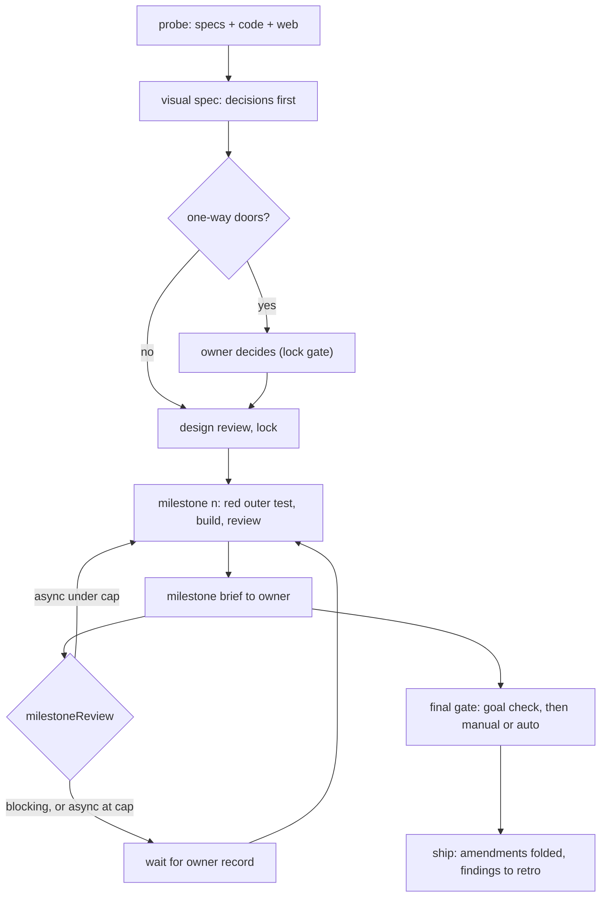
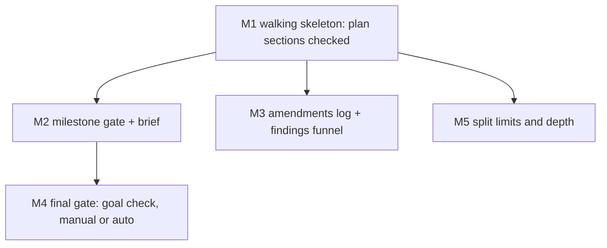

# The agentic loop: research, a visual spec, milestones the owner checks, a configurable final gate

## Decisions (one-way doors, owner to decide before lock)

| # | Decision | Recommended | Alternatives | Why it is hard to reverse |
|---|---|---|---|---|
| D-A | How a spec changes after lock | frozen original + append-only **Amendments** log (classed fix-now / hold / rejected) + the capability `SPEC.md` as the folded current view | D37 in-place edits with a Build amendments table (today) | every later spec, gate rule and reviewer reads this format |
| D-B | Where per-project switches live | one manifest per repo, `catalog-info.yaml` (already approved, Backstage format), owner-only | `.claude/gates.json`; keys in CLAUDE.md | Foreman, Catwalk, the gate and the brief all read it |
| D-C | Default milestone review | pre-traffic: `async`, at most 1 unreviewed milestone; `live`: `blocking` | blocking everywhere; async without a cap | sets how long agents wait on the owner fleet-wide |
| D-D | Default final gate | pre-traffic: `auto` (goal check + health check, reusing Foreman's `full` autonomy); `live`: `manual`, always | manual everywhere | decides what ships without a human |
| D-E | Background sections | a visible one-line summary per pattern, detail collapsed; owner preference `background: expanded` available | expanded by default | every spec's layout |
| D-F | Split limits and depth | 15 ACs, 5 milestones, 5 scopes per milestone, 4 parallel agents, 400 changed lines per milestone; depth 2, a 3rd level only when one milestone breaks a limit, never 4 | per-project only, no defaults | every spec's size and the number of agents per build |

## Purpose

Specs today plan one change at a time with no milestones, no contracts between agents, and the owner seeing work only
at `live` deploys. The owner wants to steer the design, check each milestone, and set per project how much the loop
may do unattended (owner design, `evidence/owner-design.md`, O-1..O-20).

## Goals and non-goals

- Goal: a T2 spec carries one-way-door decisions, an alternatives table, a milestone dependency chart, contracts and
  an outer test per milestone, all checked.
- Goal: the loop pauses for the owner exactly where the per-project manifest says, and never auto-accepts.
- Goal: review findings stay as a visible history and reach the retro and self-improvement loops as tracked items.
- Goal: large specs split by default limits that a project can change.
- Non-goal: T1 and bugfix items (no milestones, no owner design review).
- Non-goal: rebuilding Catwalk's Review Queue UI (it exists; owner-gated UI work) or `cycle.js` (`stage-trace`).

## Background

- **Walking skeleton**: the first milestone is the thinnest end-to-end path that runs, so integration risk shows on day one.
- **Vertical slice**: every milestone delivers something usable through all layers, never one layer at a time.
- **Contract-first**: agents that build different parts agree on a versioned schema with example fixtures before coding.
- **Double-loop TDD**: one outer acceptance test per milestone drives many inner unit tests.
- **One-way and two-way doors**: decide only the irreversible choices early; log the rest as defaults.
- **Ship / Show / Ask**: building on in-review work is fine when the amount waiting for review is capped.
- **Append-only log with a current view**: history is never edited; a separate view shows the state now.
- **Canary gate**: automatic deploys stay safe only when health checks can stop and roll them back.
- **Pugh matrix**: alternatives scored +, 0 or - against a baseline, no weighted total.

Detail and sources for each pattern

- Walking skeleton: Cockburn, Crystal Clear (2004); Shape Up ch. 11-13 (2019): scopes are integrated slices found
  while building; revise the chart after the skeleton.
- Contract-first: Pact consumer-driven contracts; MAST (arXiv 2503.13657, 2025): 32% of multi-agent failures are
  misalignment between agents; Claude Code agent teams: two agents on one file overwrite each other.
- Double-loop TDD: Freeman and Pryce, GOOS (2009); Google (2016): about 16% of tests show some flakiness, so the full
  end-to-end suite runs once, at the final gate.
- Doors: Bezos letters 2015/2016; Poppendieck (2003) last responsible moment.
- Ship/Show/Ask: Wilsenach, martinfowler.com (2021-09-08).
- Append-only: Nygard ADRs (2011); IETF errata (readers who skip errata read wrong text); event sourcing snapshots.
- Canary: Google SRE workbook, canarying releases; GitHub/GitLab environments: the deployer never approves.
- Pugh: Hazelrigg on false precision of weighted scores.
- Full notes: `D:/repo/docs/research_notes/Agentic loop design/`.

## Approach

Baseline: today's v3 (no milestones, the owner sees work at `live` only). Scores are +, 0 or - against the
baseline; each cell names its scenario.

| Dimension | A: owner's design as written | B: recommended (A with the probe's changes) | C: heavy plan docs per milestone (Spec Kit style) |
|---|---|---|---|
| Owner time | - every spec reviewed | 0 one-way doors and milestone briefs only | - long plan documents to read |
| Agent cost (stages, tokens) | - unit + integration + e2e per milestone | 0 one outer test + contract tests per milestone | - 2,577 lines of markdown for 689 of code (Scott Logic) |
| Latency to ship | - blocking reviews everywhere | + async with a cap on pre-traffic | - |
| Defect escape | + | + goal check at the final gate (MAST: 15.6% of failures) | 0 prose not executed |
| Reversibility | - every decision front-loaded | + only one-way doors front-loaded | - |
| Security and privacy | 0 | + the builder never passes its own gate | 0 |
| Operability | 0 | + auto-deploy needs a health check | 0 |
| Build complexity | 0 | - manifest, milestone gate, brief, amendments | - |

Chosen: **B**. Its cost is the build complexity; the milestones below keep each piece small.

## Milestones

| Milestone | Slice (what works after it) | Depends on | Owns | Outer test (red first) | Unblocks |
|---|---|---|---|---|---|
| M1 | a T2 spec with Decisions, Milestones and Contracts passes the checker; this spec checks itself | - | `scripts/spec_v3.py`, `contracts/work-item.v3.json` | AC-1 | every T2 spec can carry a checked plan |
| M2 | the manifest is read; a milestone waits for the owner per the manifest; the brief reaches Catwalk and TeleFi | M1 | `scripts/manifest.py`, `scripts/milestone_brief.py`, `scripts/spec_gate.py` | AC-4 | the owner checks each milestone |
| M3 | after lock only the Amendments log grows; hold rows reach the retro queue; `/retrospect` reads it | M1 | `scripts/amendments.py`, `skills/retrospect/` | AC-7 | spec history and the improvement loop |
| M4 | ship needs a goal-check record, then an owner record (manual) or a green health check (auto) | M2 | `scripts/review_record.py`, `agents/goal-checker.md` | AC-9 | unattended ship on pre-traffic, safe |
| M5 | the checker flags a spec past the limits and refuses depth over 3 | M1 | `scripts/spec_split.py` | AC-11 | large specs split by rule |

M3 and M5 can run in parallel with M2 (no shared paths). The chart is revised after M1.

## Contracts

| Name | Version | Schema | Fixtures |
|---|---|---|---|
| plan sections (Decisions, Milestones, Contracts tables) | v3.1 | `contracts/work-item.v3.json` | `contracts/fixtures/plan-valid.md`, `plan-invalid-*.md` |
| per-project manifest | v1 | `contracts/project-manifest.v1.json` | `contracts/fixtures/manifest-*.yaml` |
| milestone brief | v1 | `contracts/milestone-brief.v1.json` | `contracts/fixtures/brief-*.json` |
| review record kinds `milestone`, `goal`, `owner-decision` | review-record v2 | `contracts/review-record.v2.json` | `contracts/fixtures/record-*.md` |

## Behaviour

| AC | Traces | Given / when | Pass when | Fail when | Test |
|---|---|---|---|---|---|
| AC-1 | M1, O-4..O-11 | this README and a fixture T2 spec with Decisions, Milestones and Contracts in the exact shapes | both pass the checker | either is refused, or a malformed one passes | tests/test_agentic_loop.py |
| AC-2 | M1, O-8, O-9 | fixtures: a milestone without an outer test; a Depends-on cycle or unknown id; two milestones without a dependency owning one path; a contract whose schema or fixture is missing | each refused, the rule named | any lands | tests/test_agentic_loop.py |
| AC-3 | M2, O-13, O-15 | manifests: valid; missing; an unknown value; a `live` repo saying `auto` | valid read; missing gives the D-C/D-D defaults; unknown refused by name; `live` read as `manual` and `blocking` | a default is unsafe, or a bad value is silently used | tests/test_agentic_loop.py |
| AC-4 | M2, O-12, O-13 | a milestone moving to `building` while unreviewed done milestones are at the cap (blocking = cap 0); then after an owner `milestone` record | refused naming the waiting milestone; lands after the record | it lands at the cap, or is refused under it | tests/test_agentic_loop.py |
| AC-5 | M2, security | an owner `milestone` record written by the builder's identity, or for other content | refused | it counts | tests/test_agentic_loop.py |
| AC-6 | M2, O-12 | a milestone moves to done | a brief validating against the brief contract exists with the six parts (now, evidence, what broke, cost vs cap, assumed decisions, next) and is queued for Catwalk and TeleFi | missing, invalid, or a part absent | tests/test_agentic_loop.py |
| AC-7 | M3, O-16 | a locked spec: an edit above `## Amendments`; an appended row without a class, finding or source record; a fix-now row without a test | each refused by name; a well-formed appended row lands | any lands, or a well-formed row is refused | tests/test_agentic_loop.py |
| AC-8 | M3, O-17 | a ship with `hold` rows; a finding class seen twice | each hold row becomes a RETRO-QUEUE row with owner and source; `/retrospect` lists them; the repeat proposes a failing test or eval | a hold row is lost, or `/retrospect` ignores the queue | tests/test_agentic_loop.py |
| AC-9 | M4, O-14 | a ship without a `goal` record; with one written by the builder; with a fresh independent one | refused, refused, lands | otherwise | tests/test_agentic_loop.py |
| AC-10 | M4, O-15 | `finalGate: manual` without an owner record; `auto` with the health-check command red, then green; a `live` repo set to `auto` | refused; refused then lands; treated as manual | otherwise | tests/test_agentic_loop.py |
| AC-11 | M5, O-19, O-20 | specs with 16 ACs, 6 milestones, a child of a child of a child; a manifest raising the limits | each refused naming the limit; the raised limits apply | a limit is ignored | tests/test_agentic_loop.py |
| AC-12 | O-5, O-3 | a T2 lock whose Decisions table has rows, without and with an owner `owner-decision` record; a T2 without rows | refused, lands, lands on the design record | otherwise | tests/test_agentic_loop.py |
| AC-13 | compatibility | every v2 item and every shipped v3 item in the fleet | judged exactly as before | any result changes | tests/test_agentic_loop.py |
| AC-14 | O-18, docs | SPEC-STANDARD-V3.md, agents/implementer.md, agents/reviewer.md, DEVELOPMENT_LIFECYCLE.md | each states the loop: one milestone at a time, owned paths only, contracts change only through the planner, amendments appended | a doc contradicts the code | tests/test_agentic_loop.py |

## Outcomes

| Dimension | Level | Row or n/a reason | AC |
|---|---|---|---|
| success | L3 | a planned T2 spec runs milestone by milestone to ship | AC-1 |
| invalid input | L3 | malformed plans, manifests and amendment rows are refused by name | AC-2 |
| dependency fails | L3 | a missing manifest falls back to safe defaults | AC-3 |
| timeout | L3 | an owner who never reviews blocks the loop at the cap; nothing auto-accepts | AC-4 |
| crash mid-step | L1 | the checker and gate are pure functions over one commit, so a crash refuses that commit | |
| concurrent actor | L3 | two milestones owning one path cannot run in parallel | AC-2 |
| duplicate or replay | L3 | an owner record for other content does not count | AC-5 |
| arrival channel | L3 | merges and squashes carry milestone moves through the same rules | AC-13 |
| performance or cost | L3 | each brief reports stages used against the cap | AC-6 |
| security | L3 | the builder never writes an owner or goal record | AC-9 |
| data and compatibility | L3 | existing v2 and v3 items are judged unchanged | AC-13 |
| operability | L3 | auto-deploy needs a green health check | AC-10 |

## Assumptions

| Assumption | Observed | If violated |
|---|---|---|
| Foreman's autonomy ladder can serve as `finalGate` | `D:/repo/Factory/foreman/core/repos.js:290` | flag: M4 maps manual and auto onto the ladder; a gap is logged before M4 starts |
| Catwalk's Review Queue confirm API can write an owner record | `D:/repo/docs/research_notes/Agentic loop design/internal_survey.md:1` | defer: until it can, owner records are written with the CLI only |
| `/retrospect` can read the retro queue | `C:/Users/Michael/.claude/skills/retrospect/SKILL.md:13` | refuse: M3 does not ship until `/retrospect` reads the queue |

## Probe

[Probe and critique](evidence/probe.md), from the owner's words in [owner-design.md](evidence/owner-design.md).
