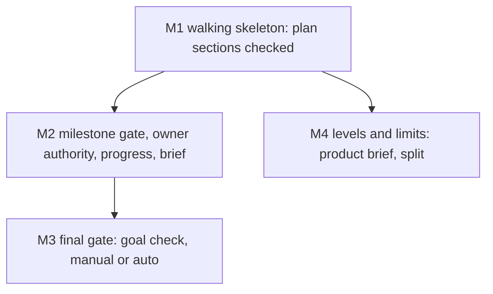

# The agentic loop: research, a visual spec, milestones the owner checks, a final gate set by project profile

Companion spec: `docs/work/feedback-loop/` (split by this spec's own limit of 5 milestones). Build order across the
three specs, the owner of each shared file and the cross-spec contracts: [INDEX](../../capabilities/INDEX.md).

## Decisions (one-way doors)

| # | Decision | Status | Choice | Alternatives | Why it is hard to reverse |
|---|---|---|---|---|---|
| D-A | How a spec changes after lock | **confirmed** (owner 2026-11-03, D43) | frozen original + append-only Amendments log + folded current view; built by `feedback-loop` | D37 in-place edits | every spec, gate rule and reviewer reads this format |
| D-B | Where per-project switches live | **confirmed, expanded** (owner 2026-11-03, D45): one source of truth for every config and core fact, built by spec `project-manifest` | one owner-only manifest per repo, `catalog-info.yaml` (approved, unbuilt) | `.claude/gates.json`; CLAUDE.md keys | Foreman, Catwalk, the gate and the brief all read it |
| D-C | What sets the loop's caution | **confirmed** (owner 2026-11-03, D44): cashcow `revenue`, every other repo `yolo` | a project **profile** in the manifest: `yolo`, `public` or `revenue` (table below); defaults follow the profile | one default for all; `deploymentTier` alone | every gate default in every repo |
| D-D | Final gate per profile | **confirmed** (owner 2026-11-03, D44) | `yolo`: auto (goal check + health check); `public` and `revenue`: manual | manual everywhere | what ships without a human |
| D-L | Who may write owner-kind records | open, recommended (AL-1) | `milestone-approval`, `owner-decision` and `final-approval` cannot be written by any agent tool call: the guard denies subagents AND the main session for the record paths and for `review_record.py approve`; the owner writes them only with their own `!` command (Catwalk and TeleFi approve actions come later, as child items in those repos); `goal` records come only from a goal-checker agent that is not the implementer | a signed owner record (ssh signature; needs key setup, stronger); the free `reviewer` string (today); Catwalk Confirm alone | every gate, cap and profile default trusts these records; changing the authority later orphans the records written under it |

### Profiles (D-C, D-D)

| Profile | Who is exposed | Values | Milestone review | Final gate | Also |
|---|---|---|---|---|---|
| `yolo` | the owner only (pre-revenue, internal) | speed | async, at most 2 unreviewed | auto: a fresh independent `goal` record that quotes a green health check | design review only where the tier requires it |
| `public` | public users, no money | security, stability | async at most 1; blocking for a milestone with a security or data flag | manual: owner `final-approval` | `security` forced to L3 in every T2; security reviewer on every T2; full end-to-end suite and a canary before release |
| `revenue` | paying users, payments or PII (today's `live`) | security, stability, data | blocking (cap 0) | manual: owner `final-approval` | flag `live` derived; security reviewer on every T2 and flagged bugfix; a rollback plan in the spec |

`deploymentTier` is derived from the profile and Foreman autonomy follows it (INDEX map: `yolo` pre-traffic and full;
`public` and `revenue` live and label-gated). A repo that never had a manifest reads CLAUDE.md as today (A-3); once
HEAD has a manifest, a missing or invalid one refuses lock, ship and deploy, and a staged profile below HEAD's needs
an owner `owner-decision` record (project-manifest AC-7, AC-13). **Unreviewed** (= waiting) means a milestone that is
done but has no owner `milestone-approval` record; it is derived from records, never from a README column.

## Assumed defaults (reversible, listed for the owner's review)

| # | Default | Why assumed | Revisit when |
|---|---|---|---|
| A-1 (was D-E) | Background: a visible one-line summary per pattern, detail collapsed; `background: expanded` in the manifest opens everything | owner: not a one-way door (2026-11-03) | the owner opens most collapsed sections |
| A-2 (was D-F) | The limits in the table below are starting values, not measured optima; a project overrides them in its manifest `limits`, and one item overrides them in its frontmatter `limits:` with a `why`; every milestone brief reports actual against limit | owner: no accurate estimate yet, keep it reversible and tunable (2026-11-03) | five items per tier have reported actuals |
| A-3 | A repo that never had a manifest takes its profile from CLAUDE.md `deploymentTier` (pre-traffic `yolo`, live `revenue`); a repo that had one never falls back | the fallback exists only where no manifest was ever committed | `project-manifest` P4 migrates every repo |

### Levels and limits for large projects (A-2)

A document holds at most two levels; scale grows sideways (more capabilities) and up (one thin product brief), never
deeper inside a spec.

| Level | Document | Holds | Limit, then |
|---|---|---|---|
| Product | `docs/capabilities/INDEX.md` as a product brief (claudence's own: [INDEX](../../capabilities/INDEX.md)) | vision, capability map, cross-capability contracts, release milestones; links, no ACs | 9 capabilities, then group into domains |
| Domain (only past 9 capabilities) | `docs/capabilities/<domain>/INDEX.md` | the same shape for its capabilities | 9 capabilities each |
| Capability | `docs/capabilities/[<domain>/]<name>/SPEC.md` | current truth: ACs, outcomes, owned paths, timeline | 40 current ACs or 200 lines, then split the capability |
| Change | `docs/work/<id>/README.md` | one change: decisions, milestones, contracts, ACs | 15 ACs, 5 milestones, 5 scopes and about 400 changed lines per milestone, 4 parallel agents |
| Child change | `docs/work/<id>/` with `parent:` | one milestone that broke a limit | never nests again |

Complexity class: **S** is one capability (a change spec alone), **M** is 2-9 capabilities (a product brief),
**L** is 10 or more (domains). Worked example, a Tarive rebuild: [levels-example.md](evidence/levels-example.md).

## Purpose

Specs today plan one change at a time with no milestones, no contracts between agents, and the owner seeing work only
at `live` deploys. The owner wants to steer the design, check each milestone, and set per project how much the loop
may do unattended, from a single change up to a large application (owner design, `evidence/owner-design.md`).

## Goals and non-goals

- Goal: a T2 spec carries one-way-door decisions, an alternatives table, a milestone chart, contracts and an outer
  test per milestone, all checked.
- Goal: the loop pauses for the owner exactly where the project profile says, and never auto-accepts.
- Goal: large projects decompose into a product brief, capabilities and changes within fixed limits.
- Non-goal: amendments, escape trace-back and retro feedback (spec `feedback-loop`).
- Non-goal: T1 and bugfix items; Catwalk UI work (owner-gated); `cycle.js` (`stage-trace`).

## Background

- **Walking skeleton**: the first milestone is the thinnest end-to-end path that runs, so integration risk shows on day one.
- **Vertical slice**: every milestone delivers something usable through all layers, never one layer at a time.
- **Contract-first**: agents that build different parts agree on a versioned schema with example fixtures before coding.
- **Double-loop TDD**: one outer acceptance test per milestone drives many inner unit tests.
- **One-way and two-way doors**: decide only the irreversible choices early; log the rest as defaults.
- **Ship / Show / Ask**: building on in-review work is fine when the amount waiting for review is capped.
- **Canary gate**: automatic deploys stay safe only when health checks can stop and roll them back.
- **Pugh matrix**: alternatives scored +, 0 or - against a baseline, no weighted total.
- **C4 levels**: context, container, component, code; most teams need only the first two documented.

Detail and sources for each pattern

- Walking skeleton: Cockburn, Crystal Clear (2004); Shape Up ch. 11-13 (2019): revise the chart after the skeleton.
- Contract-first: Pact; MAST (arXiv 2503.13657, 2025): 32% of multi-agent failures are misalignment between agents;
  Claude Code agent teams: two agents on one file overwrite each other; 3-5 agents.
- Double-loop TDD: Freeman and Pryce, GOOS (2009); Google (2016): about 16% of tests are flaky, so the full
  end-to-end suite runs once, at the final gate.
- Doors: Bezos letters 2015/2016; Poppendieck (2003). Ship/Show/Ask: Wilsenach, martinfowler.com (2021-09-08).
- Canary: Google SRE workbook; GitHub/GitLab environments: the deployer never approves. Pugh: Hazelrigg on false
  precision of weighted scores.
- C4: c4model.com ("context and container diagrams are sufficient for most teams"); arc42; OpenSpec and the Spec Kit
  domain extension group capabilities into domains.
- Full notes: `D:/repo/docs/research_notes/Agentic loop design/` and `.../Spec folder structure/`.

## Approach

Baseline: today's v3 (no milestones, the owner sees work at `live` only). Scores are +, 0 or - against the
baseline; each cell names its scenario.

| Dimension | A: owner's design as written | B: recommended (A with the probe's changes) | C: heavy plan docs per milestone (Spec Kit style) |
|---|---|---|---|
| Owner time | - every spec reviewed | 0 one-way doors and milestone briefs only | - long plan documents to read |
| Agent cost (stages, tokens) | - unit + integration + e2e per milestone | 0 one outer test + contract tests per milestone | - 2,577 lines of markdown for 689 of code (Scott Logic) |
| Latency to ship | - blocking reviews everywhere | + async where the profile allows | - |
| Defect escape | + | + goal check at the final gate (MAST: 15.6% of failures) | 0 prose not executed |
| Reversibility | - every decision front-loaded | + only one-way doors front-loaded | - |
| Security and privacy | 0 | + the builder never passes its own gate; `public` and `revenue` add the security reviewer | 0 |
| Operability | 0 | + auto-deploy needs a health check | 0 |
| Scale to large apps | - no levels | + product, capability, change, fixed limits | 0 numbered folders, no current state |
| Build complexity | 0 | - manifest, milestone gate, brief, levels | - |

Chosen: **B**. Its cost is the build complexity; the milestones below keep each piece small.

## Milestones

The table is the plan only (no Status column, no color classes). Build order and file owners: INDEX.

| Milestone | Slice (what works after it) | Depends on | Owns | Outer test (red first) | Unblocks |
|---|---|---|---|---|---|
| M1 | a T2 spec with Decisions, Milestones and Contracts passes the checker; this spec checks itself | PM-P1 (spec_v3.py order) | `scripts/spec_v3.py`, `contracts/work-item.v3.json` | AC-1 | every T2 spec can carry a checked plan |
| M2 | owner-kind records exist and only the owner can write them; a source commit on a milestone spec is gated by records; progress and the brief are generated and reach Catwalk and TeleFi | M1, PM-P1 (reads `scripts/manifest.py`) | `scripts/spec_v3.py`, `scripts/spec_gate.py`, `scripts/review_record.py`, `contracts/review-record.v1.json`, `hooks/guard.py`, `scripts/progress.py`, `scripts/milestone_brief.py`, `contracts/progress-status.v1.json`, `contracts/milestone-brief.v1.json` | AC-4 | the owner checks each milestone |
| M3 | the final gate (ship edge and deploy promote) needs a `goal` record, then an owner `final-approval` (manual) or a green health check inside the goal record (auto) | M2 | `scripts/final_gate.py`, `scripts/spec_gate.py`, `scripts/review_record.py`, `contracts/review-record.v1.json`, `hooks/guard.py`, `skills/deploy-web/SKILL.md`, `agents/goal-checker.md`, `agents/implementer.md`, `agents/reviewer.md` | AC-9 | unattended ship on `yolo` repos, safely |
| M4 | the checker reads the product brief and domains, refuses a spec or index past its limits or depth | M1, capability layer | `scripts/spec_levels.py` | AC-11 | large projects decompose by rule |

### Gates on real work (AL-2)

- A milestone is **done** when a `milestone` record (verdict `pass`: the reviewer ran its outer test green) names it by
  `milestone: M<n>` and a commit; **waiting** when done with no owner `milestone-approval`. Source commits on a
  milestone spec (an item with a Milestones table) carry a `Milestone: M<n>` trailer beside `Spec:`.
- The gate refuses a source commit while the item's waiting count is at the profile cap (blocking: while any other
  milestone waits), when the trailer is missing or unknown, or when a dependency is not done. A commit naming a
  waiting milestone is rework, allowed only inside that milestone's Owns.
- The final gate controls the `building` to `shipped` edge, the `deploy-web` promote step (both call `final_gate.py`)
  and Foreman auto-merge (label-gated for `public` and `revenue`; a Foreman child item adopts it). A host that
  auto-deploys on push for such a repo bypasses all three: the drift check of `project-manifest` reports it; it must be off.

### Progress and status (AL-3)

Two measures: **spec readiness** (ready checks passed over applicable ones) and **implementation progress** (per AC:
no test, red, green, reviewed; per milestone: green ACs over its ACs). Progress is generated, never edited:
`scripts/progress.py` writes `evidence/progress.json` and `evidence/progress.md` from the records, the `Milestone:`
trailers and the last recorded test run per AC. `evidence/` is outside the content hash (regenerating makes no record
stale) and outside the README (the feedback-loop freeze never refuses it); no gate reads it. One source for statuses,
symbols and colors, `contracts/progress-status.v1.json`: planned ○ grey, blocked ⊘ red outline, building ◐ blue,
review ◔ amber, owner ⏸ purple (done, waiting), done ● green (approved), failed ✕ red, killed ⨯ black; each shows
symbol and word. Shown in `evidence/progress.md`, `spec_status` and each brief; sample:
[progress-sample.md](evidence/progress-sample.md). M4 runs in parallel with M2 and M3 (no shared paths) and needs the
capability layer; the chart is revised after M1.

## Contracts

| Name | Version | Schema | Fixtures |
|---|---|---|---|
| plan sections (Decisions, Milestones, Contracts tables) | v3.1 | `contracts/work-item.v3.json` | `contracts/fixtures/plan-valid.md`, `plan-invalid-*.md` |
| per-project manifest and profiles (defined by `project-manifest`, read through `scripts/manifest.py`) | v1 | `contracts/project-manifest.v1.json` | `contracts/fixtures/manifest-*.yaml` |
| milestone brief | v1 | `contracts/milestone-brief.v1.json` | `contracts/fixtures/brief-*.json` |
| review record kinds `milestone`, `milestone-approval`, `owner-decision`, `final-approval` (M2), `goal` (M3); optional `milestone` field: an extension of v1, no v2 file, old records stay valid | v1 | `contracts/review-record.v1.json` | `contracts/fixtures/record-*.md` |
| progress statuses: enum, symbol, color, meaning | v1 | `contracts/progress-status.v1.json` | `contracts/fixtures/progress-*.json` |
| product brief and domain index | v1 | `contracts/product-brief.v1.json` | `contracts/fixtures/brief-index-*.md` |

Signatures: `review_record.py approve --item ID --kind <owner kind> [--milestone M<n>] --report FILE` (owner `!`
only); `progress.milestone_states(tree, item) -> dict[str, Status]`; `spec_gate.cap_problem(tree, item, milestone,
profile) -> str | None`; `final_gate.final_gate_problem(tree, item, profile) -> str | None`;
`guard.review_authority_problem(event) -> str | None`.

## Behaviour

| AC | Traces | Given / when | Pass when | Fail when | Test |
|---|---|---|---|---|---|
| AC-1 | M1, AL-3 | this README and a fixture T2 spec with Decisions, Milestones (no Status column) and Contracts in the exact shapes; a fixture with a Status column or a `classDef`/`class` line in the Milestones chart | both exact shapes pass the checker; the Status column and the class lines are refused, naming that progress is generated | either exact shape is refused, a malformed one passes, or a Status column lands | tests/test_agentic_loop.py |
| AC-2 | M1 | fixtures: a milestone without an outer test; a Depends-on cycle or unknown id; two milestones without a dependency owning one path; a contract whose schema or fixture is missing | each refused, the rule named | any lands | tests/test_agentic_loop.py |
| AC-3 | M2, D-C | manifests: each profile; a repo that never had one (pre-traffic and live); one that had one at HEAD and lost it; an unknown value; HEAD `revenue` with a staged `yolo` | each profile's defaults apply; never-had gives `yolo` or `revenue` by CLAUDE.md tier; lost refuses (project-manifest AC-7); unknown refused by name; the lowering needs an owner `owner-decision` (project-manifest AC-13) | a default is unsafe, a bad value is silently used, or a lost manifest falls back | tests/test_agentic_loop.py |
| AC-4 | M2, AL-2 | an item at the profile cap of waiting milestones (`revenue`: any); source commits with `Milestone: M<n>`: none, unknown, a dependency not done, another milestone, the waiting one inside and outside its Owns; then after an owner `milestone-approval`; a hand-edited `evidence/progress.json` | each refused naming the rule and the waiting milestone; rework inside Owns lands; another milestone lands after the approval; the edited progress file changes nothing | a commit lands at the cap, or a file the builder writes opens the gate | tests/test_agentic_loop.py |
| AC-5 | M2, D-L | guard events from a subagent (with `agent_id`) and from the main session (without): Edit/Write and shell writes on `docs/work/<id>/reviews/*`; `review_record.py approve`; `review_record.py write --kind milestone-approval`; then `approve` run directly as the owner; a record for another commit or milestone | each agent attempt denied by the guard and the CLI refuses owner kinds in `write`; the direct `approve` writes a record that counts; the record for other content does not | any agent path writes an owner-kind record, or a record for other content counts | tests/test_agentic_loop.py |
| AC-6 | M2, AL-3 | a milestone moves to done; `progress.py` and `spec_status` run on a repo with specs mid-build; the progress files regenerated | `evidence/progress.json` and `.md` validate against their contracts and an unknown status is refused; regenerating leaves the content hash and every record fresh; a brief validating against its contract has six parts (now, evidence, what broke, cost vs cap, assumed decisions, next), opens with the progress line and is queued for Catwalk and TeleFi | a file is missing or invalid, a record goes stale, or a count disagrees with the records | tests/test_agentic_loop.py |
| AC-7 | M2, D-C | a `public` repo: a T2 spec with `security` below L3, or without a security review record at lock | each refused by name | either lands | tests/test_agentic_loop.py |
| AC-8 | M2, D-C | a `revenue` repo: a T2 spec without a rollback plan; a flagged bugfix without a security review record | each refused by name | either lands | tests/test_agentic_loop.py |
| AC-9 | M3, D-L | a ship without a `goal` record; with one written from the main session or by the implementer's identity; with a fresh one from the goal-checker identity | refused, denied by the guard, lands | otherwise | tests/test_agentic_loop.py |
| AC-10 | M3, D-D, AL-2 | the ship edge and the `deploy-web` promote step: `yolo` with a goal record quoting a red health check, then green; `public` or `revenue` without, then with, an owner `final-approval`; the effective config of a `revenue` repo; a `revenue` drift fixture with host auto-deploy on | refused then lands at both channels in every case; autonomy reads label-gated; the drift check reports the host auto-deploy | a channel opens without its record, or the host auto-deploy is missed | tests/test_agentic_loop.py |
| AC-11 | M4, A-2 | a change with 16 ACs or 6 milestones; a child of a child; a product brief with 10 capabilities and no domains; a capability SPEC.md over 200 lines; a manifest raising a limit | each refused naming the limit and the split to make; the raised limit applies | a limit is ignored | tests/test_agentic_loop.py |
| AC-12 | D-B, D-L | a T2 lock whose Decisions table has open rows: with no `owner-decision` record; with one written by an agent tool call (guard denied); with one the owner wrote through `approve` for the current content; with one for older content; a T2 without open rows | refused, denied, lands, refused, lands on the design record | otherwise | tests/test_agentic_loop.py |
| AC-13 | compatibility | every v2 item and every shipped v3 item in the fleet, and the records on disk | judged exactly as before | any result changes | tests/test_agentic_loop.py |
| AC-14 | docs | SPEC-STANDARD-V3.md, agents/implementer.md, agents/reviewer.md, DEVELOPMENT_LIFECYCLE.md | each states the loop: one milestone at a time, owned paths only, contracts change only through the planner, the profile table | a doc contradicts the code | tests/test_agentic_loop.py |
| AC-15 | A-2 | a project manifest raising one limit; an item's frontmatter `limits:` with and without a `why`; a milestone brief | the project limit applies; the item override applies only with a `why`, refused without; the brief shows actual against limit | an override is silently ignored or applied without a reason | tests/test_agentic_loop.py |

## Outcomes

| Dimension | Level | Row or n/a reason | AC |
|---|---|---|---|
| success | L3 | a planned T2 spec runs milestone by milestone to ship | AC-1 |
| invalid input | L3 | malformed plans, manifests and indexes are refused by name | AC-2 |
| dependency fails | L3 | a repo that never had a manifest reads its tier; one that lost its manifest is refused | AC-3 |
| timeout | L3 | an owner who never reviews blocks the loop at the cap; nothing auto-accepts | AC-4 |
| crash mid-step | L1 | the checker and gate are pure functions over one commit, so a crash refuses that commit | |
| concurrent actor | L3 | two milestones owning one path cannot run in parallel | AC-2 |
| duplicate or replay | L3 | an owner record for other content or another commit does not count | AC-5 |
| arrival channel | L3 | the gate judges the commit being created (commit, amend, squash, cherry-pick) from its trailer and HEAD's records; a merge is judged as today | AC-4 |
| performance or cost | L3 | each brief reports stages used against the cap | AC-6 |
| security | L3 | no agent tool call writes an owner record; `goal` records come only from the goal-checker | AC-5 |
| data and compatibility | L3 | existing v2 and v3 items and records are judged unchanged | AC-13 |
| operability | L3 | every final-gate channel needs its record; host auto-deploy is reported | AC-10 |

## Assumptions

| Assumption | Observed | If violated |
|---|---|---|
| Foreman's autonomy ladder can serve as the final gate | `D:/repo/Factory/foreman/core/repos.js:290` | flag: M3 maps manual and auto onto the ladder; a gap is logged before M3 starts |
| Catwalk's Confirm writes STATE.md, not a review record | `D:/repo/docs/research_notes/Agentic loop design/internal_survey.md:131` | defer: owner records are written only by the owner's own `!` command until the Catwalk and TeleFi child items exist |
| PM-P1 ships `scripts/manifest.py` before M2 | `C:/Users/Michael/.claude/docs/capabilities/INDEX.md:34` | defer: M2 waits for PM-P1 |
| The capability layer exists before M4 | `D:/repo/docs/reports/2026-11-03 Spec structure proposal.md:31` | defer: M4 waits; M1-M3 do not need it |
| The owner's `!` commands do not pass through PreToolUse, so the guard denies agents without denying the owner; M2's probe verifies it | `C:/Users/Michael/.claude/hooks/guard.py:397` | refuse: M2 does not ship; owner records then need the signed alternative of D-L |
| The hook event names the writer's agent only by `agent_id`, not its type; M3's probe finds an identity source for the goal-checker | `C:/Users/Michael/.claude/hooks/guard.py:401` | refuse: without one, `goal` records are owner-written through `approve` and the auto final gate stays off |

## Design fix round 1

Fixed (record `reviews/2026-11-03-design-87771700.md`): AL-1, AL-2, AL-3, AL-4. In passing: AL-5, AL-6, AL-8, AL-9.

## Probe

[Probe and critique](evidence/probe.md), from the owner's words in [owner-design.md](evidence/owner-design.md).
