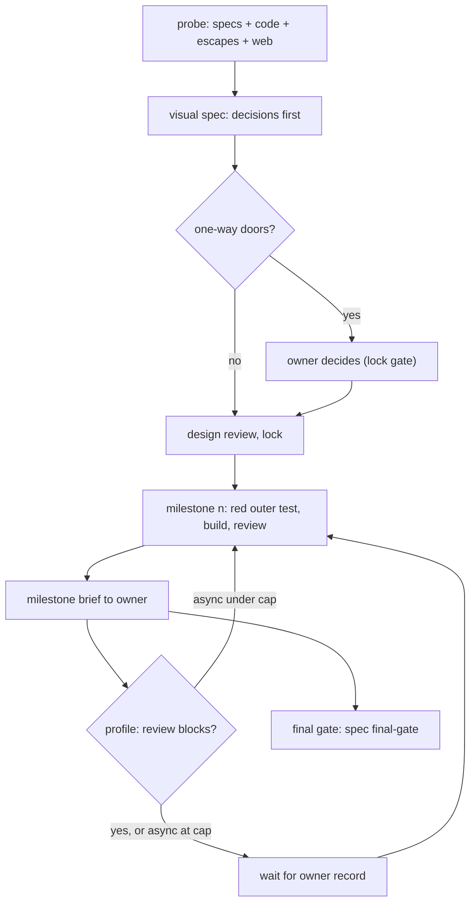
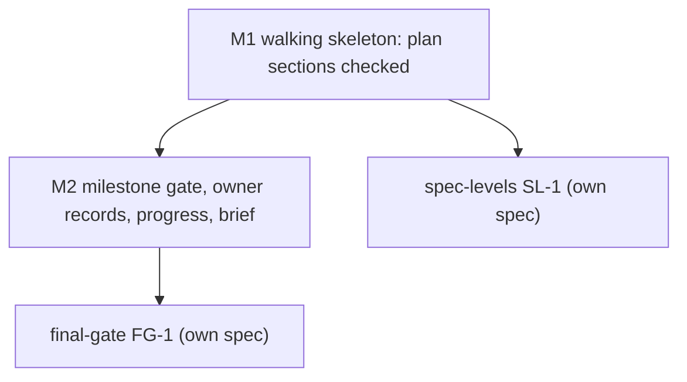

# The agentic loop: a visual spec, milestones the owner checks, caution set by project profile

Companion specs: `docs/work/feedback-loop/` (amendments, escapes, retro), `docs/work/final-gate/` (the final gate and
the deploy promote, moved out of this item as M3) and `docs/work/spec-levels/` (levels and limits, moved out as M4);
see the Scope cut below. Build order across the specs, the owner of each shared file and the cross-spec contracts:
[INDEX](../../capabilities/INDEX.md).

## Scope cut (2026-11-03)

The third review round (record `reviews/2026-11-04-verify-052d2ae8.md`) found one breaking gap, finding 1, and it lay
entirely in M3: the deploy judge was item-scoped while a deploy ships the whole repo tip. The minimal first build
needs only M1 and M2 (`D:/repo/docs/reports/2026-11-03 Loop first build proposal.md:35`). So this item keeps M1 and M2
and the rest moves into two new drafts.

| Moved | To | Why |
|---|---|---|
| M3 (final gate, goal check, deploy channels): D-D, the `goal` part of D-L, old AC-9, AC-10 and the final-gate half of AC-8, seven Assumptions rows (autonomy ladder, goal-checker identity, unjudged ranges, the action boundary, the guard's string view, Foreman auto-merge, force push) and the canary pattern | `docs/work/final-gate/README.md` (FG-1) | finding 1 is fixed there with a repo-scoped span judged from the last production deploy; findings 2 and 6 (early ship edge, guard rules for hook bypass, reverts) belong to the same channels |
| M4 (levels and limits, product brief, domains): A-2, the levels table, old AC-11 and AC-15, the capability-layer assumption, the product-brief contract, the C4 pattern and `evidence/levels-example.md` | `docs/work/spec-levels/README.md` (SL-1) | M4 depends on the capability layer and shares no path with M1 or M2 |

Re-pointed Outcomes: `operability` cited old AC-10 (moved); it now cites AC-6 (the generated brief reaching Catwalk and
TeleFi is what the owner operates by in M1 and M2). `security` no longer claims the `goal` and deploy rules. Applied in
the same edit from that verify: finding 3 (the rules key on the item's Milestones table and the map profile, never on
`processes`: AC-12), finding 4 (exclusive Owns: added as AC-13, then reverted in verify round 3 because it deadlocked the build order; now a stated limit closed by final-gate) and finding 5
(`evidence/stage-catalog.md:53` now states D56). ACs renumbered: old AC-12, AC-13 and AC-14 are now AC-9, AC-10 and
AC-11.

## Decisions (one-way doors)

| # | Decision | Status | Choice | Alternatives | Why it is hard to reverse |
|---|---|---|---|---|---|
| D-A | How a spec changes after lock | **confirmed** (owner 2026-11-03, D43) | frozen original + append-only Amendments log + folded current view; built by `feedback-loop` | D37 in-place edits | every spec, gate rule and reviewer reads this format |
| D-B | Where per-project switches live | **confirmed, expanded** (owner 2026-11-03, D45): one source of truth for every config and core fact, built by spec `project-manifest` | one owner-only manifest per repo, `catalog-info.yaml` (approved, unbuilt) | `.claude/gates.json`; CLAUDE.md keys | Foreman, Catwalk, the gate and the brief all read it |
| D-C | What sets the loop's caution | **confirmed** (owner 2026-11-03, D44; cashcow is `public` since D55) | a project **profile** read from the owner-only profile map in claudence (`contracts/profile-map.v1.yaml`, project-manifest D-I), never from the repo: `yolo`, `public` or `revenue` (table below); defaults follow the profile; cashcow `public`, every other listed repo `yolo` | one default for all; `deploymentTier` alone; the profile in the repo's own manifest (every channel into the repo can rewrite it) | every gate default in every repo |
| D-L | Who may write owner-kind records | **confirmed** (owner 2026-11-03, D56) | `milestone-approval`, `owner-decision` and `final-approval` may be written by an agent on the owner's behalf when the owner gives the approval in the conversation. Each carries `recorded` (date and time, set by the script), `owner_words` (the owner's words verbatim: their reasoning, or `none given`), `channel` (`chat`, `!` or `telefi`) and `session_id`; a record missing any of them is refused and never counts. No guard rule blocks the write. Who may write a `goal` record: final-gate D-G | a guard that denies every agent write (the earlier proposal; dropped by D56); a signed owner record (ssh signature; needs key setup, stronger); the free `reviewer` string (today); Catwalk Confirm alone | every gate, cap and profile default trusts these records; the audit fields are what lets a later audit tell an approval from a forgery |

The final gate per profile (old D-D) is final-gate D-D.

### Profiles (D-C)

| Profile | Who is exposed | Values | Milestone review | Also |
|---|---|---|---|---|
| `yolo` | the owner only (pre-revenue, internal) | speed | async, at most 2 unreviewed | design review only where the tier requires it |
| `public` | public users, no money | security, stability | async at most 1; blocking for a milestone with a security or data flag | `security` forced to L3 in every T2; security reviewer on every T2 |
| `revenue` | paying users, payments or PII | security, stability, data | blocking (cap 0) | flag `live` derived; security reviewer on every T2 and flagged bugfix; a rollback plan in the spec |

`deploymentTier` is derived from the profile and Foreman autonomy follows it (INDEX map: `yolo` pre-traffic and full;
`public` and `revenue` live and label-gated). The profile is read from the owner-only profile map, never from the repo;
a repo missing from the map reads CLAUDE.md as today (A-3) until the map is `complete`, then is refused; a listed repo
with no valid manifest at the tip is refused (project-manifest AC-7). A `live` repo can never drop below `public` (D55,
project-manifest AC-13). cashcow is `public` (D55): the security reviewer on every T2 and blocking review for security
or data milestones; it becomes `revenue` when it takes money.
**Unreviewed** (= waiting) means a milestone that is done but has no owner `milestone-approval` record; it is derived
from records, never from a README column.

**What switches the rules on** (verify finding 3). The milestone rules apply to an item because its README at its lock
commit has a Milestones table, at the cap the profile map gives its repo. Nothing in the repo's `processes` flags
(project-manifest D-J) turns a rule off: `loop` governs only whether a new milestone item may be drafted and dispatched
(project-manifest P2). A `loop: off` or `loop: frozen` at the tip, or a staged README that drops the Milestones table,
leaves every rule on for an item that was locked with one (AC-12).

## Assumed defaults (reversible, listed for the owner's review)

| # | Default | Why assumed | Revisit when |
|---|---|---|---|
| A-1 (was D-E) | Background: a visible one-line summary per pattern, detail collapsed; `background: expanded` in the manifest opens everything | owner: not a one-way door (2026-11-03) | the owner opens most collapsed sections |
| A-3 | A repo missing from the profile map takes its profile from CLAUDE.md `deploymentTier` (pre-traffic `yolo`, live `revenue`, the highest caution) until the owner sets the map's `complete: true`; after that it is refused; a listed repo never falls back | the fallback exists only where the owner has not yet classified a repo | `project-manifest` P4 lists every repo and the owner sets `complete` |

A-2 (limits and levels) moved to spec-levels as its A-2; the id is kept there.

## Purpose

Specs today plan one change at a time with no milestones, no contracts between agents, and the owner seeing work only
at `live` deploys. The owner wants to steer the design, check each milestone, and set per project how much the loop
may do unattended (owner design, `evidence/owner-design.md`).

## Goals and non-goals

- Goal: a T2 spec carries one-way-door decisions, an alternatives table, a milestone chart, contracts and an outer
  test per milestone, all checked.
- Goal: the loop pauses for the owner exactly where the project profile says, and never auto-accepts.
- Goal: a milestone's commits stay inside its owned paths, and a building item's owned paths belong to it alone.
- Non-goal: amendments, escape trace-back and retro feedback (spec `feedback-loop`).
- Non-goal: the final gate, the goal check and the deploy promote (spec `final-gate`); levels, limits and the product
  brief (spec `spec-levels`); the range judge itself (`gate-ci` GC-G1).
- Non-goal: T1 and bugfix items; Catwalk UI work (owner-gated); `cycle.js` (`stage-trace`, now folded into the factory
  service, D53).

## Background

- **Walking skeleton**: the first milestone is the thinnest end-to-end path that runs, so integration risk shows on day one.
- **Vertical slice**: every milestone delivers something usable through all layers, never one layer at a time.
- **Contract-first**: agents that build different parts agree on a versioned schema with example fixtures before coding.
- **Double-loop TDD**: one outer acceptance test per milestone drives many inner unit tests.
- **One-way and two-way doors**: decide only the irreversible choices early; log the rest as defaults.
- **Ship / Show / Ask**: building on in-review work is fine when the amount waiting for review is capped.
- **Pugh matrix**: alternatives scored +, 0 or - against a baseline, no weighted total.

Detail and sources for each pattern

- Walking skeleton: Cockburn, Crystal Clear (2004); Shape Up ch. 11-13 (2019): revise the chart after the skeleton.
- Contract-first: Pact; MAST (arXiv 2503.13657, 2025): 32% of multi-agent failures are misalignment between agents;
  Claude Code agent teams: two agents on one file overwrite each other; 3-5 agents.
- Double-loop TDD: Freeman and Pryce, GOOS (2009); Google (2016): about 16% of tests are flaky, so the full
  end-to-end suite runs once, at the final gate.
- Doors: Bezos letters 2015/2016; Poppendieck (2003). Ship/Show/Ask: Wilsenach, martinfowler.com (2021-09-08).
- Pugh: Hazelrigg on false precision of weighted scores.
- Full notes: `D:/repo/docs/research_notes/Agentic loop design/`.

## Approach

Baseline: today's v3 (no milestones, the owner sees work at `live` only). Scores are +, 0 or - against the
baseline; each cell names its scenario. The table scores the whole program; the final gate and the levels are now
built by their own specs.

| Dimension | A: owner's design as written | B: recommended (A with the probe's changes) | C: heavy plan docs per milestone (Spec Kit style) |
|---|---|---|---|
| Owner time | - every spec reviewed | 0 one-way doors and milestone briefs only | - long plan documents to read |
| Agent cost (stages, tokens) | - unit + integration + e2e per milestone | 0 one outer test + contract tests per milestone | - 2,577 lines of markdown for 689 of code (Scott Logic) |
| Latency to ship | - blocking reviews everywhere | + async where the profile allows | - |
| Defect escape | + | + a reviewed outer test per milestone; the goal check in final-gate (MAST: 15.6% of failures) | 0 prose not executed |
| Reversibility | - every decision front-loaded | + only one-way doors front-loaded | - |
| Security and privacy | 0 | + the builder never passes its own gate; `public` and `revenue` add the security reviewer | 0 |
| Operability | 0 | + generated progress and a brief per milestone | 0 |
| Scale to large apps | - no levels | + levels and limits (spec-levels) | 0 numbered folders, no current state |
| Build complexity | 0 | - milestone gate, records, brief | - |

Chosen: **B**. Its cost is the build complexity; the milestones below keep each piece small.

## Milestones

The table is the plan only (no Status column, no color classes). Build order and file owners: INDEX.

| Milestone | Slice (what works after it) | Depends on | Owns | Outer test (red first) | Unblocks |
|---|---|---|---|---|---|
| M1 | a T2 spec with Decisions, Milestones and Contracts passes the checker; this spec checks itself; the standard states the plan sections | PM-P1 (spec_v3.py order) | `scripts/spec_v3.py`, `contracts/work-item.v3.json`, `skills/dark-factory/SPEC-STANDARD-V3.md` | AC-1 | every T2 spec can carry a checked plan |
| M2 | owner-kind records exist, carry the four audit fields and count only for the current content; a source commit on a milestone spec is gated by records through pure predicates (cap, trailers, dependencies, Owns) that commit-msg runs on every branch and the range judge reuses; progress and the brief are generated and reach Catwalk and TeleFi | M1, PM-P1 (reads `scripts/manifest.py` and the profile map) | `scripts/spec_v3.py`, `scripts/spec_gate.py`, `scripts/review_record.py`, `contracts/review-record.v1.json`, `scripts/progress.py`, `scripts/milestone_brief.py`, `contracts/progress-status.v1.json`, `contracts/milestone-brief.v1.json` | AC-4 | the owner checks each milestone |

### Gates on real work (AL-2)

Every rule below is a pure predicate over (commit facts, records, milestone plans, effective config) with no git call
inside: one rule set, several drivers. This item builds the rules and their commit-msg driver; the binding driver is
final-gate's (ADR 0002).

- A milestone is **done** when a `milestone` record (verdict `pass`: the reviewer ran its outer test green) names it by
  `milestone: M<n>` and a commit; **waiting** when done with no owner `milestone-approval`. Source commits on a
  milestone spec (an item whose README at its lock commit has a Milestones table) carry a `Milestone: M<n>` trailer
  beside `Spec:`.
- **Plans come from the lock.** A rule reads an item's Milestones table (ids, Depends on, Owns) from the README at the
  item's lock commit (the last commit that moved it to `spec-locked`), never from the staged or working copy, so a
  commit cannot widen its own Owns. After the lock the table changes only through feedback-loop's Amendments (D-A).
- **Rules (M2).** Refuse a source commit while the item's waiting count is at the profile cap (blocking: while any other
  milestone waits), when the trailer is missing or unknown, or when a dependency is not done. The Owns check applies to
  every `Milestone:` trailer: the commit's changed paths must lie inside that milestone's Owns, waiting or not, so a
  self-asserted trailer cannot reach outside its milestone. A commit inside a milestone's Owns after that milestone's
  `milestone` record lands as rework and the milestone reads **not done** until a new record, so its dependents are
  refused. A commit naming a waiting milestone is rework, allowed only inside that milestone's Owns.
- **Known limit: a commit citing another item can touch a milestone's files** (verify finding 4 of 2026-11-04). An
  exclusive-Owns rule was tried and reverted: it deadlocked the program build order, because an item holds its paths
  until it ships (verify 3, finding 1). The bypass is closed at deploy instead: final-gate refuses a span in which any
  source commit's item lacks a final-gate pass (final-gate D-P). Before final-gate ships, the cap is early warning.
- **Arrival (ADR 0002 channel table).** commit-msg runs these rules on every branch for a commit, an amend and a local
  `merge --squash` followed by a commit. It returns early while a merge, rebase, cherry-pick or revert is in progress
  (`spec_gate.py:341-342`); a plain cherry-pick, `revert --no-edit`, a rebase and a fast-forward run no commit-msg at
  all, and `commit -n` or `-c core.hooksPath=` skip it (verify 052d2ae8 scratch repo). Those channels reach the same
  predicates through the range judge (GC-G1) and final-gate's binding judge. Until FG-1 ships, the cap and trailer
  rules are early warning only (ADR 0002 pilot exception: claudence). A real revert stays gate-exempt at commit-msg
  (`spec_gate.py:376`); its attribution is final-gate's. A squash commit carries exactly one `Spec:` and one
  `Milestone:` trailer; commit-msg refuses a local squash with none or two.

### Progress and status (AL-3)

Two measures: **spec readiness** (ready checks passed over applicable ones) and **implementation progress** (per AC:
no test, red, green, reviewed; per milestone: green ACs over its ACs). Progress is generated, never edited:
`scripts/progress.py` writes `evidence/progress.json` and `evidence/progress.md` from the records, the `Milestone:`
trailers and the last recorded test run per AC. `evidence/` is outside the content hash (regenerating makes no record
stale) and outside the README (the feedback-loop freeze never refuses it); no gate reads it. One source for statuses,
symbols and colors, `contracts/progress-status.v1.json`: planned ○ grey, blocked ⊘ red outline, building ◐ blue,
review ◔ amber, owner ⏸ purple (done, waiting), done ● green (approved), failed ✕ red, killed ⨯ black; each shows
symbol and word. Shown in `evidence/progress.md`, `spec_status` and each brief; sample:
[progress-sample.md](evidence/progress-sample.md). The chart is revised after M1.

## Contracts

| Name | Version | Schema | Fixtures |
|---|---|---|---|
| plan sections (Decisions, Milestones, Contracts tables) | v3.1 | `contracts/work-item.v3.json` | `contracts/fixtures/plan-valid.md`, `plan-invalid-*.md` |
| per-project manifest (no `profile` key) and the owner-only profile map (defined by `project-manifest`, read through `scripts/manifest.py`) | v1 | `contracts/project-manifest.v1.json`, `contracts/profile-map.v1.json` | `contracts/fixtures/manifest-*.yaml`, `contracts/fixtures/profile-map-*.yaml` |
| milestone brief | v1 | `contracts/milestone-brief.v1.json` | `contracts/fixtures/brief-*.json` |
| review record kinds `milestone`, `milestone-approval`, `owner-decision`, `final-approval` (M2; `goal` is added by final-gate FG-1); optional `milestone` field; the owner kinds require `owner_words`, `channel` and `session_id` beside the existing `recorded` (D56): an extension of v1, no v2 file, old records stay valid | v1 | `contracts/review-record.v1.json` | `contracts/fixtures/record-*.md` |
| progress statuses: enum, symbol, color, meaning | v1 | `contracts/progress-status.v1.json` | `contracts/fixtures/progress-*.json` |

Owner-kind record fields and their writers: `recorded` (script clock), `owner_words` (the writer: the owner's words
verbatim, or `none given`), `channel` (the writer: `chat`, `!` or `telefi`), `session_id` (the script, from the hook
event or environment; the writer when none exists). Nothing among them is an author-editable proxy for a gate fact: a
gate reads only that the fields are present and the record's content hash and commit are current; the audit compares
the rest with the transcript.

Predicate inputs and their writers: `CommitFacts(sha, spec, milestone, paths)` (git: the commit or, at commit-msg, the
index; trailers parsed by `git interpret-trailers`); `MilestonePlan(item, status, milestones)` with
`MilestoneRow(id, depends_on, owns)` (the item's README at its lock commit, status from the tip's committed README);
`Record` (`scripts/review_record.py`); `EffectiveConfig` (`scripts/manifest.py`, the cap from the profile map). None is
read from `processes`.

Signatures: `review_record.py approve --item ID --kind <owner kind> [--milestone M<n>] --report FILE --owner-words TEXT
--channel chat|!|telefi --session ID` (the owner's `!` or an agent on the owner's behalf; `write` refuses owner kinds);
`progress.milestone_states(tree, item) -> dict[str, Status]`; `spec_gate.milestone_problem(commits:
Sequence[CommitFacts], records: Sequence[Record], plans: Sequence[MilestonePlan], config: EffectiveConfig) -> str | None`
(pure; composes the cap, trailer, dependency, Owns and not-done rules; `plans` holds every milestone
item in the repo, so exclusivity is judged; `CommitFacts` and `MilestonePlan` are defined here, produced by
commit-msg's driver and by the range judge); `spec_gate.milestone_plans(tree, lock_reader) -> list[MilestonePlan]`
(the driver's reader; a lock commit it cannot find or read refuses by name).

## Behaviour

| AC | Traces | Given / when | Pass when | Fail when | Test |
|---|---|---|---|---|---|
| AC-1 | M1, AL-3 | this README and a fixture T2 spec with Decisions, Milestones (no Status column) and Contracts in the exact shapes; a fixture with a Status column or a `classDef`/`class` line in the Milestones chart | both exact shapes pass the checker; the Status column and the class lines are refused, naming that progress is generated | either exact shape is refused, a malformed one passes, or a Status column lands | tests/test_agentic_loop.py |
| AC-2 | M1 | fixtures: a milestone without an outer test; a Depends-on cycle or unknown id; two milestones without a dependency owning one path; a contract whose schema or fixture is missing | each refused, the rule named | any lands | tests/test_agentic_loop.py |
| AC-3 | M2, D-C | the reader on map fixtures: each profile; cashcow's real entry (`public`); an unlisted repo before `complete` (CLAUDE.md pre-traffic, then live), and the same after `complete`; a manifest carrying a `profile` key; an entry below its floor; an unknown value | each profile's defaults apply, cashcow's real entry reading the `public` defaults (cap 1, security reviewer on every T2); an unlisted repo gives `yolo` or `revenue` by tier before `complete` and is refused after; an in-repo profile, an entry below its floor (D55) and an unknown value are refused by name (project-manifest AC-2, AC-3, AC-13) | a default is unsafe, a bad value is silently used, or an in-repo profile is honored | tests/test_agentic_loop.py |
| AC-4 | M2, AL-2 | an item at the profile cap of waiting milestones (`revenue`: any; `public`: 1); source commits with `Milestone: M<n>`: none, unknown, a dependency not done, another milestone, the waiting one inside and outside its Owns, a not-waiting milestone's commit outside its Owns, a commit inside a done milestone's Owns after its record; then after an owner `milestone-approval`; a hand-edited `evidence/progress.json` | each breach refused naming the rule and the milestone; rework inside Owns lands and the reworked milestone reads not done until a new record, so its dependents are refused; another milestone lands after the approval; the edited progress file changes nothing | a commit lands at the cap or outside its trailer's Owns, a record survives later rework, or a file the builder writes opens the gate | tests/test_agentic_loop.py |
| AC-5 | M2, D-L | `review_record.py approve` for each owner kind run as the owner (`!`) and by an agent on the owner's behalf (chat) with all fields; with `owner_words`, `channel` or `session_id` missing in turn; `owner_words` empty; `channel` outside `chat`, `!`, `telefi`; `write --kind milestone-approval`; a hand-written record file lacking a field; a record for another commit or milestone | a complete approve writes a record that counts, `recorded` set by the script; each incomplete one is refused naming the missing field and a hand-written one is not counted by the reader; `write` refuses owner kinds; the record for other content does not count; no guard rule denies the write | a record lacking a field counts, or a record for other content counts | tests/test_agentic_loop.py |
| AC-6 | M2, AL-3 | a milestone moves to done; `progress.py` and `spec_status` run on a repo with specs mid-build; the progress files regenerated | `evidence/progress.json` and `.md` validate against their contracts and an unknown status is refused; regenerating leaves the content hash and every record fresh; a brief validating against its contract has six parts (now, evidence, what broke, cost vs cap, assumed decisions, next), lists in evidence each owner record counted (kind, milestone, `recorded`, `channel`), opens with the progress line and is queued for Catwalk and TeleFi | a file is missing or invalid, a record goes stale, or a count disagrees with the records | tests/test_agentic_loop.py |
| AC-7 | M2, D-C | a `public` repo (cashcow's entry included): a T2 spec with `security` below L3, or without a security review record at lock; a `revenue` repo: a T2 spec without a rollback plan, a flagged bugfix without a security review record | each refused by name | any lands | tests/test_agentic_loop.py |
| AC-8 | M2, AL-2 | fixture histories built by real git operations on a temp repo with a logging commit-msg hook, each holding an AC-4 breach: a worktree-branch commit, an amend, a local `merge --squash` commit with one `Spec:` and one `Milestone:`, then with two of either and with none; and, for the channels commit-msg does not see, a non-fast-forward merge, a fast-forward, a rebase, a plain cherry-pick and `revert --no-edit`, whose resulting history's `CommitFacts` are fed to `milestone_problem`; a driver whose git call times out | commit-msg refuses the branch commit, the amend and a squash with missing or doubled trailers, and judges a squash with one of each against its milestone; for each other channel the log shows no commit-msg run and `milestone_problem` over its facts refuses the breach naming the rule and the commit; the timed-out driver refuses naming the timeout | a breach passes commit-msg on a channel it runs on, the predicate passes a breach on any channel, or a timeout lets a commit land | tests/test_agentic_loop.py |
| AC-9 | D-B, D-L | a T2 lock whose Decisions table has open rows: with no `owner-decision` record; with one lacking an audit field; with a complete one for the current content (the owner's `!` or an agent on the owner's behalf); with one for older content; a T2 without open rows | refused, refused naming the field, lands, refused, lands on the design record | otherwise | tests/test_agentic_loop.py |
| AC-10 | compatibility | every v2 item and every shipped v3 item in the fleet, and the records on disk | judged exactly as before | any result changes | tests/test_agentic_loop.py |
| AC-11 | docs | SPEC-STANDARD-V3.md and `D:/repo/docs/DEVELOPMENT_LIFECYCLE.md` | each states the loop: one milestone at a time, owned paths only, contracts change only through the planner, the profile table, and that the final gate is spec final-gate's | a doc contradicts the code | tests/test_agentic_loop.py |
| AC-12 | M2, D-C | an item locked with a Milestones table at the cap, and a source commit breaching AC-4, in a repo whose manifest at the tip says `processes.loop: off`, then `loop: frozen`, then `v3: frozen`; the same breach with a staged README that drops the Milestones table or widens the milestone's Owns | each breach is refused naming the rule, exactly as with `loop: on`; the plan read is the lock commit's, so the staged edit changes nothing | a `processes` flag or a staged README edit lets the breach land | tests/test_agentic_loop.py |

## Fixture sources

Fixtures come from reality, not from this text. Git histories (AC-4, AC-8, AC-12) are made by real `git`
operations on a temp repo with the real `spec_gate.py` installed as commit-msg; the channel behaviour they expect was
observed in the verify scratch repo (git 2.39). Map and manifest fixtures (AC-3, AC-7, AC-12) start from cashcow's real
entry and real `catalog-info.yaml` once PM-P1 writes them. Record fixtures (AC-5, AC-9) are written by the real
`review_record.py approve`, then edited to remove one field each. AC-10 runs on every README and record on disk.

## Outcomes

| Dimension | Level | Row or n/a reason | AC |
|---|---|---|---|
| success | L3 | a planned T2 spec runs milestone by milestone, each gated and briefed | AC-1 |
| invalid input | L3 | malformed plans and manifests are refused by name | AC-2 |
| dependency fails | L3 | a repo missing from the map reads its CLAUDE.md tier until `complete`; an unreadable map is refused | AC-3 |
| timeout | L3 | an owner who never reviews blocks the loop at the cap; nothing auto-accepts | AC-4 |
| crash mid-step | L3 | the predicates are pure over commit facts; a driver whose git call times out or fails refuses by name | AC-8 |
| concurrent actor | L3 | two milestones without a dependency owning one path cannot both run | AC-2 |
| duplicate or replay | L3 | an owner record for other content or another commit does not count | AC-5 |
| arrival channel | L3 | commit-msg judges a commit, an amend and a local squash on every branch; every other channel reaches the same predicates through the range judge and final-gate FG-1 | AC-8 |
| performance or cost | L3 | each brief reports stages used against the cap | AC-6 |
| security | L3 | an owner record counts only with its audit fields and for its current content | AC-5 |
| data and compatibility | L3 | existing v2 and v3 items and records are judged unchanged | AC-10 |
| operability | L3 | progress and the brief are generated from records and reach Catwalk and TeleFi, so the owner sees what waits on them | AC-6 |

## Assumptions

| Assumption | Observed | If violated |
|---|---|---|
| Catwalk's Confirm writes STATE.md, not a review record | `D:/repo/docs/research_notes/Agentic loop design/internal_survey.md:131` | defer: owner records are written only through `approve` (the owner's `!` or an agent on the owner's behalf) until the Catwalk and TeleFi child items exist |
| PM-P1 ships `scripts/manifest.py` and the profile map before M2 | `C:/Users/Michael/.claude/docs/capabilities/INDEX.md:51` | defer: M2 waits for PM-P1 |
| An approval record with no matching owner message in its session transcript is possible: the writer is trusted (D56) and `owner_words` cannot be machine-verified | `C:/Users/Michael/.claude/docs/DECISIONS.md:65` | flag: a later audit compares each owner record's `owner_words` and `session_id` with the transcript and reports a mismatch; the record still counts until the owner revokes it |
| `review_record.py approve` can learn the session id from the hook event or the environment; M2's probe finds the source | `C:/Users/Michael/.claude/scripts/review_record.py:431` | refuse: without a source `approve` requires `--session` (writer-typed, audited); a record with no session id never counts |
| The `processes` flags live in the repo manifest and any channel into the repo can lower them; the rules here never read them, so a lowering cannot switch a rule off | `C:/Users/Michael/.claude/docs/work/project-manifest/README.md:212` | refuse: a rule that reads `processes` is a breaking finding, and AC-12 refuses the breach whatever the flag says |
| Until final-gate FG-1 ships the binding judge, commit-msg is the only judge of the cap and trailers, and `commit -n` skips it; claudence (`yolo`) is the pilot | `C:/Users/Michael/.claude/docs/adr/0002-loop-gate-enforcement-layer.md:205` | flag: the rules are early warning in the pilot; no other repo builds milestone items before FG-1 |
| commit-msg's driver can find an item's lock commit (the last move to `spec-locked`) within the git timeout | `C:/Users/Michael/.claude/scripts/spec_gate.py:47` | refuse: a lock commit it cannot find or read refuses the commit by name |
| commit-msg can list every building milestone item from the index tree, so exclusivity needs no other store | `C:/Users/Michael/.claude/scripts/spec_gate.py:337` | refuse: an item README it cannot read refuses a commit touching any path, naming the item |
| A squash commit carries exactly one `Spec:` and one `Milestone:` trailer | `C:/Users/Michael/.claude/scripts/spec_gate.py:350` | refuse: commit-msg refuses a local squash lacking them (AC-8); a range is refused at push and at the final gate |
| The history input of the predicates (`CommitFacts`) is produced by the range judge, which GC-G1 has not yet drafted | `C:/Users/Michael/.claude/docs/capabilities/INDEX.md:51` | defer: an amendment aligns the shape when GC-G1 is drafted |

## Design fix round 1

Fixed (record `reviews/2026-11-03-design-87771700.md`): AL-1, AL-2, AL-3, AL-4. In passing: AL-5, AL-6, AL-8, AL-9.

## Design fix round 2

Applies ADR 0002 (D47) to the second `fix-first` (record `reviews/2026-11-04-verify-52a89b83.md`). Fixed: 1 (the cap
was unreachable by merge, fast-forward, cherry-pick or a non-default branch: binding range judge, early judges, AC-8,
cherry-pick claim corrected), 2 (Owns for every `Milestone:` trailer; a commit in Owns after the record means not done,
AC-4), 3 (indirect-write assumption with `refuse`; bare `vercel --prod` guard rule, now in final-gate), 4 (`final_gate.py`
and `deploy-web` owner sequence, now FG-1 then PM-P5; the host auto-deploy fixture moved to project-manifest AC-10), 5
(citation INDEX.md:34, now :51). Owner decisions applied in the same round: D55 (profile floor `public`, cashcow
`public`: D-C, A-3, AC-3, AC-7) and D56 (owner records written by an agent with audit fields, the guard rule dropped
from M2: D-L, AC-5, AC-9).

## Probe

[Probe and critique](evidence/probe.md), from the owner's words in [owner-design.md](evidence/owner-design.md).

## Design fix round 3

Verify 3 (2026-11-04) finding 1: exclusive Owns (old AC-13) reverted; the cross-item bypass is a stated limit,
closed at deploy by final-gate D-P. Lesson logged: a fix round applied a non-breaking finding and created a breaking one.
