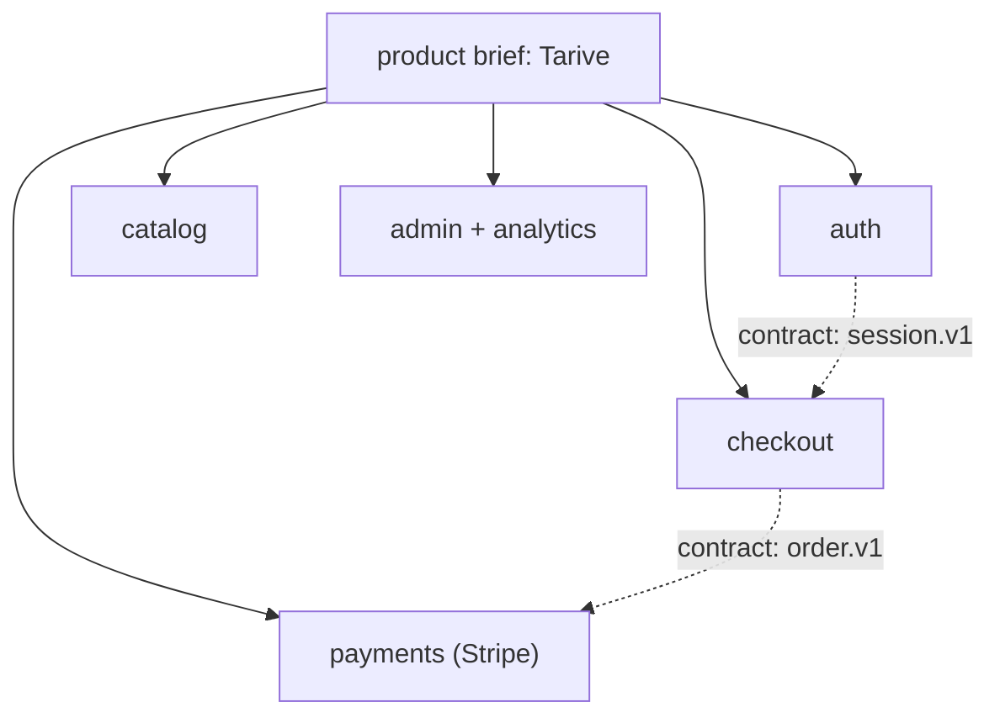
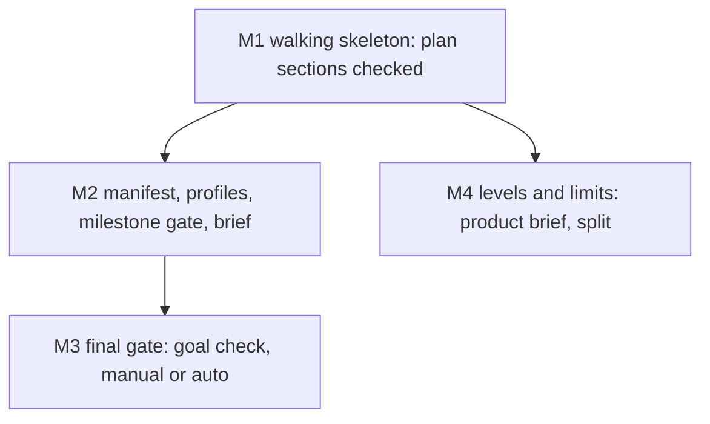

# The agentic loop: research, a visual spec, milestones the owner checks, a final gate set by project profile

Companion spec: `docs/work/feedback-loop/` (amendments log, escape trace-back, retro and agent awareness). The two
were split by this spec's own limit (5 milestones).

## Decisions (one-way doors)

| # | Decision | Status | Choice | Alternatives | Why it is hard to reverse |
|---|---|---|---|---|---|
| D-A | How a spec changes after lock | **confirmed** (owner 2026-11-03, D43) | frozen original + append-only Amendments log + folded current view; built by `feedback-loop` | D37 in-place edits | every spec, gate rule and reviewer reads this format |
| D-B | Where per-project switches live | open, recommended | one owner-only manifest per repo, `catalog-info.yaml` (approved, unbuilt) | `.claude/gates.json`; CLAUDE.md keys | Foreman, Catwalk, the gate and the brief all read it |
| D-C | What sets the loop's caution | open, recommended | a project **profile** in the manifest: `velocity`, `public` or `revenue` (table below); defaults follow the profile | one default for all; `deploymentTier` alone | every gate default in every repo |
| D-D | Final gate per profile | open, recommended | `velocity`: auto (goal check + health check); `public` and `revenue`: manual | manual everywhere | what ships without a human |
| D-E | Background sections | open, recommended | a visible one-line summary per pattern, detail collapsed; owner preference `background: expanded` | expanded by default | every spec's layout |
| D-F | Size limits and depth | open, recommended | the limits and levels table below | per-project only, no defaults | every spec's size and the number of agents per build |

### Profiles (D-C, D-D)

| Profile | Who is exposed | Values | Milestone review | Final gate | Also |
|---|---|---|---|---|---|
| `velocity` | the owner only (pre-revenue, internal) | speed | async, at most 2 unreviewed | auto: goal check + health check | design review only where the tier requires it |
| `public` | public users, no money | security, stability | async at most 1; blocking for a milestone with a security or data flag | manual | `security` forced to L3 in every T2; security reviewer on every T2; full end-to-end suite and a canary before release |
| `revenue` | paying users, payments or PII (today's `live`) | security, stability, data | blocking | manual, recorded approval | flag `live` derived; security reviewer on every T2 and flagged bugfix; a rollback plan in the spec |

A repo with no manifest is `velocity` when its `deploymentTier` is `pre-traffic` and `revenue` when it is `live`.
A manifest can raise a repo's caution but never set a `live` repo below `revenue`.

### Levels and limits for large projects (D-F)

A document holds at most two levels; scale grows sideways (more capabilities) and up (one thin product brief), never
deeper inside a spec.

| Level | Document | Holds | Limit, then |
|---|---|---|---|
| Product | `docs/capabilities/INDEX.md` as a product brief | vision, capability map, cross-capability contracts, release milestones; links, no ACs | 9 capabilities, then group into domains |
| Domain (only past 9 capabilities) | `docs/capabilities/<domain>/INDEX.md` | the same shape for its capabilities | 9 capabilities each |
| Capability | `docs/capabilities/[<domain>/]<name>/SPEC.md` | current truth: ACs, outcomes, owned paths, timeline | 40 current ACs or 200 lines, then split the capability |
| Change | `docs/work/<id>/README.md` | one change: decisions, milestones, contracts, ACs | 15 ACs, 5 milestones, 5 scopes and about 400 changed lines per milestone, 4 parallel agents |
| Child change | `docs/work/<id>/` with `parent:` | one milestone that broke a limit | never nests again |

Complexity class follows from the count: **S** is one capability (a change spec alone), **M** is 2-9 capabilities
(a product brief), **L** is 10 or more (domains). Example, a from-scratch rebuild of Tarive (cashcow), class M,
profile `revenue`:

Release R1 is a walking skeleton across capabilities (sign up, view a product, pay in test mode, receive a receipt);
later releases widen each capability. Each capability spec takes its own tier: payments is T2 with `security`,
`data` and `live`; marketing pages are T1.

## Purpose

Specs today plan one change at a time with no milestones, no contracts between agents, and the owner seeing work only
at `live` deploys. The owner wants to steer the design, check each milestone, and set per project how much the loop
may do unattended, from a single change up to a large application (owner design, `evidence/owner-design.md`).

## Goals and non-goals

- Goal: a T2 spec carries one-way-door decisions, an alternatives table, a milestone chart, contracts and an outer
  test per milestone, all checked.
- Goal: the loop pauses for the owner exactly where the project profile says, and never auto-accepts.
- Goal: large projects decompose into a product brief, capabilities and changes within fixed limits.
- Non-goal: amendments, escape trace-back and retro feedback (spec `feedback-loop`).
- Non-goal: T1 and bugfix items; Catwalk UI work (owner-gated); `cycle.js` (`stage-trace`).

## Background

- **Walking skeleton**: the first milestone is the thinnest end-to-end path that runs, so integration risk shows on day one.
- **Vertical slice**: every milestone delivers something usable through all layers, never one layer at a time.
- **Contract-first**: agents that build different parts agree on a versioned schema with example fixtures before coding.
- **Double-loop TDD**: one outer acceptance test per milestone drives many inner unit tests.
- **One-way and two-way doors**: decide only the irreversible choices early; log the rest as defaults.
- **Ship / Show / Ask**: building on in-review work is fine when the amount waiting for review is capped.
- **Canary gate**: automatic deploys stay safe only when health checks can stop and roll them back.
- **Pugh matrix**: alternatives scored +, 0 or - against a baseline, no weighted total.
- **C4 levels**: context, container, component, code; most teams need only the first two documented.

Detail and sources for each pattern

- Walking skeleton: Cockburn, Crystal Clear (2004); Shape Up ch. 11-13 (2019): scopes are integrated slices found
  while building; revise the chart after the skeleton.
- Contract-first: Pact consumer-driven contracts; MAST (arXiv 2503.13657, 2025): 32% of multi-agent failures are
  misalignment between agents; Claude Code agent teams: two agents on one file overwrite each other; 3-5 agents.
- Double-loop TDD: Freeman and Pryce, GOOS (2009); Google (2016): about 16% of tests show some flakiness, so the full
  end-to-end suite runs once, at the final gate.
- Doors: Bezos letters 2015/2016; Poppendieck (2003) last responsible moment.
- Ship/Show/Ask: Wilsenach, martinfowler.com (2021-09-08).
- Canary: Google SRE workbook, canarying releases; GitHub/GitLab environments: the deployer never approves.
- Pugh: Hazelrigg on false precision of weighted scores.
- C4: c4model.com ("system context and container diagrams are sufficient for most teams"); arc42 refines only a few
  building blocks; OpenSpec and the Spec Kit domain extension group capabilities into domains.
- Full notes: `D:/repo/docs/research_notes/Agentic loop design/` and `D:/repo/docs/research_notes/Spec folder structure/`.

## Approach

Baseline: today's v3 (no milestones, the owner sees work at `live` only). Scores are +, 0 or - against the
baseline; each cell names its scenario.

| Dimension | A: owner's design as written | B: recommended (A with the probe's changes) | C: heavy plan docs per milestone (Spec Kit style) |
|---|---|---|---|
| Owner time | - every spec reviewed | 0 one-way doors and milestone briefs only | - long plan documents to read |
| Agent cost (stages, tokens) | - unit + integration + e2e per milestone | 0 one outer test + contract tests per milestone | - 2,577 lines of markdown for 689 of code (Scott Logic) |
| Latency to ship | - blocking reviews everywhere | + async where the profile allows | - |
| Defect escape | + | + goal check at the final gate (MAST: 15.6% of failures) | 0 prose not executed |
| Reversibility | - every decision front-loaded | + only one-way doors front-loaded | - |
| Security and privacy | 0 | + the builder never passes its own gate; `public` and `revenue` add the security reviewer | 0 |
| Operability | 0 | + auto-deploy needs a health check | 0 |
| Scale to large apps | - no levels | + product, capability, change, fixed limits | 0 numbered folders, no current state |
| Build complexity | 0 | - manifest, milestone gate, brief, levels | - |

Chosen: **B**. Its cost is the build complexity; the milestones below keep each piece small.

## Milestones

| Milestone | Slice (what works after it) | Depends on | Owns | Outer test (red first) | Unblocks |
|---|---|---|---|---|---|
| M1 | a T2 spec with Decisions, Milestones and Contracts passes the checker; this spec checks itself | - | `scripts/spec_v3.py`, `contracts/work-item.v3.json` | AC-1 | every T2 spec can carry a checked plan |
| M2 | the manifest and profile are read; a milestone waits for the owner as the profile says; the brief reaches Catwalk and TeleFi | M1 | `scripts/manifest.py`, `scripts/milestone_brief.py`, `scripts/spec_gate.py` | AC-4 | the owner checks each milestone |
| M3 | ship needs a goal-check record, then an owner record (manual) or a green health check (auto) | M2 | `scripts/review_record.py`, `agents/goal-checker.md` | AC-9 | unattended ship on `velocity` repos, safely |
| M4 | the checker reads the product brief and domains, refuses a spec or index past its limits or depth | M1, capability layer | `scripts/spec_levels.py` | AC-11 | large projects decompose by rule |

M4 runs in parallel with M2 and M3 (no shared paths). It needs the capability layer (`docs/capabilities/`) from the
spec-structure proposal. The chart is revised after M1.

## Contracts

| Name | Version | Schema | Fixtures |
|---|---|---|---|
| plan sections (Decisions, Milestones, Contracts tables) | v3.1 | `contracts/work-item.v3.json` | `contracts/fixtures/plan-valid.md`, `plan-invalid-*.md` |
| per-project manifest and profiles | v1 | `contracts/project-manifest.v1.json` | `contracts/fixtures/manifest-*.yaml` |
| milestone brief | v1 | `contracts/milestone-brief.v1.json` | `contracts/fixtures/brief-*.json` |
| review record kinds `milestone`, `goal`, `owner-decision` | review-record v2 | `contracts/review-record.v2.json` | `contracts/fixtures/record-*.md` |
| product brief and domain index | v1 | `contracts/product-brief.v1.json` | `contracts/fixtures/brief-index-*.md` |

## Behaviour

| AC | Traces | Given / when | Pass when | Fail when | Test |
|---|---|---|---|---|---|
| AC-1 | M1 | this README and a fixture T2 spec with Decisions, Milestones and Contracts in the exact shapes | both pass the checker | either is refused, or a malformed one passes | tests/test_agentic_loop.py |
| AC-2 | M1 | fixtures: a milestone without an outer test; a Depends-on cycle or unknown id; two milestones without a dependency owning one path; a contract whose schema or fixture is missing | each refused, the rule named | any lands | tests/test_agentic_loop.py |
| AC-3 | M2, D-C | manifests: each profile; missing (pre-traffic and live repos); an unknown value; a `live` repo set to `velocity` | each profile's defaults apply; missing gives `velocity` or `revenue` by tier; unknown refused by name; the `live` repo stays `revenue` | a default is unsafe, or a bad value is silently used | tests/test_agentic_loop.py |
| AC-4 | M2 | a milestone moving to `building` while unreviewed done milestones are at the profile's cap (blocking = cap 0); then after an owner `milestone` record | refused naming the waiting milestone; lands after the record | it lands at the cap, or is refused under it | tests/test_agentic_loop.py |
| AC-5 | M2, security | an owner `milestone` record written by the builder's identity, or for other content | refused | it counts | tests/test_agentic_loop.py |
| AC-6 | M2 | a milestone moves to done | a brief validating against its contract exists with six parts (now, evidence, what broke, cost vs cap, assumed decisions, next) and is queued for Catwalk and TeleFi | missing, invalid, or a part absent | tests/test_agentic_loop.py |
| AC-7 | M2, D-C | a `public` repo: a T2 spec with `security` below L3, or without a security review record at lock | each refused by name | either lands | tests/test_agentic_loop.py |
| AC-8 | M2, D-C | a `revenue` repo: a T2 spec without a rollback plan; a flagged bugfix without a security review record | each refused by name | either lands | tests/test_agentic_loop.py |
| AC-9 | M3 | a ship without a `goal` record; with one written by the builder; with a fresh independent one | refused, refused, lands | otherwise | tests/test_agentic_loop.py |
| AC-10 | M3, D-D | the profile's final gate: `velocity` with the health check red, then green; `public` or `revenue` without, then with, an owner record | refused then lands, in both | otherwise | tests/test_agentic_loop.py |
| AC-11 | M4, D-F | a change with 16 ACs or 6 milestones; a child of a child; a product brief with 10 capabilities and no domains; a capability SPEC.md over 200 lines; a manifest raising a limit | each refused naming the limit and the split to make; the raised limit applies | a limit is ignored | tests/test_agentic_loop.py |
| AC-12 | D-B | a T2 lock whose Decisions table has open rows, without and with an owner `owner-decision` record; a T2 without open rows | refused, lands, lands on the design record | otherwise | tests/test_agentic_loop.py |
| AC-13 | compatibility | every v2 item and every shipped v3 item in the fleet | judged exactly as before | any result changes | tests/test_agentic_loop.py |
| AC-14 | docs | SPEC-STANDARD-V3.md, agents/implementer.md, agents/reviewer.md, DEVELOPMENT_LIFECYCLE.md | each states the loop: one milestone at a time, owned paths only, contracts change only through the planner, the profile table | a doc contradicts the code | tests/test_agentic_loop.py |

## Outcomes

| Dimension | Level | Row or n/a reason | AC |
|---|---|---|---|
| success | L3 | a planned T2 spec runs milestone by milestone to ship | AC-1 |
| invalid input | L3 | malformed plans, manifests and indexes are refused by name | AC-2 |
| dependency fails | L3 | a missing manifest falls back to the tier's profile | AC-3 |
| timeout | L3 | an owner who never reviews blocks the loop at the cap; nothing auto-accepts | AC-4 |
| crash mid-step | L1 | the checker and gate are pure functions over one commit, so a crash refuses that commit | |
| concurrent actor | L3 | two milestones owning one path cannot run in parallel | AC-2 |
| duplicate or replay | L3 | an owner record for other content does not count | AC-5 |
| arrival channel | L3 | merges and squashes carry milestone moves through the same rules | AC-13 |
| performance or cost | L3 | each brief reports stages used against the cap | AC-6 |
| security | L3 | the builder never writes an owner or goal record; `public` and `revenue` add security checks | AC-9 |
| data and compatibility | L3 | existing v2 and v3 items are judged unchanged | AC-13 |
| operability | L3 | auto-deploy needs a green health check | AC-10 |

## Assumptions

| Assumption | Observed | If violated |
|---|---|---|
| Foreman's autonomy ladder can serve as the final gate | `D:/repo/Factory/foreman/core/repos.js:290` | flag: M3 maps manual and auto onto the ladder; a gap is logged before M3 starts |
| Catwalk's Review Queue confirm API can write an owner record | `D:/repo/docs/research_notes/Agentic loop design/internal_survey.md:1` | defer: until it can, owner records are written with the CLI only |
| The capability layer exists before M4 | `D:/repo/docs/reports/2026-11-03 Spec structure proposal.md:1` | defer: M4 waits; M1-M3 do not need it |

## Probe

[Probe and critique](evidence/probe.md), from the owner's words in [owner-design.md](evidence/owner-design.md).
