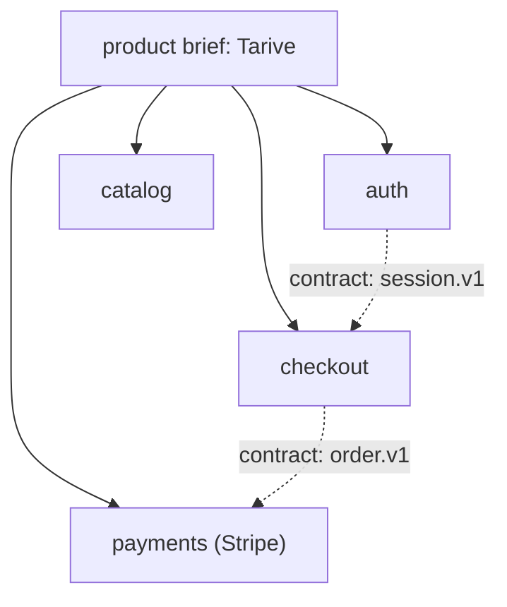

# Levels example: a from-scratch rebuild of Tarive (cashcow)

Complexity class follows from the count: **S** is one capability (a change spec alone), **M** is 2-9 capabilities
(a product brief), **L** is 10 or more (domains). Example, a from-scratch rebuild of Tarive (cashcow), class M,
profile `revenue`:

Release R1 is a walking skeleton across capabilities (sign up, view a product, pay in test mode, receive a receipt);
later releases widen each capability. Each capability spec takes its own tier: payments is T2 with `security`,
`data` and `live`; marketing pages are T1.
