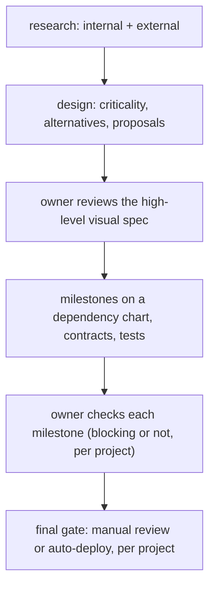

# Owner design: the agentic development loop (verbatim, 2026-11-03 11:57 PST)

The owner's words, unedited. This is the requirement the `agentic-loop` work item is judged against.

> Let's consider this as something we want to set up currently in session in regards to our contract with our
> implementer agent as well as the work implementation lifecycle starting from research both internally within our
> existing repositories and data sources as well as externally to consolidate the information Then, the design
> phase, going through what the criticality as well as major alternatives considered are, presenting the proposals
> for such. At this stage, I would expect to be looped in on the design for the spec as well as only the highest
> level summaries, where the spec itself should be a visualized representation of what we want to achieve at a high
> level. It should frontload any major decisions to be made that cannot be easily reverted down later than a line,
> and also include design patterns, architectural patterns, latency, cost, as well as time complexity and complexity
> of built in the consideration as a multidimensional variable for which alternatives consider in a table format
> where appropriate. Also provision the highest level context in regards to the pattern and such that we want to
> utilize and bring us up to date, assuming that we don't have, we might not have as much knowledge or context on
> that. Ideally, details like this should be in an expandable section that we can open by default. Keeping in mind
> the spec itself should be relatively high level, and it should allow us to complete both out as well as the
> dependency chart for how to implement everything in understandable milestones, understand the interfaces that will
> scheme us to that sets up the contract between every agent that needs to implement different aspects of the
> feature or service, as well as the preexisting test that should fail as well as pass as conditions, both in terms
> of unit integration as well as end-to-end, to mark each milestone that is complete as well as how they fit in on a
> dependency chart, along with what core functionalities are unblocked at every stage that can be verified. Then it
> should come back to us after each particular milestone to check on the implementation itself. This should be
> configurable on a per project basis in terms of if milestone review blocks additional implementation, or if the
> loop is allowed to continue building well without waiting on the milestones to be reviewed themselves. Likewise,
> before everything is finished and wrapped up to be fully integrated and deployable, there should also be a gate
> here as well in terms of having a user manually review all expected outcomes. Likewise, this should be
> configurable as well in terms of automatically deploying without review versus requiring review as a hard pass
> before going ahead.
>
> Likewise, we understand that the spec itself might not be fully comprehensive, so anything that is caught in the
> implementation review phase should be appended to the spec itself, not change the original spec, so that we
> understand the change log course of history in regards to what changes have been made since the initial
> iteration. This should also be funneled down into the retrospection, as well as any of our self-maintenance, as
> well as self-improvement agents for later down the line. This would be my design for the simplistic agentic loop
> itself. Verify this against best practices and critique it harshly in regards to if there are any additions or
> altercations to be made to this workflow. Likewise, this itself should be a spec in itself as well. For specs that
> are too large to fit in terms of a simplistic manner, break it down into notable chunks that are more manageable
> in size. This split off point can be something configurable or left up to your proposal as best practice in
> regard to where the complexity for the split off is. As well as how many layers by default we should take a look
> into it before understanding if the design should be further broken down.

## Requirements read from it (parent's numbering, for traceability)

| # | Requirement |
|---|---|
| O-1 | Research first: internal (repos, data sources) and external, consolidated |
| O-2 | Design phase: criticality and major alternatives, presented as proposals |
| O-3 | Owner looped in on the spec design, with only the highest-level summaries |
| O-4 | The spec is a visual, high-level representation of the goal |
| O-5 | Hard-to-reverse decisions are front-loaded |
| O-6 | Alternatives compared across dimensions (design and architecture patterns, latency, cost, time complexity, build complexity) in a table |
| O-7 | Background on the chosen patterns for a reader without context, in expandable sections open by default |
| O-8 | Milestones on a dependency chart, each understandable |
| O-9 | Interfaces and schemas as the contract between every implementing agent |
| O-10 | Per milestone: tests that fail before and pass after, at unit, integration and end-to-end level |
| O-11 | Per milestone: what core functionality it unblocks, verifiably |
| O-12 | The loop returns to the owner after each milestone |
| O-13 | Per project: milestone review blocks further building, or not |
| O-14 | A final gate before integration and deploy: the owner reviews all expected outcomes |
| O-15 | Per project: auto-deploy without review, or review as a hard pass |
| O-16 | Review findings are appended to the spec, never editing the original, keeping a change history |
| O-17 | Those findings feed retrospection, self-maintenance and self-improvement agents |
| O-18 | This loop is itself a spec |
| O-19 | Large specs split into manageable chunks, at a configurable or proposed threshold |
| O-20 | A default number of decomposition layers to examine before splitting further |
