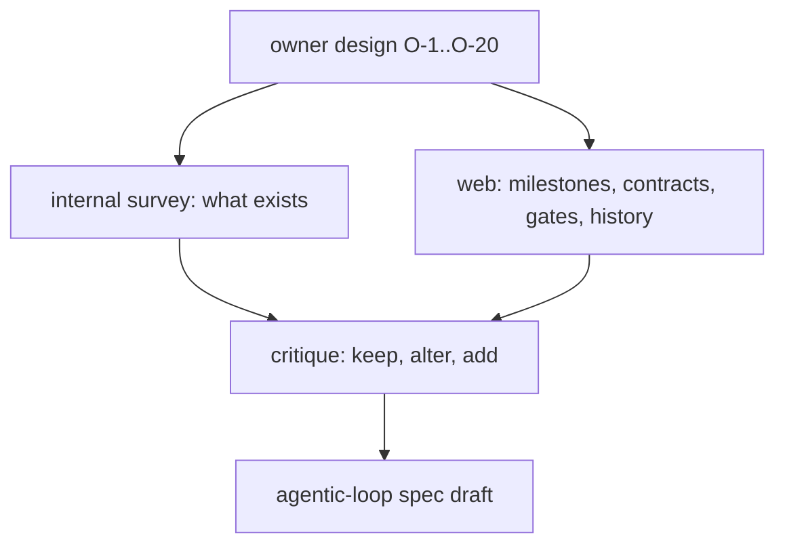

# Probe and critique: the owner's agentic loop (2026-11-03)

Sources (all read 2026-11-03): the owner's words `owner-design.md`; internal survey
`D:/repo/docs/research_notes/agentic-loop-design/internal_survey.md`; web
`D:/repo/docs/research_notes/agentic-loop-design/web_milestones_contracts.md` and `web_gates_history.md`; the
consolidated reference `D:/repo/docs/DEVELOPMENT_LIFECYCLE.md`.

## Critique of each requirement

Verdicts: **keep** (best practice agrees), **alter** (right goal, wrong mechanism), **add** (missing).

| # | Owner requirement | Verdict | Why (evidence) | Change |
|---|---|---|---|---|
| O-1 | research internal + external first | keep | OpenSpec #2021: under half of agent sessions read existing specs unless forced | already in force (c2e130a); the checker should refuse a probe that cites no existing spec for a touched area |
| O-2, O-5 | criticality, alternatives, front-load hard-to-reverse decisions | alter | front-loading every decision fights the last responsible moment; only one-way doors belong up front (Bezos 2015/2016; Poppendieck 2003) | a Decisions section lists one-way doors only, each with a recommended default; reversible choices are logged `assumed` |
| O-3 | owner reviews every spec design | alter | 93% of per-action approvals are accepted unread (Anthropic 2026-03-25); DORA: approval adds delay without lowering failure | owner reviews the one-way-door decisions and the milestone chart of T2 items; T1 and bugfixes never wait for the owner |
| O-4 | spec is visual and high level | keep | Google "traffic cop" pages, C4 levels 1-2 suffice for most teams | one diagram per view: context, milestone dependency chart |
| O-6 | multi-dimensional alternatives table | alter | weighted scores give false precision (Hazelrigg); Google/Uber docs also weigh reliability, security, privacy, operability | Pugh-style +/0/- against a baseline, each cell tied to a scenario, no total; add reversibility, security/privacy, operability; time complexity only where an algorithm matters |
| O-7 | background in sections expanded by default | alter | GOV.UK: do not hide what most readers need; expanded-by-default loses the point of collapsing; Diataxis keeps explanation in its own doc | a one-line visible summary per pattern, detail in a collapsed section or a linked explainer; owner may set expanded as a preference |
| O-8 | milestones on a dependency chart | alter | agents build one horizontal layer at a time unless checked; Shape Up scopes are integrated slices found while building | milestones are vertical slices, M1 a walking skeleton, the chart is revised after M1, at most 3-5 scopes per milestone |
| O-9 | interfaces and schemas as contracts between agents | keep, add | MAST: 32% of multi-agent failures are inter-agent misalignment; Claude Code agent teams: two agents on one file overwrite each other | versioned schema + valid and invalid fixtures, tested on both sides; each milestone lists the paths it owns; contract changes only through the planner |
| O-10 | per milestone: failing then passing unit, integration and e2e tests | alter | a growing e2e gate is slow and flaky (Google: about 16% of tests show flakiness); Fowler: levels matter less than speed and reliability | per milestone: one outer acceptance test (red first) plus contract tests on each chart edge; the full e2e suite runs at the final gate |
| O-11 | what each milestone unblocks, verifiably | keep | the walking skeleton and hill charts make progress observable | the milestone's outer test IS the unblocked capability |
| O-12, O-13 | return to owner after each milestone; blocking or not per project | keep, add | Ship/Show/Ask "Show": building on unreviewed work risks a rework cascade found weeks later | async mode gets a cap of unreviewed milestones (default 1); at the cap the loop blocks; a short evidence brief per milestone |
| O-14, O-15 | final gate: manual review or auto-deploy per project | keep, add | GitHub/GitLab/Argo: per-environment config; the deployer never approves; SRE canarying: auto-deploy needs health checks; MAST: a goal-level check removes 15.6% of failures | final gate = goal-level verification against the original intent (independent agent) + manual or auto; auto requires a health check and rollback; `live` is always manual |
| O-16 | review findings appended, original unchanged | keep, alter | every append-only system (ADR, IETF errata, event sourcing) also offers a current view; IETF: readers who skip errata read wrong text | the locked spec is frozen; findings append to an Amendments log, each classed fix-now / hold / rejected; the capability SPEC.md is the folded current view at ship. Replaces D37's in-place edits |
| O-17 | findings feed retro and self-improvement | keep, add | SRE: untracked action items are forgotten; ODC: classify by trigger and stage; evals from 20-50 real failures | each finding gets a class, an owner and a closed state; recurring classes become a failing test or eval. Today the retro queue is a dead end (`/retrospect` reads only telemetry) and `/self-improve` has never logged a run |
| O-18 | this loop is a spec | keep | dogfooding | this item |
| O-19, O-20 | split large specs; default depth | keep, add | 3-5 agents of 5-6 tasks each; scopes of a few days; C4: 2 levels suffice for most teams; review quality drops past 200-400 changed lines | defaults below; configurable per project |
| (new) | the builder never passes its own gate | add | GitHub and GitLab forbid it; already a fleet rule | stated in the loop's contract |
| (new) | low confidence stops the loop | add | Devin asks for plan approval only when its confidence is low | an agent that reports low confidence on a one-way door pauses for the owner |
| (new) | one config home | add | the internal survey: Foreman's `autonomy` ladder already acts as a final gate; the approved `catalog-info.yaml` manifest is unbuilt; `gates.json` was proposed for the same job | one per-project manifest holds every switch; `finalGate` reuses the autonomy enum |

## Split defaults (O-19, O-20)

| Limit | Default | Source |
|---|---|---|
| ACs per spec | 15 | the v2/v3 cap (review size) |
| milestones per spec | 5 | Shape Up: 3-5 scopes before one is missing |
| scopes per milestone | 5 | Shape Up |
| parallel implementing agents | 4 | Claude Code agent teams: 3-5 |
| estimated changed lines per milestone | 400 | Cisco/SmartBear review window |
| decomposition depth | 2 (spec, milestones); a 3rd level (child specs) only when one milestone breaks a limit; never 4 | C4: levels 1-2 suffice; arc42: refine only a few blocks |

## Facts the design must reuse (internal survey)

- v2's Work breakdown already has `Depends on` and `Milestone` columns and an exit rule (`C:/Users/Michael/.claude/skills/dark-factory/WORK-ITEM-STANDARD.md:277`); its checks are unbuilt.
- Foreman's contract-only mode and `dependsOn` hold run today (`D:/repo/Factory/foreman/core/dispatch-modes.js:76`).
- Catwalk's Review Queue UI and API are built; TeleFi has no approve action yet.
- `cycle.js` is suspended; `/orchestrate` depends on it.
- Three verdict sets exist (`pass/fix-first/block`, `CONFIRMED/...`, `MET/PARTIAL/FAILED`); the loop uses one.
