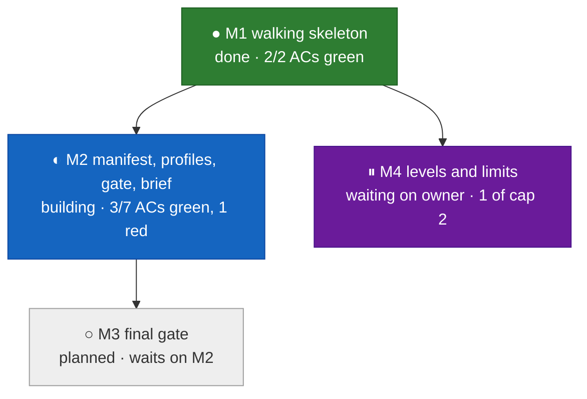

# Progress view sample: agentic-loop mid-build (illustrative state)



The state above is invented to show the colors; today every milestone is `planned`.

## Terminal view (`spec_status`), one line per item, then one per milestone

```text
agentic-loop  T2  ready 100%  ACs 6/15 green, 1 red  milestones 1/4 done  stages 5/9  profile yolo
  ● M1  walking skeleton             done      AC-1 ✓ AC-2 ✓                    owner ✓
  ◐ M2  manifest, profiles, brief    building  AC-3 ✓ AC-4 ✕ AC-5 ✓ AC-6 · ...   
  ○ M3  final gate                   planned   waits on M2
  ⏸ M4  levels and limits            owner     review waiting (1 of cap 2)
feedback-loop  T2  ready 83%  (2 of 12 ready checks open: Outcomes depth, open decision D-?)
```

## The two measures

| Measure | What it counts | Source |
|---|---|---|
| Spec readiness | ready checks passed over applicable checks: required sections, open decisions resolved, Outcomes breadth and depth, every AC with a named test, no open-question markers | the checker's ready checks, run on demand |
| Implementation progress | per AC: `·` no test yet, `✕` test red, `✓` green, `✓✓` reviewed; per milestone: green ACs over its ACs | the last recorded test run per AC (until `gate-ci`, the implementer's quoted run) and the review records |

## Status enum (one source: `contracts/progress-status.v1.json`)

| Status | Symbol | Color | Meaning |
|---|---|---|---|
| planned | ○ | grey | not started; its dependencies may be open |
| blocked | ⊘ | red outline | a dependency or a breaking finding stops it |
| building | ◐ | blue | red tests committed, code in progress |
| review | ◔ | amber | built, its review is running |
| owner | ⏸ | purple | waiting on the owner's milestone check |
| done | ● | green | outer test green, review passed, owner check passed or not required |
| failed | ✕ | red | a breaking finding or a red outer test after "done" |
| killed | ⨯ | black | dropped, kept as history |

Every status shows its symbol and word as well as its color, so it reads without color.
