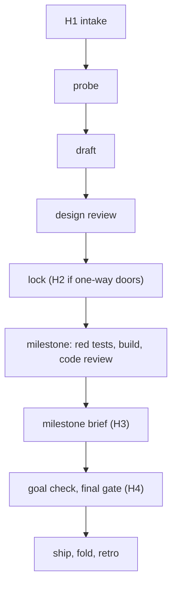

# Stage catalog: purpose, budget, failure points and notices for every step of the loop (draft, 2026-11-03)

One row per stage. **Token caps** are starting values from this session's observed subagent usage (2026-11-02/03,
from the task notifications), about 1.5 times the largest run seen; they are assumed (A-2) until meter records cost
per stage. A stage that hits its cap stops and is reported, never extended silently.

## Stages

| Stage | Purpose | Persona | Output | Done when | Token cap (observed) |
|---|---|---|---|---|---|
| H1 intake | owner says go or kill and sets the appetite | owner | a work item at draft, profile known | owner reply | - |
| Probe: research | full picture before drafting: existing specs, the code, a dated web survey | general-purpose or researcher (Cortex Researcher later) | `evidence/` notes with citations | every probe question cited or "not found" | 250k per track (90k-230k seen) |
| Probe: adversary | outcomes the design would miss, before the draft | adversary | missed-outcome rows, each with a closing rule | rows dispositioned in the probe | 100k (64k seen) |
| Draft | the spec: decisions first, alternatives, milestones, contracts, ACs | designer (or parent) | README passing the checker at spec-locked rules | checker clean | 175k (106k-151k seen) |
| Design review | find what makes the build impossible or wrong-headed | reviewer, design mode | review record | verdict line | 125k (72k-98k seen) |
| Design fix + verify | fix breaking findings once, confirm only the fix | designer, then reviewer verify | fix commit, verify record | verify `pass` | fix 175k, verify 75k (35k-69k seen) |
| Architect | settle a second `fix-first` or an approach finding | architect | ADR | ADR written, change list | 200k (158k seen) |
| Lock (H2) | freeze the design; owner decides open one-way doors | parent; owner for D-rows | lock commit with fresh records | gate accepts the lock | - |
| Milestone build | red outer test, then code, amendments appended | implementer | red-test commit, source commit | outer test green, suite green | 350k per milestone (299k seen for a whole T2 build) |
| Code review | run it: tests, mutants, corpus diff; only breaking loops | reviewer, code mode | review record naming the milestone | verdict line | 150k (115k seen) |
| Code fix + verify | fix breaking findings once | implementer or parent, then reviewer verify | fix commit, verify record | verify `pass` | fix 175k, verify 75k |
| Milestone brief (H3) | bring the owner up to speed on one milestone | generated (`milestone_brief.py`) | brief, progress view | delivered | - |
| Goal check | does the result meet the original intent, not just the ACs | goal-checker (independent) | `goal` record | verdict line | 100k (no run yet) |
| Final gate (H4) | judge the item's whole history, then ship or deploy | `final_gate.py`; owner when manual | ship commit or promote | range judged clean, approval if manual | - |
| Ship and fold | close the item; fold amendments into the current spec (after the capability layer) | parent | shipped status, Timeline row | gate accepts the ship | - |
| Escape intake | trace a later bug to the stage that missed it | implementer of the bugfix | Escape table, Amendments row on the origin | checker clean | (inside the bugfix's budget) |
| Retro | turn repeated failures into checklist lines and reviewer checks | `/retrospect`, owner | proposals with state | proposal closed or applied | - |

A T2 item with 3 milestones therefore budgets about 1.6M tokens for design and 0.6M per milestone; a T1 item skips
probe, design review and architect.

## Failure points and failsafes

| Failure point | Failsafe | Reported as |
|---|---|---|
| a stage exceeds its token or dispatch cap | stops; `repair-budget-exhausted` | blocker |
| a breaking finding at review | one fix round, then a verify; the cause is fixed upstream (stage miss) | daily digest |
| a second `fix-first` | the architect decides; no third round | info, then blocker if an owner decision results |
| a gate cannot judge (timeout, shallow history, bad contract) | refuses by name, never passes as judged | warn |
| a guard false refusal of legitimate work | the action becomes an owner yes/no; never scripted around | blocker |
| an owner record forged or attempted by an agent | guard denies; the attempt is logged | critical |
| a subagent ends without a report | one request to resend; never assume its result | none (logged) |
| milestone review not given and the cap is reached | the loop waits; nothing auto-accepts | blocker, re-sent daily |
| drift on a `public` or `revenue` repo (incl. host auto-deploy) | deploy refused until clean | warn; critical for `revenue` |
| an escaped S1/S2 defect in production | bugfix item with an Escape record; class tallied | critical |
| a process flag or kill switch changed | takes effect at the next commit | warn, immediately |

## When the owner hears about it

| Event | TeleFi kind and severity | Timing |
|---|---|---|
| milestone brief, async profile | `review`, info | next batch window (08, 12, 16, 20) |
| loop waiting on the owner (cap reached, open decision at lock, manual final gate) | `blocker`, warn | immediately outside quiet hours; repeated daily |
| breaking findings and stage misses | `digest`, info | once a day |
| budget exhausted, gate cannot judge, guard false refusal | `blocker`, warn | immediately |
| forged-record attempt, `revenue` drift, escaped S1/S2 | `failure`, critical | immediately, through quiet hours |
| item shipped | `result`, info | next batch window |

## How a failure is logged and improved on

| Failure type | Logged where | Improves what, next time |
|---|---|---|
| a product bug found after design | the bugfix's Escape table and the origin spec's Amendments (feedback-loop F2) | a probe or adversary checklist line, or a reviewer check, once a class repeats (F3) |
| a review finding during the build | the spec's Amendments log, classed fix-now, hold or rejected (F1) | hold rows become proposals (F3) |
| a process failure (stage miss, overrun, tool or guard failure) | today: a RETRO-QUEUE row written by the parent; planned: a stage-trace record per stage (`stage-trace`, roadmap 2b) | `/retrospect` reads both (F3); a fix lands in a persona, playbook, checker or guard, and the row is closed |
| a decision changed on the owner's behalf | `docs/DECISIONS.md` as `assumed`, with a revisit trigger | shown in the next milestone brief |
