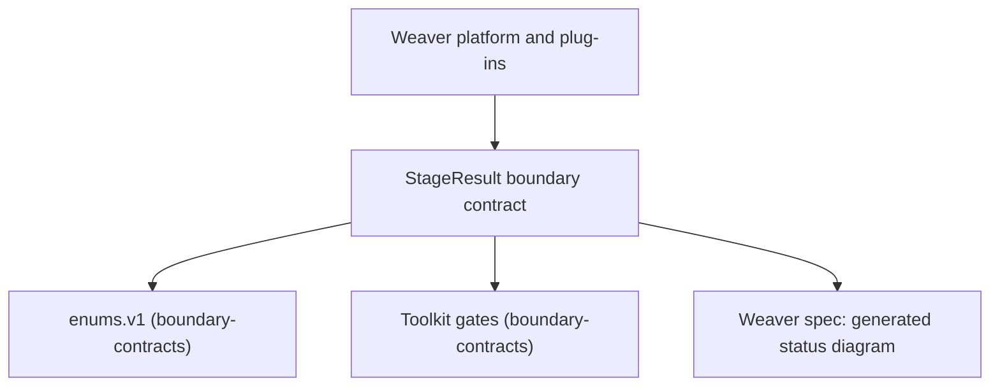

# Weaver StageResult contract and run-status machine (first adopter)

Home: authored in `~/.claude/docs/work/` while draft; the code lands in `D:/repo/Lib/weaver`. The standard limits `ext:` references to parent, child or sibling items of one repo, and the parent-child tie here is within `~/.claude`, so the cross-repo edge is logged, not modelled as `ext:`: see the parent's Open questions item 3. It must be re-homed to `D:/repo/Lib/weaver/docs/work/` and reconciled with `ap-result-schema` before status `building`.

## Purpose
Weaver defines its StageResult in zod and its status to outcomeKind mapping in a prose table (`D:/repo/Lib/weaver/docs/specs/agent-platform.md:61`). This item moves both to data: a versioned JSON Schema that references the shared enums, and a run-status machine file replacing the prose table, with generated types and a regenerate-diff gate.

## Non-goals
- Migrating Foreman, Cortex, Catwalk or TeleFi (parent Open questions).
- Changing Weaver's lifecycle stages or failure-class semantics.
- Writing the toolkit itself (parent item).

## Capabilities
| CAP | Statement |
|---|---|
| CAP-1 | The service must define StageResult as a versioned JSON Schema whose status, outcomeKind and failure class reference `enums.v1` |
| CAP-2 | The service must define the run-status protocol as a machine file validated by the toolkit, replacing the prose mapping table |
| CAP-3 | The service must reject a StageResult whose outcomeKind conflicts with the outcomeKind implied by its status |
| CAP-4 | The service must not accept a status transition the machine file does not allow, including `merged` set by anything but the merge effect result |

## Non-functional requirements
| NFR | Target | Method | Evidence |
|---|---|---|---|
| NFR-1 | Python and JS validators agree on 100% of valid and invalid fixtures | fault-injection: one injected mutant schema field flips a fixture verdict in both | AC-1 |

## Gate plan
| Risk | Kind (deterministic / qualitative) | Check | Blocking / advisory |
|---|---|---|---|
| Weaver generated types drift from the schema | deterministic | toolkit `regen.py --check` run from Weaver CI | blocking |
| machine or enum break | deterministic | toolkit `check.py` and `compat.py` run from Weaver CI | blocking |

## Gap-ledger check
Categories from `docs/SPEC-GAP-LEDGER.md`; the toolkit-level handling is in the parent.

| Category | Handled by |
|---|---|
| asserted-not-verified-claim | status table facts are read from `agent-platform.md:92` at implementation; AC-2 compares the machine file to that table |
| runtime-schema-drift | AC-1 (two-language verdict parity), AC-3 (generated-diff gate in Weaver CI) |
| invariant-checked-on-one-path-only | AC-5: all writers of status go through the machine check, including the merge effect |
| authoritative-source | status to outcomeKind is derived from the schema, never from an agent claim (AC-4) |
| fail-closed-on-unknown | AC-4 and AC-5: unknown status or event is rejected |
| hand-copied-enum | CAP-1: status and outcomeKind come from `enums.v1` |
| split-state | n/a: no new store; Weaver's own Postgres table gets the parent's generated migration |
| untestable-ac | one fault per AC, named rule or error asserted |
| scope-drift-oversize | 5 ACs; Foreman, Cortex, Catwalk, TeleFi migrations are separate items |
| other categories | n/a: no LLM call, deletion, lock or liveness, parallel writer, enforcement rule or external-contract fact is introduced here beyond those above |
