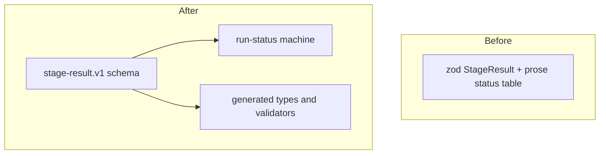

# boundary-contracts-weaver: L2 component specs

| Component | Owned files | Public interface |
|---|---|---|
| stage-result-contract | `contracts/stage-result/**`, `test/contracts/**` in D:/repo/Lib/weaver | `contracts/stage-result/stage-result.v1.schema.json`, `contracts/stage-result/stage-run.machine.v1.json` |

## stage-result-contract

### Interface
`stage-result.v1.schema.json` has the fields of the zod StageResult at `agent-platform.md:66` (`schemaVersion, status, outcomeKind, failureClass, blocker, skipReason, summary, outputs, usage, durationMs, attempt, attrs`), with `status`, `outcomeKind` and `failureClass` as `$ref` into `enums.v1`, and if/then clauses tying each status to its outcomeKind and requiring `failureClass` when outcomeKind is `failure`, `blocker` when `blocked`, `skipReason` when `skipped`. `stage-run.machine.v1.json` has states `pending`, `running` and the eight statuses, events drawn from the enums, `initial` `pending`, terminals `ok, failed, blocked, needs-human, no-pr-done, merged, skipped`.

### Functional requirements
| FR | Requirement |
|---|---|
| FR-1 | The schema validates every fixture in `test/fixtures/stage-result/valid` and rejects every fixture in `invalid`, in Ajv (JS) and pydantic (Python) alike |
| FR-2 | The machine file passes the toolkit `check.py`, and its status to outcomeKind table equals the one in `agent-platform.md:92` |
| FR-3 | A result whose `outcomeKind` differs from the one its status implies is rejected with the error `outcomekind-conflict` |
| FR-4 | `pr-open` to `merged` is the only transition into `merged`, and only on event `merge-effect-done`; `verify` events cannot move to `merged` |

### Data
Reads and writes JSON documents only; schema in data.md.

### Failure modes
| Failure | Detection | Handling |
|---|---|---|
| plug-in class overrides outcomeKind (`deferral-expired` is neutral) | fixture `valid/deferral-expired.json` | schema allows the override only for registered classes; open question in README of parent |
| generated types stale | `regen.py --check` in Weaver CI | CI fails |
| unknown status in a stored row | validator | rejected with `schema-invalid`, never defaulted |

### Budget
| Dimension | Budget |
|---|---|
| Latency | validation of one result in 5 ms p95 |
| Cost | $0 per run, no model call |
