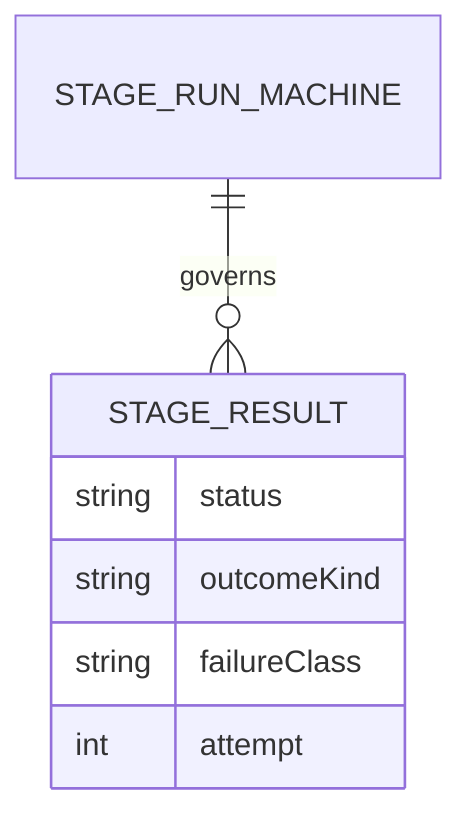

# boundary-contracts-weaver: L2 data and contracts

Before: zod object plus prose table. After: above.

## Schema
Source of truth: `contracts/stage-result/stage-result.v1.schema.json` in D:/repo/Lib/weaver. Types are generated by the parent toolkit; the zod definition at `agent-platform.md:66` is retired when the generated validators replace it.

## Contracts
| Contract | Version | Schema file | Provider | Valid fixtures | Invalid fixtures | Digest | Status |
|---|---|---|---|---|---|---|---|
| stage-result | 1 | contracts/stage-result/stage-result.v1.schema.json | weaver | test/fixtures/stage-result/valid/*.json | test/fixtures/stage-result/invalid/*.json |  | current |

COMPAT: additive within v1; a breaking change means stage-result.v2 plus a dual-read window.

## Migration and back-compat
Weaver is `pre-traffic`; no stored rows exist yet, so the zod to schema switch needs no data migration. Reversible by reverting the adopter commit.
