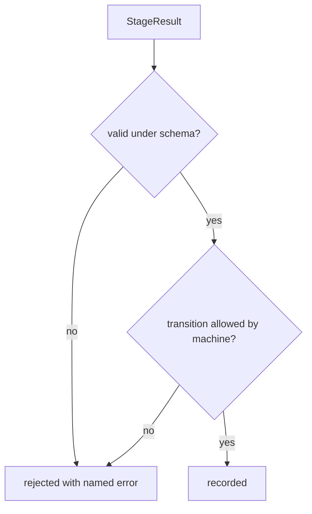

# boundary-contracts-weaver: L3 functional and acceptance criteria

## FR/NFR delta
| ID | Change | Note |
|---|---|---|
| FR-1 to FR-4 | added | components.md |
| NFR-1 | added | README |

## Acceptance criteria
| AC | Traces | Given / when | Pass when | Fail when | Test |
|---|---|---|---|---|---|
| AC-1 | CAP-1, FR-1, NFR-1 | every valid and invalid StageResult fixture, validated with Ajv and with pydantic | both validators agree on every fixture; valid pass, invalid reject; a mutated schema field flips both | any fixture where the two disagree | test/contracts/stage-result.test.js, test/contracts/test_stage_result.py |
| AC-2 | CAP-2, FR-2 | the machine file and the prose table at `agent-platform.md:92` | `check.py` exits 0 and the machine status to outcomeKind equals the table row for row | a status or its outcomeKind differs | test/contracts/stage-run-machine.test.js |
| AC-3 | CAP-1, CAP-2 | Weaver CI step running `regen.py --check` and `mermaid.py --check` after one generated byte is edited | exits 1 naming the edited file; clean tree exits 0 | edit not detected | test/contracts/regen-gate.test.js |
| AC-4 | CAP-3, FR-3 | fixture `invalid/outcomekind-conflict.json` (status `ok`, outcomeKind `failure`) | rejected with error `outcomekind-conflict` | accepted, or rejected with another reason | test/contracts/stage-result.test.js::outcomekind-conflict |
| AC-5 | CAP-4, FR-4 | a recorded sequence where `verify` tries to move to `merged`, and one with `merge-effect-done` from `pr-open` | the first is rejected naming the event and state; the second is accepted | `merged` reachable by verify | test/contracts/stage-run-sequences.test.js |

Tests cite `boundary-contracts-weaver/AC-<n>` verbatim (for example `boundary-contracts-weaver/AC-1`).
