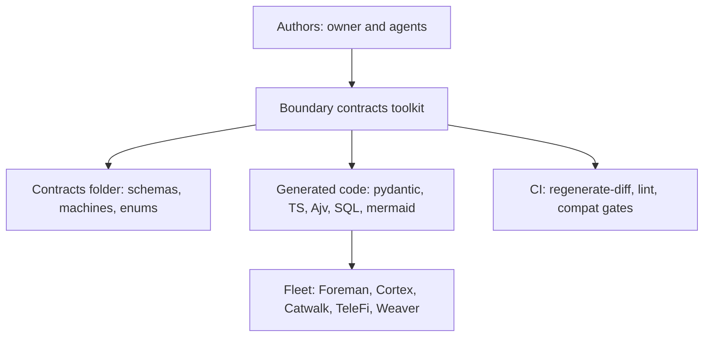
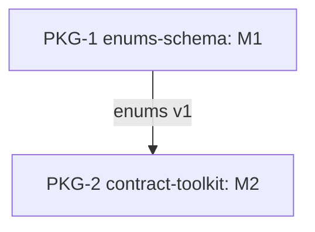

# Boundary contracts: schema, protocol state machine, shared enums, mechanical sync

Home repo: `~/.claude` (claudence), under `contracts/`. The first adopter is Weaver (`D:/repo/Lib/weaver`), specified as the nested item `boundary-contracts-weaver`.

## Overview
Every boundary between components, internal or external, today carries only a data shape, and often a hand-copied one. This item makes each boundary state four things at the boundary: the schema, the protocol state machine, shared enums defined once, and a mechanical guarantee that every language stays in sync. CAP-1 is the shared enums file. CAP-2 is the machine file with its structural checks. CAP-3 is code generation with a regenerate-and-diff gate. CAP-4 is the lint ruleset. CAP-5 is the compatibility gate. CAP-6 is the mermaid generator, so the high-level to low-level picture is read from data. CAP-7 is the sequence checkers in Python and TypeScript. CAP-8 is the single transition write path in SQL. M1 delivers the enums schema with its seed set. M2 delivers the toolkit that consumes it. The Weaver adopter is a separate nested item and is the proof on real code.

## Purpose
The fleet copies enums by hand across files and languages and they drift, and the only state rule written as data is one if/then in `contracts/work-item.v2.json`. The outcome is a per-boundary contract folder where schema, state machine and enums are data, every language binding is generated from it, CI fails on any difference, and the architecture diagrams are generated from the same files.

Before (current-state evidence from the fleet inventory):
- Hand-copied enums: blocker classes in 4 places, Catwalk-drifted (`live-tier-approval`); attention classes in 2; the verdict to kind map in JS and Python; work-item type drift (Catwalk `build` versus `feature`); Foreman run-status subsets in two files.
- Cortex emits severity `warning`, which TeleFi's envelope enum rejects (on the unmerged dedup branch).
- The only state rule written as data is the if/then in `contracts/work-item.v2.json`.
- The Weaver status table is prose (`D:/repo/Lib/weaver/docs/specs/agent-platform.md:92`).

## Non-goals
- Migrating Foreman, Cortex, Catwalk and TeleFi onto the shared enums (follow-up items, see Open questions).
- Pact consumer-driven contracts, AsyncAPI documents, OpenAPI or oasdiff (no HTTP boundary yet), XState or SCXML formats, `z.fromJSONSchema`.
- A runtime workflow engine. The machine file describes and checks a protocol; it does not execute it.
- Editing the Work-Item Standard (proposed only, see Open questions).

## Capabilities
| CAP | Statement |
|---|---|
| CAP-1 | The service must hold every shared enum once, in `contracts/common/enums.v1.schema.json`, with a description on every value |
| CAP-2 | The service must validate each boundary machine file against a meta-schema and reject unreachable states, outgoing transitions from terminal states, and states or events absent from the enums |
| CAP-3 | The service must generate pydantic models, TypeScript types, Ajv validators and a SQL enum migration from the schemas, and CI must fail on any regenerate diff |
| CAP-4 | The service must lint every contract schema with a Spectral ruleset for versioned ids, descriptions and one enum casing |
| CAP-5 | The service must fail the compatibility gate when a fixture valid under vN is invalid under vN+k, or when an enum value or machine state disappears |
| CAP-6 | The service must generate a mermaid stateDiagram-v2 from each machine file and fail when the committed copy in the spec is stale |
| CAP-7 | The service must check a recorded message sequence against its machine, with identical verdicts in Python and TypeScript |
| CAP-8 | The service must route every database write of a machine-governed state through one generated transition check, so an illegal transition cannot be stored |

## Non-functional requirements
| NFR | Target | Method | Evidence |
|---|---|---|---|
| NFR-1 | a new boundary folder is processed with 0 edits to toolkit source files | extensibility: add a new boundary folder in a test and run every gate | AC-13 |
| NFR-2 | 0 imports from the toolkit into the enums package, and 0 imports of another package's internals | fitness: import-linter contract over the package owns | AC-14 + config:scripts/contracts/importlinter.ini |
| NFR-3 | every gate returns within 10 s per boundary and exits 1 with a named rule id on malformed input, never hangs or crashes | fault-injection: truncated JSON, cyclic machine, missing file, injected hang | AC-15 |

## Trade-offs
| Option | Latency | Cost | Maintenance | Extensibility | Refactorability | Verdict |
|---|---|---|---|---|---|---|
| JSON Schema 2020-12 plus a small machine JSON file, codegen per language, regenerate-diff CI | seconds per gate | free tools, 2 packages to own | one schema source, bindings generated | a new boundary is a folder | rename in one file, regenerate | chosen |
| AsyncAPI documents plus Pact consumer contracts | slower, broker or mock server | extra services | two more formats to keep in sync | strong for brokers | high churn | rejected: duplicates schema and state, built for brokered estates the fleet lacks |
| XState or SCXML as the machine format | runtime library per language | free | machine format tied to a JS runtime or XML tooling | good in JS only | poor for Python and SQL consumers | rejected: not language-neutral, heavier than the 5 fields needed |
| zod as the source, converted to JSON Schema | fast in TS | free | TypeScript-only source, Python needs a second copy | weak across languages | drift risk returns | rejected: re-creates the hand-copy problem; `z.fromJSONSchema` is skipped by decision |

## Patterns applied
| Pattern | Where | Why |
|---|---|---|
| UML protocol state machine semantics: messages valid per state, each moves the receiver to a state | contract-toolkit machine files and sequence checkers | the protocol is stated at the boundary and checked mechanically |
| Single source of truth with generated code | enums-schema and contract-toolkit codegen | one enums file, no hand copy in any language |
| Consumer fixtures replayed against producer schema | contract-toolkit compat gate | compatibility is observed on fixtures, not predicted from a diff |
| Single write function or trigger for stateful tables | contract-toolkit SQL migration | the store is the authoritative layer for transitions |

## Components chosen
| Need | Chosen (off the shelf) | Rejected | Why rejected |
|---|---|---|---|
| JSON to pydantic | datamodel-code-generator, pinned at 0.60.2 or later (research cites CVE-2026-54656) | hand-written models | drift, the very defect being removed |
| JSON to TypeScript types | json-schema-to-typescript 16.x on Node 20, schemas dereferenced first, no prefixItems or $dynamicRef | hand-written types | drift; the schema limits avoid the generator's known gaps |
| Runtime JS validation | Ajv | zod via `z.fromJSONSchema` | skipped by decision, second schema dialect |
| Schema lint | Spectral with a custom ruleset | hand-rolled linter | Spectral owns rule execution and reporting |
| Compat check | built in-house, fixture replay of about 40 lines, because no tool replays fixtures across versions; `jsonschema-changelog` runs as advisory | oasdiff, `jsonschema-changelog` as a gate | oasdiff is OpenAPI-only; the changelog tool cannot see semantic enum or state loss |
| Machine format and diagram | built in-house: machine JSON validated by a meta-schema, a 30-line mermaid generator, 40-line sequence checkers; nothing off the shelf is language-neutral | python-statemachine 3.2.0, XState, SCXML | language-specific runtimes; python-statemachine is Python-only |
| Consumer contracts | none | Pact (pact-python) | needs a broker or mock flow; fixtures already give producer and consumer the same cases |

## Gate plan
| Risk | Kind (deterministic / qualitative) | Check | Blocking / advisory |
|---|---|---|---|
| generated code drifts from schemas | deterministic | `python scripts/contracts/regen.py --check` fails on any diff | blocking |
| enum, state or schema break shipped within a version | deterministic | `python scripts/contracts/compat.py` fixture replay | blocking |
| malformed schema or machine merged | deterministic | Spectral ruleset plus `python scripts/contracts/check.py` | blocking |
| package isolation | deterministic | isolation: `python scripts/spec_check.py docs/work/boundary-contracts/README.md --sparse PKG-2` into `git sparse-checkout set --stdin`, then pytest and vitest in that tree | blocking |
| semantic changes that fixtures miss | qualitative | `jsonschema-changelog` run in CI, a human reads it | advisory |

## Gap-ledger check
Categories from `docs/SPEC-GAP-LEDGER.md`.

| Category | Handled by |
|---|---|
| probabilistic-call-reliability | n/a: no LLM call in this item |
| creative-domain-anchoring | n/a: no generated creative output |
| asserted-not-verified-claim | tool versions and the CVE number come from the research and are not verified by the designer; AC-6 asserts the pins, and data.md lists each seed enum's source file to be read at implementation |
| concurrent-actor-incomplete | AC-9 and AC-11: machine files enumerate every state of an external resource; a classifier is never binary |
| runtime-schema-drift | CAP-3, AC-6 (regenerate-diff), AC-12 (Python and TS verdict parity); validators fail closed, unknown keys rejected by `additionalProperties: false` in the meta-schema |
| invariant-checked-on-one-path-only | CAP-8, AC-7 (one transition check for all writers); AC-12 (both language paths) |
| signal-consumer-enumeration | data.md lists the hand-copied consumers of each seed enum; migration of each is a named follow-up in Open questions |
| cross-platform-path-identity | AC-6 and AC-10 run with a Windows-shaped path fixture (backslashes) and compare normalized repo-relative paths |
| authoritative-source | each enum value has a named source file in data.md; the database transition check is the authority for stored state (CAP-8); a diagram is generated from the machine file, never drawn |
| fail-closed-on-unknown | FR-4, FR-11, AC-15: unknown state, event, enum value or malformed file exits 1 with a rule id; a missing generator tool is an error, never a skip |
| destructive-op-proof | n/a: the toolkit only writes generated files into declared output paths and deletes nothing |
| liveness-and-time | n/a: no lock, lease or liveness; every subprocess has a 10 s timeout (NFR-3, AC-15) |
| concurrency-granularity | n/a: no parallel writers; each package owns disjoint globs |
| external-contract-unverified | data.md "Seed enum sources" names the file for every external enum; the Cortex severity fact on the unmerged dedup branch is cited, not verified; AC-2 fails when a seed enum lacks a source row |
| split-state | CAP-8 and AC-7: stored transitions are checked by one generated function or trigger; no second store |
| untestable-ac | one fault per AC (AC-3, AC-4, AC-5 separate), the specific rule id asserted, parity ACs use recorded sequence files |
| scope-drift-oversize | 15 ACs in this item; adopters (Weaver, then Foreman, Cortex, Catwalk, TeleFi) are separate items; new requirements are new items |
| enforcement-allowlist | AC-8: the Spectral ruleset lists its legitimate exceptions (CloudEvents envelope attribute names keep their own casing, not kebab) with fixtures |
| hand-copied-enum | CAP-1, CAP-3, AC-2, AC-6: the category this item resolves |

## Sources
- AsyncAPI specification (message and operation model, reviewed and skipped): https://www.asyncapi.com/docs/reference/specification/v3.0.0
- CloudEvents specification (attribute names id, source, type, specversion, time, dataschema): https://github.com/cloudevents/spec
- python-statemachine 3.2.0 (Python-only machine runtime, rejected): https://pypi.org/project/python-statemachine/
- datamodel-code-generator releases (0.60.2 or later): https://github.com/koxudaburo/datamodel-code-generator/releases
- json-schema-to-typescript (16.x): https://github.com/bcherny/json-schema-to-typescript
- Zod JSON Schema support (`z.fromJSONSchema`, skipped): https://zod.dev/json-schema
- Spectral (custom rulesets): https://github.com/stoplightio/spectral
- oasdiff (OpenAPI diff, skipped): https://github.com/oasdiff/oasdiff
- jsonschema-changelog (advisory only): https://pypi.org/project/jsonschema-changelog/
- pact-python (skipped): https://github.com/pact-foundation/pact-python

## Open questions
1. Proposed Standard change, not an edit: the v2 Work-Item Standard Contracts table gains a `machine` column (path of `<boundary>.machine.v<N>.json`, or `-`), and `spec_check.py` checks that file against the meta-schema from PKG-2. Owner decides whether to open a standard change item.
2. Follow-up items, one per consumer: migrate Foreman (run-status subsets in two files, blocker classes), Cortex (severity `warning` rejected by TeleFi's envelope enum on the unmerged dedup branch; attention classes), Catwalk (blocker class `live-tier-approval`, work-item type `build` versus `feature`), TeleFi (envelope severity and kind enums, the verdict to kind map duplicated in JS and Python) onto `enums.v1`.
3. Weaver adopter home: `boundary-contracts-weaver` lives in this repo while drafting because the standard limits `ext:` references to parent, child or sibling items of one repo. Before `building` it must be re-homed to `D:/repo/Lib/weaver/docs/work/` and reconciled with the planned `ap-result-schema` child of the Weaver migration. Owner confirm.
4. Enum value sets for the seed enums are read from each source file at implementation; where sources disagree (blocker classes, 4 copies) the union is the default and the disagreement is logged in DECISIONS.
5. SQL write path: default is a transition table plus a trigger, since writers in several languages cannot all be forced through one caller; a single stored function is the alternative.
6. Whether the toolkit later gets its own repo; default is `~/.claude`, where `contracts/` and `scripts/` already live.
