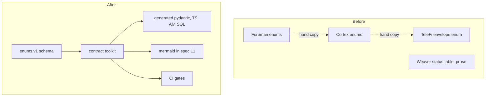
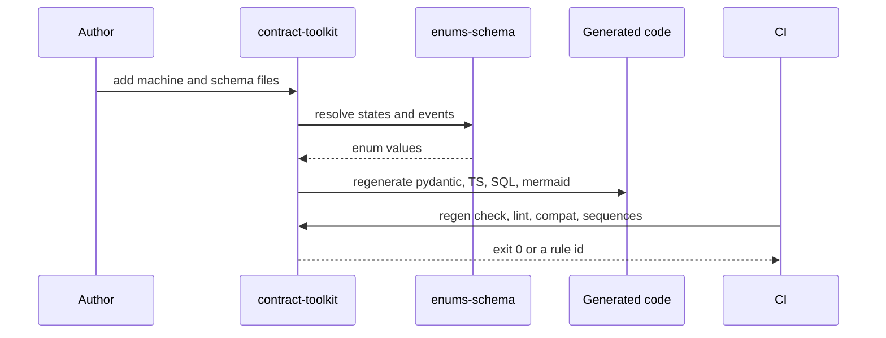
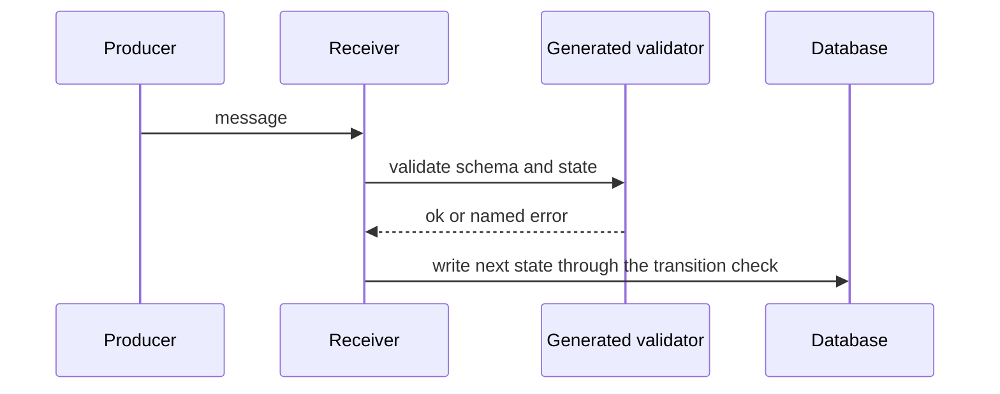
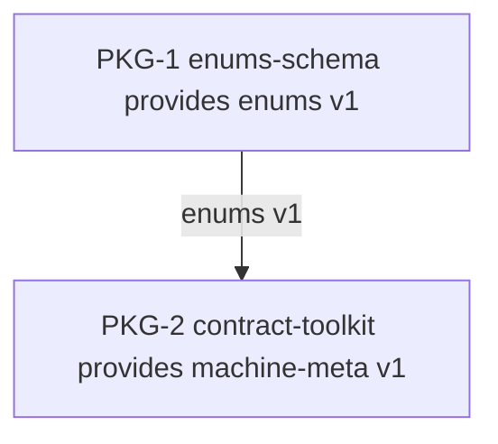

# boundary-contracts: L1 architecture

Before: n/a for tooling; each repo holds its own copies of the enums. After: one enums file and per-boundary folders feed a toolkit that generates every binding and every diagram, and CI regenerates and fails on any diff.

## Components
| Component | Role (one line) | Spec |
|---|---|---|
| enums-schema | the single shared enums file, seeded with the fleet's enums | components.md `## enums-schema` |
| contract-toolkit | meta-schema, machine checks, codegen, lint, compat gate, mermaid, sequence checkers | components.md `## contract-toolkit` |
| stage-result adopter | Weaver StageResult contract and run-status machine | nested: docs/work/boundary-contracts-weaver/ |

Per-boundary folder shape (`contracts/<boundary>/`): `<msg>.v<N>.schema.json`, a reference to the common enums, `<boundary>.machine.v<N>.json`, `fixtures/{valid,invalid}/`, `sequences/{valid,invalid}/*.jsonl`, and a one-line COMPAT note: additive within vN; a breaking change is a new vN+1 file plus a dual-read window.

## Call chains
### Author adds a boundary, CI proves sync

### Receiver validates a message at runtime

## Work breakdown

| Package | Component | Owns | Provides | Consumes | Depends on | Milestone | ACs | Test seam |
|---|---|---|---|---|---|---|---|---|
| PKG-1 | enums-schema | contracts/common/** | enums@1 | - | - | M1 | AC-1, AC-2 | none |
| PKG-2 | contract-toolkit | contracts/machine-meta/**, contracts/generated/**, scripts/contracts/**, tests/contracts/**, .spectral/** | machine-meta@1 | enums@1 | PKG-1 | M2 | AC-3, AC-4, AC-5, AC-6, AC-7, AC-8, AC-9, AC-10, AC-11, AC-12, AC-13, AC-14, AC-15 | fixtures:enums@1 |
| SHARED | - | package.json, pnpm-lock.yaml, pyproject.toml, .github/workflows/contracts.yml | - | - | - | M1 | - | none |

Package numbering follows the owner's list (toolkit first in prose); PKG-1 is the enums file because the toolkit consumes it, so it takes the earlier milestone. The Weaver adopter is a nested item, not a package.

Owns use the Foreman glob dialect and are pairwise disjoint. Milestone exit: listed ACs green, contract tests for every contract provided or consumed, and the isolation run passing per package.
