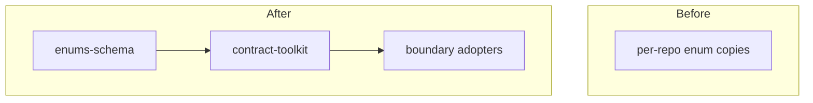

# boundary-contracts: L2 component specs

Owned files and packages are in architecture.md `## Work breakdown`.

| Component | Public interface |
|---|---|
| enums-schema | `contracts/common/enums.v1.schema.json` (`$defs` only) |
| contract-toolkit | `python scripts/contracts/{check,regen,compat,mermaid,seqcheck}.py`, `scripts/contracts/seqcheck.ts`, `contracts/machine-meta/machine-meta.v1.schema.json` |
| boundary-contracts-weaver | nested item |

## enums-schema

### Interface
A JSON Schema 2020-12 document with `$id` `https://claudence.local/contracts/common/enums.v1.schema.json`, containing only `$defs`. Each `$defs` entry is a string enum written as `oneOf` of `{const, description}` so every value carries a description. Boundaries reference entries by `$ref` to this `$id`. Value casing is lowercase-kebab. No code; no function signatures.

### Functional requirements
| FR | Requirement |
|---|---|
| FR-1 | Every enum value is a `const` with a non-empty `description`, in lowercase-kebab, and no value is defined in two `$defs` entries unless the entries are distinct enums |
| FR-2 | The file is seeded with: run status and outcomeKind, failure class core set, severity, telefi kind, blocker class, attention class, work-item status, work-item type; each seed enum has a row in data.md naming its source file and the consumers to migrate |
| FR-3 | A published enum value is never removed or renamed within v1; a new value is additive |

### Data
`enums.v1.schema.json`; seed sources and consumers in data.md `## Schema`.

### Failure modes
| Failure | Detection | Handling |
|---|---|---|
| value without description | Spectral rule and AC-1 test | lint fails with the value path |
| seed enum without a source row | AC-2 test | test fails naming the enum |
| source files disagree on membership | implementation review | union adopted, disagreement logged in DECISIONS |

### Budget
| Dimension | Budget |
|---|---|
| Latency | validation of the file in 1 s p95 |
| Cost | $0 per run, no model call |

## contract-toolkit

### Interface
- `check.py <boundary-dir> [--enums <file>]` exit 0 or 1; validates the machine file against `machine-meta.v1.schema.json` and runs the structural checks; each finding `<rule-id>: <path>: <message>` on stderr. Rule ids: `machine-unreachable-state`, `machine-terminal-outgoing`, `machine-unknown-state`, `machine-unknown-event`, `machine-schema-invalid`.
- `regen.py [--check]` regenerates `contracts/generated/**` (pydantic via datamodel-code-generator, TS via json-schema-to-typescript after dereferencing, Ajv standalone validators, SQL enum and transition migration). With `--check` it writes nothing and exits 1 on any diff against the committed files.
- `compat.py <boundary-dir> --from vN --to vN+k` replays every vN fixture under the vN+k schema and compares enum values and machine states; exit 1 naming the fixture, enum value or state lost.
- `mermaid.py <machine-file> [--into <md-file> --check]` emits a `stateDiagram-v2` block; with `--into` it replaces the block between `<!-- machine:<boundary> -->` markers; with `--check` it exits 1 when the committed block differs.
- `seqcheck.py <machine-file> <sequence.jsonl>` and `seqcheck.ts` (same arguments): exit 0 valid; exit 1 printing `seq-invalid: <file>: message <index>: event <on> not valid in state <state>`.
- Machine file shape, `<boundary>.machine.v<N>.json`: `{initial: State, terminal: [State], states: [State], transitions: [{from: State, on: Event, to: State, guard?: string}]}`; State and Event are `$ref`s into the enums. `additionalProperties: false` everywhere.
- Spectral ruleset `.spectral/contracts.yaml`: rules `versioned-id`, `property-description`, `enum-value-description`, `enum-kebab-case`, `envelope-cloudevents-names` (envelope schemas use `id`, `source`, `type`, `specversion`, `time`, `dataschema` exactly).
- Sequence file: JSON Lines, one `{"on": Event}` per line, starting from the machine's `initial` state.

### Functional requirements
| FR | Requirement |
|---|---|
| FR-4 | `check.py` rejects a machine with a state unreachable from `initial`, a transition leaving a `terminal` state, or a state or event not in the enums, each with its own rule id; an unknown key or malformed JSON is `machine-schema-invalid` |
| FR-5 | `regen.py --check` fails on any difference between regenerated and committed outputs and pins datamodel-code-generator at 0.60.2 or later and json-schema-to-typescript at 16.x |
| FR-6 | The SQL migration holds a CHECK or enum type per shared enum and a transition table with one trigger function that rejects any update whose (old state, event, new state) is not a machine transition |
| FR-7 | The Spectral ruleset enforces versioned `$id`, a description on every property and enum value, lowercase-kebab enum values, and CloudEvents envelope attribute names |
| FR-8 | `compat.py` fails when any vN valid fixture is invalid under vN+k, or any enum value or machine state present in vN is absent in vN+k |
| FR-9 | `mermaid.py` emits one edge per transition `from --> to: on`, `[*] --> initial`, and `terminal --> [*]` for each terminal state, in sorted order so the output is deterministic |
| FR-10 | `seqcheck` in Python and in TypeScript return the same verdict and the same first-bad index for every sequence file |
| FR-11 | Every tool exits 1 with a rule id on a missing file, malformed input or missing external generator, and every subprocess has a 10 s timeout that reports a named failure |

### Data
Reads boundary folders and `enums.v1.schema.json`; writes only `contracts/generated/**` and marked blocks in spec markdown. Schema in data.md.

### Failure modes
| Failure | Detection | Handling |
|---|---|---|
| generator tool missing or wrong version | version probe at start | exit 1 `tool-missing` or `tool-version`, no skip |
| generator hangs | 10 s subprocess timeout | exit 1 `tool-timeout` |
| machine file cycles with no terminal | reachability check | not an error by itself; reachable-state rule applies |
| mermaid markers absent in target file | marker search | exit 1 `mermaid-marker-missing` |
| sequence file malformed line | JSON parse per line | exit 1 `seq-malformed` with line number |

### Budget
| Dimension | Budget |
|---|---|
| Latency | `check`, `compat`, `mermaid`, `seqcheck` 2 s p95 per boundary; `regen` 10 s p95 |
| Cost | $0 per run, no model call |

## boundary-contracts-weaver
Nested spec: `docs/work/boundary-contracts-weaver/`. Trigger: boundary and team.
