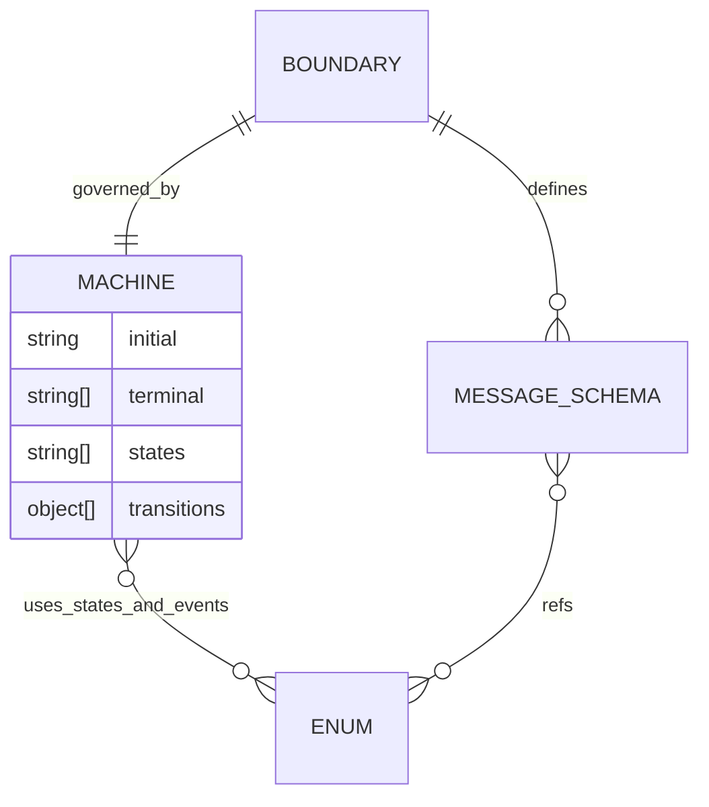

# boundary-contracts: L2 data and contracts

Before: n/a, new. After: above.

## Schema
The schema sources of truth are `contracts/common/enums.v1.schema.json` and `contracts/machine-meta/machine-meta.v1.schema.json`; every binding is generated from them into `contracts/generated/**` and is never hand edited. Envelope messages use CloudEvents attribute names `id, source, type, specversion, time, dataschema`.

Seed enum sources (each must be read at implementation; the AC-2 test fails when a row is missing):

| Enum | Source of truth to read | Consumers to migrate (follow-up) |
|---|---|---|
| run status, outcomeKind | `D:/repo/Lib/weaver/docs/specs/agent-platform.md:92` | Foreman (two files), Weaver |
| failure class core set | `D:/repo/Lib/weaver/docs/specs/agent-platform.md:81` | Weaver, Cortex plug-in |
| severity | TeleFi `envelope.v1` schema in `D:/repo/Lib/telefi` | Cortex (emits `warning`), TeleFi |
| telefi kind, verdict to kind map | TeleFi `envelope.v1` schema and the JS and Python maps | TeleFi JS, Python |
| blocker class | the 4 hand copies in Foreman, Cortex, Catwalk, Weaver (to locate at implementation) | all four |
| attention class | the 2 hand copies (to locate at implementation) | Catwalk and one more |
| work-item status, type | `contracts/work-item.v2.json` and `skills/dark-factory/WORK-ITEM-STANDARD.md` | Catwalk (`build` versus `feature`) |

## Contracts
| Contract | Version | Schema file | Provider | Valid fixtures | Invalid fixtures | Digest | Status |
|---|---|---|---|---|---|---|---|
| enums | 1 | contracts/common/enums.v1.schema.json | PKG-1 | contracts/common/fixtures/valid/*.json | contracts/common/fixtures/invalid/*.json |  | current |
| machine-meta | 1 | contracts/machine-meta/machine-meta.v1.schema.json | PKG-2 | contracts/machine-meta/fixtures/valid/*.json | contracts/machine-meta/fixtures/invalid/*.json |  | current |

COMPAT: additive within vN; a breaking change means a new vN+1 file plus a dual-read window. Producer and consumer tests both run against these fixtures.

## Migration and back-compat
New files only; nothing existing is edited. Existing `contracts/work-item.v2.json` stays as is and is migrated in a later item. Adopters keep their hand-copied enums until their own follow-up item lands; each follow-up is reversible by reverting that item's commit. The SQL migration is additive (new types and a transition table), applied per adopter database.
