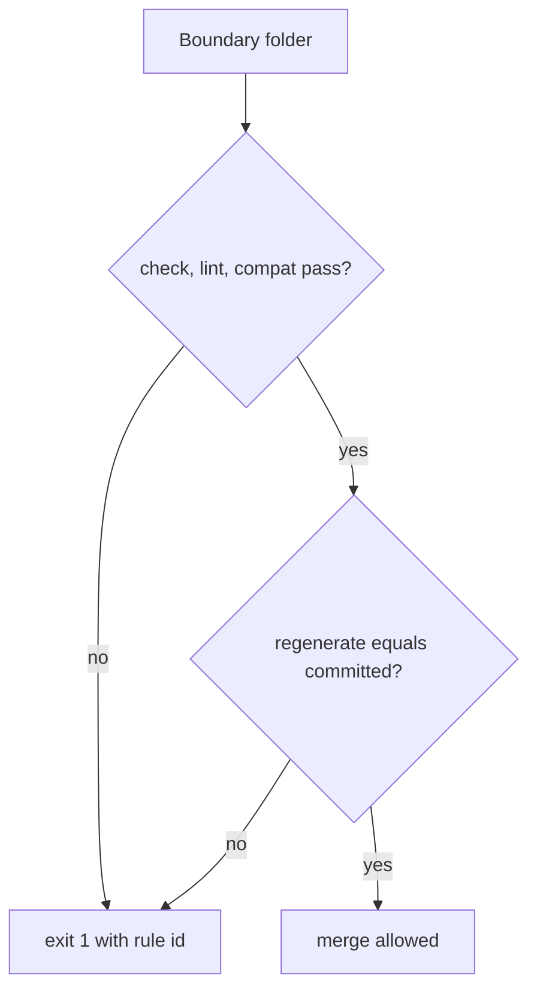

# boundary-contracts: L3 functional and acceptance criteria

## FR/NFR delta
| ID | Change | Note |
|---|---|---|
| FR-1 to FR-11 | added | components.md |
| NFR-1 to NFR-3 | added | README |

## Acceptance criteria
| AC | Traces | Given / when | Pass when | Fail when | Test |
|---|---|---|---|---|---|
| AC-1 | CAP-1, FR-1 | enums file with one value lacking `description` | validation exits 1 naming that value path; the real file passes | the real file has a value without description, or the bad file passes | contracts/common/tests/test_enums.py::test_descriptions |
| AC-2 | CAP-1, FR-2, FR-3 | the real enums file and the seed-source table in data.md | all 9 seed enums present, each with a source row, and `live-tier-approval` and `warning` present in blocker class and severity; a seed enum without a row fails | a seed enum is absent or has no source row | contracts/common/tests/test_enums.py::test_seed_set |
| AC-3 | CAP-2, FR-4 | machine fixture with one state no transition reaches | `check.py` exits 1 with `machine-unreachable-state` naming it | exit 0, or a different rule id | tests/contracts/test_machine_check.py::test_unreachable |
| AC-4 | CAP-2, FR-4 | machine fixture with a transition from a terminal state | exit 1 with `machine-terminal-outgoing` naming the transition | exit 0, or a different rule id | tests/contracts/test_machine_check.py::test_terminal |
| AC-5 | CAP-2, FR-4 | machine fixture using a state, and another using an event, not in the enums | exit 1 with `machine-unknown-state` and `machine-unknown-event` respectively | either is accepted | tests/contracts/test_machine_check.py::test_enum_membership |
| AC-6 | CAP-3, FR-5 | committed generated files, then one byte of the pydantic output edited, and a Windows-shaped path argument | `regen.py --check` exits 0 on clean tree, exits 1 naming the edited file after the edit; tool versions at pins | edit not detected, or version below pin accepted | tests/contracts/test_regen.py |
| AC-7 | CAP-3, CAP-8, FR-6 | a real Postgres (url from `CONTRACTS_TEST_DB_URL`) with the generated migration applied | inserting an enum value outside the shared enum is rejected, and an update whose (old, event, new) is not a machine transition is rejected by the trigger; a legal one is stored; a missing database url fails the test, never skips | illegal value or transition stored | tests/contracts/test_sql.py |
| AC-8 | CAP-4, FR-7 | schema fixtures: no versioned `$id`; property without description; enum value in camelCase; envelope using `eventType` instead of `type`; and a CloudEvents-named valid envelope | Spectral reports the matching rule id for each of the four bad fixtures and none for the valid one | a bad fixture passes, or the valid envelope is flagged | tests/contracts/test_spectral.py |
| AC-9 | CAP-5, FR-8 | v1 and v2 of a boundary: v2 makes a v1 valid fixture invalid; then v2 drops an enum value; then v2 only adds a field | `compat.py` exits 1 naming the fixture, exits 1 naming the value, exits 0 | a breaking change passes or the additive one fails | tests/contracts/test_compat.py |
| AC-10 | CAP-6, FR-9 | a machine file with 2 terminal states and a marker block in a markdown file | the block contains exactly one edge per transition, `[*] --> initial` and one `--> [*]` per terminal; a stale block makes `--check` exit 1; regenerating twice is byte-identical | edge missing or duplicated, stale block accepted | tests/contracts/test_mermaid.py |
| AC-11 | CAP-7, FR-10 | the recorded `sequences/invalid` file with a message invalid in its state | `seqcheck.py` exits 1 printing the index and the state; every `sequences/valid` file exits 0 | invalid accepted, or index wrong | tests/contracts/test_seqcheck.py |
| AC-12 | CAP-7, FR-10 | every valid and invalid sequence file across all boundaries run through `seqcheck.py` and `seqcheck.ts` | the exit code and first-bad index are identical for each file | any file where the two differ | tests/contracts/test_seqcheck_parity.py |
| AC-13 | NFR-1 | a new boundary folder (schema, machine, fixtures, sequences) added in a temp tree with no toolkit change | check, regen, compat, mermaid and seqcheck all process it and exit 0 | any tool needs a source edit or a registry entry | tests/contracts/test_extensibility.py |
| AC-14 | NFR-2 | import-linter contract run over the package owns | 0 imports from `scripts/contracts` into `contracts/common`, and 0 cross-package internal imports; a planted import makes it exit 1 | the rule passes with a planted import | tests/contracts/test_fitness.py |
| AC-15 | NFR-3, FR-11 | truncated JSON machine file, missing file, missing generator binary, and an injected generator hang | each exits 1 within 10 s with `machine-schema-invalid`, `file-missing`, `tool-missing`, `tool-timeout` respectively | a crash trace, a hang over 10 s, or exit 0 | tests/contracts/test_faults.py |

Tests cite `boundary-contracts/AC-<n>` verbatim (for example `boundary-contracts/AC-1`).
