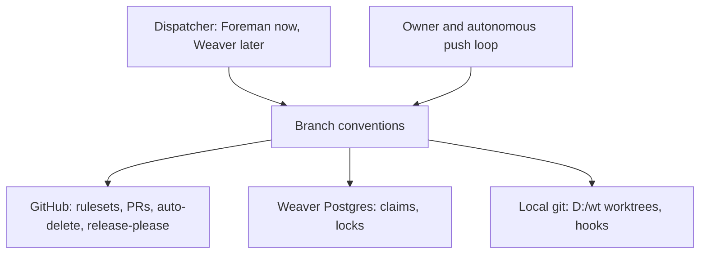
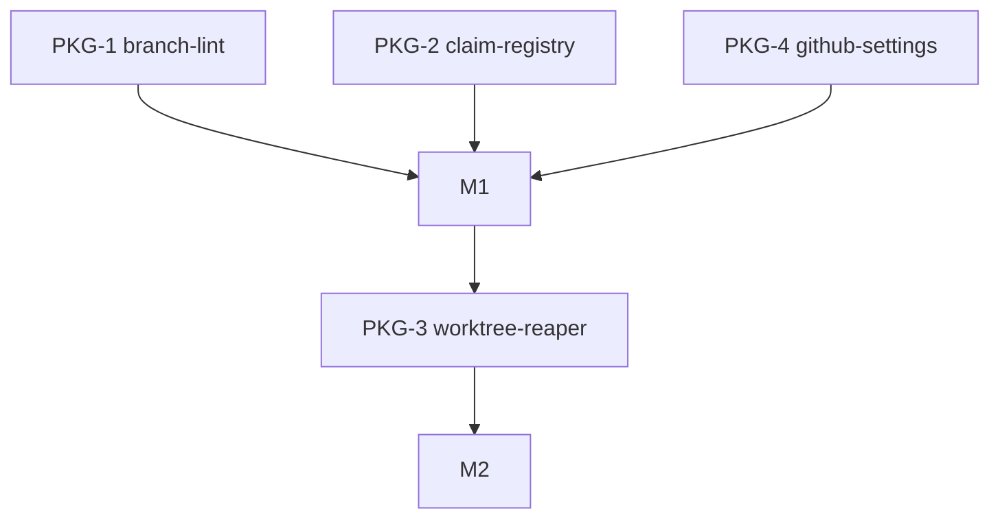

# Branch, worktree and claim conventions for agent-driven repos

## Overview
This item fixes one convention for how agents name branches, place worktrees, claim work, delete finished work and merge. CAP-1 is the branch-name format, enforced by a lint. CAP-2 puts worktrees outside every repo. CAP-3 is the claim and lock registry in Weaver's Postgres, so two dispatchers cannot take the same work. CAP-4 is a fail-closed safe-delete predicate. CAP-5 is cleanup: global prune, a weekly reaper, and an owner-pending remote auto-delete. CAP-6 is the merge model: trunk-based, squash only. CAP-7 is versioning through release-please. Four packages deliver it. M1 holds the naming lint, the claim registry (which also provides the `work-claim@1` contract) and the GitHub settings with release-please. M2 holds the worktree reaper, which consumes `work-claim@1` to skip live claims. No package imports another's internals; the only seam is the contract.

## Purpose
Parallel agents and an autonomous push loop have produced stale worktrees, ambiguous branch names and unsafe deletes. This item gives one naming scheme, one claim registry with leases, one safe-delete rule and one merge model, each enforced by a check rather than by convention, so work is never lost and two agents never edit the same thing.

## Non-goals
- Replacing Foreman's dispatch loop; Foreman's `.git/foreman-worktrees` stay until Weaver's Foreman step replaces them.
- Enabling GitHub auto-delete of remote head branches (owner chose local cleanup only for now).
- Requiring pull requests on the default branch (open question 1).
- Hosting or building a merge queue.

## Capabilities
| CAP | Statement |
|---|---|
| CAP-1 | The service must name every work branch `<type>/<id>-<slug>` with type in feat, fix, chore, docs, refactor, test, hotfix, release; lowercase, at most 60 characters, slug frozen at claim, no agent or attempt in the name; enforced by `commit-check` as a pre-push hook and `commit-check-action` as a PR check |
| CAP-2 | The service must create each worktree at `D:/wt/<repo>/<id>`, outside every repo, by the orchestrator, with a fresh `pnpm install` and never `file:` links across repos |
| CAP-3 | The service must keep a registry and locks in Weaver's Postgres: an exclusive leased work claim keyed (repo, work item, package), one writer per worktree, a per-repo advisory-lock critical section, one merge per repo at a time rebased on main, contract files owned by their provider package, liveness by process plus heartbeat (never age), visibility mirrors (assignee, `agent:claimed` label, draft PR after first push), and a `--force-with-lease` empty-expect push guard |
| CAP-4 | The service must delete a worktree or branch only when a five-rule fail-closed safe-delete predicate holds, in the defined removal order |
| CAP-5 | The service must clean up merged work: `fetch.prune true` globally, a weekly reaper applying the predicate, squash-merge detection by upstream `[gone]` or `gh pr list --state merged`; remote auto-delete stays owner-pending with the audit analysis recorded |
| CAP-6 | The service must merge trunk-based with short-lived branches, squash only, PR title as a Conventional Commit, with default-branch protection against deletion, non-fast-forward and non-linear history |
| CAP-7 | The service must version with SemVer plus Conventional Commits, release-please for meter, telefi and weaver, tags `v1.2.3`, and branches never carrying versions |

## Non-functional requirements
| NFR | Target | Method | Evidence |
|---|---|---|---|
| NFR-1 | 0 deletions of unmerged work across all 5 predicate rules, 1 injected fault per rule | fault-injection: per-rule tests against real temp repos with a stubbed `gh` | AC-8 |
| NFR-2 | 0 of at least 30 bad-name fixtures accepted and 0 of at least 10 good-name fixtures rejected | fault-injection: bad-name and good-name fixture set run through the lint | AC-1 |
| NFR-3 | exactly 1 winner in 100 of 100 runs of 2 processes claiming one key | fault-injection: two real processes race one claim key against Postgres | AC-4 |
| NFR-4 | one reaper run over 200 worktrees finishes in <= 120 s, each `gh` call bounded at <= 10 s | latency-bench: reaper over a synthetic 200-worktree set with a stubbed slow `gh` | AC-11 |
| NFR-5 | no import across packages' owned files except consumed contracts (import boundary) | fitness: import-linter rule from the Work breakdown owns | AC-15 + config:.importlinter |

## Trade-offs
| Option | Latency | Cost | Maintenance | Extensibility | Refactorability | Verdict |
|---|---|---|---|---|---|---|
| Trunk-based, squash only, claims in Weaver Postgres, local worktrees under D:/wt | seconds per lock | none beyond existing Postgres | one registry, one predicate | new package or repo = new key | rules are code, replaceable | chosen |
| Keep Foreman's in-memory `withLock` and per-repo `.git/foreman-worktrees` | microseconds | none | lock lost on restart, tied to Foreman | single process only | low | rejected: not crash-safe, cannot span dispatchers |
| Long-lived feature branches with merge commits (git-flow style) | slow integration | extra rebase and conflict cost | many branch kinds | high | low | rejected: conflicts with squash-only and autonomous loop |
| Third-party worktree manager (gwq, git-worktree-runner) as the registry | fast | none | outside our control | medium | medium | rejected: no PR-state delete predicate, no shared claims |

## Patterns applied
| Pattern | Where | Why |
|---|---|---|
| Lease with heartbeat | claim-registry | liveness survives sleep and wake because it checks process plus heartbeat, never age |
| Advisory lock critical section | claim-registry | short per-repo serialisation of worktree add/remove, branch creation and merge |
| Fail-closed predicate | worktree-reaper | any error, timeout or missing PR means keep, with the reason recorded |
| Optimistic remote guard | claim-registry | `--force-with-lease` with empty expect makes a second dispatcher's first push fail |
| Policy as code | github-settings | rulesets and merge settings are applied and verified by script |

## Components chosen
| Need | Chosen (off the shelf) | Rejected | Why rejected |
|---|---|---|---|
| Branch-name lint | `commit-check` (pre-push) plus `commit-check-action` | hand-written regex hook | two enforcement points to maintain; commit-check covers hook and CI |
| Release automation | release-please | semantic-release, manual tags | release-please opens a reviewable release PR and fits squash-only |
| Locks | Postgres advisory locks in Weaver | file locks, Foreman in-memory lock | not shared across processes or not crash-safe |
| Branch protection | GitHub rulesets | classic branch protection | rulesets are the current API and support the deletion, non-fast-forward and linear-history rules |
| Safe-delete predicate and reaper | built in-house on `git` and `gh` | gwq, git-worktree-runner | they manage worktrees but have no PR-state, headRefOid and fail-closed rules |
| PR state lookup | `gh pr view` and `gh pr list` | raw REST calls | `gh` already authenticated on the host and already used by Foreman |

## Gate plan
| Risk | Kind (deterministic / qualitative) | Check | Blocking / advisory |
|---|---|---|---|
| Unmerged work deleted | deterministic | per-rule fault-injection tests (AC-8, AC-9, AC-10) | blocking |
| Bad branch name reaches remote | deterministic | lint fixtures plus pre-push hook test (AC-1, AC-2) | blocking |
| Two agents claim one key | deterministic | two-process race test (AC-4) | blocking |
| Package isolation | deterministic | isolation: `python scripts/spec_check.py docs/work/branch-conventions/README.md --sparse PKG-n` then sparse checkout, build and test per package (gate command not yet written, open question 3) | blocking |
| Ruleset or merge-setting drift | deterministic | settings verifier against GitHub (AC-13) | blocking |
| Design soundness of the claim model | qualitative | adversarial design review before `spec-locked` | advisory |

## Open questions
1. No required-PR rule on the default branch yet, because the owner's autonomous commit-and-push loop pushes to main directly. Revisit when the loop moves to PRs.
2. Remote auto-delete of head branches is owner-pending (needs-owner, low urgency); local cleanup only for now.
3. The isolation gate command (sparse checkout, build, test) is named but unwritten.
4. The claim registry's server side (tables, advisory-lock helpers) is delivered as a Weaver child work item at `D:/repo/Lib/weaver/docs/work/` cross-referenced as `ext:` from this item once it exists; until then PKG-2 owns the contract, fixtures and a harness-side conformance suite only.
5. The weaver ruleset is blocked: private repos need GitHub Pro (needs-owner).
6. Whether a ruleset branch-name regex can enforce CAP-1 server-side is unverified, as is merge-queue availability on personal accounts; neither is relied on.
7. Whether git follows junctions during `git worktree remove` is unverified; treated as dangerous regardless, hence links are deleted first.

### Audit analysis: remote branch deletion
A merged PR keeps `refs/pull/<n>/head`, its commits, its review and its diff, plus a Restore button on the PR. Deleting the remote head branch therefore loses no history for PR-merged work. Branches pushed without a PR keep their remote copy, because the reaper only acts on branches with a PR state, or on the `merge-base --is-ancestor` fallback.

### Applied settings (2026-10-31)
`fetch.prune true` set globally. Rulesets 26286582 (meter) and 26286583 (telefi): block deletion, block non-fast-forward, require linear history. Squash-only merge set on meter, telefi and weaver. The weaver ruleset was blocked (GitHub Pro needed).

## References
- Conventional Branch v1.1.0: https://conventionalbranch.org
- Claude Code worktrees: https://code.claude.com/docs/en/worktrees.md
- git push (`--force-with-lease`): https://git-scm.com/docs/git-push
- GitHub rulesets docs, merge queue docs and REST API reference pages: https://docs.github.com (rulesets, merge queue, REST)
- git-worktree-runner: https://github.com/coderabbitai/git-worktree-runner
- gwq: https://github.com/d-kuro/gwq
- commit-check: https://pypi.org/project/commit-check
- Graphite, trunk-based development guide: https://graphite.dev
- release-please: https://github.com/googleapis/release-please

Unverified: ruleset branch-name regex support; merge queue availability on personal accounts; whether git follows junctions on `git worktree remove` (treated as dangerous regardless).
