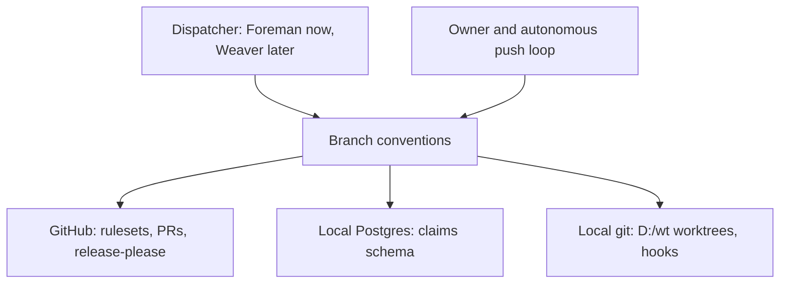
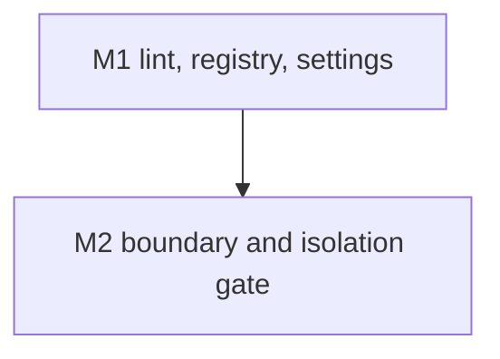

# Branch, worktree and claim conventions for agent-driven repos

Home repo: `~/.claude` (claudence). External targets: the local `postgresql-x64-17` service, and the GitHub repos meter, telefi and weaver.

## Overview
This item fixes how agents name branches, place worktrees, claim work and merge. CAP-1 is the branch-name format with a lint. CAP-2 places each worktree outside every repo, one per package-level id, so path, branch and claim key agree. CAP-3 is a self-contained claim registry with process-based liveness and atomic takeover. CAP-4 serialises per-repo mutations and guards the first push. CAP-5 keeps local cleanup safe; the delete predicate and the weekly reaper live in the nested item worktree-reaper. CAP-6 is the merge model, trunk-based and squash only. CAP-7 is versioning through release-please. M1 delivers the lint, the claim registry with its two contracts, and the GitHub settings. M2 delivers the import-boundary and isolation gate over all M1 output.

## Purpose
Parallel agents and an autonomous push loop have produced stale worktrees, ambiguous branch names and unsafe deletes. This item gives one naming scheme, one claim registry whose liveness cannot be fooled by sleep or PID reuse, and one merge model, each enforced by a check rather than by convention. The safe-delete rule is specified in the nested item `docs/work/worktree-reaper/`.

## Non-goals
- Replacing Foreman's dispatch loop; Foreman's `.git/foreman-worktrees` stay until Weaver's Foreman step replaces them.
- Enabling GitHub auto-delete of remote head branches (owner chose local cleanup only for now; see decision:D21).
- Requiring pull requests on the default branch (open question 1).
- Adopting the registry inside Weaver, or cross-repo `ext:` references (follow-ups, open questions 4 and 5).

## Capabilities
| CAP | Statement |
|---|---|
| CAP-1 | The service must name every work branch `<type>/<id>-<slug>` with type in feat, fix, chore, docs, refactor, test, hotfix, release; lowercase; at most 60 characters including `type/`; slug frozen at claim; no agent or attempt in the name; the default branch, `release-please--*`, `dependabot/*` and `renovate/*` are allow-listed; enforced by `commit-check` as a pre-push hook and `commit-check-action` as a PR check |
| CAP-2 | The service must create each worktree at `D:/wt/<repo>/<id>`, outside every repo, by the orchestrator, where `<id>` is the package-level id (`<item>-pkg-<n>` for a multi-package item), so path, branch and claim key agree; a fresh `pnpm install` runs only in JS repos, never with `file:` links across repos |
| CAP-3 | The service must keep claims in its own additive `claims` schema in the Postgres named by an environment connection string: an exclusive claim keyed (repo, work item, package), one writer per worktree, liveness decided by the holder process (host, pid and process start time) with the heartbeat advisory, atomic takeover of an expired claim, and a live holder with no progress flagged to the owner and never reclaimed |
| CAP-4 | The service must serialise worktree add/remove, branch creation and merge per repo in one session-level advisory-lock critical section, merge one pull request per repo at a time rebased on main first, guard the first push with `--force-with-lease=refs/heads/<b>:` so a second dispatcher fails, and mirror each claim as assignee, an `agent:claimed` label and a draft PR after the first push |
| CAP-5 | The service must keep local cleanup safe: `fetch.prune true` set globally, deletion only through the safe-delete predicate of the nested item, and remote head-branch auto-delete left owner-pending |
| CAP-6 | The service must merge trunk-based with short-lived branches, squash only, the PR title a Conventional Commit checked by an action, and the default branch protected against deletion, non-fast-forward and non-linear history |
| CAP-7 | The service must version with SemVer plus Conventional Commits, release-please for meter, telefi and weaver, tags `v1.2.3`, and branches never carrying versions |

## Non-functional requirements
| NFR | Target | Method | Evidence |
|---|---|---|---|
| NFR-1 | 0 of at least 30 bad-name fixtures accepted and 0 of at least 10 good-name fixtures rejected, including 1 fixture per allow-list pattern | fault-injection: bad-name, good-name and allow-list fixtures run through the lint | AC-1 |
| NFR-2 | name validation p95 <= 500 ms | latency-bench: 100 validations timed against the budget | AC-1 |
| NFR-3 | exactly 1 winner in 100 of 100 runs of 2 processes claiming one key | fault-injection: two real processes race one claim key against an ephemeral database | AC-3 |
| NFR-4 | claim acquisition p95 <= 50 ms | latency-bench: 200 sequential claims timed against the budget | AC-3 |
| NFR-5 | 0 reclaims of a claim whose holder process is suspended past the heartbeat window | clock-kill: suspend the real holder process, then resume it | AC-6 |
| NFR-6 | 0 imports across packages' owned files except consumed contract files (import boundary) | fitness: import-linter rule built from the Work breakdown owns, run by a gate command | AC-15 + config:.importlinter |

## Trade-offs
| Option | Latency | Cost | Maintenance | Extensibility | Refactorability | Verdict |
|---|---|---|---|---|---|---|
| Trunk-based, squash only, own claims schema in local Postgres, worktrees under D:/wt | milliseconds per claim, seconds per lock | none beyond the existing Postgres | one registry, one lint | a new package or repo is a new key | rules are code, replaceable | chosen |
| Keep Foreman's in-memory `withLock` and `.git/foreman-worktrees` | microseconds | none | lock lost on restart, tied to Foreman | single process only | low | rejected: not crash-safe, cannot span dispatchers |
| Long-lived feature branches with merge commits | slow integration | extra rebase and conflict cost | many branch kinds | high | low | rejected: conflicts with squash-only and the autonomous loop |
| Third-party worktree manager (gwq, git-worktree-runner) as the registry | fast | none | outside our control | medium | medium | rejected: no shared claims, no PR-state delete predicate |

## Patterns applied
| Pattern | Where | Why |
|---|---|---|
| Process-identity liveness | claim-registry | host, pid and process start time defeat PID reuse and sleep; the heartbeat is advisory |
| Atomic compare-and-set takeover | claim-registry | exactly one reclaimer wins an expired claim |
| Advisory lock critical section | claim-registry | short per-repo serialisation with a collision-safe two-int key |
| Optimistic remote guard | claim-registry | `--force-with-lease` with an empty expect makes a second dispatcher's first push fail |
| Policy as code | github-settings | rulesets and merge settings are applied and verified by script |
| Fitness function | boundary-gate | the import boundary is checked on every run, not by review |

## Components chosen
| Need | Chosen (off the shelf) | Rejected | Why rejected |
|---|---|---|---|
| Branch-name check | `commit-check` (pre-push) plus `commit-check-action` | hand-written regex hook | two enforcement points to maintain; commit-check covers hook and CI |
| PR-title check | `amannn/action-semantic-pull-request` (name unverified by fetch) | custom workflow | an existing action already enforces Conventional Commit titles |
| Release automation | release-please | semantic-release, manual tags | opens a reviewable release PR and fits squash-only |
| Locks and registry store | Postgres advisory locks and a `claims` schema | file locks, Foreman in-memory lock | not shared across processes or not crash-safe |
| Branch protection | GitHub rulesets | classic branch protection | rulesets are the current API and support deletion, non-fast-forward and linear-history rules |
| Process liveness | `psutil` (pid and create_time) | pid file with timestamp | a pid alone is reused by the OS; create_time pins identity |
| Import boundary | import-linter | hand-written import scan | a maintained tool with contract syntax |

## Gate plan
| Risk | Kind (deterministic / qualitative) | Check | Blocking / advisory |
|---|---|---|---|
| Bad branch name reaches remote | deterministic | lint fixtures plus pre-push hook test (AC-1) | blocking |
| Two agents claim one key | deterministic | two-process race test (AC-3) | blocking |
| Live holder reclaimed | deterministic | kill, suspend and hung-process tests (AC-4, AC-6, AC-7) | blocking |
| Package isolation | deterministic | isolation: `python scripts/gates/isolation.py` runs a sparse checkout from `spec_check.py --sparse PKG-n`, then build and test per package | blocking |
| Ruleset or merge-setting drift | deterministic | settings verifier on rule contents (AC-12) | blocking |
| Settings drift on the live repos | deterministic | live read-only advisory check (AC-13) | advisory |
| Design soundness of the claim model | qualitative | adversarial design review before `spec-locked` | advisory |

## Open questions
1. No required-PR rule on the default branch yet, because the owner's autonomous commit-and-push loop pushes to main directly. Revisit when the loop moves to PRs.
2. Remote auto-delete of head branches is owner-pending (needs-owner, low urgency).
3. The id/slug split for hyphenated work-item ids is ambiguous in `<id>-<slug>`; the lint checks overall shape only and the registry holds the exact id and slug (default chosen; revisit if the lint must split).
4. Weaver adoption follow-up: Weaver adopts this registry (schema `claims`) in its Foreman step; until then the harness owns it.
5. Cross-repo `ext:` references are not supported by the standard (its open question 9), so the Weaver link is prose only.
6. The weaver ruleset is blocked: private repos need GitHub Pro (needs-owner). Whether a ruleset branch-name regex can enforce CAP-1 server-side, and merge-queue availability on personal accounts, are unverified and not relied on.
7. Advisory locks require a session-level, direct Postgres connection; a transaction pooler would break them. This is stated as a requirement, not tested against a pooler.

### Applied settings (2026-10-31)
`fetch.prune true` set globally. Rulesets 26286582 (meter) and 26286583 (telefi): block deletion, block non-fast-forward, require linear history. Squash-only merge set on meter, telefi and weaver. The weaver ruleset was blocked (GitHub Pro needed). Verification asserts rule contents, not ids.

## References
- Conventional Branch v1.1.0: https://conventionalbranch.org
- Claude Code worktrees: https://code.claude.com/docs/en/worktrees.md
- git push (`--force-with-lease`): https://git-scm.com/docs/git-push
- GitHub rulesets docs, merge queue docs and REST API reference pages: https://docs.github.com (rulesets, merge queue, REST)
- git-worktree-runner: https://github.com/coderabbitai/git-worktree-runner
- gwq: https://github.com/d-kuro/gwq
- commit-check: https://pypi.org/project/commit-check
- Graphite, trunk-based development guide: https://graphite.dev
- release-please: https://github.com/googleapis/release-please
- amannn/action-semantic-pull-request: https://github.com/amannn/action-semantic-pull-request (name from memory; verify before lock)
- Decision rows: decision:D21 (remote branch deletion audit analysis) in `docs/DECISIONS.md`.

Unverified: ruleset branch-name regex support; merge queue availability on personal accounts; the PR-title action's exact name.

## Gap-ledger check
Categories from `docs/SPEC-GAP-LEDGER.md` (2026-10-31 rows).

| Category | Handled by |
|---|---|
| authoritative-source | FR-9 (liveness from the process, not the heartbeat), FR-21 (settings read from GitHub), AC-4, AC-12; default branch and PR state are handled in the nested item worktree-reaper (its FR-3, AC-3) |
| fail-closed-on-unknown | FR-6 (unknown id or path means refuse), FR-16 (registry unreachable means no claim), AC-2; deletion fail-closed cases live in the nested item (its AC-6) |
| destructive-op-proof | n/a: no deletion happens in this item; the proof rules are in the nested item worktree-reaper (CAP-1, NFR-1) |
| liveness-and-time | FR-9, FR-10, FR-12, NFR-5, AC-4 (real kill), AC-6 (real suspend), AC-7 (hung holder) |
| concurrency-granularity | FR-6 (path, branch and claim key all from the package-level id), AC-2 (two package claims of one item get distinct paths and branches), AC-3 |
| external-contract-unverified | FR-21 and AC-13 (live read-only check of the GitHub settings), AC-12 (rule contents, not ids); the PR-title action name is unverified and listed in References |
| split-state | FR-16 (one `claims` table is the single source of ownership and liveness; PR and worktree state are derived at read time), data.md Schema |
| untestable-ac | one fault per AC and the specific reason asserted (AC-4, AC-5, AC-6, AC-7 are separate); contract fixtures with invalid cases (AC-10) |
| scope-drift-oversize | the reaper split into the nested item; this item has 15 ACs; a new requirement is a new item |
| enforcement-allowlist | FR-3 and AC-1 (allow-list fixtures for the default branch, `release-please--*`, `dependabot/*`, `renovate/*`) |
