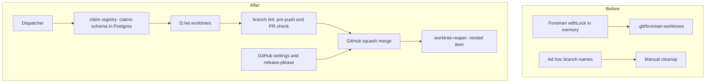
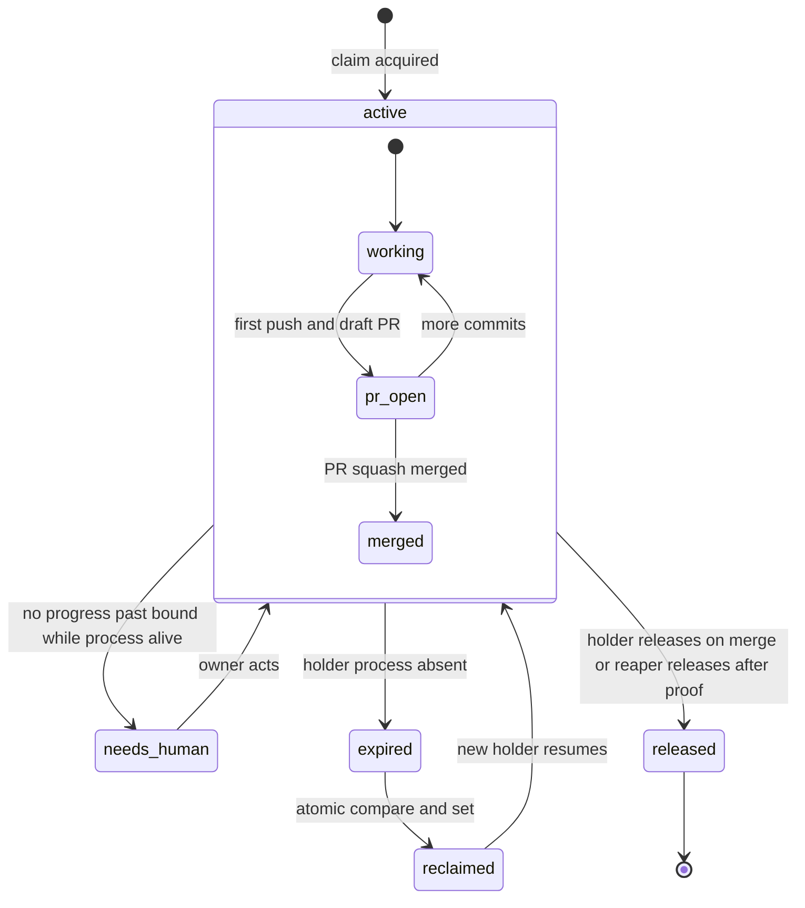
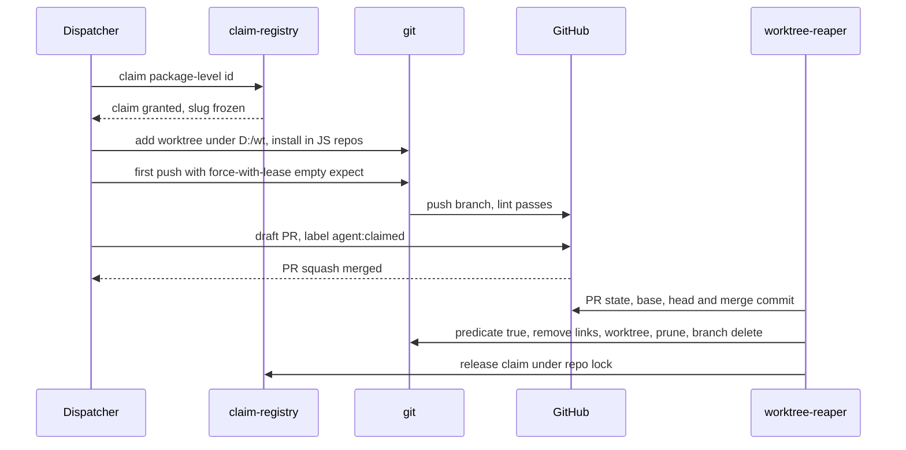
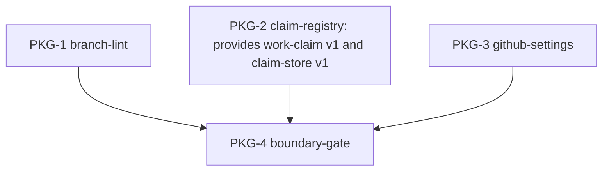

# branch-conventions: L1 architecture

Before: Foreman holds an in-memory lock and keeps worktrees under each repo's `.git/foreman-worktrees`; branch names are free-form and cleanup is manual. After: a Postgres-backed claim registry gates every worktree under `D:/wt/<repo>/<id>`, a lint gates names at push and on PRs, settings are applied as code, and the nested reaper item applies one delete predicate.

## Components
| Component | Role (one line) | Spec |
|---|---|---|
| branch-lint | validates `<type>/<id>-<slug>` at pre-push and on PRs | components.md `## branch-lint` |
| claim-registry | claims, liveness, takeover, critical section, push guard, mirrors, ClaimStore port | components.md `## claim-registry` |
| github-settings | rulesets, squash-only, PR-title check, release-please | components.md `## github-settings` |
| boundary-gate | import-boundary and isolation gate commands | components.md `## boundary-gate` |
| worktree-reaper | safe-delete predicate and weekly reaper | nested: docs/work/worktree-reaper/ |

## Lifecycle
Lifecycle of a work claim. Stored states are active, expired and released; the phases inside active are derived from git and GitHub at read time and are never stored.

## Call chains
### Dispatch to reap

## Work breakdown

| Package | Component | Owns | Provides | Consumes | Depends on | Milestone | ACs | Test seam |
|---|---|---|---|---|---|---|---|---|
| PKG-1 | branch-lint | scripts/branch_lint/**, tests/branch_lint/**, cchk.toml, .pre-commit-config.yaml, templates/branch-lint/** | - | - | - | M1 | AC-1 | none |
| PKG-2 | claim-registry | scripts/claims/**, tests/claims/**, contracts/** | work-claim@1, claim-store@1 | - | - | M1 | AC-2, AC-3, AC-4, AC-5, AC-6, AC-7, AC-8, AC-9, AC-10 | none |
| PKG-3 | github-settings | scripts/gh_settings/**, tests/gh_settings/**, templates/release-please/**, templates/pr-title/** | - | - | - | M1 | AC-11, AC-12, AC-13, AC-14 | none |
| PKG-4 | boundary-gate | scripts/gates/**, tests/gates/**, .importlinter | - | - | PKG-1, PKG-2, PKG-3 | M2 | AC-15 | none |
| SHARED | - | pyproject.toml | - | - | - | M1 | - | none |

Owns use the Foreman glob dialect and are pairwise disjoint. The two contracts are consumed by the nested worktree-reaper item through `ext:branch-conventions:work-claim@1` and `ext:branch-conventions:claim-store@1`; stubs for them live inside the provider's owns. Hook wiring (`.pre-commit-config.yaml`) is owned by PKG-1.
