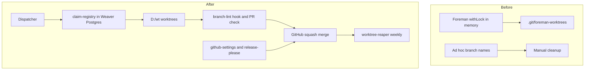
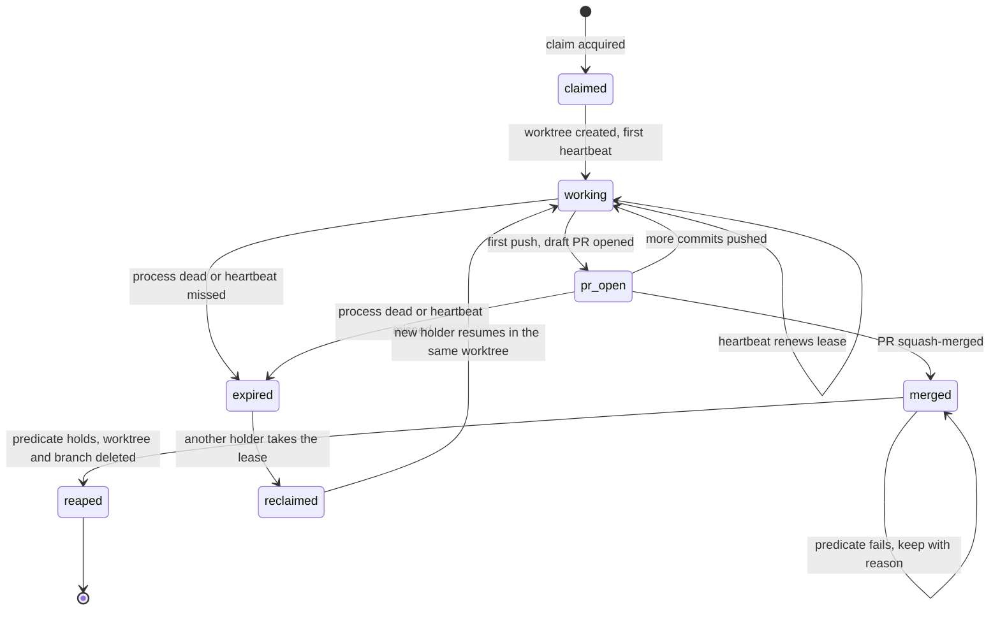
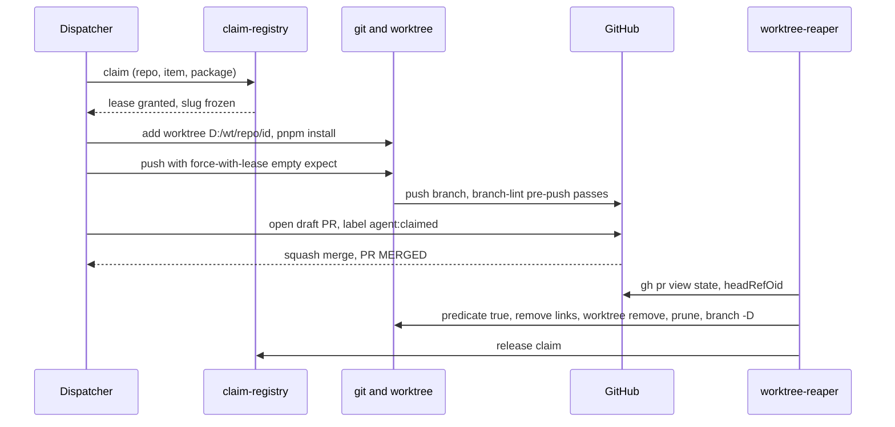

# branch-conventions: L1 architecture



Before: Foreman holds an in-memory lock and keeps worktrees under each repo's `.git/foreman-worktrees`; branch names are free-form and cleanup is manual. After: a Postgres-backed claim registry gates every worktree under `D:/wt/<repo>/<id>`, a lint gates names at push and PR, and a reaper applies one delete predicate.

## Components
| Component | Role (one line) | Spec |
|---|---|---|
| branch-lint | validates `<type>/<id>-<slug>` at pre-push and on PRs | components.md `## branch-lint` |
| claim-registry | leased claims, worktree writer, advisory-lock critical section, push guard, visibility mirrors | components.md `## claim-registry` |
| worktree-reaper | safe-delete predicate and weekly reaper | components.md `## worktree-reaper` |
| github-settings | rulesets, squash-only, release-please, auto-delete audit | components.md `## github-settings` |

## Lifecycle
Lifecycle of a work claim.



## Call chains
### Dispatch to reap


## Work breakdown
```mermaid
flowchart TD
  P1[PKG-1 branch-lint] --> P3[PKG-3 worktree-reaper]
  P2[PKG-2 claim-registry<br/>provides work-claim@1] -->|work-claim@1| P3
  P4[PKG-4 github-settings]
```

| Package | Component | Owns | Provides | Consumes | Depends on | Milestone | ACs | Test seam |
|---|---|---|---|---|---|---|---|---|
| PKG-1 | branch-lint | scripts/branch_lint/**, tests/branch_lint/**, cchk.toml | - | - | - | M1 | AC-1, AC-2 | none |
| PKG-2 | claim-registry | scripts/claims/**, tests/claims/**, contracts/work-claim.v1.json, contracts/fixtures/work-claim.v1/** | work-claim@1 | - | - | M1 | AC-3, AC-4, AC-5, AC-6, AC-7 | none |
| PKG-3 | worktree-reaper | scripts/worktree_reaper/**, tests/worktree_reaper/**, tests/architecture/** | - | work-claim@1 | PKG-2 | M2 | AC-8, AC-9, AC-10, AC-11, AC-15 | fixtures:work-claim@1 + stub:contracts/fixtures/work-claim.v1/stub.py |
| PKG-4 | github-settings | scripts/gh_settings/**, tests/gh_settings/**, templates/release-please/** | - | - | - | M1 | AC-12, AC-13, AC-14 | none |
| SHARED | - | pyproject.toml, .importlinter, .pre-commit-config.yaml | - | - | - | M1 | - | none |

Owns use the Foreman glob dialect and are pairwise disjoint. PKG-1 and PKG-4 do not depend on PKG-2 and may run in parallel with it.
