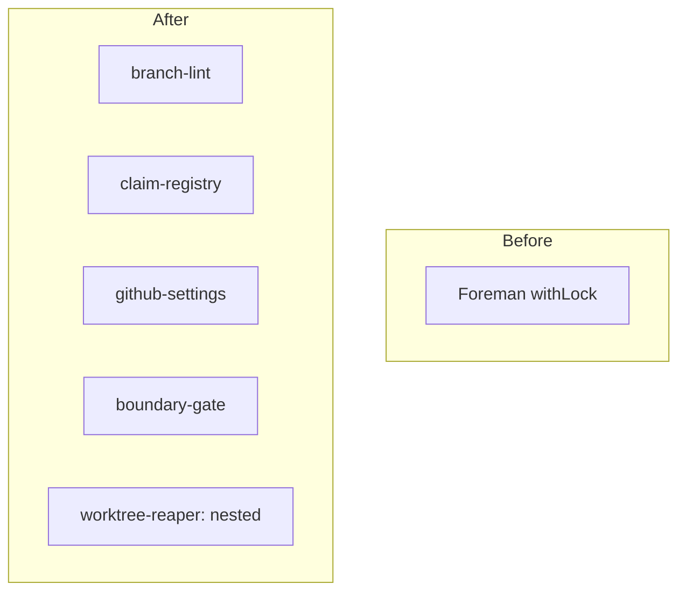

# branch-conventions: L2 component specs

| Component | Public interface |
|---|---|
| branch-lint | `commit-check` pre-push hook, `commit-check-action` PR check, `validate_branch(name, default_branch) -> list[str]` |
| claim-registry | `claim`, `heartbeat`, `release`, `pass_lease`, `reclaim`, `repo_lock`, `worktree_path`; the ClaimStore port |
| github-settings | `apply(repo)`, `verify(repo, live=False) -> list[Drift]` |
| boundary-gate | `python scripts/gates/import_boundaries.py`, `python scripts/gates/isolation.py` |

## branch-lint

### Interface
`validate_branch(name: str, default_branch: str) -> list[str]` returns violation codes, empty when valid. Shape `<type>/<id>-<slug>`: type in feat, fix, chore, docs, refactor, test, hotfix, release; lowercase letters, digits, hyphens and dots; at most 60 characters including `type/`. The id is an issue number, or a work-item id (shape only; whether it matches a claim is a registry check, not a lint check). Allow-listed and never linted: the default branch, `release-please--*`, `dependabot/*`, `renovate/*`. Wired through `cchk.toml` and `.pre-commit-config.yaml` as a pre-push hook, and as the PR check. Exit code is non-zero on any violation.

### Functional requirements
| FR | Requirement |
|---|---|
| FR-1 | A name not matching the shape, containing uppercase, or over 60 characters counted with `type/` is rejected with a named violation code |
| FR-2 | A name with an unknown type, an agent or attempt token, or a version string is rejected |
| FR-3 | The default branch, `release-please--*`, `dependabot/*` and `renovate/*` pass, each proved by a fixture |
| FR-4 | The lint checks shape only; it never reads the registry |
| FR-5 | The pre-push hook blocks the push and the PR check fails on a bad name |

### Data
Reads the branch name and the default branch name (from GitHub `defaultBranchRef`, passed in by the caller). Type list and limits come from `cchk.toml`.

### Failure modes
| Failure | Detection | Handling |
|---|---|---|
| `commit-check` not installed | hook exits with command-not-found | push blocked with a named install message, never skipped |
| Default branch name unavailable | caller passes none | allow-list for the default branch is skipped and the name is linted as any other (fail closed) |
| Id empty after the type | pattern mismatch | rejected with code `missing-id` |

### Budget
| Dimension | Budget |
|---|---|
| Latency | 500 ms p95 per name |
| Cost | $0 per push |

## claim-registry

### Interface
Python package `scripts/claims`. `claim(repo, work_item, package, holder) -> Claim` raises `ClaimConflict` when the key is held by a live holder. `heartbeat(claim)`, `progress(claim)`, `release(claim)`, `pass_lease(claim, new_holder)`, `reclaim(claim) -> Claim` (one atomic compare-and-set on `version`), `repo_lock(repo)` (context manager over a session-level advisory lock). The ClaimStore port (`contracts/claim-store.v1.json`): `live_claims(repo)`, `release(claim)`, `repo_lock(repo)`. Schema `work-claim@1` in data.md. `worktree_path(repo, id)` returns `D:/wt/<repo>/<id>`. Connection string from `CLAIMS_DB_URL`; DDL in `scripts/claims/sql/`.

### Functional requirements
| FR | Requirement |
|---|---|
| FR-6 | The worktree path is `D:/wt/<repo>/<id>`, outside every repo, created by the orchestrator, with `<id>` the package-level id (`<item>-pkg-<n>` for a multi-package item) so path, branch and claim key agree; an unknown or malformed id is refused; a fresh `pnpm install` runs only in JS repos and never with `file:` links across repos |
| FR-7 | The slug is chosen at claim and frozen: later claims and renames of the same key reuse it |
| FR-8 | A claim on (repo, work item, package) is exclusive; parallel packages of one item are allowed and get distinct paths and branches |
| FR-9 | A claim is expired only when its holder process is absent: no process with the recorded pid and start time on the recorded host (the start time defeats PID reuse); age alone never expires a claim |
| FR-10 | The heartbeat is advisory: used only for a remote holder, or after a grace window measured on a monotonic clock that excludes suspend; heartbeat and progress timestamps use the database `now()` |
| FR-11 | Taking over an expired claim is one atomic compare-and-set on `version`; of two reclaimers exactly one wins |
| FR-12 | A live holder with no progress past a bound, measured on a monotonic clock excluding suspend, is flagged `needs_human` and never auto-reclaimed while the process lives |
| FR-13 | One writer per worktree, the claim holder; a team shares a worktree only by passing the lease; readers need no claim |
| FR-14 | Worktree add/remove, branch creation and merge run inside one per-repo critical section using a session-level advisory lock (two-int key, fixed namespace) bounded at 30 s; one merge per repo at a time, rebased on main first |
| FR-15 | The first push uses `--force-with-lease=refs/heads/<b>:` so a second dispatcher fails; mirrors are set: assignee, the `agent:claimed` label, and a draft PR after the first push |
| FR-16 | The registry is self-contained: it creates an additive `claims` schema from its own DDL in the database named by `CLAIMS_DB_URL`; an unreachable database means no claim is granted; the table holds ownership and liveness only |
| FR-17 | The ClaimStore port exposes `live_claims`, `release` and `repo_lock`; the holder releases on PR merge, or a reaper releases after its merged-proof |

### Data
Reads and writes the `claims` table (data.md `## Schema`) and the contract files it owns. It reads GitHub and git state only to set mirrors, never to decide liveness.

### Failure modes
| Failure | Detection | Handling |
|---|---|---|
| Holder process dies | no process with the recorded pid and start time on the host | claim becomes `expired`, then `reclaim` by atomic compare-and-set |
| Host sleep and wake | wall-clock jump | the process check decides, not age, so the claim is kept while the process lives |
| PID reused by another process | start time differs from `proc_start` | treated as absent, so the claim expires |
| Live holder makes no progress | `progress_at` unchanged past the bound on the suspend-excluding monotonic clock | `needs_human` is set and the owner is flagged; never reclaimed while the process lives |
| Remote holder | recorded host differs from this host | the heartbeat grace window decides |
| Two reclaimers race | compare-and-set matches 0 rows for the loser | the loser raises `ClaimConflict` |
| Database unreachable | connect timeout 5 s | `registry-unavailable`; nothing proceeds without a claim |
| Advisory lock held past 30 s | lock watchdog | `lock-held-too-long`, the critical section aborts |
| Second dispatcher pushes the same branch | lease-guard push rejected | dispatcher aborts with `branch-already-claimed` |

### Budget
| Dimension | Budget |
|---|---|
| Latency | claim p95 50 ms; advisory lock held at most 30 s |
| Cost | $0 per claim |

## github-settings

### Interface
`apply(repo: str)` is idempotent. `verify(repo: str, live: bool = False) -> list[Drift]`: with `live=False` it checks recorded GitHub responses; with `live=True` it makes read-only calls and is advisory. Templates in `templates/release-please/` and `templates/pr-title/`.

### Functional requirements
| FR | Requirement |
|---|---|
| FR-18 | A PR-title check enforces a Conventional Commit title (action `amannn/action-semantic-pull-request`, name to verify before lock) |
| FR-19 | Squash-only merging, and the default-branch ruleset contains the rules deletion, non_fast_forward and required_linear_history; asserted by rule contents, not ruleset ids |
| FR-20 | `apply` brings a repo to the target settings and a second `apply` changes nothing |
| FR-21 | `verify(live=True)` reads the real settings read-only and reports drift as advisory |
| FR-22 | release-please is configured for meter, telefi and weaver with tags `v1.2.3`; branches carry no versions |
| FR-23 | `fetch.prune true` is verified in the global git config; remote head-branch auto-delete is reported `needs-owner`, not drift (analysis: decision:D21) |

### Data
Reads and writes GitHub repo settings and rulesets. Applied 2026-10-31: rulesets 26286582 (meter) and 26286583 (telefi), squash-only on all three. The weaver ruleset is blocked: private repos need GitHub Pro.

### Failure modes
| Failure | Detection | Handling |
|---|---|---|
| Ruleset call returns 403 on a private repo | HTTP 403 | recorded as `needs-owner`, not retried |
| Settings drift | `verify` returns a difference | non-zero exit with the drift list |
| Live call fails or times out at 10 s | exit code or timeout | advisory result `unknown`, never reported as ok |

### Budget
| Dimension | Budget |
|---|---|
| Latency | 10 s per repo per call |
| Cost | $0 per run |

## boundary-gate

### Interface
`python scripts/gates/import_boundaries.py` runs the import-linter rule generated from the Work breakdown owns and exits non-zero on any cross-package import. `python scripts/gates/isolation.py <PKG-id>` sparse-checks out the set printed by `spec_check.py --sparse`, then builds and tests.

### Functional requirements
| FR | Requirement |
|---|---|
| FR-24 | Files owned by one package import only their own files, third-party packages, shared files, and consumed contract files and stubs |
| FR-25 | The isolation command fails when a package does not build and test in its sparse checkout |

### Data
Reads `.importlinter` and the Work breakdown owns.

### Failure modes
| Failure | Detection | Handling |
|---|---|---|
| import-linter not installed | command not found | gate fails with a named install message, never skipped |
| Owns cannot be parsed | parse error | gate fails closed |

### Budget
| Dimension | Budget |
|---|---|
| Latency | 60 s per run |
| Cost | $0 per run |

## worktree-reaper
Nested spec: `docs/work/worktree-reaper/`. Trigger: boundary and contract.
