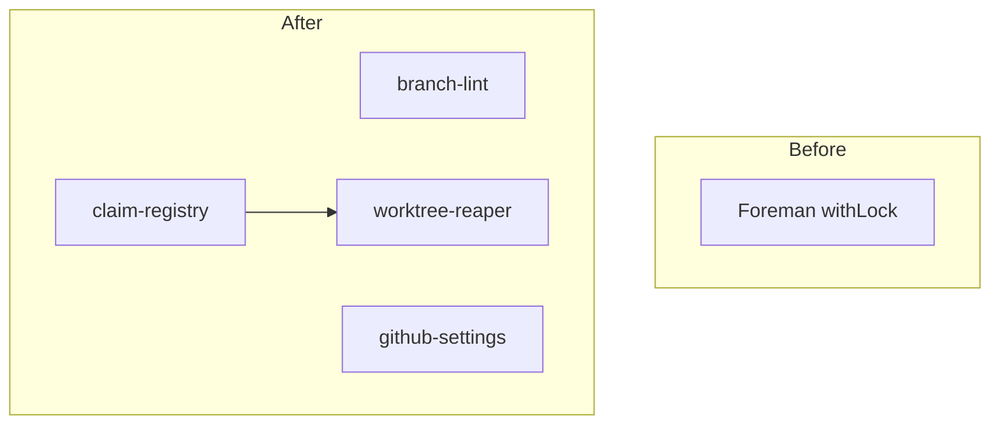

# branch-conventions: L2 component specs

| Component | Public interface |
|---|---|
| branch-lint | `commit-check` pre-push hook, `commit-check-action` PR check, `validate_branch(name) -> list[str]` |
| claim-registry | `claim(repo, item, package) -> Lease`, `heartbeat(lease)`, `release(lease)`, `with_repo_lock(repo)` |
| worktree-reaper | `safe_to_delete(worktree) -> Decision`, `reap(repo, dry_run) -> Report` |
| github-settings | `apply(repo)`, `verify(repo) -> list[Drift]` |

## branch-lint

### Interface
`validate_branch(name: str) -> list[str]` returns violation codes, empty when valid. Pattern `<type>/<id>-<slug>`; types feat, fix, chore, docs, refactor, test, hotfix, release; lowercase; at most 60 characters. Wired through `cchk.toml` as a `commit-check` pre-push hook and `commit-check-action`. Exit code non-zero on any violation.

### Functional requirements
| FR | Requirement |
|---|---|
| FR-1 | A name not matching `<type>/<id>-<slug>`, containing uppercase, or over 60 characters is rejected with a named violation code |
| FR-2 | A name containing an agent or attempt token, or a version string, is rejected |
| FR-3 | The pre-push hook blocks the push and the PR check fails on a bad name |

### Data
Reads the branch name only. Type list and limits come from `cchk.toml`.

### Failure modes
| Failure | Detection | Handling |
|---|---|---|
| `commit-check` not installed | hook exits with command-not-found | push blocked with a named install message, never skipped |
| Id empty after the type | pattern mismatch | rejected with code `missing-id` |

### Budget
| Dimension | Budget |
|---|---|
| Latency | 500 ms p95 per name |
| Cost | $0 per push |

## claim-registry

### Interface
`claim(repo, work_item, package, holder) -> Lease` raises `ClaimConflict` when the key is held by a live holder. `heartbeat(lease)`, `release(lease)`, `pass_lease(lease, new_holder)`, `with_repo_lock(repo)` (context manager over a Postgres advisory lock), `push_guard(branch)` runs `git push --force-with-lease=refs/heads/<b>:`. Schema: `work-claim@1` (data.md). `worktree_path(repo, id) -> D:/wt/<repo>/<id>`.

### Functional requirements
| FR | Requirement |
|---|---|
| FR-4 | A worktree path is `D:/wt/<repo>/<id>`, outside every repo, created by the orchestrator with a fresh `pnpm install` and no `file:` links across repos |
| FR-5 | A claim on (repo, item, package) is exclusive; parallel packages of one item are allowed |
| FR-6 | A claim is leased and heartbeat-renewed; liveness is the holder process plus its heartbeat, never age |
| FR-7 | One writer per worktree (the claim holder); a team shares a worktree only by passing the lease |
| FR-8 | Worktree add/remove, branch creation and merge run inside the per-repo advisory-lock critical section; one merge per repo at a time, rebased on main first |
| FR-9 | Visibility mirrors are set: assignee, `agent:claimed` label, draft PR after the first push |
| FR-10 | The first push uses `--force-with-lease=refs/heads/<b>:` so a second dispatcher fails |

### Data
Reads and writes the claim table (data.md `## Schema`); contract files are owned by their provider package.

### Failure modes
| Failure | Detection | Handling |
|---|---|---|
| Holder process dies | heartbeat missed and process absent | claim becomes expired, then reclaimable |
| Host sleep and wake | wall-clock jump | process check decides, not age, so the claim is kept if the process lives |
| Postgres unreachable | connect timeout 5 s | claim fails with `registry-unavailable`; nothing proceeds without a claim |
| Second dispatcher pushes the same branch | lease-guard push rejected | dispatcher aborts with `branch-already-claimed` |

### Budget
| Dimension | Budget |
|---|---|
| Latency | 50 ms p95 per claim; advisory lock held for seconds, bounded at 30 s |
| Cost | $0 per claim |

## worktree-reaper

### Interface
`safe_to_delete(worktree: Path) -> Decision` where `Decision = {delete: bool, reasons: list[str]}`. `reap(repo, dry_run=True) -> Report`. Weekly entry point `python scripts/worktree_reaper/reap.py`. Calls `git` and `gh pr view --json state,headRefOid,mergeCommit`, each with a 10 s timeout.

### Functional requirements
| FR | Requirement |
|---|---|
| FR-11 | Delete only if ALL hold: (1) `git status --porcelain=v2 --untracked-files=all` empty and no stashes; (2) `git rev-list @{u}..HEAD` empty; (3) the branch PR is MERGED; (4) PR `headRefOid` equals worktree HEAD; (5) for a non-squash merge with no PR, `git merge-base --is-ancestor HEAD origin/<default>` holds |
| FR-12 | A `gh` error, timeout or missing PR returns keep with the reason recorded |
| FR-13 | Removal order: delete each link and junction itself, then plain `git worktree remove` (never `--force`), then prune, then `git branch -D` |
| FR-14 | `.git/foreman-worktrees` and worktrees with a live claim are excluded |
| FR-15 | Squash merges are detected by upstream `[gone]` or `gh pr list --state merged`, never `git branch --merged` |

### Data
Reads the git worktree list, `gh` JSON and the `work-claim@1` contract. Writes only deletions and a keep-reason report.

### Failure modes
| Failure | Detection | Handling |
|---|---|---|
| `gh` timeout or non-zero exit | subprocess timeout or exit code | keep, reason `gh-error` |
| Commit made after the merge | `headRefOid` differs from HEAD | keep, reason `head-moved` |
| Junction inside the worktree | reparse-point check | junction removed itself first; if that fails, keep |
| Reaper exceeds its time bound | wall-clock budget | stop, report remaining worktrees as `deferred` |

### Budget
| Dimension | Budget |
|---|---|
| Latency | 120 s total per run over 200 worktrees; 10 s per external call |
| Cost | $0 per run |

## github-settings

### Interface
`apply(repo: str)` and `verify(repo: str) -> list[Drift]`, using `gh api` against rulesets and repo settings. Provides release-please config templates in `templates/release-please/`.

### Functional requirements
| FR | Requirement |
|---|---|
| FR-16 | Squash-only merging with PR title as a Conventional Commit; default-branch ruleset blocks deletion, non-fast-forward and non-linear history |
| FR-17 | `fetch.prune true` is verified in global git config |
| FR-18 | release-please is configured for meter, telefi and weaver with tags `v1.2.3`; branches carry no versions |
| FR-19 | The remote auto-delete setting is recorded as owner-pending and `verify` reports it as `needs-owner`, not as drift |

### Data
Reads and writes GitHub repo settings and rulesets. Applied 2026-10-31: rulesets 26286582 (meter), 26286583 (telefi); squash-only on meter, telefi, weaver. Weaver ruleset blocked: private repo needs GitHub Pro.

### Failure modes
| Failure | Detection | Handling |
|---|---|---|
| Ruleset call returns 403 on a private repo | HTTP 403 | recorded as `needs-owner`, not retried |
| Settings drift | `verify` returns a difference | non-zero exit with the drift list |

### Budget
| Dimension | Budget |
|---|---|
| Latency | 10 s per repo |
| Cost | $0 per run |
