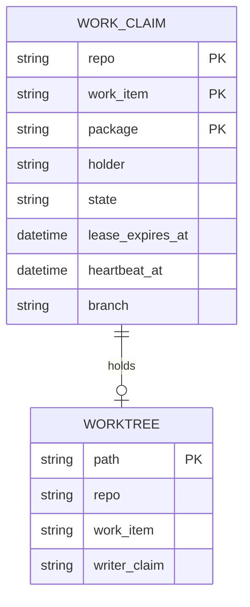

# branch-conventions: L2 data and contracts

Before: n/a, new (Foreman state was in memory). After: above.

## Schema
The source of truth is the `work-claim` JSON Schema at `contracts/work-claim.v1.json` (the Weaver Postgres table mirrors it). Types are derived from it. States: claimed, working, pr-open, merged, reaped, expired, reclaimed. The branch name is `<type>/<id>-<slug>`, the slug frozen at claim; agent and attempt live in `holder` and the PR body, not the name.

## Contracts
| Contract | Version | Schema file | Provider | Valid fixtures | Invalid fixtures | Digest | Status |
|---|---|---|---|---|---|---|---|
| work-claim | 1 | contracts/work-claim.v1.json | PKG-2 | contracts/fixtures/work-claim.v1/valid/*.json | contracts/fixtures/work-claim.v1/invalid/*.json |  | current |

The reaper (PKG-3) consumes `work-claim@1` to skip any worktree whose claim is live. A breaking change adds `work-claim.v2.json` and a new row.

## Migration and back-compat
None for existing data: Foreman's `.git/foreman-worktrees` are left untouched and excluded from the reaper until Weaver's Foreman step replaces them. The Weaver Postgres table is added by the Weaver child item (open question 4); it is additive.
