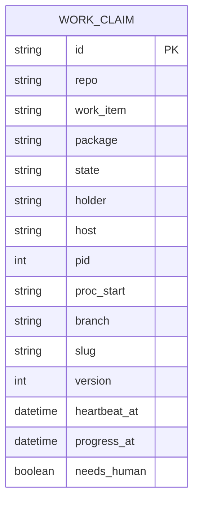

# branch-conventions: L2 data and contracts

Before: n/a, new (Foreman state was in memory). After: above. The table holds ownership and liveness only. PR and worktree state are derived from GitHub and git at read time, so there is no worktree entity.

## Schema
The source of truth is the pair of JSON Schemas under `contracts/` (`work-claim.v1.json` for the record, `claim-store.v1.json` for the port operations); the DDL in `scripts/claims/sql/` creates an additive `claims` schema in the Postgres named by the `CLAIMS_DB_URL` environment variable, over a session-level direct connection (no transaction pooler). Types are derived from the schemas. Stored `state` is `active`, `expired` or `released`.

Key facts:
- `id` is the package-level id: `<item>-pkg-<n>` for a multi-package item, `<item>` otherwise; path, branch and claim key all derive from it. The claim key is unique on (repo, work_item, package).
- Liveness: a claim is expired when its holder process is absent, that is no process with `pid` and `proc_start` on `host`. `heartbeat_at` and `progress_at` are written with the database `now()` and are advisory: used for a remote holder, or after a grace window on a monotonic clock that excludes suspend. There is no age-based lease expiry.
- `version` is the compare-and-set counter for takeover.
- Advisory lock: `pg_advisory_lock(namespace_int, repo_hash_int)`, the two-int form with a fixed namespace constant.

## Contracts
| Contract | Version | Schema file | Provider | Valid fixtures | Invalid fixtures | Digest | Status |
|---|---|---|---|---|---|---|---|
| work-claim | 1 | contracts/work-claim.v1.json | PKG-2 | contracts/fixtures/work-claim.v1/valid/*.json | contracts/fixtures/work-claim.v1/invalid/*.json |  | current |
| claim-store | 1 | contracts/claim-store.v1.json | PKG-2 | contracts/fixtures/claim-store.v1/valid/*.json | contracts/fixtures/claim-store.v1/invalid/*.json |  | current |

`claim-store@1` describes the port: `live_claims(repo)`, `release(claim)` and `repo_lock(repo)`. A provider-owned in-memory stub lives at `contracts/fixtures/claim-store.v1/stub.py`. The consumer is the nested item `docs/work/worktree-reaper/`, through `ext:` tokens. A breaking change adds a `v2` file and a new row.

## Migration and back-compat
None for existing data: Foreman's `.git/foreman-worktrees` are untouched. The `claims` schema is additive and created by the DDL in `scripts/claims/sql/`; dropping the schema is the rollback. Weaver adoption is a follow-up (README open question 4).
