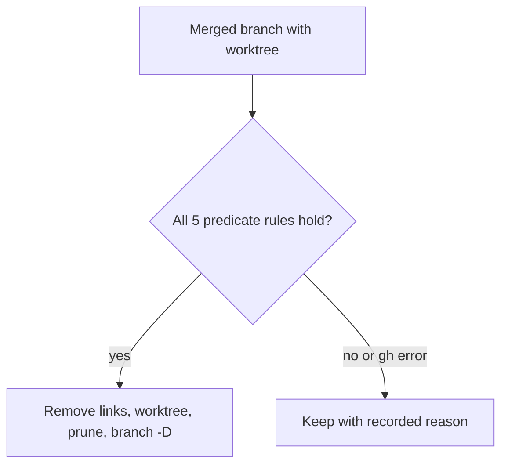

# branch-conventions: L3 functional and acceptance criteria

## FR/NFR delta
| ID | Change | Note |
|---|---|---|
| FR-1..FR-3 | added | branch-lint |
| FR-4..FR-10 | added | claim-registry |
| FR-11..FR-15 | added | worktree-reaper |
| FR-16..FR-19 | added | github-settings |
| NFR-1..NFR-5 | added | see README |

## Acceptance criteria
| AC | Traces | Given / when | Pass when | Fail when | Test |
|---|---|---|---|---|---|
| AC-1 | CAP-1, FR-1, FR-2, NFR-2 | the fixture set of at least 30 bad and 10 good branch names runs through `validate_branch` | every bad name returns a violation code and every good name returns none; bad includes uppercase, over 60 characters, unknown type, agent or attempt token, version string | any bad name accepted or any good name rejected | tests/branch_lint/test_validate.py |
| AC-2 | CAP-1, FR-3 | a push of a bad-named branch is attempted through the pre-push hook and the PR check config is loaded | the hook exits non-zero before the push and `cchk.toml` enables the PR check | the push proceeds or the config lacks the PR check | tests/branch_lint/test_hook.py |
| AC-3 | CAP-2, FR-4 | the orchestrator creates a worktree for repo `r` item `i` | the path is `D:/wt/r/i`, outside every repo, `pnpm install` ran fresh, and a `file:` link to another repo is rejected | path inside a repo, or a cross-repo `file:` link accepted | tests/claims/test_worktree_path.py |
| AC-4 | CAP-3, FR-5, NFR-3 | two real processes claim the same (repo, item, package) key against Postgres, 100 runs | exactly one wins each run and the other gets `ClaimConflict`; a different package of the same item is allowed | zero or two winners in any run | tests/claims/test_claim_race.py |
| AC-5 | CAP-3, FR-6, FR-7 | the clock jumps forward past the lease age while the holder process lives; then the holder process is killed | the claim is kept while the process lives and heartbeats, becomes expired after the kill, and passing the lease moves the single writer | the claim is reclaimed by age alone while the process lives, or two writers exist | tests/claims/test_liveness.py |
| AC-6 | CAP-3, FR-8, FR-10 | two dispatchers call add-worktree, merge and first push on one repo | the advisory lock serialises them, merges are one at a time and rebased, and the second first-push with empty expect fails | concurrent critical sections, or the second push succeeds | tests/claims/test_critical_section.py |
| AC-7 | CAP-3, FR-9 | a claim is acquired and the first push happens | assignee and the `agent:claimed` label are set and a draft PR exists after the first push | any mirror missing | tests/claims/test_mirrors.py |
| AC-8 | CAP-4, FR-11, NFR-1 | per rule, a real temp repo violates exactly that rule (dirty, stash, unpushed commit, PR not merged, head moved after merge, not an ancestor with no PR) with a stubbed `gh` | the decision is keep for every case and delete only when all rules hold | any violating case reports delete | tests/worktree_reaper/test_predicate.py |
| AC-9 | CAP-4, FR-12 | `gh` returns an error, times out at 10 s, or there is no PR | the decision is keep with a recorded reason such as `gh-error` | delete, or no reason recorded | tests/worktree_reaper/test_gh_failure.py |
| AC-10 | CAP-4, FR-13, FR-14 | a worktree containing a junction and a link is reaped; a foreman worktree and a live-claim worktree are present | links are removed first, `git worktree remove` runs without `--force`, then prune then `branch -D`; foreman and live-claim worktrees are untouched | `--force` used, order differs, or an excluded worktree removed | tests/worktree_reaper/test_removal_order.py |
| AC-11 | CAP-5, FR-15, NFR-4 | the reaper runs over 200 synthetic worktrees with a slow stubbed `gh`; a squash-merged branch exists | the run ends in <= 120 s, each call bounded at 10 s, the squash merge is found by `[gone]` or `gh pr list --state merged`, and unfinished items are reported `deferred` | the run exceeds 120 s, or detection uses `git branch --merged` | tests/worktree_reaper/test_reaper_bounds.py |
| AC-12 | CAP-5, FR-17, FR-19 | `verify` runs on a repo with the global config set and remote auto-delete off | `fetch.prune true` is confirmed, auto-delete is reported `needs-owner`, and the audit analysis exists in README | prune not checked, or auto-delete reported as drift | tests/gh_settings/test_cleanup_settings.py |
| AC-13 | CAP-6, FR-16 | `verify` runs on meter, telefi and weaver against recorded GitHub responses | squash-only is confirmed on all three, rulesets 26286582 and 26286583 are confirmed on meter and telefi, and the weaver ruleset is reported `needs-owner` | merge or rebase merging enabled, or a missing ruleset reported as ok | tests/gh_settings/test_merge_model.py |
| AC-14 | CAP-7, FR-18 | the release-please templates are rendered for meter, telefi and weaver | each has a config with tag format `v1.2.3` and Conventional Commit types, and no branch template carries a version | missing repo, tag without `v`, or a version in a branch name | tests/gh_settings/test_release_please.py |
| AC-15 | NFR-5 | the import-linter rule built from the Work breakdown owns runs on the repo | no package imports another's internals; only the consumed contract and stub are allowed | any cross-package import | tests/architecture/test_import_boundaries.py |

Tests cite `branch-conventions/AC-<n>` verbatim (for example `branch-conventions/AC-1`). Every CAP appears in the Traces of at least one row.
