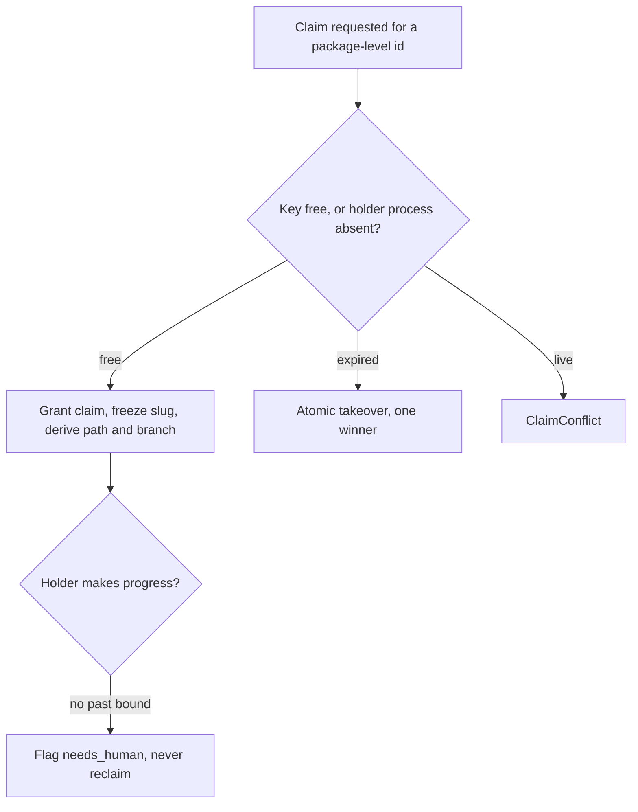

# branch-conventions: L3 functional and acceptance criteria

## FR/NFR delta
| ID | Change | Note |
|---|---|---|
| FR-1..FR-5 | added | branch name lint |
| FR-6..FR-17 | added | claim store |
| FR-18..FR-23 | added | GitHub settings |
| FR-24..FR-25 | added | gate commands |
| NFR-1..NFR-6 | added | see README |

## Acceptance criteria
| AC | Traces | Given / when | Pass when | Fail when | Test |
|---|---|---|---|---|---|
| AC-1 | CAP-1, FR-1, FR-2, FR-3, FR-4, FR-5, NFR-1, NFR-2 | at least 30 bad names, 10 good names and 1 name per allow-list pattern (default branch, `release-please--*`, `dependabot/*`, `renovate/*`) run through `validate_branch`; a bad name is pushed through the pre-push hook; 100 validations are timed | each bad name returns its specific violation code (uppercase, over 60 characters counting `type/`, unknown type, agent or attempt token, version string), each good and allow-listed name returns none, the hook exits non-zero before the push, the PR check is enabled in `cchk.toml`, and p95 is <= 500 ms | any bad name accepted, any good or allow-listed name rejected, a wrong code returned, or p95 above 500 ms | tests/branch_lint/test_validate.py, tests/branch_lint/test_hook.py, tests/branch_lint/test_latency.py |
| AC-2 | CAP-2, CAP-1, FR-6, FR-7, FR-8 | two package claims of one item (`<item>-pkg-1` and `<item>-pkg-2`) are granted, then the first is released and reclaimed with a different requested slug; one claim is made in a non-JS repo | the two claims get distinct paths under `D:/wt/<repo>/` and distinct branches, the slug of the reclaimed claim equals the frozen slug, `pnpm install` runs only in the JS repo, a `file:` link to another repo is refused, and a malformed id is refused | two package claims share a path or a branch, the slug changes, or `pnpm install` runs in a non-JS repo | tests/claims/test_identity.py |
| AC-3 | CAP-3, FR-8, FR-16, NFR-3, NFR-4 | two real processes claim the same (repo, item, package) key against an ephemeral per-test database on the local postgresql-x64-17 service, 100 runs, plus 200 sequential claims timed | exactly one process wins each run and the other gets `ClaimConflict`, a different package of the same item is granted, and claim p95 is <= 50 ms | zero or two winners in any run, or p95 above 50 ms | tests/claims/test_claim_race.py |
| AC-4 | CAP-3, FR-9, FR-11 | the real holder process is killed, then two reclaimers call `reclaim` at once; separately a process reuses the dead pid with a different start time | the claim is `expired` after the kill, exactly one reclaimer wins the compare-and-set, and the reused pid is treated as absent | the claim is reclaimed while the holder lives, both reclaimers win, or a reused pid keeps the claim alive | tests/claims/test_kill_takeover.py |
| AC-5 | CAP-3, FR-13 | the lease is passed from one holder to another for one worktree; then a second holder tries to write without the lease | after the pass exactly one writer is recorded, and the second holder is refused | two writers exist at once, or the pass leaves the old holder as writer | tests/claims/test_pass_lease.py |
| AC-6 | CAP-3, FR-9, FR-10, NFR-5 | the real holder process is suspended with psutil past the heartbeat window and the wall clock is advanced, then resumed | the claim is kept (not expired, not reclaimed) throughout the suspension and after the resume | the claim is reclaimed or marked expired while the process is merely suspended | tests/claims/test_suspend.py |
| AC-7 | CAP-3, FR-12 | a live holder makes no progress past the bound on the suspend-excluding monotonic clock; a reclaim is attempted | the claim is flagged `needs_human`, the owner flag is raised, and the reclaim is refused while the process lives | the live holder is auto-reclaimed, or no flag is raised | tests/claims/test_hung_holder.py |
| AC-8 | CAP-4, FR-14 | two dispatchers enter the critical section of one repo; one holds the lock past 30 s; two merges are requested for the same repo | the second waits and entries are serialised, the lock key is the two-int form with the fixed namespace on a session-level connection, the over-bound hold aborts with `lock-held-too-long`, and merges run one at a time each rebased on main first | concurrent critical sections, a hold beyond 30 s without abort, or a merge not rebased first | tests/claims/test_critical_section.py |
| AC-9 | CAP-4, FR-15, FR-16, FR-17 | a first push with `--force-with-lease=refs/heads/<b>:` is made by two dispatchers; a claim is acquired and a first push happens; the database is made unreachable | the second first-push is rejected, assignee and `agent:claimed` are set, a draft PR exists after the first push, and with the database down no claim is granted | the second push succeeds, a mirror is missing, or a claim is granted with the database down | tests/claims/test_push_guard_mirrors.py |
| AC-10 | CAP-3, FR-16, FR-17 | the valid and invalid fixtures of `work-claim@1` and `claim-store@1` are validated by the provider and by the in-memory stub | every valid fixture passes, every invalid fixture is rejected for its specific reason, and the stub behaves like the real store on the port operations | an invalid fixture accepted, or stub and real store disagree | tests/claims/test_contracts.py |
| AC-11 | CAP-6, FR-18 | a PR with a non-Conventional-Commit title and one with a valid title are run through the title check config | the bad title fails the check and the valid title passes | the bad title passes or the valid title fails | tests/gh_settings/test_pr_title.py |
| AC-12 | CAP-6, CAP-5, FR-19, FR-23 | `verify` runs on meter, telefi and weaver against recorded GitHub responses and the global git config | the default-branch ruleset must contain deletion, non_fast_forward and required_linear_history by rule content (a changed ruleset id does not matter), squash is the only merge method, `fetch.prune true` is confirmed, and remote auto-delete is reported `needs-owner` with the weaver ruleset reported `needs-owner` | merge or rebase merging enabled, a rule missing but reported ok, or auto-delete reported as drift | tests/gh_settings/test_merge_model.py |
| AC-13 | CAP-6, FR-20, FR-21 | `apply` runs twice against a fake GitHub; `verify(live=True)` runs against a failing and a drifted fake | the second `apply` changes nothing, the drift is reported as advisory, and a failed or timed-out live call reports `unknown` | the second `apply` changes state, or a live failure is reported as ok | tests/gh_settings/test_apply_live.py |
| AC-14 | CAP-7, FR-22 | the release-please templates are rendered for meter, telefi and weaver | each has a config with tag format `v1.2.3` and Conventional Commit types, and no branch name template carries a version | a repo missing, a tag without `v`, or a version in a branch name | tests/gh_settings/test_release_please.py |
| AC-15 | NFR-6, FR-24, FR-25 | the gate command runs the import-linter rule built from the Work breakdown owns on the repo, with one fixture import that crosses packages | the gate exits non-zero on the crossing fixture and zero on the real tree; only consumed contract files and stubs may be imported across packages | the crossing import is not detected, or the gate passes with the rule file missing | tests/gates/test_import_boundaries.py |

Tests cite `branch-conventions/AC-<n>` verbatim (for example `branch-conventions/AC-1`). Every CAP appears in the Traces of at least one row.
