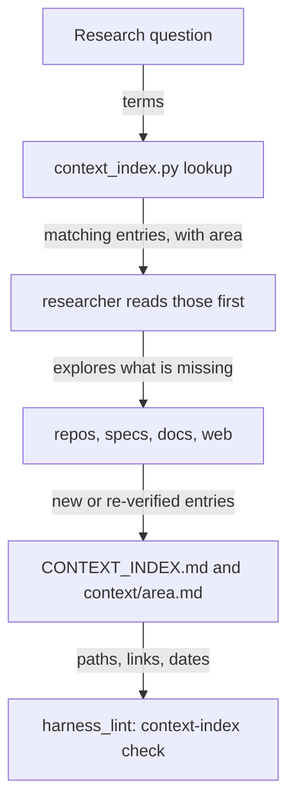
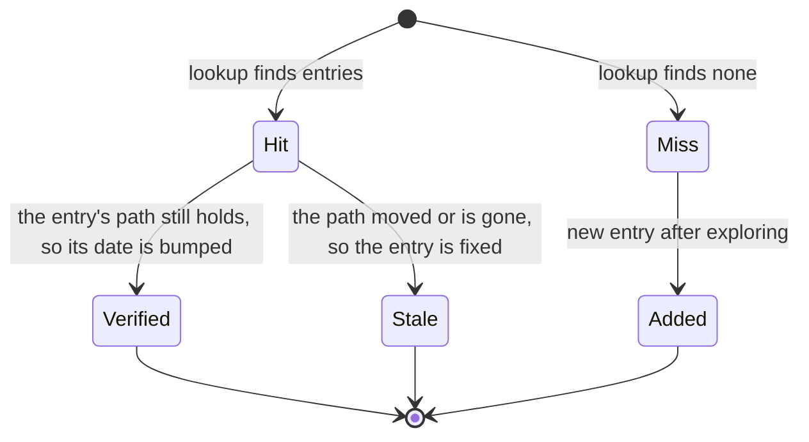

# A context index the researcher checks first and grows as it explores

## Purpose

Owner, 2026-11-07: the researcher "should point to a centralized file - the file should act as a table of content / data cache lookup for local context it has explored. It should write to / update that file whenever it explore new code, docs, context to build up the list. It should check that list first for references to things first, the doc should be able to nest and reference to others in more detail where appropriate".

The same day a research brief missed Weaver, a planned and locked spec, because nothing recorded where each role already lives.

Reuse:
- `D:/repo/docs/REPOS.md` stays the list of projects, and `D:/repo/docs/README.md` the doc map. The index links both and repeats neither.
- The index is by role and topic, across projects.
- The lint pattern comes from `scripts/harness_lint.py`.

## Goals and non-goals

Goal: one place to look up where a role already lives, which the researcher keeps current. Non-goal: listing projects (REPOS.md) or docs (README.md).

- Root `D:/repo/docs/CONTEXT_INDEX.md`: a table of areas, each linking its file under `D:/repo/docs/context/`.
- An area file holds a table: `| Topic | Where | Kind | Summary | Verified |`.
  - Where is an absolute `file:line` or a link to another area file, which is how entries nest.
  - Kind is one of: code, spec, plan, decision, report, config, service, index.
- The researcher looks up first, reads the matches, explores only what is missing, and then adds or re-dates entries (`Verified`) for what answered the question.

## Behaviour

| AC | Traces | Given / when | Pass when | Fail when | Test |
|---|---|---|---|---|---|
| AC-1 | Purpose | a root and two area files, one nested under the other | `lookup weaver runner` prints each matching entry with its area, including the nested one | a matching entry is missed, or a non-matching one is printed | `tests/test_context_index.py` |
| AC-2 | States | an entry whose path does not exist, an area file not linked from the root, and an entry with no date | `check` names all three | any of them passes | `tests/test_context_index.py` |
| AC-3 | Purpose | the harness lint runs on the fleet docs | the context-index findings are part of its report | they are not | `tests/test_context_index.py` |
| AC-4 | Purpose | the researcher card and the research-page skill | the card can edit files, and the skill says lookup first and update the index last | either is missing | `tests/test_context_index.py` |

## Outcomes

| Dimension | Level | Row or n/a reason | AC |
|---|---|---|---|
| success | L3 | Lookup returns what was explored before | AC-1 |
| invalid input | L3 | A broken path, orphan area or undated entry is named | AC-2 |
| dependency fails | L2 | A missing root or area file is itself a finding | - |
| timeout | L1 | Local file reads only, no network | - |
| crash mid-step | L2 | One area file is written at a time, and the lint catches a half-made link | - |
| concurrent actor | L2 | Two researchers editing one area file: git shows both, and the Edit tool refuses a stale file | - |
| duplicate or replay | L2 | Re-verifying an entry only moves its date | - |
| arrival channel | L3 | The skill reaches every research run | AC-4 |
| performance or cost | L2 | One grep over a few files | - |
| security | L2 | Private fleet docs; TeleFi and claudence keep no index | - |
| data and compatibility | L3 | The lint runs it with the other fleet checks | AC-3 |
| operability | L2 | `lookup` and `check` are one command each | - |

## Assumptions

| Assumption | Observed | If violated |
|---|---|---|
| The guard lets a subagent edit fleet docs | `hooks/guard.py:25-30` governs CLAUDE.md, memory, settings, agents, hooks and rules only | keep: the main session writes the entries the researcher reports |
