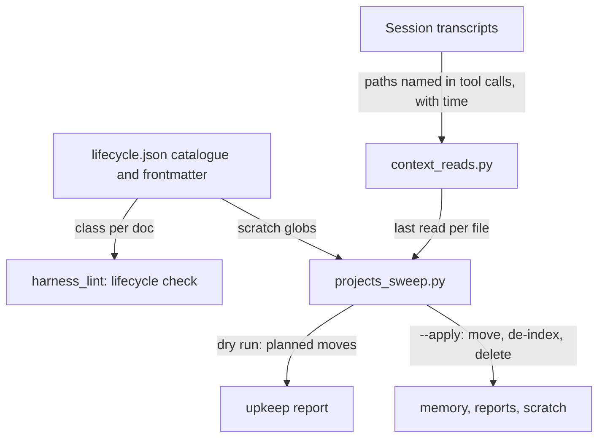

# Every piece of context has a lifecycle, and unused context is retired

Research: `D:/repo/docs/reports/2026-11-07-context-lifecycle-research.md`. Pilot of the lean flow.

## Purpose

Owner, 2026-11-07: "ensure each piece of context we generate has its own lifecycle in regard to knowing where and when to trigger updates or deletions, vs if it should be cataloged in such a way to be referred to as dated context that we know might not be up to date or no longer fresh", and "if its context thats generated for the sake of context but isn't generally applicable or catalogged then it should be aggressively archived, and deleted at a set cycle. Lets minimize the context we keep updated". The owner approved the cycles the same day.

Reuse: `scripts/projects_sweep.py` already finds clutter in `projects/` (dry run only), and `scripts/harness_lint.py` already lints fleet docs and memory. Both run from Cortex upkeep. Nothing records when context is read.

## Goals and non-goals

Goal: every fleet doc has one class (live, generated, snapshot or scratch), and memory, reports and scratch that nobody reads leave on a fixed cycle. Non-goal: generating STATE.md (its own item), and repo docs outside the fleet docs folder.

```mermaid
stateDiagram-v2
  [*] --> Active
  Active --> Active: read or edited
  Active --> Archived: memory or report unread 60 days; scratch unread 14 days
  Archived --> Active: read again, moved back by hand
  Archived --> Deleted: memory 90 days, scratch 30 days after archiving
  Archived --> Kept: reports are snapshots, never deleted
```

Scratch also covers the leftover temp and orphaned-worktree folders under `~/.claude/projects/` (the owner approved deleting them, 2026-11-07). They move to `~/.claude/archive/projects/` and are deleted 30 days later. Scratch from the fleet docs goes to `archive/scratch/`, the only fleet folder anything is deleted from. A snapshot's archive (`<dir>/archive/YYYY-MM/`) is never under it. The sweep commits only the fleet paths it moved, leaving out ignored ones, and any failed move or git step makes it exit 1.

Read means the file's parent folder and name appear in any tool call of any transcript, subagents included: Read, Grep, Glob, Bash or Edit. Claude Code keeps transcripts 180 days (`cleanupPeriodDays`), longer than every cycle. Without `--apply` nothing moves.

## Behaviour

| AC | Traces | Given / when | Pass when | Fail when | Test |
|---|---|---|---|---|---|
| AC-1 | Purpose | a fleet doc with no class in its frontmatter or in `lifecycle.json` | the lint names it; a live doc without `updated-by` is named too | an unclassified doc passes | `tests/test_context_lifecycle.py` |
| AC-2 | States | a path named in a transcript tool call, as `D:\x\y.md` or `D:/x/y.md` | its last read is that call's time | a mentioned file reads as never read, or a different file matches | `tests/test_context_lifecycle.py` |
| AC-3 | States | a memory note unread and unedited for 60 days, with `--apply` | it moves to that memory dir's `archive/` and its index line goes; 90 days later it is deleted | a recently read note moves, or the index keeps a dead line | `tests/test_context_lifecycle.py` |
| AC-4 | States | a report unread 60 days, or scratch unread 14 days, with `--apply` | the report moves to `reports/archive/YYYY-MM/`; scratch is archived, then deleted 30 days later | a report is ever deleted, or scratch read last week moves | `tests/test_context_lifecycle.py` |
| AC-5 | Purpose | the sweep runs without `--apply` | every planned move is listed and no file changes | any file moves | `tests/test_context_lifecycle.py` |

## Outcomes

| Dimension | Level | Row or n/a reason | AC |
|---|---|---|---|
| success | L3 | Unread context leaves on its cycle | AC-3 |
| invalid input | L3 | An unclassified doc is named, never passed | AC-1 |
| dependency fails | L2 | A transcript line that is not JSON is skipped; no transcripts means nothing is unread long enough to move | - |
| timeout | L2 | Local reads only; git calls keep the 30 second bound the sweep already uses | - |
| crash mid-step | L2 | Each file moves on its own, so a crash leaves files either moved or not; a moved note left in the index is a parity finding | - |
| concurrent actor | L2 | A session editing a note resets its age, so it is not moved | - |
| duplicate or replay | L2 | A second run finds nothing new to move | - |
| arrival channel | L3 | Every tool call that names the path counts as a read | AC-2 |
| performance or cost | L2 | One pass over about 1 GB of transcripts, weekly | - |
| security | L1 | No secrets read or written | - |
| data and compatibility | L3 | Reports are never deleted; the default stays a dry run | AC-4 |
| operability | L3 | The dry run lists every planned move | AC-5 |

## Assumptions

| Assumption | Observed | If violated |
|---|---|---|
| Transcripts are kept 180 days, and unread time counts only from the oldest transcript | `cleanupPeriodDays: 180` in `~/.claude/settings.json`; the oldest tool call the tracker saw is from 2026-10-25, so nothing can move before about 2026-11-15 | keep: a file counts as read at the oldest transcript's time, so nothing moves before the record is long enough |
| A path in a tool call is a fair proxy for use | lower bound: injected context is not counted | keep: the memory index and CLAUDE.md files are live and never swept |
