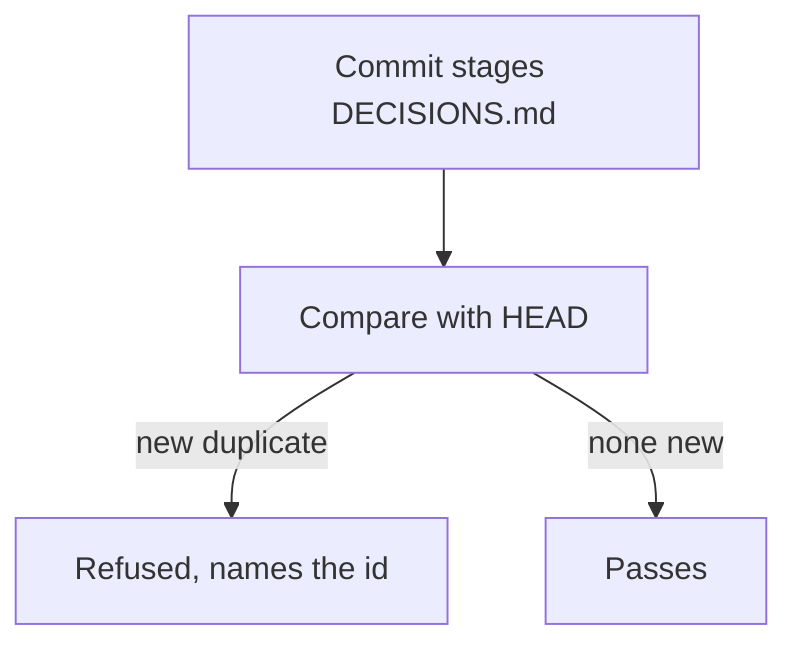

# Refuse a commit that adds a duplicate decision id

On 2026-11-06 two sessions took Cortex C132 within minutes and nothing noticed. Crucible already holds two old duplicates, so only new ones are refused.

## Acceptance criteria

| Id | Pass | Test |
|---|---|---|
| AC1 | A new duplicate is reported by id | `tests/test_decision_ids.py` |
| AC2 | An existing duplicate does not block unrelated work | `tests/test_decision_ids.py` |
| AC3 | A real commit with a clash is refused | `tests/test_decision_ids.py` |
