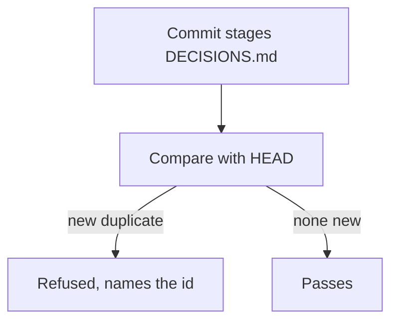

# Refuse a commit that adds a duplicate decision id

## Symptom

Two sessions took Cortex decision id C132 within minutes on 2026-11-06, and nothing noticed.

## Reproduce

Stage a `docs/DECISIONS.md` with the same id on two rows and commit.

## Expected

| AC | Traces | Given / when | Pass when | Fail when | Test |
|---|---|---|---|---|---|
| AC-1 | - | A staged file adds a duplicate id | The id is reported | It passes silently | `tests/test_decision_ids.py` |
| AC-2 | - | The duplicate already exists at HEAD | Unrelated work passes | The commit is blocked | `tests/test_decision_ids.py` |
| AC-3 | - | A real commit carries a clash | The hook exits 1 and names the id | It exits 0 | `tests/test_decision_ids.py` |

## Actual

The commit landed, and the clash was found by a failed text patch.

## Must not change

| ID | Must not change | Test |
|---|---|---|
| MNC-1 | Old duplicates in Crucible (D-195, D-230) do not block its commits | `tests/test_decision_ids.py` |

## Root cause

Decision ids are hand-picked by whichever session writes the row, and no check compares them.
