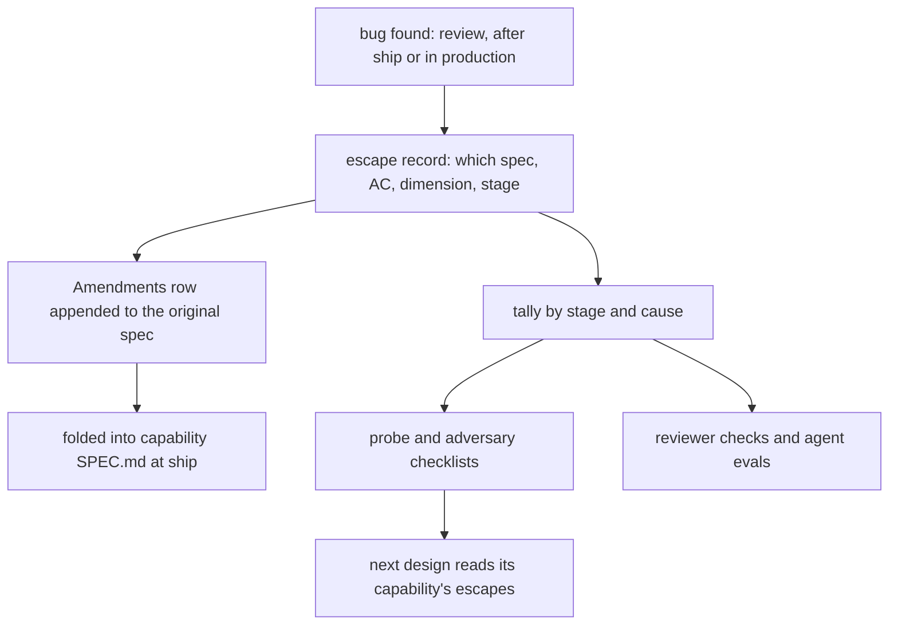
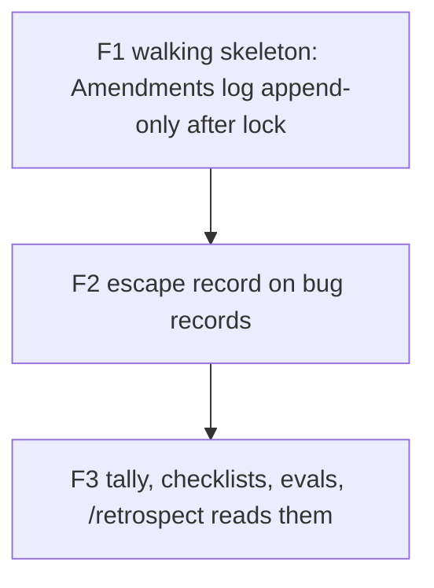

# Feedback loop: specs keep their history, escaped bugs trace back to the stage that missed them

Companion to `docs/work/agentic-loop/` (split by its 5-milestone limit). Implements decision D43 (owner-confirmed).

## Decisions (one-way doors)

| # | Decision | Status | Choice | Alternatives | Why it is hard to reverse |
|---|---|---|---|---|---|
| D-A | History model | **confirmed** (D43) | frozen original, append-only Amendments log, folded current view | in-place edits (D37) | every spec's format |
| D-G | Where an escape is recorded | **confirmed** (owner 2026-11-03, D45) | on the bug record itself (an `Escape` table), linked to the origin spec's Amendments row | a separate defect database | every bug record and the tally read it |
| D-H | The escape classes | **confirmed** (owner 2026-11-03, D45): one enum, one meaning source | the table below, adapted from IBM's Orthogonal Defect Classification (trigger and stage) | free text | the tally and every agent checklist key on it |

### Escape classes (D-H)

The question for each bug: **which stage should have caught it, and why didn't it?** The enum and each value's
meaning have one source, `contracts/escape-class.v1.json`; this table is a rendering of it, and a test keeps the two
equal (AC-11). The glossary points to the contract instead of restating it.

| Should have caught it | Signal in the origin spec | Cause class | What changes next time |
|---|---|---|---|
| probe | the area's existing spec, code or a known practice was not read | `context-not-loaded` | a probe checklist line for that capability |
| design | no AC and no Outcomes row covered the behaviour, or its level was L1 with a weak reason | `spec-gap` | an adversary question for that dimension |
| design | an Assumptions row held, then broke in reality | `envelope-broke` | the assumption gets a detector |
| implementation | an AC covered it but no test pinned it, or the test was tautological | `test-gap` | a reviewer check plus a mutation target |
| code review | the test existed, the review passed, the behaviour was wrong | `review-miss` | an eval case for the reviewer persona |
| final gate | every AC passed but the goal was not met | `goal-miss` | a goal-check question |
| none (production only) | depended on real traffic, data or time | `env-only` | a monitoring signal in Operations |

## Purpose

Bugs found after design are fixed but not traced back: nothing records which spec missed them, at which stage, or
why, so the same class recurs. The retro queue dead-ends (`/retrospect` reads only telemetry) and `/self-improve` has
never logged a run (internal survey). The owner wants every finding appended to the original spec and fed back into
the designer's and implementer's awareness (owner design O-16, O-17; follow-up 2026-11-03).

## Goals and non-goals

- Goal: after lock, a spec's original text is frozen; findings append as classed Amendments rows.
- Goal: every bug record names its origin spec and AC (or the missing one), the stage that should have caught it, and
  a cause class.
- Goal: escapes are tallied per capability and per stage, and recurring classes change a checklist, a reviewer check
  or an eval the next design must face.
- Non-goal: a defect database or dashboard (the tally is a generated table); per-team metrics.

## Background

- **Orthogonal Defect Classification (ODC)**: classify each defect by what triggered it and which stage let it
  through, so the process, not the person, is fixed.
- **Defect removal efficiency**: the share of defects each stage removes; escapes show which stage underperforms.
- **Blameless postmortem action items**: each has an owner, a tracking item and a closed state, or it is forgotten.
- **Evals from real failures**: a small set of real failures, kept passing, steers an agent better than new rules.

Detail and sources

- ODC: IBM Research (Chillarege et al., 1992); trigger and defect type separate "what found it" from "what was wrong".
- Defect removal efficiency: Capers Jones (2011), design inspection about 87%, unit tests 32-38% on average.
- Postmortems: Google SRE workbook, postmortem culture: action items without a tracking ticket are forgotten.
- Evals: Anthropic (2026-01-09, vendor): start from 20-50 real failures; keep regression evals near 100%.
- Notes: `D:/repo/docs/research_notes/Agentic loop design/web_gates_history.md` (questions 4, 5).

## Approach

Baseline: today (D37 in-place amendments, bugs fixed without trace-back, a retro queue nobody reads).

| Dimension | A: free-text retro notes | B: recommended (classed escapes on the bug record, tally, checklists and evals) | C: a defect-tracking database |
|---|---|---|---|
| Owner time | 0 | 0 the tally is generated | - another tool to read |
| Agent cost | 0 | - one Escape table per bug | - |
| Recurrence of a class | 0 nothing reads notes | + the next probe and review face the class | + |
| Reversibility | + | + plain files | - data locked in a tool |
| Build complexity | + | - gate rule, tally, checklist wiring | - |

Chosen: **B**.

## Milestones

| Milestone | Slice (what works after it) | Depends on | Owns | Outer test (red first) | Unblocks |
|---|---|---|---|---|---|
| F1 | after lock only `## Amendments` grows; each row has a class, finding, source and (for fix-now) a test; the ship folds rows into the capability SPEC.md | - | `scripts/amendments.py`, `scripts/spec_gate.py` | AC-1 | D43 in force; D37 retired |
| F2 | a bugfix record carries an Escape table naming origin spec, AC or `none`, dimension, stage and class; it appends a row to the origin spec's Amendments | F1 | `scripts/spec_v3.py`, `contracts/work-item.v3.json` | AC-4 | every bug traces back |
| F3 | escapes and hold rows are tallied per capability and stage; a class seen twice proposes a checklist line, reviewer check or eval; the probe must cite its capability's escapes; `/retrospect` reads the tally and the retro queue | F2 | `scripts/escape_tally.py`, `skills/retrospect/`, `agents/adversary.md`, `agents/reviewer.md` | AC-7 | agents learn from escapes |

## Contracts

| Name | Version | Schema | Fixtures |
|---|---|---|---|
| Amendments row | v1 | `contracts/work-item.v3.json` | `contracts/fixtures/amendments-*.md` |
| Escape table | v1 | `contracts/work-item.v3.json` | `contracts/fixtures/escape-*.md` |
| escape classes: enum, meaning, stage, next-time change | v1 | `contracts/escape-class.v1.json` | `contracts/fixtures/escape-class-*.json` |
| escape tally | v1 | `contracts/escape-tally.v1.json` | `contracts/fixtures/tally-*.json` |

## Behaviour

| AC | Traces | Given / when | Pass when | Fail when | Test |
|---|---|---|---|---|---|
| AC-1 | F1, D-A | a locked spec: an edit above `## Amendments`; an appended row missing its class, finding or source; a fix-now row without a test; a well-formed row | the first three refused by name; the last lands | any of the first three lands, or the last is refused | tests/test_feedback_loop.py |
| AC-2 | F1 | a ship with Amendments rows and a capability SPEC.md | each fix-now and hold row appears in SPEC.md's Behaviour or Timeline in the ship commit; a ship that skips the fold is refused | the fold is skipped and the ship lands | tests/test_feedback_loop.py |
| AC-3 | F1, compatibility | every item locked before F1 ships | still judged by D37's rules | its result changes | tests/test_feedback_loop.py |
| AC-4 | F2, D-G | bugfix records: with a full Escape table; without one; naming a spec or AC that does not exist; a class outside the list | the first lands; the others refused by name | otherwise | tests/test_feedback_loop.py |
| AC-5 | F2 | a bugfix whose origin spec is shipped | its ship appends a row to the origin spec's Amendments with the escape class and a link back | the origin spec is unchanged | tests/test_feedback_loop.py |
| AC-6 | F2, D-H | each class's signal (no AC; an AC with no pinning test; a broken assumption; a passing wrong test; an unmet goal; production only) | the checker suggests the matching class; a mismatch is a warning, not a refusal | no suggestion is made | tests/test_feedback_loop.py |
| AC-7 | F3 | two escapes of one class in one capability | the tally lists them; a proposal for a checklist line, reviewer check or eval is written to the retro queue with an owner | no proposal, or a duplicate on a third escape | tests/test_feedback_loop.py |
| AC-8 | F3 | a T2 probe for a capability with escapes on record | the probe must cite them; one that does not is refused | it lands without | tests/test_feedback_loop.py |
| AC-9 | F3 | `/retrospect` run with a tally and retro-queue rows | it lists them with their proposals | it reads only telemetry | tests/test_feedback_loop.py |
| AC-11 | D-H | `contracts/escape-class.v1.json` and the Escape classes table in this README; a temp copy of the contract with a value added | the table equals the contract; the checker accepts the new value and refuses one absent from the contract | the table drifts, or any code keeps its own list | tests/test_feedback_loop.py |
| AC-10 | docs | agents/designer.md, adversary.md, implementer.md, reviewer.md and SPEC-STANDARD-V3.md | each states its part: read escapes at the probe, append don't edit, classify escapes | a doc contradicts the code | tests/test_feedback_loop.py |

## Outcomes

| Dimension | Level | Row or n/a reason | AC |
|---|---|---|---|
| success | L3 | a bug traces to its origin and changes the next probe | AC-5 |
| invalid input | L3 | malformed Amendments rows and Escape tables are refused by name | AC-1 |
| dependency fails | L3 | an origin spec that does not exist is refused | AC-4 |
| timeout | L1 | no clocks, leases or waits in these checks | |
| crash mid-step | L1 | the checker and gate are pure functions over one commit, so a crash refuses that commit | |
| concurrent actor | L1 | the Amendments log is append-only, so concurrent appends merge as union | |
| duplicate or replay | L3 | a third escape of a class adds to the tally without a duplicate proposal | AC-7 |
| arrival channel | L3 | items locked before F1 keep their rules | AC-3 |
| performance or cost | L1 | the tally is regenerated from files on demand, with no service to run | |
| security | L1 | no secrets, users or permissions are involved in these files | |
| data and compatibility | L3 | items locked before F1 keep D37's rules | AC-3 |
| operability | L3 | `/retrospect` surfaces the tally to the owner | AC-9 |

## Assumptions

| Assumption | Observed | If violated |
|---|---|---|
| The retrospect skill can be changed to read more sources | `C:/Users/Michael/.claude/skills/retrospect/SKILL.md:13` | refuse: F3 does not ship until it reads the tally |
| The capability layer exists before F1's fold | `D:/repo/docs/reports/2026-11-03 Spec structure proposal.md:1` | defer: until it does, the fold writes to the change spec's Timeline only |

## Probe

[Probe](evidence/probe.md): the owner's follow-up verbatim and the shared critique (agentic-loop, rows O-16 and O-17).
