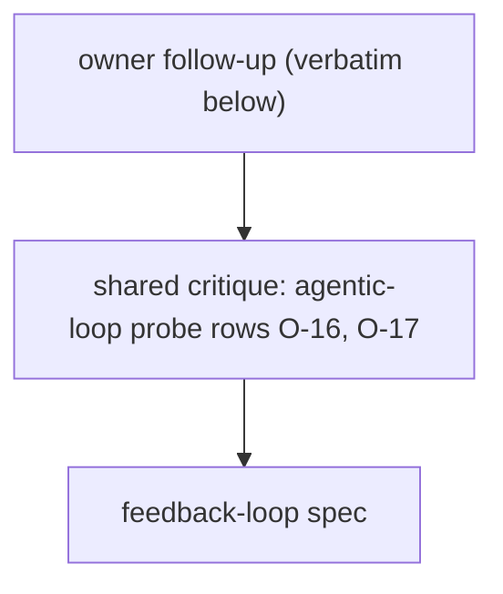

# Probe: feedback loop (2026-11-03)

Shared probe and critique: `C:/Users/Michael/.claude/docs/work/agentic-loop/evidence/probe.md` (rows O-16, O-17),
from `C:/Users/Michael/.claude/docs/work/agentic-loop/evidence/owner-design.md`. Research:
`D:/repo/docs/research_notes/agentic-loop-design/web_gates_history.md` (questions 4, 5) and `internal_survey.md`
(question 5: the retro queue dead-ends; `/self-improve` has never logged a run).

## The owner's follow-up (verbatim, 2026-11-03 13:59 PST, the part this spec answers)

> DA makes sense, SHIP that. [...] And likewise, if for retrospection and such, when new bugs and such are found, how
> can we bring them back to be aligned with the initial spec to understand if anything was prior missing during the
> development phase or the design phase itself and caught in production or after development practices. This way we
> can also use this as a feedback loop in itself to boost our designer or implementation agent's awareness for next
> time.

## Facts that shape the design

| Fact | Where |
|---|---|
| Review findings reach the spec only on harness items, through Build amendments | `D:/repo/docs/research_notes/agentic-loop-design/internal_survey.md:1` (question 5) |
| `/retrospect` reads only the telemetry friction reports | `C:/Users/Michael/.claude/skills/retrospect/SKILL.md:13` |
| The Spec-Gap Ledger is written by hand and read by the designer and reviewer | `C:/Users/Michael/.claude/docs/SPEC-GAP-LEDGER.md:1` |
| Action items without a tracking ticket are forgotten (Google SRE); classify by trigger and stage (IBM ODC) | `D:/repo/docs/research_notes/agentic-loop-design/web_gates_history.md:1` |
