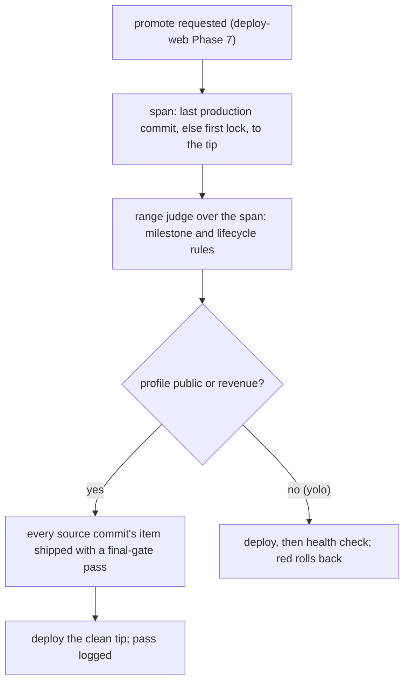

# Final gate: ship and promote only what passed, judged from production to the tip

Moved out of `docs/work/agentic-loop/` as its milestone M3 (agentic-loop Scope cut, 2026-11-03). It fixes the breaking
finding of that item's third review (record `docs/work/agentic-loop/reviews/2026-11-04-verify-052d2ae8.md`, finding 1:
the deploy judge was item-scoped while a deploy ships the whole repo tip), and folds in findings 2 (the ship edge is
early where a deploy exists; guard rules for `commit -n` and `-c core.hooksPath`) and 6 (reverts). It reuses agentic-loop
AL-M2's predicates and record kinds and `gate-ci` GC-G1's range judge (ADR [0002](../../adr/0002-loop-gate-enforcement-layer.md),
D47). Build order and file owners: [INDEX](../../capabilities/INDEX.md) (FG-1).

## Decisions (one-way doors)

| # | Decision | Status | Choice | Alternatives | Why it is hard to reverse |
|---|---|---|---|---|---|
| D-D | Final gate per profile (moved from agentic-loop) | **confirmed** (owner 2026-11-03, D44) | `yolo`: auto (goal check + health check); `public` and `revenue`: manual (owner `final-approval`) | manual everywhere | what ships without a human |
| D-G | Who may write a `goal` record (moved from agentic-loop D-L) | **confirmed** (owner 2026-11-03, D56) | only a goal-checker agent that is not the implementer, through `review_record.py`; the guard denies a `goal` write from any other identity, the main session included | the implementer self-checks; the owner only | the auto final gate on `yolo` trusts this record |
| D-P | What a deploy promote judges (verify finding 1) | **proposed**, owner confirms at lock | the span from the last production deploy's commit (or, with none, the repo's first lock commit) to the deployed tip; on `public` and `revenue`, refuse unless every source commit in the span belongs to an item that is shipped with a final-gate pass, by the citation policy below; on `yolo`, refuse on any rule breach in the span | item-scoped lock..tip (old M3: ships another item's unapproved work); one owner approval for the whole span (the owner reads a commit list, with no per-item evidence) | it decides what reaches users on every live repo |

### Citation policy at the promote (D-P)

A **final-gate pass** is recomputed at each promote from the records, never read from a log: the item's README at the
tip says `shipped`; its range from its lock commit to its ship commit (the commit that moved it to `shipped`) is judged
clean; a `goal` record and, on `public` and `revenue`, an owner `final-approval` are fresh for the item's content at
the ship commit. A v2 item is judged the same way (it has no milestone rules to break).

| Commit in the span | `public`, `revenue` | `yolo` |
|---|---|---|
| source commit whose `Spec:` names a v3 or v2 item | counts only when that item has a final-gate pass | judged by the milestone and lifecycle rules |
| source commit whose `Spec:` names a legacy `docs/specs/` file | refused: no item to judge (migrate it into a work item) | judged by the lifecycle rules |
| source commit with no `Spec:` (a repo without the hook, `commit -n`, pre-gate history inside the span) | refused naming the commit | refused naming the commit |
| non-source commit (docs, `evidence/`, review records), as `spec_gate.py` classifies it | excused | excused |
| any commit whose every changed path is byte-identical at the base and the tip | excused: it reaches production as nothing (a commit and its full revert inside the span) | excused |
| real revert (`is_real_revert`: the body names a commit that exists) not excused above | attributed to the reverted commit's item, which must have a pass; a reverted commit with no item refuses and names the host's rollback as the path | judged as rework of the reverted commit's milestone |
| a revert-looking message naming a commit that does not exist | judged by its own trailers (a claim, not evidence) | the same |
| merge commit | judged by its combined diff (`git diff-tree --cc`): a source change of its own needs its own citation; a clean merge is excused | the same |

### Channels (verify finding 2)

- **Deploy promote: binding.** `scripts/promote.py` is the only sanctioned production deploy. It refuses a dirty
  working tree or a HEAD not reachable from the pushed default branch, checks out the tip in a fresh worktree, calls
  `final_gate.py promote`, deploys only on exit 0, then runs the health check (deploy-web Phase 4 and 5) and on red
  runs the host's rollback to the previous production deployment. The bytes deployed are the judged tip's, never the
  working tree's. `skills/deploy-web/SKILL.md` Phase 7 calls it.
- **Ship edge: early wherever a deploy exists.** commit-msg calls `final_gate.py ship` on a commit that moves a
  milestone item from `building` to `shipped`. `commit -n` or `-c core.hooksPath=` skips commit-msg, so on a repo whose
  effective config names a deploy target the ship edge is early and the promote, which recomputes every pass, is
  binding. On a repo with no deploy target (claudence, libraries) the ship edge is the only final-gate channel; its
  bypass is denied on the command string below and detected later by gate-ci CI.
- **Guard rules (command string only).** Denied in subagents and the main session: a bare `vercel --prod`, `vercel
  deploy --prod` and `vercel promote` (only `promote.py` deploys); `git commit` with `-n` alone or in a short-flag
  cluster; `git -c core.hooksPath=...` with any subcommand (the key matched case-insensitively, as git reads it); `git
  config [--local|--global|--worktree] core.hooksPath <value>`; a `goal` record write from any identity but the
  goal-checker. The existing `--no-verify` and force-push rules stay (`guard.py:357-361`).
- **Not covered.** A host that auto-deploys on push bypasses every gate: it must be off for `public` and `revenue`, and
  project-manifest P5 reports it, with a production deploy that has no final-gate pass. A helper script that runs
  `vercel --prod`, an import that writes a `goal` record, or `GIT_CONFIG_PARAMETERS` in the environment is not seen by
  the guard; P5's drift report catches the deploy, and the promote recomputes every pass whatever was skipped.

## Purpose

agentic-loop gates each milestone, but nothing yet decides what may reach production. The old M3 judged one item's
history while a deploy ships the whole tip, so an approved item could carry another item's unapproved milestone to
users (verify finding 1). The owner wants unattended deploys on `yolo` repos and no unapproved code on `public` or
`revenue` ones (D44).

## Goals and non-goals

- Goal: a production deploy ships only a tip whose whole span since the last production deploy passed its profile's
  final gate.
- Goal: the ship edge needs a clean range, an independent goal check and, where manual, an owner `final-approval`.
- Goal: the deployed bytes are the judged commit's, and the known hook bypasses are denied.
- Non-goal: the milestone rules, owner records and briefs (agentic-loop AL-M2); the range judge (gate-ci GC-G1); drift
  reports and the deploy refusal while drift is open (project-manifest P5); hosts other than Vercel.
- Non-goal: turning off cashcow's host auto-deploy (an owner action, D49).

## Background

- **Canary gate**: automatic deploys stay safe only when health checks can stop and roll them back.
- **The deployer never approves**: GitHub and GitLab environments refuse a self-approved production deploy.
- **Judge what ships**: a gate observes what will be deployed (the commit), never the working tree or a summary of it.

Sources

- Canary: Google SRE workbook, "Canarying releases"; GitHub/GitLab environments: the deployer never approves.
- Goal-level check: MAST (arXiv 2503.13657, 2025): a goal-level verification removes 15.6% of failures.
- Channel facts: ADR 0002 channel table; the verify record's scratch repo (git 2.39) and its guard events.

## Approach

Baseline: the old M3 design (item-scoped lock..tip at ship and promote). Scores +, 0 or - against it.

| Dimension | A: item-scoped (old M3) | B: repo-scoped span with recomputed passes (chosen) | C: one owner approval of the span's commit list |
|---|---|---|---|
| Defect escape | baseline: another item's waiting milestone ships | + every commit's item must have passed | 0 the owner reads commits, not evidence |
| Owner time | baseline | 0 one `final-approval` per item, as before | - a list per deploy |
| Authoritative source | baseline: pass inferred from one item | + base from the host, passes from records, bytes from the tip | 0 |
| Latency | baseline | - a deploy waits for every item in its span to ship | 0 |
| Build complexity | baseline | - attribution policy, host read, clean worktree | 0 |

Chosen: **B**. Its cost is latency: a deploy waits until every item with commits in the span has shipped, which is
the point on `public` and `revenue`; a revert of the unshipped work, or shipping it, unblocks the deploy.

## Milestones

The table is the plan only. Build order and file owners: INDEX.

| Milestone | Slice (what works after it) | Depends on | Owns | Outer test (red first) | Unblocks |
|---|---|---|---|---|---|
| FG-1 | the ship edge and the deploy promote run the final gate by profile over the span; `promote.py` deploys only a judged clean tip; the guard denies bare production deploys, hook bypasses and foreign `goal` writes; the goal-checker persona exists | agentic-loop AL-M2 (predicates, record kinds), gate-ci GC-G1 (`judge_range`, `range-verdict.v1.json`, `HistoryView`) | `scripts/final_gate.py`, `scripts/promote.py`, `contracts/final-gate-pass.v1.json`, `scripts/spec_gate.py`, `scripts/review_record.py`, `contracts/review-record.v1.json`, `hooks/guard.py`, `skills/deploy-web/SKILL.md`, `agents/goal-checker.md`, `agents/implementer.md`, `agents/reviewer.md` | AC-2 | unattended ship on `yolo` repos, and no unapproved code on `public` or `revenue` |

## Contracts

| Name | Version | Schema | Fixtures |
|---|---|---|---|
| range verdict of one judged span (defined by gate-ci GC-G1, read here) | v1 | `contracts/range-verdict.v1.json` | `contracts/fixtures/range-*.json` |
| review record kind `goal`: `item`, `content`, `commit`, `verdict`, and on `yolo` a `health` object (`command`, `result` green or red, `excerpt`); an extension of v1 beside AL-M2's kinds | v1 | `contracts/review-record.v1.json` | `contracts/fixtures/record-goal-*.md` |
| final-gate pass log line: `repo`, `base`, `base_source` (`production` or `first-lock`), `tip`, `profile`, `items`, `recorded` | v1 | `contracts/final-gate-pass.v1.json` | `contracts/fixtures/final-gate-pass-*.json` |

Writers: the range verdict by `judge_range`; a `goal` record by the goal-checker through `review_record.py` (D-G); a
pass line only by `final_gate.py`, after a promote judgement passes, at `~/.claude/state/final-gate/<repo>.jsonl`. The
pass log is read only by project-manifest P5's drift report; no gate reads it, so it is not a proxy for a pass.

Signatures (the commit and plan types are agentic-loop's `CommitFacts` and `MilestonePlan`):

- `final_gate.span(repo: Path, host: DeployHost, view: HistoryView) -> Span | Unjudged`; `Span(base, tip, base_source)`.
- `final_gate.attribute(commit: CommitFacts, span: Span, view: HistoryView) -> Attribution`, one of `Item(id, via)`
  (`via`: `trailer` or `revert`), `Excused(reason)` or `Refused(reason)` (pure; the citation policy table).
- `final_gate.item_pass(item: str, config: EffectiveConfig, view: HistoryView, records: Sequence[Record]) -> str | None`.
- `final_gate.ship_problem(repo: Path, item: str, config: EffectiveConfig) -> str | None` (commit-msg, at the ship edge).
- `final_gate.promote_problem(repo: Path, tip: str, config: EffectiveConfig, host: DeployHost) -> str | None`.
- `DeployHost.last_production_commit(repo: Path) -> str | None` (None: never deployed); raises `HostUnreadable`.
- CLI: `final_gate.py promote --repo PATH --tip SHA` and `final_gate.py ship --item ID`: exit 0 pass, 1 refused, 2
  unjudged, each with the reason on stderr; `promote.py --repo PATH`: exit 0 deployed and healthy, 1 refused before
  deploy, 3 deployed then rolled back.
- `guard.vercel_prod_problem(event) -> str | None`, `guard.hook_bypass_problem(event) -> str | None`,
  `guard.goal_authority_problem(event) -> str | None`.

## Behaviour

| AC | Traces | Given / when | Pass when | Fail when | Test |
|---|---|---|---|---|---|
| AC-1 | FG-1, D-P | `span` on host fixtures: a last production commit that is an ancestor of the tip; no production deployment and an item locked; a production commit not an ancestor of the tip (rewritten history); a production deployment with no commit or a dirty flag; a host that times out; no deployment and no lock | the span is production..tip, then first-lock..tip; each other case returns `Unjudged` naming its reason and the promote exits 2 | a span is guessed, or an unjudged span lets a deploy run | tests/test_final_gate.py |
| AC-2 | FG-1, D-P | the verify-finding-1 history on a `public` repo (cashcow's entry) and on a `revenue` repo: item A's M1 done and waiting, its commits on main; item B shipped with a goal record and a complete `final-approval`; promote for the tip; then A shipped with both records; the same first history on a `yolo` repo | refused naming item A and its commit, then passes; on `yolo` it passes (no rule breached) | the deploy for B ships A's unapproved M1 | tests/test_final_gate.py |
| AC-3 | FG-1, D-P | spans holding: a source commit citing a shipped v2 item with both records, then a building v2 item; a legacy `docs/specs/` citation; a source commit with no `Spec:`; a docs-only commit; a clean merge commit; a merge commit whose conflict resolution changes a source path | on `public`: lands, refused, refused, refused, excused, excused, refused, each naming the commit; on `yolo` the legacy citation is judged by the lifecycle rules | a commit is attributed wrongly or an unattributable source commit passes | tests/test_final_gate.py |
| AC-4 | FG-1, D-P | reverts made by `git revert --no-edit` and by a hand-written message, on `public`: a full revert of unshipped A's span commit; a partial revert of it; a revert of a pre-span commit whose item has a pass; a revert of a pre-span commit with no item; a message naming a commit that does not exist | the full pair is excused and the promote passes; the partial revert is attributed to A and refused; the third passes; the fourth is refused naming the host rollback; the fake one is judged by its own trailers and refused | a revert hides unshipped work or a message alone excuses a commit | tests/test_final_gate.py |
| AC-5 | FG-1 | `ship_problem` over lock..tip on fixture histories built by real git operations, each holding an agentic-loop AC-4 breach: a worktree-branch commit, a local `merge --squash`, a non-fast-forward merge, a fast-forward, a rebase, a plain cherry-pick, a force-pushed rewrite, a Foreman-style squash with one, two and no `Spec:` and `Milestone:` trailers; a shallow clone, a missing object, a range over the bound | every breach refused naming the rule and the commit; the squash with one of each is judged against its milestone; the unreadable ranges refuse as `unjudged` | a breach reaches ship by any channel, or an unjudged range passes | tests/test_final_gate.py |
| AC-6 | FG-1, D-G | a ship without a `goal` record; a `goal` write attempted by the implementer's identity and from the main session; a fresh one from the goal-checker; one for older content; on a manual repo a `final-approval` lacking one audit field, then a complete one | refused; the writes denied by the guard; lands; refused as stale; the incomplete approval refused naming the field, the complete one lands | otherwise | tests/test_final_gate.py |
| AC-7 | FG-1, D-D | the ship edge and the promote: `yolo` with a goal record quoting a red health check, then green; `public` (cashcow's entry) and `revenue` without, then with, a complete `final-approval`; a span holding a cap breach delivered by fast-forward with every record present; a `yolo` deploy whose post-deploy health check is red; the effective config of a `public` repo | refused then lands at both channels in every case; the breach is refused even with approval; the red post-deploy check runs the rollback and exits 3; autonomy reads label-gated | a channel opens without its record, a breach ships, or a red deploy stays in production | tests/test_final_gate.py |
| AC-8 | FG-1 | `promote.py` with a dirty working tree; with HEAD not reachable from the pushed default branch; with an untracked file the build would include; a clean pushed tip; `final_gate.py` exit 1 and 2; deploy-web Phase 7's text | the first three refused before any deploy; the clean tip is deployed from a fresh worktree at the judged commit and a pass line validating against its contract is written; exit 1 and 2 stop the deploy; Phase 7 names `promote.py` and stops on non-zero | bytes other than the judged tip deploy, or a refused judgement deploys | tests/test_final_gate.py |
| AC-9 | FG-1 | guard events, subagent and main session: `vercel --prod`, `vercel deploy --prod`, `vercel promote <url>`; look-alikes `vercel deploy`, `vercel ls --prod`, `vercel env ls`, `vercel rollback`, `echo "vercel --prod"`, `python scripts/promote.py --repo X` | the three denied in both; every look-alike allowed | a production deploy command is allowed or a look-alike denied | tests/test_guard.py |
| AC-10 | FG-1 | guard events: `git commit -n -m x`, `git commit -anm x`, `git -c core.hooksPath=NUL commit -m x`, `git -c core.HooksPath= push origin main`, `git config core.hooksPath x`, `git config --local core.hooksPath x`; look-alikes `git merge -n`, `git push -n`, `git log -n 5`, `git rev-list -n 1 HEAD`, `git commit -m "-n"`, `git config --local core.hooksPath` (a read), `git config --get core.hooksPath`, `echo "-c core.hooksPath=x"` | each bypass denied; each look-alike allowed | a bypass is allowed or a look-alike denied | tests/test_guard.py |
| AC-11 | FG-1 | on a repo with a deploy target, item C moved to `shipped` by `git commit -n` with no `goal` record, then a promote; on a repo with no deploy target, the same ship commit made through commit-msg | the promote refuses naming C (its pass is recomputed); the commit-msg ship is refused | a skipped ship edge lets C's code deploy, or the no-deploy ship passes | tests/test_final_gate.py |
| AC-12 | compatibility | every v2 and v3 item in the fleet without a Milestones table, their ship commits, the records on disk; a repo with no deploy target | they ship exactly as before (the ship-edge gate applies to milestone items only); no promote runs where no deploy target exists | any result changes | tests/test_final_gate.py |
| AC-13 | docs | `agents/goal-checker.md`, `agents/implementer.md`, `agents/reviewer.md`, `skills/deploy-web/SKILL.md`, `D:/repo/docs/DEVELOPMENT_LIFECYCLE.md` | the goal-checker states it is independent of the implementer and checks the original intent; implementer and reviewer state that the builder never writes a `goal` record; deploy-web and the lifecycle doc state the promote is binding and the ship edge early wherever a deploy exists | a doc contradicts the code | tests/test_final_gate.py |

## Fixture sources

- Git histories (AC-2 to AC-5, AC-11): real `git` operations on a temp repo with the real hooks installed; the
  channel behaviour expected was observed in the verify record's scratch repo (git 2.39).
- Host responses (AC-1): a real Vercel production-deployments response for cashcow, captured once at FG-1's red-test
  step (the probe question below), then edited to remove the commit and to set the dirty flag.
- Guard events (AC-9, AC-10): the PreToolUse event shape of `tests/test_guard.py`; the bypass strings are the four the
  verify fed to `guard.py`; the read form `git config --local core.hooksPath` is the real call at
  `scripts/install_fleet_hooks.py:42`.
- Profile entries: cashcow's real map entry once PM-P1 writes it.

## Outcomes

| Dimension | Level | Row or n/a reason | AC |
|---|---|---|---|
| success | L3 | a span whose items all passed deploys, and an unblocked span after the waiting item ships | AC-2 |
| invalid input | L3 | a commit with no item, a legacy citation or a fake revert is refused by name | AC-3 |
| dependency fails | L3 | an unreadable host, a missing production commit or a rewritten history gives `unjudged`, which refuses the deploy | AC-1 |
| timeout | L3 | a git or host call past its bound reports `unjudged`, never a pass | AC-5 |
| crash mid-step | L3 | the judgement completes before any deploy; a red health check after the deploy rolls back | AC-8 |
| concurrent actor | L3 | another item's commits on the default branch at deploy time are judged with the deploy | AC-2 |
| duplicate or replay | L3 | a `goal` or `final-approval` record for older content does not count | AC-6 |
| arrival channel | L3 | every channel that puts history on the default branch is judged over the span at the promote and over lock..tip at the ship edge | AC-5 |
| performance or cost | L3 | a span over the range judge's commit bound is `unjudged` and refused, so a judgement never runs unbounded | AC-5 |
| security | L3 | `commit -n`, a `core.hooksPath` override and a bare production deploy are denied; a skipped ship edge is caught at the promote | AC-10 |
| data and compatibility | L3 | items without milestones and repos without a deploy target behave as before | AC-12 |
| operability | L3 | every final-gate channel needs its record and a clean span, and a red post-deploy health check rolls back | AC-7 |

## Assumptions

| Assumption | Observed | If violated |
|---|---|---|
| Foreman's autonomy ladder can serve as the final gate's manual and auto modes | `D:/repo/Factory/foreman/core/repos.js:290` | flag: FG-1 maps manual and auto onto the ladder; a gap is logged before FG-1 starts |
| The hook event names the writer's agent only by `agent_id`, not its type; FG-1's probe finds an identity source for the goal-checker | `C:/Users/Michael/.claude/hooks/guard.py:401` | refuse: without one, `goal` records are written only through `approve` by the owner and the auto final gate stays off |
| The range judge refuses by name when it cannot finish (git timeout, shallow history, missing objects, more commits than its bound); a shallow CI checkout fetches full history | `C:/Users/Michael/.claude/docs/adr/0002-loop-gate-enforcement-layer.md:82` | refuse: FG-1 does not ship until AC-5 shows an `unjudged` range refused |
| The host's deployments list names each production deployment's commit, including a CLI deploy made from a git checkout | `C:/Users/Michael/.claude/docs/adr/0002-loop-gate-enforcement-layer.md:79` | refuse: a production deployment with no commit makes the span `unjudged` (AC-1) |
| The Vercel CLI uploads the working directory, not a commit, so only a clean worktree at the tip deploys what was judged | `C:/Users/Michael/.claude/skills/deploy-web/SKILL.md:92` | refuse: `promote.py` refuses a dirty tree or an unpushed HEAD before any deploy (AC-8) |
| A clean worktree can deploy with the project link copied from the main checkout's `.vercel/project.json` | `D:/repo/SaaS/cashcow/vercel.json:1` | refuse: with no link, `promote.py` refuses naming the missing link |
| The action boundary is the only path to production; host auto-deploy on push and a direct `vercel` call violate it | `D:/repo/SaaS/cashcow/vercel.json:1` | flag: cashcow's auto-deploy stays on (D49) and the final gate does not protect it until it is off; project-manifest P5 reports it |
| The guard sees only the command string: a helper script, an import or `GIT_CONFIG_PARAMETERS` is not seen | `C:/Users/Michael/.claude/hooks/guard.py:352` | refuse: a `public` or `revenue` deploy is refused while P5 reports a production deploy with no final-gate pass (project-manifest AC-11), and the promote recomputes every pass |
| The fleet hook installer only reads `core.hooksPath`, so the deny rule does not block it | `C:/Users/Michael/.claude/scripts/install_fleet_hooks.py:42` | keep: the read form is a look-alike fixture in AC-10 |
| Foreman auto-merge stays off for repos with milestone items until `foreman-range-gate` ships: its server-side squash runs no local hook | `D:/repo/Factory/foreman/core/merge.js:135` | flag: the ship edge and the promote re-judge the range, so a merged breach is refused there, at the cost of wasted work |
| A force push rewriting the default branch is denied by the guard on the command string; the range judge reads whatever history exists | `C:/Users/Michael/.claude/hooks/guard.py:359-361` | flag: a rewritten history that erases a `milestone` record reads as not done and is refused; one that drops the production commit is `unjudged` (AC-1) |
| A real revert is told from a message claim by `is_real_revert`, and commit-msg returns early while a revert or cherry-pick is in progress | `C:/Users/Michael/.claude/scripts/spec_gate.py:376` | keep: attribution reuses that function and the byte-identity excuse reads trees, not messages (AC-4) |
| `HistoryView` and `judge_range` are defined by gate-ci GC-G1, not yet drafted | `C:/Users/Michael/.claude/docs/capabilities/INDEX.md:51` | defer: FG-1 waits for GC-G1; an amendment aligns the shapes when it is drafted |

## Gate plan

| Risk | Kind (deterministic / qualitative) | Check | Blocking / advisory |
|---|---|---|---|
| an unapproved commit reaches production | deterministic | AC-2, AC-3, AC-4 on real git histories, plus a mutation check on the attribution lines | blocking |
| the deployed bytes differ from the judged tip | deterministic | AC-8 | blocking |
| the guard misses a bypass or denies a look-alike | deterministic | AC-9, AC-10, plus a mutation check on the new rule lines | blocking |
| an existing item's ship changes | deterministic | AC-12 corpus run, old versus new | blocking |
| a goal check that rubber-stamps | qualitative | the reviewer reads the pilot's `goal` records against each item's Purpose | advisory |

## Gap-ledger check

| Category | Handled by |
|---|---|
| probabilistic-call-reliability | AC-6 (the goal check is an independent agent's record); its judgement quality is advisory in the Gate plan |
| creative-domain-anchoring | n/a: no generated creative output |
| asserted-not-verified-claim | the Assumptions table, each row citing a resolving line; host and channel facts come from real captures (Fixture sources) |
| concurrent-actor-incomplete | AC-2 (another item's commits), the Foreman and force-push assumptions, host auto-deploy left to project-manifest P5 |
| runtime-schema-drift | the `goal` kind and the pass line validate against their contracts (AC-6, AC-8) |
| invariant-checked-on-one-path-only | AC-5 (every arrival channel), AC-7 (both the ship edge and the promote), AC-11 (a skipped ship edge) |
| signal-consumer-enumeration | the consumers of a final-gate pass are `promote_problem` (recomputes) and project-manifest P5 (reads the pass log only); Foreman autonomy reads the profile, not the pass |
| cross-platform-path-identity | paths are git's repo-relative forward-slash form only; AC-8 runs the worktree on Windows |
| authoritative-source | base from the host (AC-1), passes recomputed from records (AC-2), bytes from a clean worktree at the tip (AC-8) |
| fail-closed-on-unknown | AC-1 and AC-5 (`unjudged` refuses); AC-8 (exit 2 stops the deploy) |
| destructive-op-proof | the rollback targets only the host's previous production deployment (AC-7); `promote.py` removes only the worktree it created |
| liveness-and-time | n/a: no locks or leases; every git and host call has a timeout and reports `unjudged` on expiry |
| concurrency-granularity | n/a: the host serialises production deploys, and each promote judges its own tip from whatever production holds when it reads |
| external-contract-unverified | the host commit field is an assumption with `refuse`, captured from a real response at FG-1 (Fixture sources) |
| split-state | n/a: passes are recomputed from records; the pass log is a detector input only |
| untestable-ac | one fault per fixture row with its named reason; mutation checks in the Gate plan |
| scope-drift-oversize | 13 ACs; drift, the range judge and the milestone rules are non-goals owned elsewhere |
| enforcement-allowlist | look-alikes in AC-9 and AC-10; non-source commits, full reverts and clean merges excused (AC-3, AC-4); `vercel rollback` allowed |
| hand-copied-enum | profiles from the profile map through `scripts/manifest.py`; record kinds from `review-record.v1.json` |
| composite-history-vs-per-commit | merge commits by combined diff (AC-3); squash trailers (AC-5) |
| citation-regex-false-positive | trailers read by `git interpret-trailers`; the revert pattern reused from `spec_gate.py:37`; quoted text is data in the guard (AC-9, AC-10 echo fixtures) |
| lifecycle-gate-legitimate-commit-blocked | AC-12 (unchanged ships), AC-4 (a full revert is excused, a host rollback is named) |

## Open questions

- OQ-1: the brief set the risk to `enforcement` and `live`. `contract` arguably applies too (the pass log is read by
  project-manifest P5, and the `goal` kind extends a shared contract). The Contracts section is written as if it did;
  the design review decides whether to add the flag.
- OQ-2: cashcow's last 60 commits carry no `Spec:` trailer (`git log`, 2026-11-03). Its first promote judges from its
  last production deploy, so older history is outside the span, but any later source commit without a trailer refuses.
  The default is to refuse. The other option is a one-time owner-approved baseline commit for each repo.
- OQ-3: a v2 item is judged like a v3 one, so it needs a `goal` record. The other option is to accept an owner
  `final-approval` alone for v2 items until v2 is `frozen`.

## Probe

[Probe pointer](evidence/probe.md): ADR 0002 and the verify record that found the gap.
