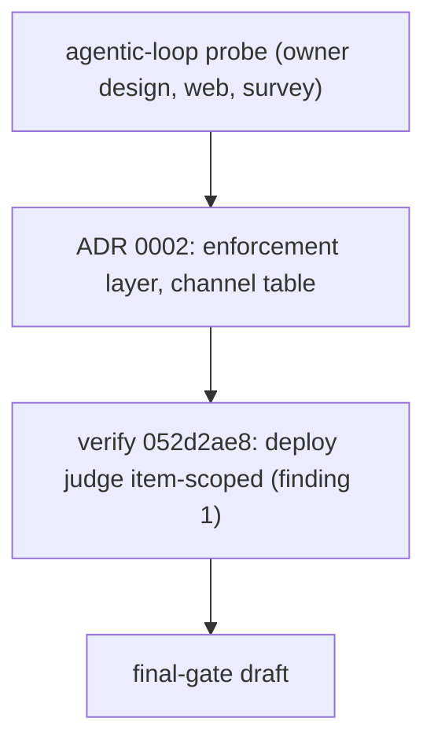

# Probe pointer: final-gate (2026-11-03)

This item was split out of agentic-loop (its milestone M3), so its probe is the record that already exists. It is not
repeated here.

| Source | What it settles | Where |
|---|---|---|
| ADR 0002, loop gate enforcement layer (D47) | the binding judge sits at the action boundary; the channel table; unjudged ranges fail safe; no pre-merge-commit | [0002-loop-gate-enforcement-layer.md](../../../adr/0002-loop-gate-enforcement-layer.md), channel table at line 66 |
| Verify record 052d2ae8 (third review round of agentic-loop) | finding 1: a deploy ships the whole tip but was judged item-scoped; finding 2: `commit -n` and `-c core.hooksPath=` skip commit-msg and the guard allowed them; finding 6: revert and cherry-pick claims and the missing revert fixture. Scratch-repo facts (git 2.39): plain cherry-pick, `revert --no-edit`, fast-forward and rebase run no commit-msg; `merge --no-ff` runs it with MERGE_HEAD; `merge --squash` then commit runs it with only SQUASH_MSG | [2026-11-04-verify-052d2ae8.md](../../agentic-loop/reviews/2026-11-04-verify-052d2ae8.md) |
| agentic-loop probe | the owner's requirements O-14 and O-15 (final gate, manual or auto per project), the canary and goal-check evidence | [probe.md](../../agentic-loop/evidence/probe.md) |
| Code read for this draft (2026-11-03) | commit-msg returns early on MERGE_HEAD, REBASE_HEAD, CHERRY_PICK_HEAD and REVERT_HEAD (`C:/Users/Michael/.claude/scripts/spec_gate.py:38`, `:341-342`); a real revert is told from a claim by `is_real_revert` (`:376`); the guard denies `--no-verify` and force-push to main by string (`C:/Users/Michael/.claude/hooks/guard.py:357-361`); the hook installer reads `core.hooksPath` (`C:/Users/Michael/.claude/scripts/install_fleet_hooks.py:42`); deploy-web Phase 7 runs `vercel --prod` from the working tree (`C:/Users/Michael/.claude/skills/deploy-web/SKILL.md:91-94`); cashcow's last 60 commits carry no `Spec:` trailer | the files named |

Open probe question for FG-1 (before red tests): capture one real Vercel production-deployments response for cashcow
and confirm which field names the commit for a git-integration deploy and for a CLI deploy. It becomes the AC-1
fixture.
