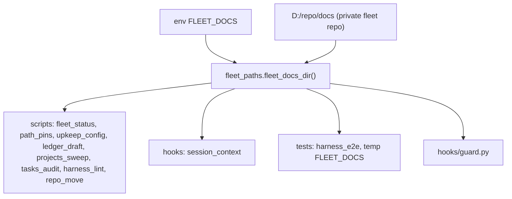

# Fleet docs home: one resolver, private fleet docs move to D:/repo/docs

Owner intent (2026-10-31): the private fleet documentation moves from `~/.claude/docs/fleet/` (a local-only git repo nested in claudence and git-ignored there) to `D:/repo/docs/`, the centralized documentation home and the private repo source. The env var `FLEET_DOCS` designates it. This item changes only where code looks; it moves no files (the move is a separate owner step after the code lands).

## Motivation
The path `~/.claude/docs/fleet` is spelled out in about 15 code, test and skill files, plus Cortex config outside this repo. Moving the folder today means editing every one of them, and a miss silently reads an empty folder. The fleet docs also sit inside a public repo's working tree, hidden only by a gitignore line. One resolver makes the location a single fact with one override (`FLEET_DOCS`), which tests also use to run against a temp dir instead of the real docs.

## What got simpler
- Hard-coded fleet path strings in scripts, hooks, tests and skills: from 14 sites to 0 (the resolver is the only place the default is derived; measured by a grep test, AC-7).
- Locations to edit for a future move: from about 15 files to 1 environment variable.
- The `.gitignore` special case for a nested private repo: removed.
- Config keys `ledgerFile` and `draftsDir` become relative to the fleet docs dir instead of the harness root, so the config no longer encodes the folder name.

## Acceptance criteria
| AC | Traces | Given / when | Pass when | Fail when | Test |
|---|---|---|---|---|---|
| AC-1 | - | `FLEET_ROOT` and `FLEET_DOCS` set to temp dirs, then unset or empty | `scripts/fleet_paths.py` is the single owner of both: `REPO_ROOT` is `FLEET_ROOT` when non-empty else `D:/repo`; `fleet_docs_dir()` is `FLEET_DOCS` when non-empty else `REPO_ROOT / "docs"`; `hooks/guard.py` imports `REPO_ROOT` from it (same object) and defines no repo-root literal; importing guard prints nothing and the guard still runs with PATH empty | either value is defined twice, the env is ignored, or a path under `~/.claude` is returned | tests/test_fleet_docs.py::test_resolver, tests/test_fleet_docs.py::test_guard_shares_repo_root |
| AC-2 | - | `fleet_status.py` and `path_pins.py` build their argument parsers with `FLEET_DOCS` set to a temp dir and no `--out` | the default `--out` is the temp dir; an explicit `--out` still wins | the default is `~/.claude/docs/fleet` or the real `D:/repo/docs` | tests/test_fleet_docs.py::test_default_out |
| AC-3 | - | `upkeep_config` loads config with `FLEET_DOCS` set to a temp dir holding `upkeep.config.json` | config is read from the temp dir; `ledgerFile` and `draftsDir` defaults are `LEDGER.md` and `drafts` under it; `ledger_draft`, `projects_sweep` and `tasks_audit` use that location | any of them reads `<root>/docs/fleet`, or a config at the old path is still honoured | tests/test_ledger_draft.py, tests/test_projects_sweep.py, tests/test_tasks_audit.py |
| AC-4 | - | `harness_lint` runs with `FLEET_DOCS` set to a temp dir holding `L.md` with a retired term | the file is path-checked via the resolver (labelled `fleet:L.md`) and skipped by the deny check, as `docs/fleet/*.md` was; no crash for a path outside the harness root | it is ignored, or `rel()` raises for the outside path | tests/test_harness_lint.py::test_fleet_docs_linted_via_resolver |
| AC-5 | - | `session_context` and `repo_move` run with `FLEET_DOCS` set to a temp dir | pending ledger drafts come from the temp `drafts` and `LEDGER.md`; `MOVES.jsonl` and `path_pins.json` are read and written there | either touches `~/.claude/docs/fleet` | tests/test_session_context.py, tests/test_fleet_docs.py::test_repo_move_log |
| AC-6 | - | `tests/harness_e2e.py` runs | it sets a temp `FLEET_DOCS` for its subprocesses and the real fleet docs are untouched | it writes or reads the real folder | tests/harness_e2e.py |
| AC-7 | - | a grep test scans `scripts/`, `hooks/`, `tests/` and `skills/` | no file contains `docs/fleet` or a `"docs" / "fleet"` join (the grep test's own pattern excepted); `skills/ledger/SKILL.md` names `$FLEET_DOCS` | any hit remains | tests/test_fleet_docs.py::test_no_hardcoded_fleet_path |
| AC-8 | - | `bad_repo_target` on `D:/repo/docs` and `D:/repo/docs/x` | both return False (a repo may live there) | `D:/repo/docs` is denied | tests/test_guard.py::test_repo_root_docs_is_allowed |
| AC-9 | - | `bad_repo_target` on bare root names other than `docs` (`D:/repo/foo`, `D:/repo/docs2`, `D:/repo/ai`) | still True; `D:/repo` itself still False | the exemption widens beyond the single name `docs` | tests/test_guard.py::test_other_bare_root_names_stay_denied |
| AC-10 | - | `.gitignore` is read | it has no active `docs/fleet` pattern and carries a comment that the folder moved to `$FLEET_DOCS` | the ignore line remains or the note is missing | tests/test_fleet_docs.py::test_gitignore_note |
| AC-11 | - | the full tests directory runs after the change | every test that passed before still passes with the same assertions, fixtures only re-pointed at a temp `FLEET_DOCS` | a previously green test fails, or an assertion was weakened | tests/test_fleet_docs.py |

## Gate plan
| Risk | Kind (deterministic / qualitative) | Check | Blocking / advisory |
|---|---|---|---|
| A reader still uses the old path and silently sees an empty folder | deterministic | AC-7 grep test | blocking |
| Guard exemption widens | deterministic | AC-8, AC-9 | blocking |
| Behaviour drift in upkeep jobs | deterministic | AC-3, AC-11 full tests run | blocking |
| Cortex jobs keep passing the old drafts dir (outside this repo) | qualitative | parent updates Cortex bin/upkeep.js, config/capabilities.json and agents/harness-steward.md before the folder move | advisory |
