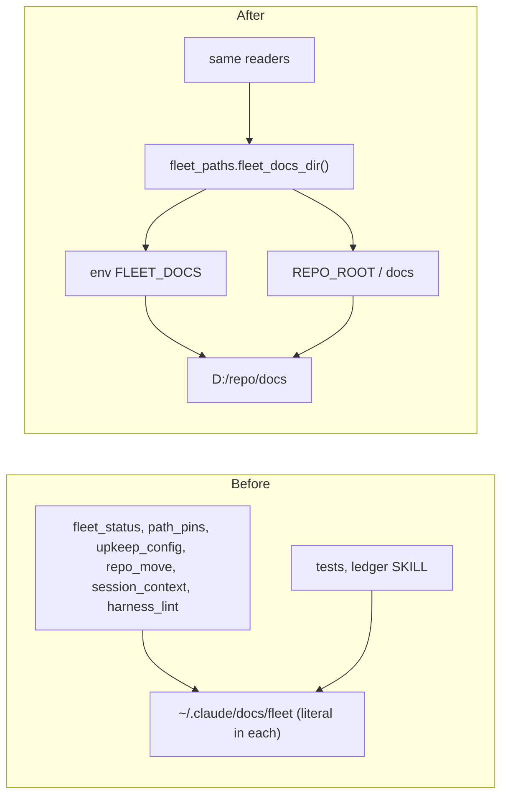

# Architecture: one resolver for the fleet docs location

Authoritative source: the location is one fact, owned by the resolver. `D:/repo` (`FLEET_ROOT` override) is owned by the same module as `REPO_ROOT`; `hooks/guard.py` imports it from there.

Not moved here: Cortex (`bin/upkeep.js`, `config/capabilities.json`, `agents/harness-steward.md`) hard-codes the old drafts dir outside this repo; the parent updates it together with the folder move.
