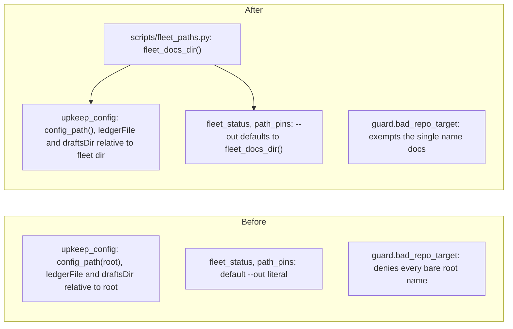

# Components: resolver and its readers

Searched `scripts/` for a path-resolver role: found `upkeep_config.py` (config loading only, imports nothing from guard). A separate small `scripts/fleet_paths.py` is added because `hooks/session_context.py` and `repo_move.py` need the resolver without the upkeep defaults. It is the single owner of `REPO_ROOT` (env `FLEET_ROOT`, default `D:/repo`) and `fleet_docs_dir()` (env `FLEET_DOCS`, default `REPO_ROOT/docs`); guard imports `REPO_ROOT` from it.

| Owned file | Change |
|---|---|
| scripts/fleet_paths.py | new: `fleet_docs_dir()` |
| scripts/upkeep_config.py | `config_path()`, `ledgerFile` becomes `LEDGER.md`, `draftsDir` becomes `drafts`, both under the fleet dir; docstring |
| scripts/ledger_draft.py, projects_sweep.py, tasks_audit.py | call the new `config_path()`; ledger_draft resolves `ledgerFile` under the fleet dir |
| scripts/fleet_status.py, path_pins.py | default `--out` |
| scripts/harness_lint.py | fleet docs pattern and the skip-deny special case via the resolver |
| scripts/repo_move.py, hooks/session_context.py | `FLEET` and `FLEET_DIR` from the resolver |
| hooks/guard.py | imports `REPO_ROOT` (no own literal); `docs` exemption in `bad_repo_target`; docstring points at `$FLEET_DOCS` |
| scripts/harness_router.py | docstring |
| skills/ledger/SKILL.md | paths become `$FLEET_DOCS`; commit step uses `git -C "$FLEET_DOCS"` |
| tests/harness_e2e.py, test_ledger_draft.py, test_harness_lint.py, test_guard.py, test_fleet_docs.py (new) | temp `FLEET_DOCS`, new ACs |
| .gitignore | remove the `docs/fleet` line, add a moved-to note |
| state/*.json | not hand-edited: harness-lint fleet-doc finding ids change label (one-time new finding); ledger-draft.json draft paths rewritten on the next run |
