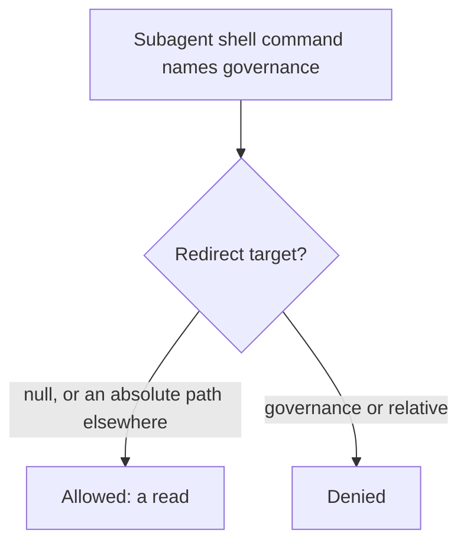

# The guard judges what a shell command writes, not what it names

## Symptom

About 14 read-only commands across 8 agents were denied on 2026-11-06, and one reviewer lost the theme rules.

## Reproduce

As a subagent, run `sed -n 1,5p ~/.claude/agents/README.md 2>/dev/null`.

## Expected

| AC | Traces | Given / when | Pass when | Fail when | Test |
|---|---|---|---|---|---|
| AC-1 | - | A read of governance with a null or outside redirect | Allowed | Denied | `tests/test_guard.py` |
| AC-2 | - | A redirect into governance, including relative after `cd` | Denied | Allowed | `tests/test_guard.py` |

## Actual

Any `>` beside a governance path counted as a write, including `2>/dev/null`.

## Must not change

| ID | Must not change | Test |
|---|---|---|
| MNC-1 | Every other governance write check | `tests/test_guard.py` |

## Root cause

`SHELL_WRITE` matched any redirect without looking at its target.
