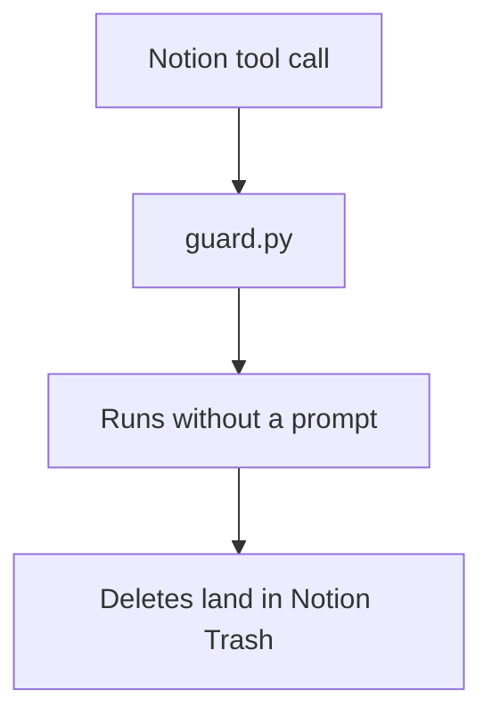

# Remove the Notion write prompt from the guard

## Symptom

Every Notion create and update in an interactive session stopped for a per-action prompt.

## Reproduce

Call any Notion write tool on an id outside `~/.cortex/notion-allow.json`.

## Expected

| AC | Traces | Given / when | Pass when | Fail when | Test |
|---|---|---|---|---|---|
| AC-1 | - | Notion update, create, delete or move tool call in an interactive session | The guard returns no decision | Any of them returns `ask` | `tests/test_guard.py::test_notion_writes_never_prompt` |

## Actual

The guard returned `ask`, and the owner found the prompts too noisy (2026-11-06).

## Must not change

| ID | Must not change | Test |
|---|---|---|
| MNC-1 | Every other guard rule, such as the force-push, secrets and governance blocks | `tests/test_guard.py` |

## Root cause

`hooks/guard.py` asked on all Notion writes outside a short id allowlist, and row-level ids are never on it. Notion deletes go to Trash, so the prompt is not needed for recovery.
